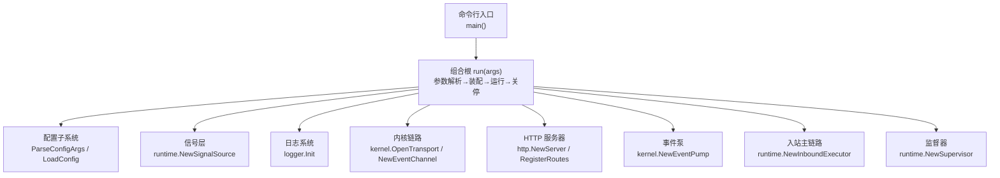
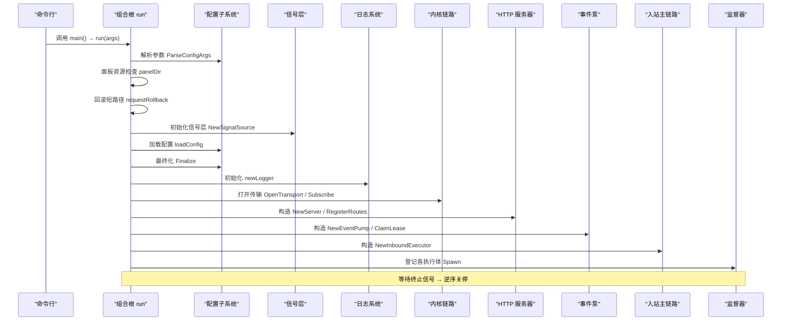
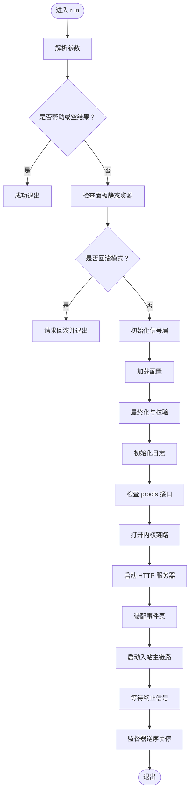
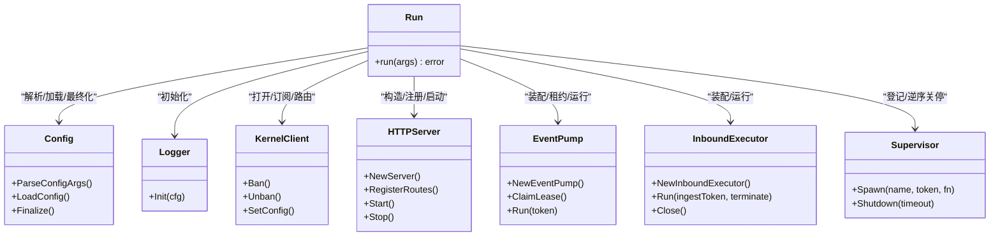
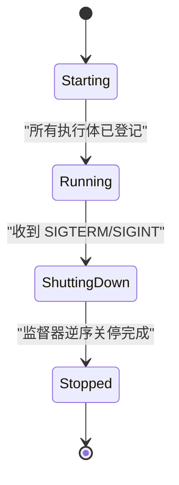
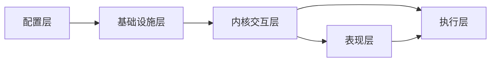

# 组合根装配模式

<cite>
**本文引用的文件**   
- [main.go](file://src/daemon/cmd/firewall-daemon/main.go)
- [shutdown.go](file://src/daemon/internal/runtime/shutdown.go)
- [supervisor_test.go](file://src/daemon/internal/runtime/supervisor_test.go)
</cite>

## 目录
1. [引言](#引言)
2. [项目结构](#项目结构)
3. [核心组件](#核心组件)
4. [架构总览](#架构总览)
5. [详细组件分析](#详细组件分析)
6. [依赖关系分析](#依赖关系分析)
7. [性能与健壮性考量](#性能与健壮性考量)
8. [故障排查指南](#故障排查指南)
9. [结论](#结论)

## 引言
本文聚焦守护进程的组合根装配模式，围绕 `main.go` 中的 `run` 函数展开，解释它如何作为“装配与生命周期”的单一入口，把配置解析、信号层初始化、日志系统启动、内核链路建立、HTTP 服务器启动、事件泵装配、入站主链路启动等关键步骤按依赖顺序串联起来。文档同时说明组合根如何通过依赖注入、组件生命周期管理以及统一的关停策略，确保正确的启动和关停顺序。

## 项目结构
本仓库采用 Go 守护进程 + Linux 内核模块的双端架构：用户态守护进程负责配置加载、规则下发、事件处理与 HTTP API；内核模块负责网络包拦截、封禁表维护与 procfs/sysfs 暴露。组合根位于守护进程的命令行入口中，只负责装配与生命周期编排，不含业务判定逻辑。

**图表来源** 
- [main.go:44-49](file://src/daemon/cmd/firewall-daemon/main.go#L44-L49)
- [main.go:52-498](file://src/daemon/cmd/firewall-daemon/main.go#L52-L498)

**章节来源**
- [main.go:1-6](file://src/daemon/cmd/firewall-daemon/main.go#L1-L6)
- [main.go:44-49](file://src/daemon/cmd/firewall-daemon/main.go#L44-L49)

## 核心组件
- **组合根 run**：唯一装配点，负责参数解析、前置检查、依赖构建、执行体注册与优雅关停。
- **配置子系统**：解析命令行参数、加载单文件或目录配置、最终化校验并输出安全告警。
- **信号层**：在任意 goroutine 启动前建立，接收 SIGTERM/SIGINT/SIGUSR1 等信号。
- **日志系统**：按配置初始化结构化日志，支持降级回退。
- **内核链路**：通过 netlink 打开内核通信通道，订阅事件、建立路由器与客户端。
- **HTTP 服务器**：提供 REST API、SSE 实时流与 Prometheus 指标。
- **事件泵**：消费内核事件，更新快照、镜像与统计，并向入站执行体下发反向指令。
- **入站主链路**：持有配置所有权，监听输入、执行检测、触发封禁与配置下发。
- **监督器 Shutdown/Supervisor**：统一停机令牌与执行体登记/逆序关停。

**章节来源**
- [main.go:52-498](file://src/daemon/cmd/firewall-daemon/main.go#L52-L498)
- [shutdown.go:5-36](file://src/daemon/internal/runtime/shutdown.go#L5-L36)

## 架构总览
下图展示 run 函数的装配时序与关键依赖关系。注意：组合根不是把所有功能塞进一个函数，而是按依赖顺序创建对象、注入依赖、注册执行体，最后由监督器协调关停。

**图表来源** 
- [main.go:52-498](file://src/daemon/cmd/firewall-daemon/main.go#L52-L498)

## 详细组件分析

### 组合根 run 的装配流程
run 是组合根的核心，其装配顺序严格遵循依赖关系：

1. **参数解析**：调用配置子系统的参数解析，若为帮助或空结果则直接返回。
2. **面板资源检查**：前端静态资源缺失时直接失败，避免运行时反复报接口错误。
3. **回滚模式处理**：若为回滚参数，则向其他 firewall-daemon 进程发送 SIGUSR1 后退出。
4. **信号层初始化**：在任何 goroutine 启动前建立信号通道，防止启动窗口内信号丢失。
5. **配置加载与最终化**：加载配置并进行智能默认值、校验与正则编译；将警告暂存到日志器。
6. **日志初始化**：根据配置初始化日志目的地、格式与级别。
7. **内核链路建立**：打开 netlink 传输、订阅事件、建立路由器与客户端；失败时记录告警但不阻断后续能力。
8. **HTTP 服务器启动**：构造服务器、注册路由与静态资源；若未启用监听地址则跳过。
9. **事件泵装配**：连接内核事件流、快照存储、指标、缓存与反向指令通道；申请租约并启动泵。
10. **入站主链路启动**：组装执行体依赖（事实源、封禁落盘、配置下发、文件重载器等），启动主循环。
11. **优雅关停**：主 goroutine 等待 SIGTERM/SIGINT，然后通知监督器按登记逆序关停所有执行体。

**图表来源** 
- [main.go:52-498](file://src/daemon/cmd/firewall-daemon/main.go#L52-L498)

**章节来源**
- [main.go:52-498](file://src/daemon/cmd/firewall-daemon/main.go#L52-L498)

### 依赖注入与组件协作
组合根通过显式构造与字段注入的方式把子系统装配在一起：

- **内核客户端与路由器**：由 `kernel.OpenTransport` 与 `kernel.NewEventChannel` 构建，供 HTTP API、事件泵与入站执行体共享。
- **封禁下发汇聚点**：`banSinkForDaemon` 同时被入站执行体与 HTTP API 使用，保证封禁落库、活跃缓存与信誉缓存一致。
- **白名单与配置下发出口**：分别由 `whitelistSinkForDaemon` 与 `configSinkForDaemon` 提供，HTTP 与执行体共用同一内核客户端。
- **观测快照与速率历史**：`telemetry.Store` 由事件泵写入，HTTP 与统计面读取，避免读侧区分“无内核”与“尚未采样”。
- **Jail 启用状态源**：`jailEnabled` 被 HTTP API 与入站执行体共享，实现启停开关的统一视图。
- **SSE 与日志流**：`sseBroker` 与 `logStream` 由 HTTP 段构造，事件泵与执行体的变更通知桥接到表现层。

**图表来源** 
- [main.go:52-498](file://src/daemon/cmd/firewall-daemon/main.go#L52-L498)

**章节来源**
- [main.go:122-456](file://src/daemon/cmd/firewall-daemon/main.go#L122-L456)

### 生命周期管理与关停顺序
组合根使用 `runtime.NewSupervisor()` 统一管理执行体生命周期，并通过 `runtime.NewShutdown()` 传递停机意图：

- **登记顺序决定关停顺序**：先登记的先于后登记的停止，即“后进先出”，确保上游依赖先于下游关闭。
- **HTTP 服务器的特殊关停**：先关闭 SSE 与日志流，再调用 `httpServer.Stop`，避免长连接阻塞关停超时。
- **事件泵与入站主链路**：事件泵先登记，入站主链路后登记，关停时入站主链路先结束，避免收尾期间事件堆积。
- **延迟清理**：数据库、SSE Broker、内核传输等资源的 `defer Close` 在监督器关停之后按 LIFO 释放。

**图表来源** 
- [main.go:465-497](file://src/daemon/cmd/firewall-daemon/main.go#L465-L497)
- [shutdown.go:5-36](file://src/daemon/internal/runtime/shutdown.go#L5-L36)

**章节来源**
- [main.go:465-497](file://src/daemon/cmd/firewall-daemon/main.go#L465-L497)
- [shutdown.go:5-36](file://src/daemon/internal/runtime/shutdown.go#L5-L36)
- [supervisor_test.go:9-52](file://src/daemon/internal/runtime/supervisor_test.go#L9-L52)

### 错误处理策略
组合根对关键子系统采用分层错误处理：

- **致命错误**：参数解析失败、面板资源缺失、procfs 接口不可用、回滚信号发送失败等直接返回错误，进程退出。
- **可降级能力**：内核链路打开失败仅记录告警，HTTP 服务器仍可运行；持久化数据库打开失败仅禁用历史分析功能。
- **非阻塞告警**：正则编译失败、威胁情报管理器装配失败等不阻断启动，仅记录告警并让相关接口返回“服务不可用”。
- **单实例约束**：事件泵租约获取失败表示已有活跃守护进程，直接返回错误，避免多实例竞争。

**章节来源**
- [main.go:62-70](file://src/daemon/cmd/firewall-daemon/main.go#L62-L70)
- [main.go:122-124](file://src/daemon/cmd/firewall-daemon/main.go#L122-L124)
- [main.go:173-200](file://src/daemon/cmd/firewall-daemon/main.go#L173-L200)
- [main.go:413-418](file://src/daemon/cmd/firewall-daemon/main.go#L413-L418)

## 依赖关系分析
run 函数中的依赖关系呈现清晰的层次结构：

- **配置层**：参数解析 → 配置加载 → 最终化 → 安全告警。
- **基础设施层**：信号层 → 日志系统 → 指标注册表 → 持久化数据库。
- **内核交互层**：netlink 传输 → 事件通道 → 路由器 → 客户端。
- **表现层**：HTTP 服务器 → API 处理器 → SSE 与日志流。
- **执行层**：事件泵 → 入站主链路。

**图表来源** 
- [main.go:52-498](file://src/daemon/cmd/firewall-daemon/main.go#L52-L498)

**章节来源**
- [main.go:52-498](file://src/daemon/cmd/firewall-daemon/main.go#L52-L498)

## 性能与健壮性考量
- **指标预注册**：Prometheus 计数器在启动早期预注册，确保 `/metrics` 从启动起就有稳定样本。
- **事件队列容量**：内核命令通道容量设为 256，避免事件堆积钉住主循环。
- **异步关停**：HTTP 服务器关停使用带超时的 context，避免长连接阻塞进程退出。
- **降级设计**：内核链路、持久化数据库、威胁情报等均可降级，保证核心功能可用。
- **单实例保护**：通过内核租约机制防止多实例竞争，提升整体稳定性。

[本节为通用性能讨论，不直接分析具体文件]

## 故障排查指南
- **面板静态资源缺失**：检查 go:embed 是否包含前端静态文件。
- **procfs 接口不可用**：确认内核模块已加载且版本兼容。
- **内核链路打开失败**：检查 netlink 权限与内核模块状态。
- **事件泵租约失败**：确认没有其他 firewall-daemon 实例运行。
- **HTTP 服务器关停超时**：检查是否有未关闭的 SSE 连接或长轮询。
- **回滚信号发送失败**：确认目标进程存在且有权限发送信号。

**章节来源**
- [main.go:62-70](file://src/daemon/cmd/firewall-daemon/main.go#L62-L70)
- [main.go:122-124](file://src/daemon/cmd/firewall-daemon/main.go#L122-L124)
- [main.go:173-200](file://src/daemon/cmd/firewall-daemon/main.go#L173-L200)
- [main.go:413-418](file://src/daemon/cmd/firewall-daemon/main.go#L413-L418)

## 结论
组合根 `run` 函数通过严格的装配顺序与依赖注入，将配置、信号、日志、内核、HTTP、事件泵与入站主链路有机整合。它采用监督器模式管理生命周期，确保启动顺序正确、关停顺序可控，并对关键错误进行分层处理。这种设计使守护进程具备高内聚、低耦合、易测试与强健壮性的特点，适合复杂系统工程的长期演进与维护。

[本节为总结性内容，不直接分析具体文件]