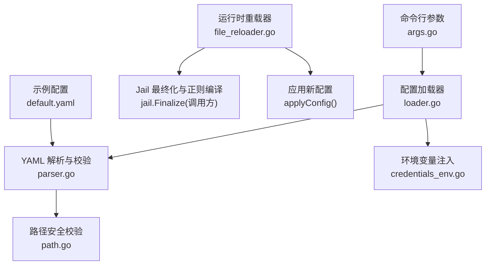
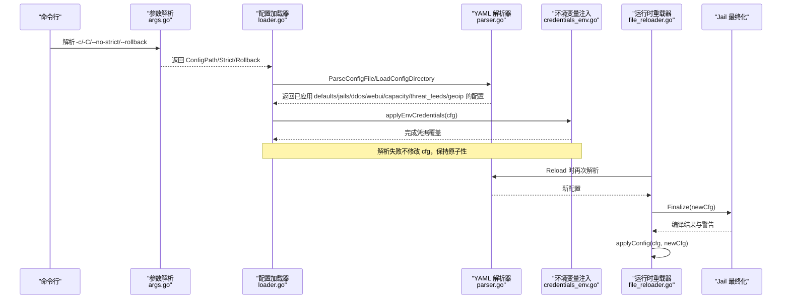
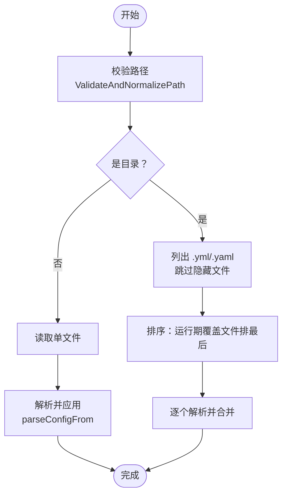
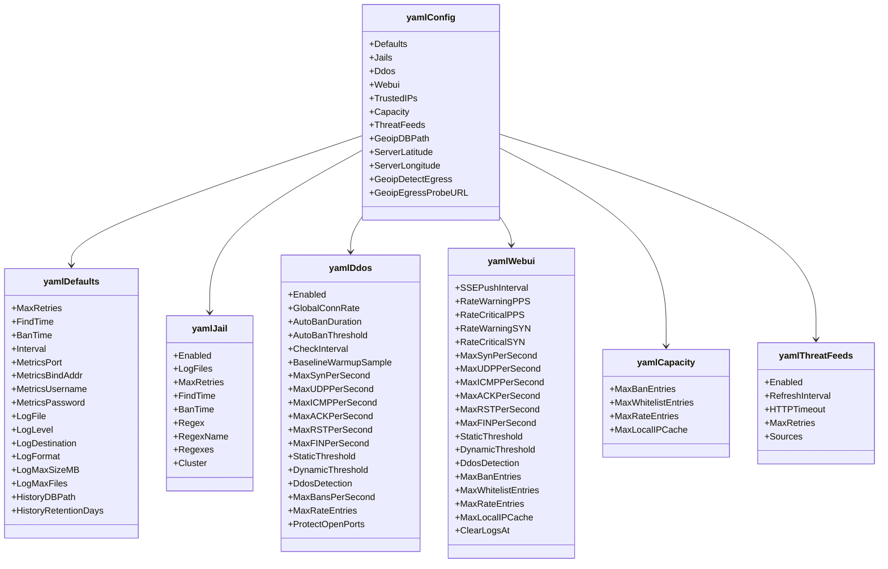
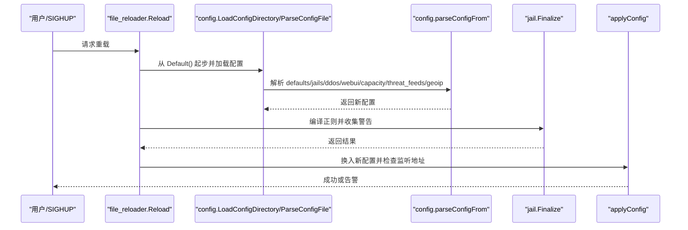
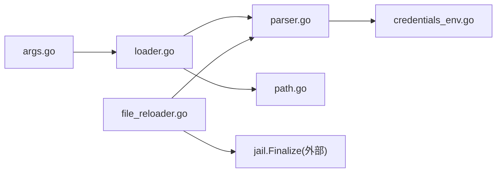

# 配置管理系统

<cite>
**本文引用的文件**   
- [README.md](file://README.md)
- [default.yaml](file://config/default.yaml)
- [loader.go](file://src/daemon/internal/config/loader.go)
- [parser.go](file://src/daemon/internal/config/parser.go)
- [path.go](file://src/daemon/internal/config/path.go)
- [args.go](file://src/daemon/internal/config/args.go)
- [logging.go](file://src/daemon/internal/config/logging.go)
- [credentials_env.go](file://src/daemon/internal/config/credentials_env.go)
- [file_reloader.go](file://src/daemon/internal/runtime/file_reloader.go)
</cite>

## 目录
1. [引言](#引言)
2. [项目结构](#项目结构)
3. [核心组件](#核心组件)
4. [架构总览](#架构总览)
5. [详细组件分析](#详细组件分析)
6. [依赖关系分析](#依赖关系分析)
7. [性能与容量特性](#性能与容量特性)
8. [故障排查指南](#故障排查指南)
9. [结论](#结论)
10. [附录：配置参考与实践](#附录配置参考与实践)

## 引言
本文件系统性地梳理防火墙守护进程的配置管理体系，覆盖 YAML 语法结构、字段定义、默认值机制、动态重载与热更新策略、环境变量注入、配置文件优先级、目录模式支持、后处理流程、正则表达式编译、Jail 规则验证、持久化与回滚、版本兼容性与最佳实践。目标是让运维与开发者既能快速上手，也能深入理解实现细节。

## 项目结构
配置相关代码集中在守护进程的 `internal/config` 与 `internal/runtime` 两个子包中，配合 `config/default.yaml` 示例提供开箱即用的默认行为。

**图示来源**
- [args.go:14-21](file://src/daemon/internal/config/args.go#L14-L21)
- [loader.go:17-51](file://src/daemon/internal/config/loader.go#L17-L51)
- [parser.go:155-207](file://src/daemon/internal/config/parser.go#L155-L207)
- [path.go:21-51](file://src/daemon/internal/config/path.go#L21-L51)
- [credentials_env.go:21-32](file://src/daemon/internal/config/credentials_env.go#L21-L32)
- [file_reloader.go:24-59](file://src/daemon/internal/runtime/file_reloader.go#L24-L59)

**章节来源**
- [README.md:10-31](file://README.md#L10-L31)
- [args.go:8-11](file://src/daemon/internal/config/args.go#L8-L11)

## 核心组件
- 命令行参数与入口：负责解析 `-c` / `-C` / `--no-strict` / `--rollback` 等参数，并给出默认单文件配置路径。
- 配置加载器：支持单文件与目录两种模式，保证原子性、排序合并与运行期覆盖文件的特殊语义。
- YAML 解析器：将 YAML 映射到内部结构，执行 defaults、jails、ddos、webui、capacity、threat_feeds、geoip 等段的应用与校验。
- 路径安全校验：拒绝路径遍历、URL 编码绕过、Shell 元字符注入、超长路径与可疑软链接。
- 环境变量注入：以更高优先级覆盖面板认证凭据，同时保留“未配置”的语义区分。
- 运行时重载器：基于文件或目录进行热重载与回滚，触发 Jail 最终化（含正则编译），并在监听地址变化时给出告警。

**章节来源**
- [args.go:14-21](file://src/daemon/internal/config/args.go#L14-L21)
- [loader.go:17-51](file://src/daemon/internal/config/loader.go#L17-L51)
- [parser.go:155-207](file://src/daemon/internal/config/parser.go#L155-L207)
- [path.go:21-51](file://src/daemon/internal/config/path.go#L21-L51)
- [credentials_env.go:21-32](file://src/daemon/internal/config/credentials_env.go#L21-L32)
- [file_reloader.go:24-59](file://src/daemon/internal/runtime/file_reloader.go#L24-L59)

## 架构总览
配置从命令行进入，经加载器读取 YAML，由解析器完成字段映射、默认值填充与校验；随后通过环境变量注入最终凭据；运行时重载器在 SIGHUP 或文件变更时重新加载，并触发 Jail 正则编译与内核下发。

**图示来源**
- [args.go:62-111](file://src/daemon/internal/config/args.go#L62-L111)
- [loader.go:17-51](file://src/daemon/internal/config/loader.go#L17-L51)
- [parser.go:155-207](file://src/daemon/internal/config/parser.go#L155-L207)
- [credentials_env.go:21-32](file://src/daemon/internal/config/credentials_env.go#L21-L32)
- [file_reloader.go:24-59](file://src/daemon/internal/runtime/file_reloader.go#L24-L59)

## 详细组件分析

### 命令行参数与默认行为
- 默认单文件配置路径为 `/etc/firewall-daemon/config.yml`。
- 支持 `-c` / `--config` 指定单文件，`-C` / `--config-dir` 指定目录模式。
- `--no-strict` 关闭严格模式，允许未知键；默认严格模式会拒绝未知顶层字段。
- `--rollback` 触发回滚到备份配置。

**章节来源**
- [args.go:8-11](file://src/daemon/internal/config/args.go#L8-L11)
- [args.go:62-111](file://src/daemon/internal/config/args.go#L62-L111)

### 配置加载器：单文件与目录模式
- 单文件解析 `ParseConfigFile`：先做路径校验，再读取并解析，失败时整体回滚到快照。
- 目录加载 `LoadConfigDirectory`：按文件名字母序合并 `.yml` / `.yaml`，跳过隐藏文件与非 YAML；运行期覆盖文件（前缀 `_`）最后合并，拥有最终发言权。
- 目录模式下设置 `ConfigDir`，清空 `ConfigFile`，避免重载只加载单个文件。

**图示来源**
- [loader.go:17-51](file://src/daemon/internal/config/loader.go#L17-L51)
- [loader.go:53-127](file://src/daemon/internal/config/loader.go#L53-L127)
- [path.go:21-51](file://src/daemon/internal/config/path.go#L21-L51)

**章节来源**
- [loader.go:17-51](file://src/daemon/internal/config/loader.go#L17-L51)
- [loader.go:53-127](file://src/daemon/internal/config/loader.go#L53-L127)

### YAML 解析器：字段、默认值与校验
- 顶层结构包含 `defaults`、`jails`、`ddos`、`webui`、`trusted_ips`、`capacity`、`threat_feeds`、`geoip_db_path`、`server_latitude/longitude`、`geoip_detect_egress`、`geoip_egress_probe_url`。
- 应用顺序：defaults → jails → ddos → webui → trusted_ips → capacity → threat_feeds → geoip → 环境变量注入。
- 严格模式：使用 `KnownFields(true)`，未知顶层字段直接报错。
- Jails：同名后到优先，按键排序保证确定性；支持 `regex` 单条与 `regexes` 映射两种写法；对 `log_files`、`max_retries`、`findtime`、`ban_time` 等进行校验与智能默认推断。
- GeoIP 坐标：经纬度必须成对给出且范围合法；探测 URL 仅允许 http(s)，并进行长度与控制字符检查。

**图示来源**
- [parser.go:16-153](file://src/daemon/internal/config/parser.go#L16-L153)

**章节来源**
- [parser.go:155-207](file://src/daemon/internal/config/parser.go#L155-L207)
- [parser.go:209-275](file://src/daemon/internal/config/parser.go#L209-L275)
- [parser.go:277-471](file://src/daemon/internal/config/parser.go#L277-L471)
- [parser.go:499-559](file://src/daemon/internal/config/parser.go#L499-L559)
- [parser.go:561-635](file://src/daemon/internal/config/parser.go#L561-L635)
- [parser.go:637-706](file://src/daemon/internal/config/parser.go#L637-L706)

### 路径安全校验
- 拒绝包含 `..` 的路径遍历。
- 拒绝 URL 编码绕过（单层与双重编码）。
- 拒绝 Shell 元字符（如 `|&;$`()<>{} `）。
- 限制最大路径长度。
- 对已存在路径解析符号链接，防止逃逸。

**章节来源**
- [path.go:21-51](file://src/daemon/internal/config/path.go#L21-L51)

### 环境变量注入与认证开关
- 环境变量名：`FIREWALL_METRICS_USERNAME`、`FIREWALL_METRICS_PASSWORD`。
- 覆盖时机：YAML 全部应用成功后，确保解析失败不影响原子性。
- 语义：两项都空表示「未配置认证」；只填一项视为非法并拒绝访问。
- 日志来源追踪：可报告用户名与口令来自环境变量、配置文件或未配置。

**章节来源**
- [credentials_env.go:1-19](file://src/daemon/internal/config/credentials_env.go#L1-L19)
- [credentials_env.go:21-32](file://src/daemon/internal/config/credentials_env.go#L21-L32)
- [credentials_env.go:34-72](file://src/daemon/internal/config/credentials_env.go#L34-L72)

### 运行时重载与热更新策略
- 重载入口：`Reload` 从 `Default()` 起步，再加载当前文件或目录，避免零值污染默认段。
- 正则编译：调用 `jail.Finalize`，编译失败不阻断重载，退化为关键字回退并记录警告。
- 回滚：优先读取同目录下的 `config.yaml.rollback`；不存在则等价于 Reload。
- 监听地址：重载不重绑 HTTP 端口，若配置变化则告警需重启生效。

**图示来源**
- [file_reloader.go:24-59](file://src/daemon/internal/runtime/file_reloader.go#L24-L59)
- [file_reloader.go:61-91](file://src/daemon/internal/runtime/file_reloader.go#L61-L91)
- [file_reloader.go:94-106](file://src/daemon/internal/runtime/file_reloader.go#L94-L106)

**章节来源**
- [file_reloader.go:24-59](file://src/daemon/internal/runtime/file_reloader.go#L24-L59)
- [file_reloader.go:61-91](file://src/daemon/internal/runtime/file_reloader.go#L61-L91)
- [file_reloader.go:94-106](file://src/daemon/internal/runtime/file_reloader.go#L94-L106)

### 配置优先级与合并策略
- 优先级（从高到低）：环境变量 > YAML > 默认值。
- 目录模式：按文件名字母序合并，运行期覆盖文件（前缀 `_`）最后合并，拥有最终决定权。
- Jails：同名后到优先，只覆盖显式给出的字段；新建 jail 才应用智能默认。
- 严格模式：未知顶层字段直接报错；可通过 `--no-strict` 放宽。

**章节来源**
- [loader.go:53-127](file://src/daemon/internal/config/loader.go#L53-L127)
- [parser.go:155-207](file://src/daemon/internal/config/parser.go#L155-L207)
- [parser.go:277-471](file://src/daemon/internal/config/parser.go#L277-L471)
- [credentials_env.go:21-32](file://src/daemon/internal/config/credentials_env.go#L21-L32)

### 配置后处理与正则编译
- 所有 YAML 段应用完成后，执行环境变量注入。
- 重载时调用 `jail.Finalize` 编译正则；编译失败的 jail 降级为关键字匹配，逐条告警但不阻断重载。
- 该设计保证热更新鲁棒性：即使个别正则错误，其他 jail 仍可正常生效。

**章节来源**
- [parser.go:155-207](file://src/daemon/internal/config/parser.go#L155-L207)
- [file_reloader.go:47-54](file://src/daemon/internal/runtime/file_reloader.go#L47-L54)

### Jail 规则验证与智能默认
- `log_files`：数量上限校验，避免过多文件句柄。
- `max_retries`：0 时回退到全局默认；最小 1。
- `findtime`：0 时回退到全局默认；小于 10 秒强制提升到 10 秒。
- `ban_time`：0 时回退到全局默认；负数表示永久封禁。
- 智能默认：仅在新建 jail 且未显式给出 findtime/ban_time/max_retries 时启用，根据 findtime 长短调整 ban_time 与 max_retries。

**章节来源**
- [parser.go:420-471](file://src/daemon/internal/config/parser.go#L420-L471)
- [parser.go:473-497](file://src/daemon/internal/config/parser.go#L473-L497)

### 配置持久化、备份恢复与版本兼容性
- 持久化：WebUI 的 `clear_logs_at` 随 webui 段落盘，热重载与重启均保留。
- 备份恢复：回滚优先读取 `config.yaml.rollback`；不存在则等价 Reload。
- 版本兼容：严格模式拒绝未知字段，避免旧配置在新版本下静默忽略；宽松模式用于过渡期兼容。

**章节来源**
- [parser.go:124-127](file://src/daemon/internal/config/parser.go#L124-L127)
- [file_reloader.go:61-91](file://src/daemon/internal/runtime/file_reloader.go#L61-L91)
- [args.go:34-35](file://src/daemon/internal/config/args.go#L34-L35)

## 依赖关系分析
配置子系统内部耦合清晰：命令行参数驱动加载器，加载器协调解析器与路径校验，环境变量注入作为后置步骤；运行时重载器复用同一套解析与最终化逻辑，保证一致性。

**图示来源**
- [args.go:62-111](file://src/daemon/internal/config/args.go#L62-L111)
- [loader.go:17-51](file://src/daemon/internal/config/loader.go#L17-L51)
- [parser.go:155-207](file://src/daemon/internal/config/parser.go#L155-L207)
- [path.go:21-51](file://src/daemon/internal/config/path.go#L21-L51)
- [credentials_env.go:21-32](file://src/daemon/internal/config/credentials_env.go#L21-L32)
- [file_reloader.go:24-59](file://src/daemon/internal/runtime/file_reloader.go#L24-L59)

**章节来源**
- [args.go:62-111](file://src/daemon/internal/config/args.go#L62-L111)
- [loader.go:17-51](file://src/daemon/internal/config/loader.go#L17-L51)
- [parser.go:155-207](file://src/daemon/internal/config/parser.go#L155-L207)
- [file_reloader.go:24-59](file://src/daemon/internal/runtime/file_reloader.go#L24-L59)

## 性能与容量特性
- 目录加载按文件名稳定排序，避免随机迭代导致的行为差异。
- 运行期覆盖文件最后合并，减少预置定义被意外覆盖的风险。
- 正则编译失败不阻断重载，降低热更新失败面。
- 容量字段（`capacity.*`）控制封禁表、白名单、速率表与本地 IP 缓存上限，避免资源耗尽。
- DDoS 检测与速率表条目数可通过配置调节，兼顾吞吐与内存占用。

**章节来源**
- [loader.go:96-107](file://src/daemon/internal/config/loader.go#L96-L107)
- [file_reloader.go:47-54](file://src/daemon/internal/runtime/file_reloader.go#L47-L54)
- [parser.go:550-559](file://src/daemon/internal/config/parser.go#L550-L559)
- [parser.go:499-522](file://src/daemon/internal/config/parser.go#L499-L522)

## 故障排查指南
- 配置解析失败：检查 YAML 语法与未知字段（严格模式），确认 defaults/jails/ddos/webui/capacity/threat_feeds/geoip 字段拼写正确。
- 路径问题：确认无 `..`、URL 编码、Shell 元字符与过长路径；软链接目标不可逃逸。
- 环境变量：确认 `FIREWALL_METRICS_USERNAME` 与 `FIREWALL_METRICS_PASSWORD` 是否同时设置；只设一项会被判定为非法。
- 重载无效：确认重载的是单文件还是目录；HTTP 监听地址变化不会热绑定，需重启守护进程。
- 正则失效：查看重载日志中的正则编译警告；对应 jail 将退化到关键字匹配。
- 回滚失败：确认备份文件 `config.yaml.rollback` 是否存在且可读。

**章节来源**
- [path.go:21-51](file://src/daemon/internal/config/path.go#L21-L51)
- [credentials_env.go:66-72](file://src/daemon/internal/config/credentials_env.go#L66-L72)
- [file_reloader.go:94-106](file://src/daemon/internal/runtime/file_reloader.go#L94-L106)
- [file_reloader.go:61-91](file://src/daemon/internal/runtime/file_reloader.go#L61-L91)

## 结论
本配置管理系统以严格的解析与校验为基础，结合目录合并、运行期覆盖与环境变量注入，实现了高可用、可观测、可回滚的热更新能力。通过智能默认与正则回退机制，既降低了配置门槛，又保证了生产环境的鲁棒性。建议在生产环境中采用目录模式拆分配置、启用严格模式、使用环境变量管理敏感凭据，并结合容量与 DDoS 阈值调优系统稳定性。

## 附录：配置参考与实践

### YAML 字段参考（节选）
- 全局默认 `defaults`：`max_retries`、`findtime`、`ban_time`、`interval`、`metrics_port`、`metrics_bind_address`、`metrics_username`、`metrics_password`、`log_file`、`log_level`、`log_destination`、`log_format`、`log_max_size_mb`、`log_max_files`、`history_db_path`、`history_retention_days`。
- 服务防护 `jails.<name>`：`enabled`、`log_files`、`max_retries`、`findtime`、`ban_time`、`regex`、`regex_name`、`regexes.<name>.pattern`、`cluster.*`。
- DDoS `ddos`：`enabled`、`global_conn_rate`、`auto_ban_duration`、`auto_ban_threshold`、`check_interval`、`baseline_warmup_samples`、协议专项阈值、静态/动态阈值开关、`max_bans_per_second`、`max_rate_entries`、`protect_open_ports`。
- WebUI `webui`：SSE 推送间隔、速率告警阈值、DDoS 检测开关、容量字段、`clear_logs_at`。
- 容量 `capacity`：`max_ban_entries`、`max_whitelist_entries`、`max_rate_entries`、`max_local_ip_cache`。
- 威胁情报 `threat_feeds`：`enabled`、`refresh_interval`、`http_timeout`、`max_retries`、`sources[*].name/url/enabled/category/confidence`。
- GeoIP：`geoip_db_path`、`server_latitude`、`server_longitude`、`geoip_detect_egress`、`geoip_egress_probe_url`。

**章节来源**
- [default.yaml:7-31](file://config/default.yaml#L7-L31)
- [default.yaml:35-53](file://config/default.yaml#L35-L53)
- [default.yaml:56-91](file://config/default.yaml#L56-L91)
- [default.yaml:106-110](file://config/default.yaml#L106-L110)
- [default.yaml:113-121](file://config/default.yaml#L113-L121)
- [default.yaml:123-168](file://config/default.yaml#L123-L168)
- [default.yaml:171-198](file://config/default.yaml#L171-L198)

### 示例配置说明
- `config/default.yaml` 提供了开箱即用的默认值与 SSH 示例 jail，可直接作为基线使用。
- 建议将服务级配置拆分为多个 YAML 文件放入目录模式，按命名顺序组织基础与覆盖配置。

**章节来源**
- [default.yaml:1-53](file://config/default.yaml#L1-L53)

### 最佳实践
- 使用目录模式管理多服务配置，利用字母序与运行期覆盖文件实现分层覆盖。
- 开启严格模式，尽早发现未知字段与配置漂移。
- 使用环境变量注入敏感凭据，避免将密钥提交至仓库。
- 合理设置容量与 DDoS 阈值，平衡性能与安全性。
- 定期维护威胁情报源与 GeoIP 库，确保检测准确性。
- 使用回滚机制保障热更新安全，必要时重启以应用监听地址变更。

**章节来源**
- [loader.go:53-127](file://src/daemon/internal/config/loader.go#L53-L127)
- [args.go:34-35](file://src/daemon/internal/config/args.go#L34-L35)
- [credentials_env.go:1-19](file://src/daemon/internal/config/credentials_env.go#L1-L19)
- [file_reloader.go:94-106](file://src/daemon/internal/runtime/file_reloader.go#L94-L106)