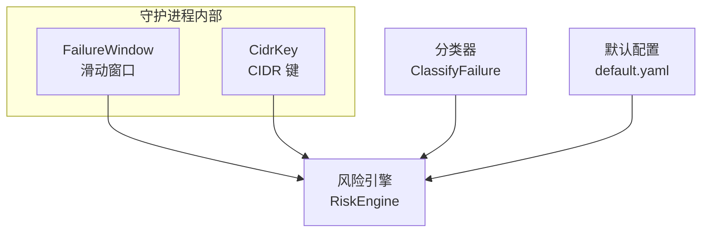
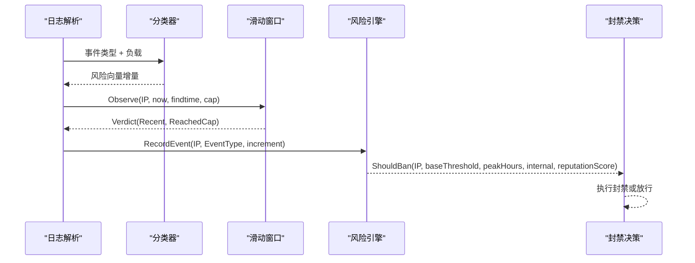
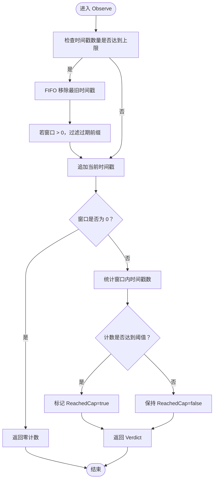
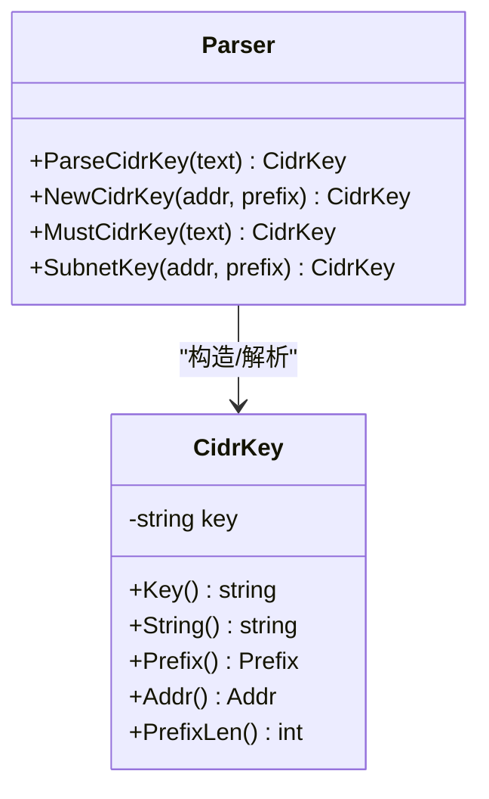
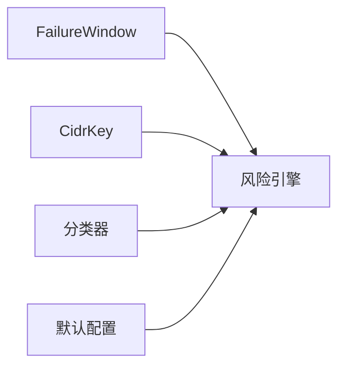
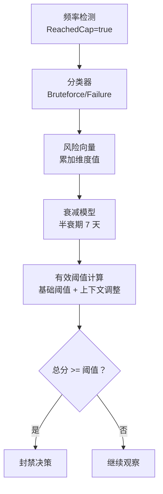

# 频率检测算法

<cite>
**本文引用的文件**   
- [window.go](file://src/daemon/internal/detect/window.go)
- [cidr.go](file://src/daemon/internal/detect/cidr.go)
- [window_test.go](file://src/daemon/internal/detect/window_test.go)
- [cidr_test.go](file://src/daemon/internal/detect/cidr_test.go)
- [types.go](file://src/daemon/internal/risk/types.go)
- [classifier.go](file://src/daemon/internal/risk/classifier.go)
- [engine_test.go](file://src/daemon/internal/risk/engine_test.go)
- [default.yaml](file://config/default.yaml)
</cite>

## 目录
1. [简介](#简介)
2. [项目结构](#项目结构)
3. [核心组件](#核心组件)
4. [架构总览](#架构总览)
5. [详细组件分析](#详细组件分析)
6. [依赖关系分析](#依赖关系分析)
7. [性能与内存优化](#性能与内存优化)
8. [配置参数说明](#配置参数说明)
9. [使用示例](#使用示例)
10. [与风险评分系统的集成](#与风险评分系统的集成)
11. [故障排查指南](#故障排查指南)
12. [结论](#结论)

## 简介
本文件聚焦于“频率检测算法”的实现与使用，覆盖以下要点：
- 滑动窗口算法的时间窗口管理、计数统计与阈值判定逻辑。
- CIDR 前缀归一化与 IP 段级别的频率检测支持。
- 频率检测的关键配置项（窗口大小、阈值等）及其对行为的影响。
- 性能与内存优化策略。
- 具体配置示例，展示如何为不同服务设置频率限制规则。
- 与风险评分系统的集成方式，以及频率超限对风险评估的影响。

## 项目结构
频率检测相关代码位于守护进程的 detect 包中，包含两个核心模块：
- 滑动窗口 FailureWindow：按 IP 维度维护失败时间戳序列，提供观察、查询、清理与遍历能力。
- CIDR 键 CidrKey：负责 CIDR 文本解析、归一化与访问器，用于 IP 段级别聚合与匹配。

**图表来源**
- [window.go:20-125](file://src/daemon/internal/detect/window.go#L20-L125)
- [cidr.go:23-147](file://src/daemon/internal/detect/cidr.go#L23-L147)
- [types.go:44-130](file://src/daemon/internal/risk/types.go#L44-L130)
- [classifier.go:5-34](file://src/daemon/internal/risk/classifier.go#L5-L34)
- [default.yaml:7-11](file://config/default.yaml#L7-L11)

**章节来源**
- [window.go:1-125](file://src/daemon/internal/detect/window.go#L1-L125)
- [cidr.go:1-147](file://src/daemon/internal/detect/cidr.go#L1-L147)
- [default.yaml:7-11](file://config/default.yaml#L7-L11)

## 核心组件
- FailureWindow：实现每个 jail 的失败时间戳滑动窗口，提供：
  - Observe：记录一次失败并返回窗口内计数与是否达到阈值。
  - Peek：只读查询窗口内计数。
  - CleanupExpired：批量清理过期条目。
  - Iter：导出快照用的遍历接口。
- CidrKey：实现 CIDR 文本解析与归一化，提供稳定键、地址与前缀长度访问器，以及子网聚合键生成。

关键特性：
- 每 IP 最多保留固定数量的时间戳，超出时 FIFO 淘汰最旧值。
- 窗口为 0 时不触发计数，但仍记录时间戳以保持观测一致性。
- CIDR 裸地址自动归一为 /32 或 /128；越界前缀在构造路径收敛到最大位宽，在解析路径报错。

**章节来源**
- [window.go:9-125](file://src/daemon/internal/detect/window.go#L9-L125)
- [cidr.go:23-147](file://src/daemon/internal/detect/cidr.go#L23-L147)

## 架构总览
频率检测与风险评分的整体流程如下：
- 日志解析后得到事件类型与负载信息。
- 分类器将事件映射到风险向量维度（如 failure、bruteforce、scan 等）。
- 滑动窗口按 IP 维度统计失败次数，判断是否达到阈值。
- 风险引擎根据历史向量、衰减与权重计算总分，结合信誉分与上下文调整阈值，决定是否封禁。

**图表来源**
- [classifier.go:5-34](file://src/daemon/internal/risk/classifier.go#L5-L34)
- [window.go:36-70](file://src/daemon/internal/detect/window.go#L36-L70)
- [engine_test.go:128-144](file://src/daemon/internal/risk/engine_test.go#L128-L144)

## 详细组件分析

### 滑动窗口 FailureWindow
FailureWindow 以 map[IP][]int64 存储每个 IP 的时间戳序列，采用 FIFO 队列语义控制容量，并在满员时顺手过滤过期前缀。

- 时间窗口管理
  - 窗口大小由 findtime 决定，单位秒。
  - 当 window <= 0 时，不触发计数，但会记录时间戳，避免配置为 0 时静默丢弃观测。
- 计数统计
  - countRecent 扫描时间戳数组，统计满足 now >= t 且 now - t <= window 的数量。
  - 达到 cap 即提前终止累加，减少无谓计算。
- 阈值判定
  - Observe 返回 Verdict.Recent 与 ReachedCap，ReachedCap = Recent >= cap。
- 生命周期管理
  - Forget：封禁成功后清除该 IP 的窗口，避免重复计数。
  - CleanupExpired：若某 IP 最新时间戳已过期则删除整条。
  - Iter：导出快照用，返回每个 IP 的最新时间戳与是否被跟踪。

**图表来源**
- [window.go:36-70](file://src/daemon/internal/detect/window.go#L36-L70)
- [window.go:111-125](file://src/daemon/internal/detect/window.go#L111-L125)

**章节来源**
- [window.go:20-125](file://src/daemon/internal/detect/window.go#L20-L125)
- [window_test.go:17-130](file://src/daemon/internal/detect/window_test.go#L17-L130)

### CIDR 键 CidrKey
CidrKey 提供稳定的网络地址+前缀键，用于 IP 段级别的频率检测与聚合。

- 解析与归一化
  - ParseCidrKey：支持裸地址（自动补 /32 或 /128）、带前缀的 CIDR 文本。
  - NewCidrKey：从 netip.Addr 与前缀构造，前缀越界时收敛到最大位宽。
- 错误处理
  - 空串、多个斜杠、非法地址、非法前缀、前缀越界均有明确错误类型。
- 访问器
  - Key/String：稳定文本形式。
  - Prefix/PrefixLen/Addr：还原为 netip.Prefix、前缀长度、网络地址。
  - SubnetKey：按给定前缀长度生成聚合网段键，用于集群扫描检测。

**图表来源**
- [cidr.go:23-147](file://src/daemon/internal/detect/cidr.go#L23-L147)

**章节来源**
- [cidr.go:1-147](file://src/daemon/internal/detect/cidr.go#L1-L147)
- [cidr_test.go:8-94](file://src/daemon/internal/detect/cidr_test.go#L8-L94)

## 依赖关系分析
- FailureWindow 与 CidrKey 均为纯计算组件，无锁、无 IO，便于并发复用与单测。
- 风险引擎依赖分类器将事件映射到向量维度，并结合滑动窗口的阈值结果进行封禁决策。
- 默认配置提供全局与 jail 级频率检测参数，影响滑动窗口与阈值判定。

**图表来源**
- [window.go:20-125](file://src/daemon/internal/detect/window.go#L20-L125)
- [cidr.go:23-147](file://src/daemon/internal/detect/cidr.go#L23-L147)
- [classifier.go:5-34](file://src/daemon/internal/risk/classifier.go#L5-L34)
- [default.yaml:7-11](file://config/default.yaml#L7-L11)

**章节来源**
- [window.go:20-125](file://src/daemon/internal/detect/window.go#L20-L125)
- [cidr.go:23-147](file://src/daemon/internal/detect/cidr.go#L23-L147)
- [classifier.go:5-34](file://src/daemon/internal/risk/classifier.go#L5-L34)
- [default.yaml:7-11](file://config/default.yaml#L7-L11)

## 性能与内存优化
- 时间戳上限控制
  - 每 IP 最多保留 MaxTimestampsPerIP 个时间戳，避免无限增长。
- 早停计数
  - countRecent 在达到 cap 后立即停止累加，降低高吞吐场景下的 CPU 开销。
- 过期清理
  - CleanupExpired 基于单调追加的时间戳特性，仅检查队尾即可判断整条是否过期，减少扫描成本。
- 满员时的前缀过滤
  - 在 FIFO 淘汰时顺手过滤过期前缀，减少后续计数阶段的无效比较。
- 只读查询
  - Peek 不修改状态，适合高频诊断与 API 暴露。
- 无锁设计
  - FailureWindow 由调用方独占，避免锁竞争，提升并发性能。

**章节来源**
- [window.go:9-125](file://src/daemon/internal/detect/window.go#L9-L125)

## 配置参数说明
- 全局默认
  - max_retries：重试上限。
  - findtime：滑动窗口大小（秒），默认 600。
  - ban_time：封禁时长（秒），-1 表示永久。
  - interval：检查间隔（秒）。
- Jail 级
  - enabled：是否启用。
  - log_files：日志文件列表。
  - regexes：正则表达式集合，用于提取攻击源 IP。
- DDoS 防护
  - global_conn_rate、auto_ban_duration、auto_ban_threshold 等。
  - 协议专项阈值与内核模块参数。
- 可信 IP 白名单
  - 支持单 IP 与 CIDR 格式。
- 容量配置
  - max_ban_entries、max_whitelist_entries、max_rate_entries、max_local_ip_cache。

**章节来源**
- [default.yaml:7-11](file://config/default.yaml#L7-L11)
- [default.yaml:35-52](file://config/default.yaml#L35-L52)
- [default.yaml:63-91](file://config/default.yaml#L63-L91)
- [default.yaml:93-109](file://config/default.yaml#L93-L109)

## 使用示例
以下为不同服务的频率限制规则配置思路（以 YAML 为例）：
- SSH 服务
  - 设置较短的 findtime（如 300 秒）与较低的阈值（如 3 次失败），配合永久封禁（ban_time=-1）以抑制暴力破解。
  - 定义多个正则表达式匹配常见 SSH 攻击模式。
- Web 服务
  - 针对认证失败（HTTP 401）与目录遍历分别设置不同的阈值与窗口。
  - 结合 DDoS 防护的全局连接速率与协议专项阈值，防止流量型攻击。
- 数据库服务
  - 使用更严格的阈值与更短的窗口，快速阻断异常连接。
  - 将可信 IP 白名单加入，避免误封运维地址。

注意：
- 上述配置应结合业务实际流量特征调优，避免误报与漏报。
- 对于高并发场景，建议适当增大 MaxTimestampsPerIP 与 capacity，同时监控内存使用。

**章节来源**
- [default.yaml:35-52](file://config/default.yaml#L35-L52)
- [default.yaml:63-91](file://config/default.yaml#L63-L91)
- [default.yaml:93-109](file://config/default.yaml#L93-L109)

## 与风险评分系统的集成
风险评分系统通过多维向量评估 IP 的风险等级，频率检测的结果作为输入之一：
- 事件分类
  - 分类器将事件映射到 failure、bruteforce、scan、ddos、geo、cluster、ban 等维度。
- 向量累积与衰减
  - 每次事件增加对应维度的向量值，并按半衰期 7 天衰减。
- 阈值判定
  - 风险引擎根据基础阈值、高峰时段、内网标识与信誉分计算有效阈值。
  - 若向量总分超过有效阈值，则触发封禁。

频率超限对风险评估的影响：
- 滑动窗口达到阈值会增加 bruteforce 或 failure 维度的向量值。
- 高风险向量会提高整体风险评分，进而降低封禁阈值，加速封禁决策。
- 信誉分较低时，有效阈值进一步下调，更易触发封禁。

**图表来源**
- [classifier.go:5-34](file://src/daemon/internal/risk/classifier.go#L5-L34)
- [types.go:44-130](file://src/daemon/internal/risk/types.go#L44-L130)
- [engine_test.go:128-144](file://src/daemon/internal/risk/engine_test.go#L128-L144)

**章节来源**
- [classifier.go:5-34](file://src/daemon/internal/risk/classifier.go#L5-L34)
- [types.go:44-130](file://src/daemon/internal/risk/types.go#L44-L130)
- [engine_test.go:128-144](file://src/daemon/internal/risk/engine_test.go#L128-L144)

## 故障排查指南
- 窗口计数异常
  - 检查 findtime 是否为 0，若为 0 则不会触发计数。
  - 确认时间戳是否乱序或未来时间戳，countRecent 会忽略未来时间戳。
- CIDR 解析错误
  - 检查 CIDR 文本是否包含多个斜杠、非法地址或非法前缀。
  - 前缀越界时，构造路径收敛到最大位宽，解析路径报错。
- 内存占用过高
  - 检查 MaxTimestampsPerIP 与 capacity 设置是否合理。
  - 定期调用 CleanupExpired 清理过期条目。
- 封禁决策不符合预期
  - 检查风险向量维度是否正确分类。
  - 验证有效阈值计算是否考虑了高峰时段、内网标识与信誉分。

**章节来源**
- [window.go:36-70](file://src/daemon/internal/detect/window.go#L36-L70)
- [cidr.go:50-90](file://src/daemon/internal/detect/cidr.go#L50-L90)
- [window_test.go:47-67](file://src/daemon/internal/detect/window_test.go#L47-L67)
- [cidr_test.go:36-69](file://src/daemon/internal/detect/cidr_test.go#L36-L69)

## 结论
频率检测算法通过滑动窗口与 CIDR 归一化实现了高效、可扩展的 IP 级别与 IP 段级别频率限制。结合风险评分系统，频率超限会直接提升风险向量，进而影响封禁决策。通过合理的配置与性能优化，可在高并发场景下保持稳定与低延迟。