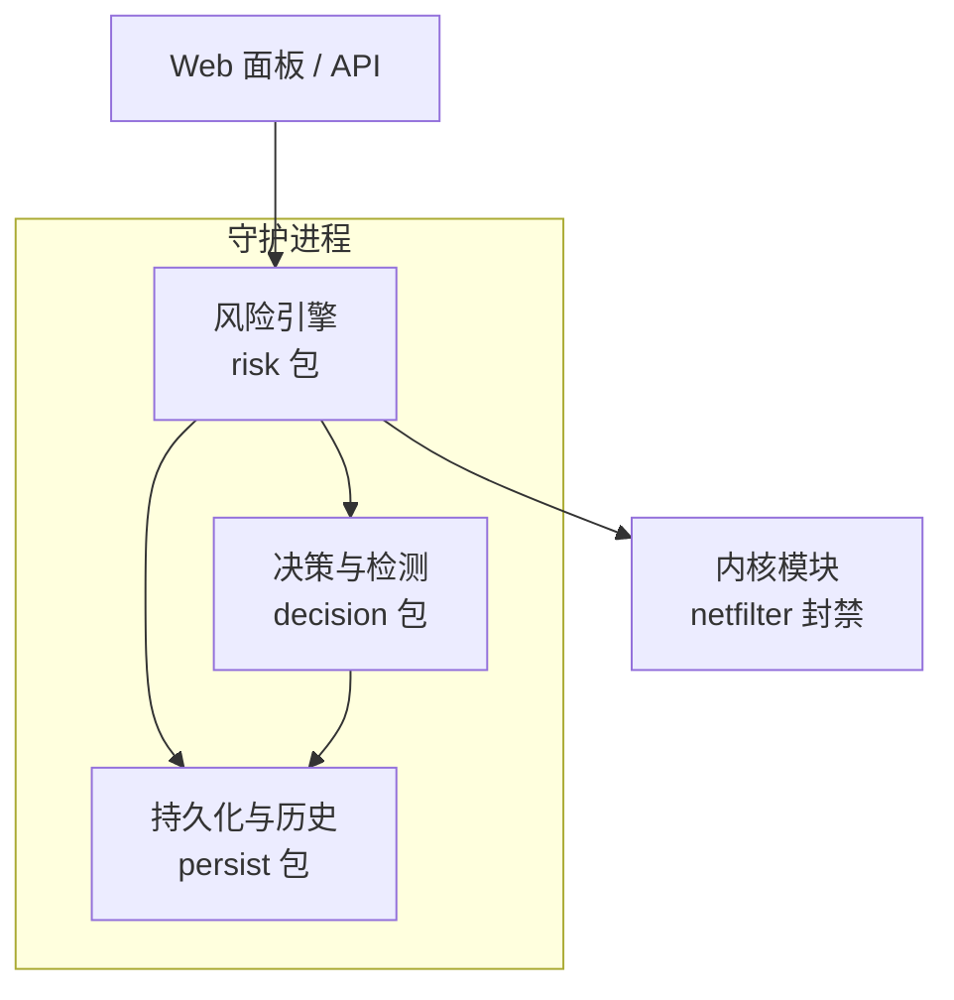
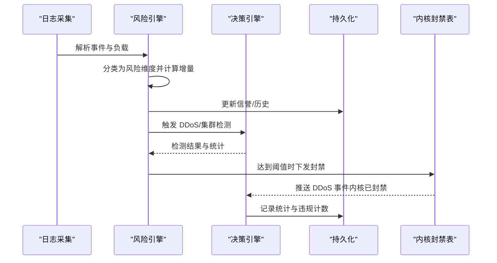
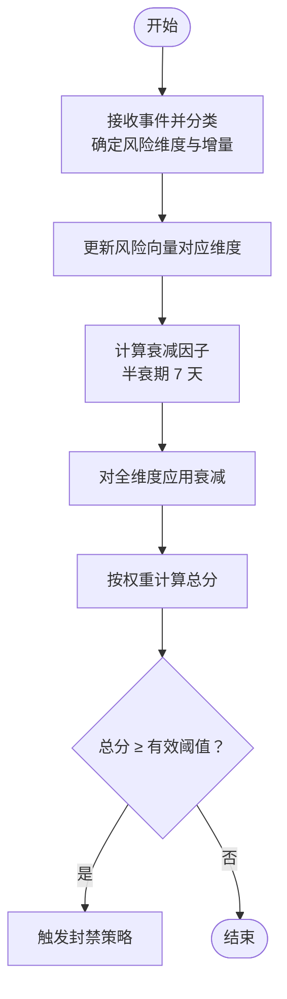
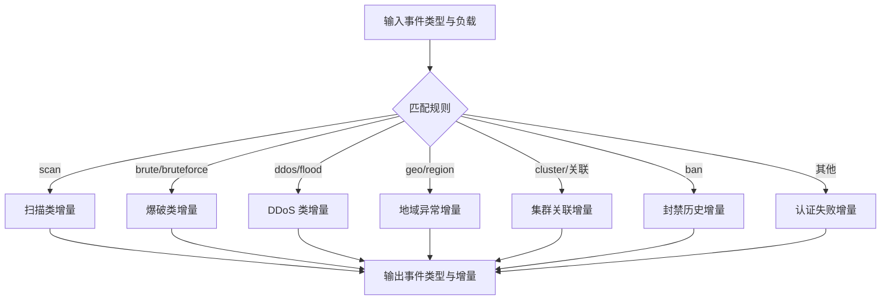
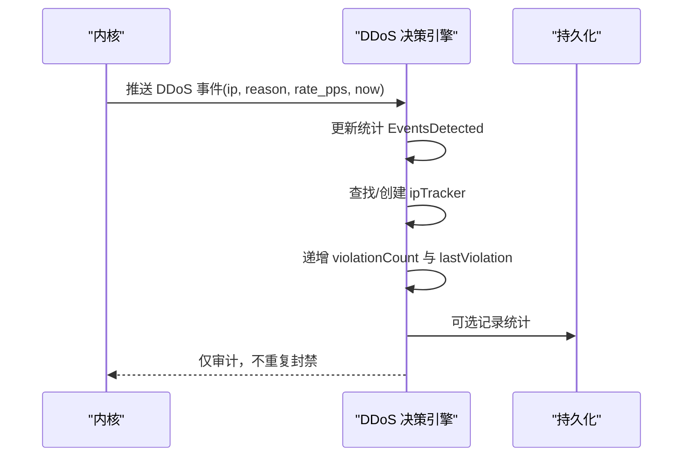
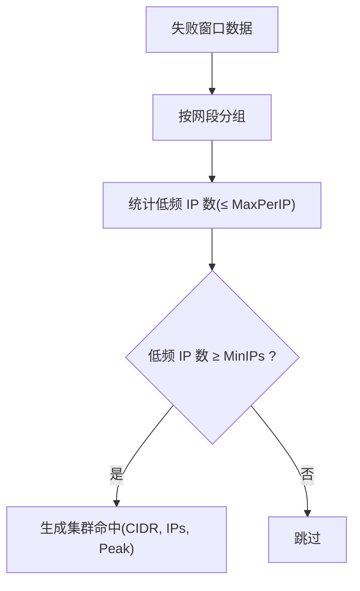
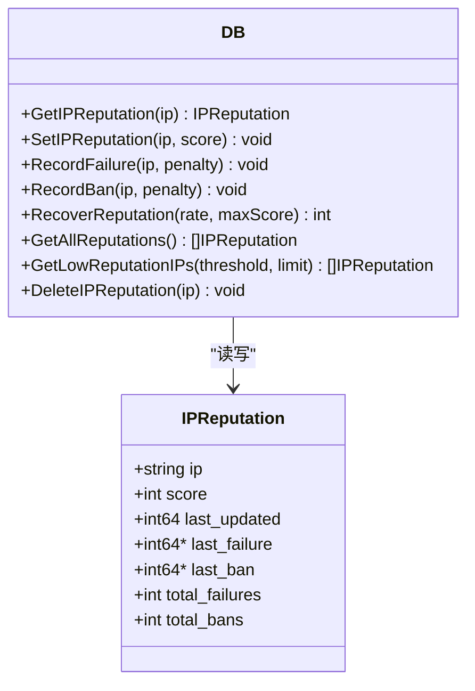
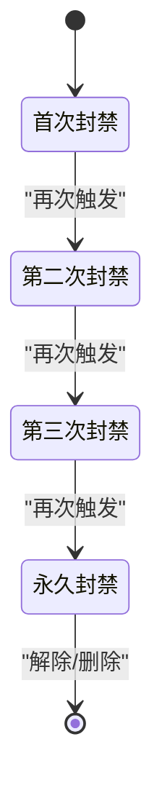
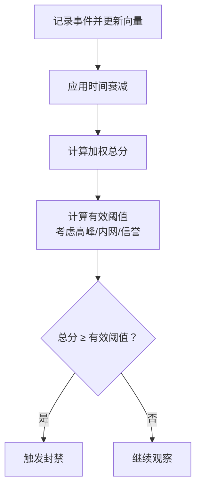
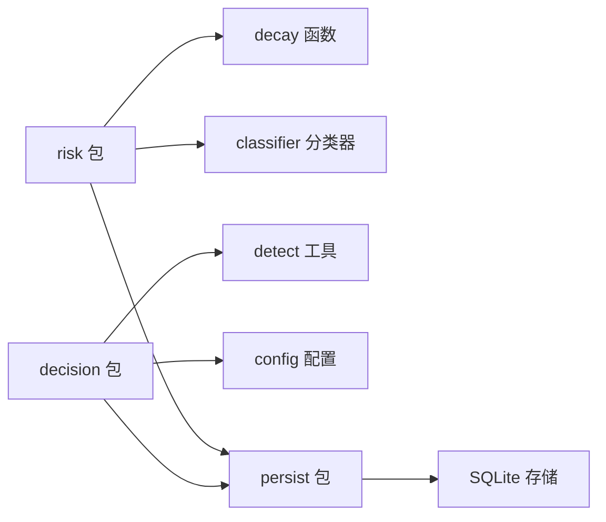

# 风险引擎系统

<cite>
**本文引用的文件**   
- [README.md](file://README.md)
- [types.go](file://src/daemon/internal/risk/types.go)
- [classifier.go](file://src/daemon/internal/risk/classifier.go)
- [decay.go](file://src/daemon/internal/risk/decay.go)
- [engine_test.go](file://src/daemon/internal/risk/engine_test.go)
- [ddos.go](file://src/daemon/internal/decision/ddos.go)
- [cluster.go](file://src/daemon/internal/decision/cluster.go)
- [reputation.go](file://src/daemon/internal/persist/reputation.go)
- [history.go](file://src/daemon/internal/persist/history.go)
</cite>

## 目录
1. [引言](#引言)
2. [项目结构](#项目结构)
3. [核心组件](#核心组件)
4. [架构总览](#架构总览)
5. [详细组件分析](#详细组件分析)
6. [依赖关系分析](#依赖关系分析)
7. [性能与可扩展性](#性能与可扩展性)
8. [故障排查指南](#故障排查指南)
9. [结论](#结论)
10. [附录：评分权重与调优参数](#附录评分权重与调优参数)

## 引言
本文件面向“风险引擎系统”的技术与运维读者，系统性解释多维风险评分、时间衰减、渐进式封禁、攻击分类、DDoS 防护、信誉分模型、历史行为分析与集群扫描检测等关键机制。文档同时给出风险评估流程图、评分权重配置说明、阈值判定逻辑与自动封禁触发条件，并提供可操作的排障建议。

## 项目结构
风险引擎位于守护进程内部，主要涉及三个子域：
- 风险向量与衰减：risk 包定义事件类型、风险向量、维度权重、衰减函数与分类器。
- 决策与检测：decision 包实现 DDoS 事件统计与集群扫描检测。
- 持久化与历史：persist 包维护 IP 信誉、封禁历史与累计计数。

图表来源
- [README.md:10-31](file://README.md#L10-L31)
- [types.go:1-131](file://src/daemon/internal/risk/types.go#L1-L131)
- [ddos.go:1-164](file://src/daemon/internal/decision/ddos.go#L1-L164)
- [reputation.go:1-202](file://src/daemon/internal/persist/reputation.go#L1-L202)

章节来源
- [README.md:10-31](file://README.md#L10-L31)

## 核心组件
- 多维风险向量与权重：支持失败、扫描、爆破、DDoS、地域异常、关联集群、封禁历史等维度，各自独立衰减与加权求和。
- 时间衰减：按半衰期指数衰减，避免长期误判累积。
- 攻击分类器：根据日志事件类型与负载字段，映射到具体风险维度并赋予增量。
- DDoS 决策引擎：统计内核已触发的 DDoS 封禁事件，跟踪违规次数与阈值。
- 集群扫描检测：在失败窗口内识别低频多源 IP 的协同扫描。
- 信誉分模型：基于 SQLite 的 IP 信誉分数、最近失败/封禁时间与累计次数。
- 封禁历史：记录每次封禁次数、是否永久封禁、最近解封时间等。

章节来源
- [types.go:1-131](file://src/daemon/internal/risk/types.go#L1-L131)
- [classifier.go:1-145](file://src/daemon/internal/risk/classifier.go#L1-L145)
- [decay.go:1-35](file://src/daemon/internal/risk/decay.go#L1-L35)
- [ddos.go:1-164](file://src/daemon/internal/decision/ddos.go#L1-L164)
- [cluster.go:1-147](file://src/daemon/internal/decision/cluster.go#L1-L147)
- [reputation.go:1-202](file://src/daemon/internal/persist/reputation.go#L1-L202)
- [history.go:1-164](file://src/daemon/internal/persist/history.go#L1-L164)

## 架构总览
风险引擎采用“用户态智能判定 + 内核态高速封禁”的分层架构。日志采集后进入风险引擎进行多维评分与分类；达到阈值则触发封禁策略（含渐进式时长），并将结果写入内核封禁表。DDoS 事件由内核直接封禁，守护进程仅做统计与审计。

图表来源
- [README.md:10-31](file://README.md#L10-L31)
- [classifier.go:1-145](file://src/daemon/internal/risk/classifier.go#L1-L145)
- [ddos.go:1-164](file://src/daemon/internal/decision/ddos.go#L1-L164)
- [reputation.go:1-202](file://src/daemon/internal/persist/reputation.go#L1-L202)
- [history.go:1-164](file://src/daemon/internal/persist/history.go#L1-L164)

## 详细组件分析

### 多维风险评分与时间衰减
- 风险向量包含多个维度，每个维度独立累加与衰减。
- 衰减使用半衰期 7 天的指数衰减函数；DaysSince 将秒级时间差转换为天数。
- Total 方法按配置的维度权重计算总分，用于阈值判定。

图表来源
- [types.go:44-93](file://src/daemon/internal/risk/types.go#L44-L93)
- [decay.go:5-34](file://src/daemon/internal/risk/decay.go#L5-L34)

章节来源
- [types.go:44-93](file://src/daemon/internal/risk/types.go#L44-L93)
- [decay.go:5-34](file://src/daemon/internal/risk/decay.go#L5-L34)

### 攻击分类机制
分类器根据事件类型字符串与负载字段，将原始事件映射到具体风险维度，并返回对应的向量增量：
- 扫描类：端口扫描、目录遍历等，依据端口数或路径特征提高增量。
- 爆破类：高频认证失败，依据速率提升增量。
- DDoS 类：流量型攻击，依据 PPS 提升增量。
- 地域异常：境外访问标记提升增量。
- 集群关联：与已知恶意 IP 关联提升增量。
- 封禁历史：临时或永久封禁历史提升增量。

图表来源
- [classifier.go:5-144](file://src/daemon/internal/risk/classifier.go#L5-L144)

章节来源
- [classifier.go:5-144](file://src/daemon/internal/risk/classifier.go#L5-L144)

### DDoS 防护：速率检测与自动封禁
- 内核已完成封禁，守护进程的 DDoS 引擎不重复封禁，只负责统计与审计。
- 每 IP 跟踪条目记录违规次数与最后违规时间，超过 StaleTrackerWindow 被清理。
- AutoBanThreshold 作为自动封禁阈值，用于统计与日志展示。
- 提供 Stats 快照与 TrackedIPs 数量查询。

图表来源
- [ddos.go:14-164](file://src/daemon/internal/decision/ddos.go#L14-L164)

章节来源
- [ddos.go:14-164](file://src/daemon/internal/decision/ddos.go#L14-L164)

### 集群扫描检测算法
- 在失败窗口中，按网段聚合低频源 IP，若网段内满足“不同 IP 数 ≥ MinIPs”，且“每 IP 失败数 ≤ MaxPerIP”，则判定为集群扫描。
- 该设计避免 CGNAT 与正常高频访客被误伤，强调“网段内不同 IP 数”而非“每 IP 失败数”。
- 返回命中的 CIDR、参与判定的 IP 列表与峰值单 IP 失败数。

图表来源
- [cluster.go:38-84](file://src/daemon/internal/decision/cluster.go#L38-L84)
- [cluster.go:91-146](file://src/daemon/internal/decision/cluster.go#L91-L146)

章节来源
- [cluster.go:38-84](file://src/daemon/internal/decision/cluster.go#L38-L84)
- [cluster.go:91-146](file://src/daemon/internal/decision/cluster.go#L91-L146)

### 信誉分计算模型与历史行为分析
- 信誉分初始为 100，失败与封禁会扣减分数，最低为 0。
- 支持恢复机制：在一定时间内未发生失败，可按恢复速率逐步回升至上限。
- 记录最近一次失败/封禁时间与累计失败/封禁次数，便于趋势分析与预测。
- 低信誉 IP 可通过阈值筛选导出，供威胁情报或风控策略使用。

图表来源
- [reputation.go:9-202](file://src/daemon/internal/persist/reputation.go#L9-L202)

章节来源
- [reputation.go:9-202](file://src/daemon/internal/persist/reputation.go#L9-L202)

### 渐进式封禁策略
- 首次封禁后，后续封禁时长逐步增加，最终可能转为永久封禁。
- 封禁历史表记录累计封禁次数、是否永久、最近封禁与解封时间。
- 通过 ban_count 与 is_permanent 字段支撑分级成效与复发统计。

图表来源
- [history.go:9-65](file://src/daemon/internal/persist/history.go#L9-L65)
- [history.go:83-164](file://src/daemon/internal/persist/history.go#L83-L164)

章节来源
- [history.go:9-65](file://src/daemon/internal/persist/history.go#L9-L65)
- [history.go:83-164](file://src/daemon/internal/persist/history.go#L83-L164)

### 风险评估流程与阈值判定
- 风险向量按维度累加事件增量，随后应用时间衰减。
- 计算加权总分并与有效阈值比较；有效阈值受高峰时段、内网来源、信誉分等因素影响。
- 测试用例覆盖基础阈值、高峰时段、内网来源、低信誉分等场景。

图表来源
- [types.go:82-93](file://src/daemon/internal/risk/types.go#L82-L93)
- [engine_test.go:43-125](file://src/daemon/internal/risk/engine_test.go#L43-L125)

章节来源
- [types.go:82-93](file://src/daemon/internal/risk/types.go#L82-L93)
- [engine_test.go:43-125](file://src/daemon/internal/risk/engine_test.go#L43-L125)

## 依赖关系分析
- risk 包依赖 decay 与 classifier，提供向量、衰减与分类能力。
- decision 包依赖 detect 与 config，实现 DDoS 统计与集群扫描检测。
- persist 包提供 SQLite 存取接口，支撑信誉与历史数据。
- 整体耦合度较低，各包职责清晰，便于扩展与替换。

图表来源
- [types.go:1-131](file://src/daemon/internal/risk/types.go#L1-L131)
- [classifier.go:1-145](file://src/daemon/internal/risk/classifier.go#L1-L145)
- [decay.go:1-35](file://src/daemon/internal/risk/decay.go#L1-L35)
- [ddos.go:1-164](file://src/daemon/internal/decision/ddos.go#L1-L164)
- [cluster.go:1-147](file://src/daemon/internal/decision/cluster.go#L1-L147)
- [reputation.go:1-202](file://src/daemon/internal/persist/reputation.go#L1-L202)

章节来源
- [types.go:1-131](file://src/daemon/internal/risk/types.go#L1-L131)
- [ddos.go:1-164](file://src/daemon/internal/decision/ddos.go#L1-L164)
- [cluster.go:1-147](file://src/daemon/internal/decision/cluster.go#L1-L147)
- [reputation.go:1-202](file://src/daemon/internal/persist/reputation.go#L1-L202)

## 性能与可扩展性
- 内核封禁表使用 hlist + RCU，命中即丢，零用户态开销。
- 风险向量与衰减为纯函数与轻量计算，适合高并发场景。
- DDoS 引擎使用原子变量与互斥锁保护共享状态，避免重复封禁。
- 集群扫描检测在窗口内分组与排序，保证结果可复现。
- 持久化层使用 SQLite，支持批量恢复与低信誉 IP 导出。

[本节为通用性能讨论，不直接分析具体文件]

## 故障排查指南
- 风险评分不生效
  - 检查事件分类是否正确映射到风险维度。
  - 确认维度权重与阈值配置是否符合预期。
  - 验证时间衰减是否导致分数快速下降。
- DDoS 统计异常
  - 核对 AutoBanThreshold 与内核事件推送是否一致。
  - 检查 ipTracker 是否因长时间未活动被清理。
- 集群扫描误报/漏报
  - 调整 MinIPs、MaxPerIP、Window 等参数以匹配业务流量。
  - 关注网段聚合前缀与 IPv4/IPv6 地址族差异。
- 信誉分恢复缓慢
  - 检查恢复速率与最大分数设置。
  - 确认 last_failure 时间戳是否更新。
- 封禁历史不一致
  - 核查 RecordBanHistory 返回值与面板显示是否同步。
  - 区分显式解封与临时封禁到期，避免混淆 last_unbanned_at。

章节来源
- [engine_test.go:128-144](file://src/daemon/internal/risk/engine_test.go#L128-L144)
- [ddos.go:103-164](file://src/daemon/internal/decision/ddos.go#L103-L164)
- [cluster.go:38-84](file://src/daemon/internal/decision/cluster.go#L38-L84)
- [reputation.go:118-137](file://src/daemon/internal/persist/reputation.go#L118-L137)
- [history.go:42-65](file://src/daemon/internal/persist/history.go#L42-L65)

## 结论
风险引擎通过多维风险向量、时间衰减与攻击分类，结合 DDoS 决策与集群扫描检测，形成完整的风险判定体系。配合信誉分模型与封禁历史，可实现渐进式封禁与自动化防护。内核态的高速封禁与用户态的智能判定相结合，既保证了性能，又提升了可观测性与可维护性。

[本节为总结性内容，不直接分析具体文件]

## 附录：评分权重与调优参数
- 维度权重
  - failure、ban、scan、bruteforce、ddos、geo、cluster，默认均为 1.0。
  - 权重越大，对应维度对总风险的贡献越高。
- 时间衰减
  - 半衰期 7 天；DaysSince 将秒差转天数；DecayFactor 计算衰减因子。
- DDoS 阈值
  - AutoBanThreshold：自动封禁阈值（统计与日志）。
  - StaleTrackerWindow：长时间未活动的清理窗口（5 分钟）。
- 集群扫描
  - Enabled：是否启用。
  - Window：失败窗口大小。
  - MinIPs：网段内低频 IP 的最小数量。
  - MaxPerIP：单 IP 失败数的上限（排除高频正常访客）。
- 信誉分
  - recoveryRate：恢复速率。
  - maxScore：最高信誉分数。
  - threshold：低信誉 IP 的筛选阈值。
- 封禁历史
  - ban_count：累计封禁次数。
  - is_permanent：是否永久封禁。
  - last_unbanned_at：最近一次显式解封时间。

章节来源
- [types.go:106-131](file://src/daemon/internal/risk/types.go#L106-L131)
- [decay.go:5-34](file://src/daemon/internal/risk/decay.go#L5-L34)
- [ddos.go:14-164](file://src/daemon/internal/decision/ddos.go#L14-L164)
- [cluster.go:38-84](file://src/daemon/internal/decision/cluster.go#L38-L84)
- [reputation.go:118-137](file://src/daemon/internal/persist/reputation.go#L118-L137)
- [history.go:9-65](file://src/daemon/internal/persist/history.go#L9-L65)