# 数据流设计

<cite>
**本文引用的文件**   
- [data-flow.md](file://docs/zh/architecture/data-flow.md)
- [fw_hook.c](file://src/kernel-module/fw_hook.c)
- [fw_ban.c](file://src/kernel-module/fw_ban.c)
- [fw_wl.c](file://src/kernel-module/fw_wl.c)
- [fw_rate.h](file://src/kernel-module/fw_rate.h)
- [fw_rate.c](file://src/kernel-module/fw_rate.c)
- [pipeline.go](file://src/daemon/internal/runtime/pipeline.go)
- [ingest.go](file://src/daemon/internal/ingest/ingest.go)
- [splitter.go](file://src/daemon/internal/logparse/splitter.go)
- [policy.go](file://src/daemon/internal/decision/policy.go)
- [engine.go](file://src/daemon/internal/risk/engine.go)
- [ban.go](file://src/daemon/internal/bans/ban.go)
- [consumer.go](file://src/daemon/internal/kernel/consumer.go)
</cite>

## 目录
1. [引言](#引言)
2. [项目结构](#项目结构)
3. [核心组件](#核心组件)
4. [架构总览](#架构总览)
5. [详细组件分析](#详细组件分析)
6. [依赖关系分析](#依赖关系分析)
7. [性能与监控](#性能与监控)
8. [故障排查](#故障排查)
9. [结论](#结论)

## 引言
本文件面向“数据流设计”，覆盖内核态数据包处理路径与用户态日志处理流水线，并解释事件驱动的消息传递、异步模型与背压策略。目标是让读者能准确理解：
- 一个入站报文从 Netfilter 钩子到白名单、本机地址、封禁表、速率判定、DDoS 自决封禁的完整顺序。
- 守护进程如何把日志切行、规则匹配、IP 提取、失败累计、阈值计算、风险评估、自动封禁决策串联起来。
- 内核与守护进程之间通过 netlink 和 ProcFS 的双向契约，以及事件泵如何维护镜像、对账、推送 SSE。

## 项目结构
仓库按“内核模块 + 守护进程 + 前端 + 配置 + 测试”组织。数据流相关代码集中在：
- 内核态：`src/kernel-module/`，负责 Netfilter 钩子、白名单、本机地址、封禁表、速率表、统计与 netlink 事件。
- 用户态：`src/daemon/internal/`，负责日志采集、解析、判定、封禁缓存、风险引擎、netlink 消费者与 HTTP/SSE 暴露。

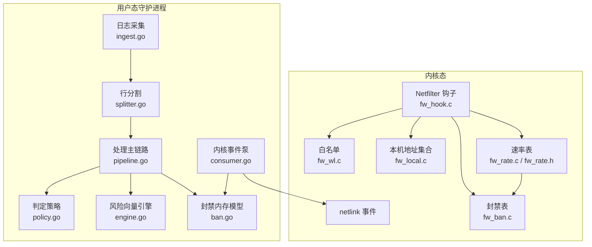

**图表来源**
- [fw_hook.c:77-154](file://src/kernel-module/fw_hook.c#L77-L154)
- [fw_wl.c:114-147](file://src/kernel-module/fw_wl.c#L114-L147)
- [fw_ban.c:369-383](file://src/kernel-module/fw_ban.c#L369-L383)
- [fw_rate.c:661-749](file://src/kernel-module/fw_rate.c#L661-L749)
- [pipeline.go:225-341](file://src/daemon/internal/runtime/pipeline.go#L225-L341)
- [consumer.go:371-549](file://src/daemon/internal/kernel/consumer.go#L371-L549)

**章节来源**
- [data-flow.md:1-11](file://docs/zh/architecture/data-flow.md#L1-L11)

## 核心组件
本节聚焦数据流中的关键节点：内核热路径、封禁表、白名单、速率表、用户态处理管线、内核事件泵。

### 内核热路径：Netfilter 钩子
- 钩子注册在 `NF_INET_PRE_ROUTING`，IPv4 与 IPv6 各一个，优先级为 `NF_IP_PRI_FILTER - 1`。
- 入口先做环回接口豁免、报文合法性检查、源地址合法性检查；TCP 标志异常直接丢弃并计入丢弃统计。
- 进入判定前只统计全局流量，异常报文不计入全局流量。
- 判定主体 `fw_ban_check` 在一个 RCU 读侧临界区内完成白名单、本机地址、封禁表、端口门控与速率观察。
- 自决封禁在 RCU 外执行，统一走 `fw_ban_try_add`，并发送 DDoS 事件后返回 `NF_DROP`。

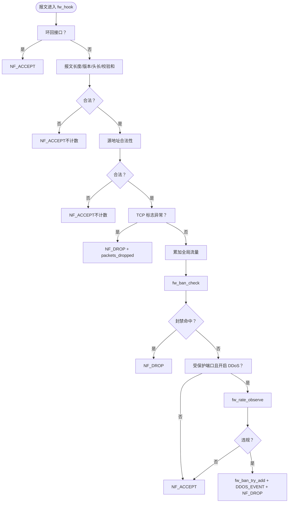

**图表来源**
- [fw_hook.c:104-154](file://src/kernel-module/fw_hook.c#L104-L154)
- [fw_hook.c:156-278](file://src/kernel-module/fw_hook.c#L156-L278)
- [fw_hook.c:280-410](file://src/kernel-module/fw_hook.c#L280-L410)

**章节来源**
- [fw_hook.c:1-45](file://src/kernel-module/fw_hook.c#L1-L45)
- [fw_hook.c:77-154](file://src/kernel-module/fw_hook.c#L77-L154)
- [data-flow.md:13-85](file://docs/zh/architecture/data-flow.md#L13-L85)

### 白名单查找
- 精确条目走哈希桶，子网条目走链表前缀匹配。
- 热路径自带 RCU 读侧临界区，避免与 `call_rcu` 释放交错。
- 移除时若命中本机地址集合则拒绝，防止误删系统接口地址。

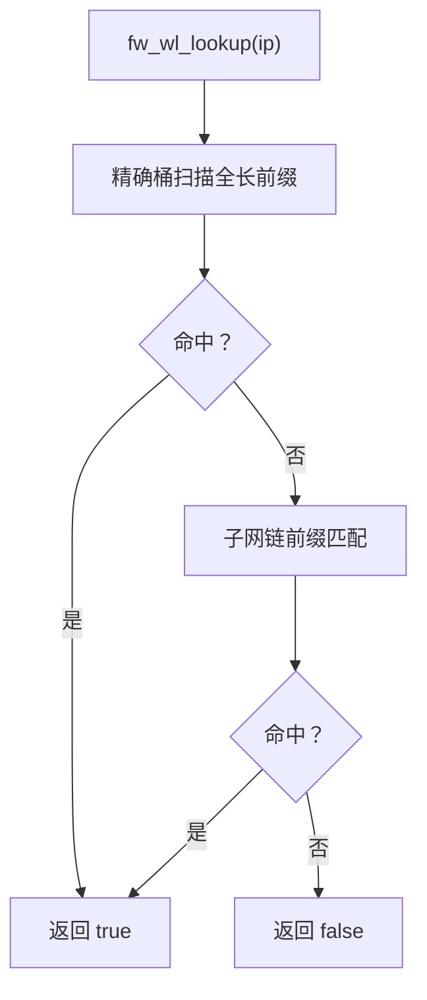

**图表来源**
- [fw_wl.c:114-147](file://src/kernel-module/fw_wl.c#L114-L147)

**章节来源**
- [fw_wl.c:1-18](file://src/kernel-module/fw_wl.c#L1-L18)
- [fw_wl.c:114-147](file://src/kernel-module/fw_wl.c#L114-L147)
- [data-flow.md:87-108](file://docs/zh/architecture/data-flow.md#L87-L108)

### 封禁表查找与添加
- 封禁表按前缀长度分层：全长层复用 4096 桶，短前缀层每层 64 桶。
- 查找先查最长前缀层，再按位图遍历更短前缀层，每层一次哈希探测。
- 添加路径统一走 `fw_ban_try_add`：白名单前检 → 泛洪闸门 → 容量检查 → 插入 → 可选通知。
- 到期回调在 RCU 读侧临界区内摘链，使用 `timer_delete()` + `hlist_del_rcu()` + `call_rcu()` 保证安全释放。

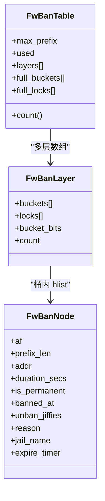

**图表来源**
- [fw_ban.c:180-226](file://src/kernel-module/fw_ban.c#L180-L226)
- [fw_ban.c:234-268](file://src/kernel-module/fw_ban.c#L234-L268)
- [fw_ban.c:369-383](file://src/kernel-module/fw_ban.c#L369-L383)
- [fw_ban.c:506-531](file://src/kernel-module/fw_ban.c#L506-L531)

**章节来源**
- [fw_ban.c:1-41](file://src/kernel-module/fw_ban.c#L1-L41)
- [fw_ban.c:369-383](file://src/kernel-module/fw_ban.c#L369-L383)
- [fw_ban.c:506-531](file://src/kernel-module/fw_ban.c#L506-L531)
- [data-flow.md:110-147](file://docs/zh/architecture/data-flow.md#L110-L147)

### 速率表与窗口滚动
- 速率表 65536 桶，条目固定占 per-CPU 槽，热路径只写本 CPU 槽，无共享 cache line 写。
- 窗口滚动由抢到选举的 CPU 汇总所有槽并清零，更新 EWMA 平滑值与端口并集。
- 违规判定分两类：总速率阈值与协议专项阈值；表满时有意放行，避免误伤正常流量。
- 静默条目回收工作项定期释放长期不活跃条目，使槽位可周转。

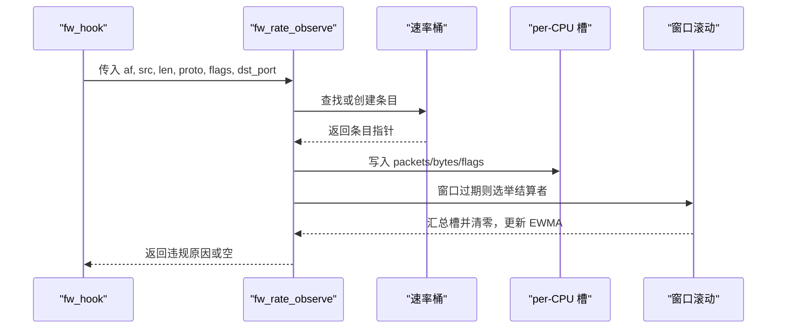

**图表来源**
- [fw_rate.c:661-749](file://src/kernel-module/fw_rate.c#L661-L749)
- [fw_rate.c:506-577](file://src/kernel-module/fw_rate.c#L506-L577)
- [fw_rate.h:37-58](file://src/kernel-module/fw_rate.h#L37-L58)

**章节来源**
- [fw_rate.c:1-37](file://src/kernel-module/fw_rate.c#L1-L37)
- [fw_rate.c:661-749](file://src/kernel-module/fw_rate.c#L661-L749)
- [fw_rate.h:1-26](file://src/kernel-module/fw_rate.h#L1-L26)

### 用户态处理流水线
- 采集层由单个协程独占 inotify、源注册、增量读取，跨协程只传不可变消息。
- 行分割器按换行切行，超长行丢弃并计数，半行缓冲挂在源上而非 jail 上。
- 处理主链路装配体 `Pipeline` 单线程独占状态，内部无锁。
- 判定阶段先记录失败，再取信誉分数计算有效阈值，最后用滑动窗口判断是否达到封禁阈值。
- 封禁计划由纯函数计算，支持渐进式时长与永久封禁。

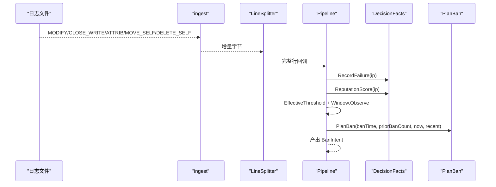

**图表来源**
- [ingest.go:1-12](file://src/daemon/internal/ingest/ingest.go#L1-L12)
- [splitter.go:33-73](file://src/daemon/internal/logparse/splitter.go#L33-L73)
- [pipeline.go:225-341](file://src/daemon/internal/runtime/pipeline.go#L225-L341)
- [policy.go:47-76](file://src/daemon/internal/decision/policy.go#L47-L76)
- [policy.go:131-174](file://src/daemon/internal/decision/policy.go#L131-L174)

**章节来源**
- [ingest.go:1-12](file://src/daemon/internal/ingest/ingest.go#L1-L12)
- [splitter.go:1-91](file://src/daemon/internal/logparse/splitter.go#L1-L91)
- [pipeline.go:1-12](file://src/daemon/internal/runtime/pipeline.go#L1-L12)
- [pipeline.go:225-341](file://src/daemon/internal/runtime/pipeline.go#L225-L341)
- [policy.go:1-13](file://src/daemon/internal/decision/policy.go#L1-L13)

### 风险向量引擎
- 维护 LRU 缓存的风险向量，记录失败、封禁、扫描、暴力破解、DDoS、地理、集群等维度。
- 衰减基于天数，查询时返回当前向量；阈值计算采用加法模型修复旧乘法 Bug。
- `ShouldBan` 根据向量加权总分与有效阈值决定是否封禁。

```mermaid
flowchart TD
RStart["RecordEvent(ip, type, inc)"] --> CacheGet["LRU 获取向量"]
CacheGet --> Decay["按天数衰减"]
Decay --> AddInc["累加增量"]
AddInc --> SetExpire["设置过期时间"]
SetExpire --> REnd["返回向量"]
RQuery["GetVector(ip)"] --> Hit{"缓存命中且未过期？"}
Hit --> |是| ReturnVec["返回衰减后的向量"]
Hit --> |否| LoadDB["调用方从数据库加载"]
```

**图表来源**
- [engine.go:39-82](file://src/daemon/internal/risk/engine.go#L39-L82)
- [engine.go:84-102](file://src/daemon/internal/risk/engine.go#L84-L102)
- [engine.go:116-189](file://src/daemon/internal/risk/engine.go#L116-L189)

**章节来源**
- [engine.go:1-20](file://src/daemon/internal/risk/engine.go#L1-L20)
- [engine.go:39-82](file://src/daemon/internal/risk/engine.go#L39-L82)
- [engine.go:116-189](file://src/daemon/internal/risk/engine.go#L116-L189)

### 内核事件泵与消息传递
- 事件泵是内核 → 用户态的唯一消费者，维护队列深度 4096，超深静默丢弃。
- 周期任务：采样（5 秒）、对账（30 秒）、注册续约（10 秒）。
- 封禁镜像以内核为准：补内核独有条目，剔除镜像幽灵，pending 保护刚下发未确认条目。
- 反向指令非阻塞投递，队列满时丢弃并记日志，避免事件流被执行体阻塞。

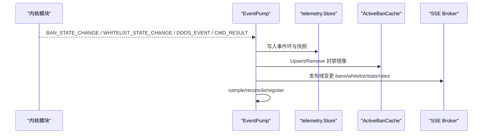

**图表来源**
- [consumer.go:1-21](file://src/daemon/internal/kernel/consumer.go#L1-L21)
- [consumer.go:37-51](file://src/daemon/internal/kernel/consumer.go#L37-L51)
- [consumer.go:371-549](file://src/daemon/internal/kernel/consumer.go#L371-L549)
- [consumer.go:572-613](file://src/daemon/internal/kernel/consumer.go#L572-L613)
- [consumer.go:632-690](file://src/daemon/internal/kernel/consumer.go#L632-L690)

**章节来源**
- [consumer.go:1-21](file://src/daemon/internal/kernel/consumer.go#L1-L21)
- [consumer.go:371-549](file://src/daemon/internal/kernel/consumer.go#L371-L549)
- [consumer.go:572-690](file://src/daemon/internal/kernel/consumer.go#L572-L690)

## 架构总览
整体数据流分为两条主线：
- 内核热路径：Netfilter 钩子 → 白名单 → 本机地址 → 封禁表 → 速率表 → 自决封禁。
- 用户态处理链：日志采集 → 行分割 → 规则匹配 → IP 提取 → 失败累计 → 阈值计算 → 封禁计划 → 内核下发。

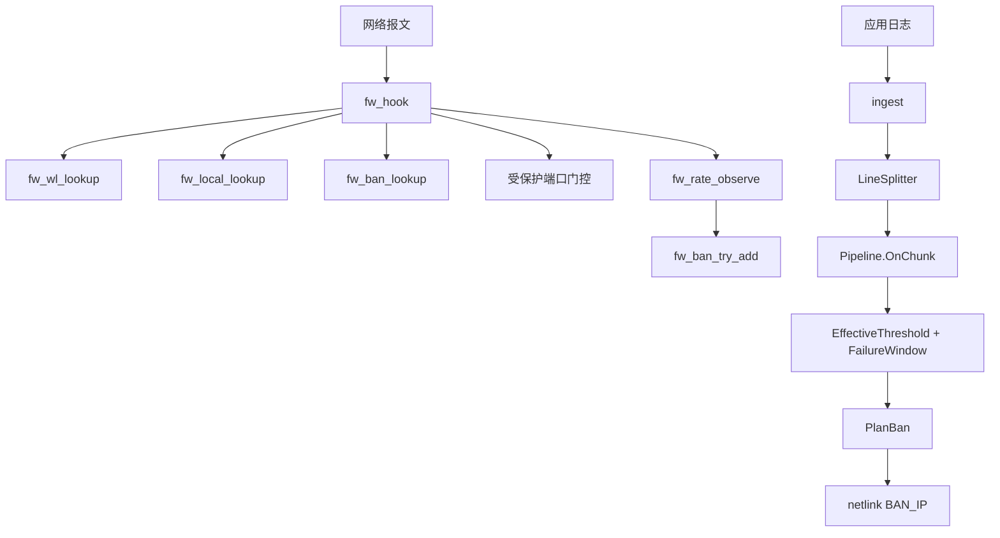

**图表来源**
- [fw_hook.c:104-154](file://src/kernel-module/fw_hook.c#L104-L154)
- [fw_rate.c:661-749](file://src/kernel-module/fw_rate.c#L661-L749)
- [pipeline.go:225-341](file://src/daemon/internal/runtime/pipeline.go#L225-L341)
- [policy.go:47-76](file://src/daemon/internal/decision/policy.go#L47-L76)
- [policy.go:131-174](file://src/daemon/internal/decision/policy.go#L131-L174)

## 详细组件分析

### 数据包在内核态的处理流程
- 入站路径：PREROUTING 钩子 → 合法性检查 → 源地址检查 → 白名单短路 → 本机地址短路 → 封禁表命中即丢包 → 受保护端口门控 → 速率观察 → 违规即自决封禁。
- 三条约束：本机地址判定先于封禁表；四张表在同一 RCU 读侧临界区读完；端口门控只加在速率判定分支。
- 前置检查：lo 接口、报文长度/版本/头长/校验和、非法源地址、TCP 标志异常。

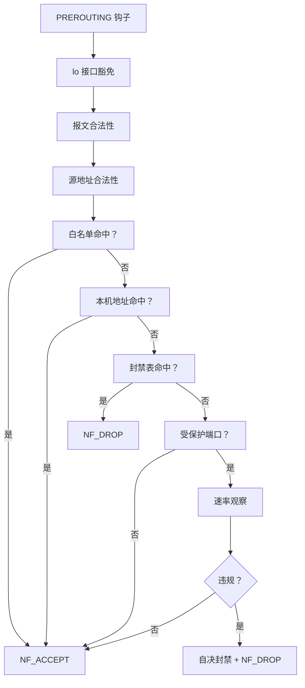

**图表来源**
- [data-flow.md:17-41](file://docs/zh/architecture/data-flow.md#L17-L41)
- [fw_hook.c:104-154](file://src/kernel-module/fw_hook.c#L104-L154)

**章节来源**
- [data-flow.md:13-85](file://docs/zh/architecture/data-flow.md#L13-L85)
- [fw_hook.c:104-154](file://src/kernel-module/fw_hook.c#L104-L154)

### 用户态数据处理流水线
- 日志采集：inotify 监视文件变化，按 offset 增量读取，源身份稳定。
- 行分割：按 `\n` 切行，超长行丢弃，半行缓冲挂源。
- 规则匹配：正则匹配提取 IP，保留段校验。
- 频率分析：每个 jail 的失败窗口累计失败次数。
- 风险评估：信誉分调整有效阈值，风险向量加权总分参与决策。
- 自动封禁：生成 BanIntent，封装 BanPlan，最终经 netlink 下发。

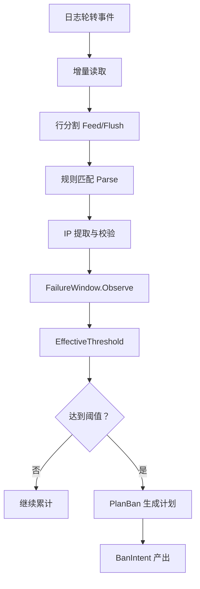

**图表来源**
- [pipeline.go:225-341](file://src/daemon/internal/runtime/pipeline.go#L225-L341)
- [splitter.go:33-73](file://src/daemon/internal/logparse/splitter.go#L33-L73)
- [policy.go:47-76](file://src/daemon/internal/decision/policy.go#L47-L76)
- [policy.go:131-174](file://src/daemon/internal/decision/policy.go#L131-L174)

**章节来源**
- [pipeline.go:225-341](file://src/daemon/internal/runtime/pipeline.go#L225-L341)
- [splitter.go:33-73](file://src/daemon/internal/logparse/splitter.go#L33-L73)

### 事件驱动架构中的消息传递机制
- 内核 → 用户态：netlink 多播事件（DDOS_EVENT、BAN_STATE_CHANGE、WHITELIST_STATE_CHANGE、CONFIG_CHANGE、CMD_RESULT），单播查询响应（LIST_BANS_RESPONSE、LIST_WHITELIST_RESPONSE、LIST_RATES_RESPONSE、STATS_RESPONSE、ANALYSIS_RESPONSE）。
- 用户态 → 内核：netlink 命令（BAN_IP、UNBAN_IP、ADD_WHITELIST、REMOVE_WHITELIST、SET_CONFIG、SET_PROTECTED_PORTS、DAEMON_REGISTER），ProcFS 读写。
- 事件泵维护镜像、对账、SSE 推送，反向指令非阻塞投递。

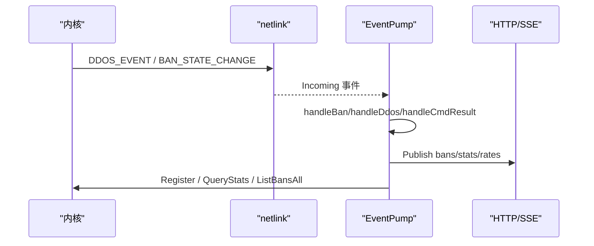

**图表来源**
- [consumer.go:37-68](file://src/daemon/internal/kernel/consumer.go#L37-L68)
- [consumer.go:371-549](file://src/daemon/internal/kernel/consumer.go#L371-L549)
- [consumer.go:572-613](file://src/daemon/internal/kernel/consumer.go#L572-L613)

**章节来源**
- [data-flow.md:236-280](file://docs/zh/architecture/data-flow.md#L236-L280)
- [consumer.go:371-549](file://src/daemon/internal/kernel/consumer.go#L371-L549)

### 异步处理模型与背压策略
- 内核热路径零自旋锁、RCU 读侧临界区、per-CPU 槽，避免热点竞争。
- 用户态采集与处理由单协程串行，避免锁与竞态。
- 事件泵队列深度 4096，超深静默丢弃；反向指令非阻塞投递，队列满丢弃并记日志。
- 速率表满时有意放行，避免误伤；静默条目回收提供槽位周转。

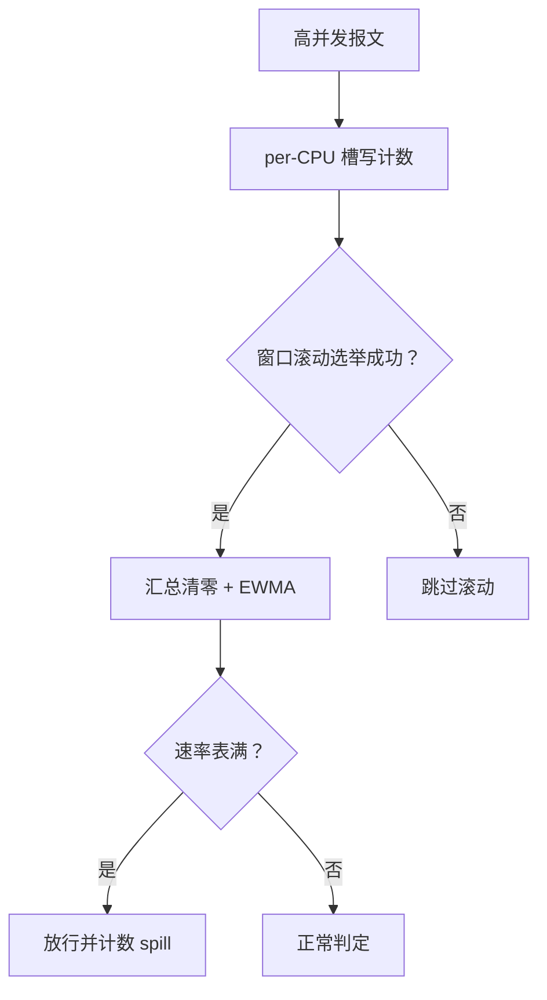

**图表来源**
- [fw_rate.c:661-749](file://src/kernel-module/fw_rate.c#L661-L749)
- [consumer.go:1-21](file://src/daemon/internal/kernel/consumer.go#L1-L21)
- [consumer.go:551-566](file://src/daemon/internal/kernel/consumer.go#L551-L566)

**章节来源**
- [fw_rate.c:1-37](file://src/kernel-module/fw_rate.c#L1-L37)
- [consumer.go:1-21](file://src/daemon/internal/kernel/consumer.go#L1-L21)

## 依赖关系分析
- 内核模块内部依赖：`fw_hook.c` 依赖 `fw_wl.c`、`fw_ban.c`、`fw_rate.c`、`fw_stats.h`、`fw_netlink.h`。
- 用户态内部依赖：`pipeline.go` 依赖 `logparse`、`detect`、`decision`、`ingest`；`consumer.go` 依赖 `bans`、`contract`、`runtime`、`telemetry`。
- 外部契约：`contract/*.fwidl` 定义 netlink、HTTP、ProcFS 接口，生成物作为类型基础。

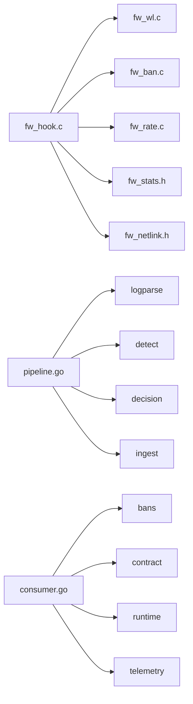

**图表来源**
- [fw_hook.c:58-64](file://src/kernel-module/fw_hook.c#L58-L64)
- [pipeline.go:14-23](file://src/daemon/internal/runtime/pipeline.go#L14-L23)
- [consumer.go:23-35](file://src/daemon/internal/kernel/consumer.go#L23-L35)

**章节来源**
- [fw_hook.c:58-64](file://src/kernel-module/fw_hook.c#L58-L64)
- [pipeline.go:14-23](file://src/daemon/internal/runtime/pipeline.go#L14-L23)
- [consumer.go:23-35](file://src/daemon/internal/kernel/consumer.go#L23-L35)

## 性能与监控
- 内核热路径指标：packets_dropped、tcp_anomaly_dropped、rate_slot_spill、ban_table_full_rejects、wl_reject_count。
- 用户态指标：lines_parsed、regex_matches、ips_extracted、bans_intent、ddos_events_total、kernel_commands_rejected_total。
- 调优建议：
  - 调整受保护端口集合，缩小速率判定作用面。
  - 调整速率窗口与阈值，平衡误报与漏报。
  - 调整封禁容量与泛洪闸门，防止控制面拥塞。
  - 调整事件泵采样与对账间隔，平衡实时性与开销。

**章节来源**
- [fw_rate.c:446-474](file://src/kernel-module/fw_rate.c#L446-L474)
- [fw_ban.c:479-484](file://src/kernel-module/fw_ban.c#L479-L484)
- [pipeline.go:109-121](file://src/daemon/internal/runtime/pipeline.go#L109-L121)
- [consumer.go:124-130](file://src/daemon/internal/kernel/consumer.go#L124-L130)

## 故障排查
- 内核侧：
  - 封禁表满：检查 `ban_table_full_rejects`，调整 `fw_max_ban_entries`。
  - 速率表溢出：检查 `rate_slot_spill`，关注活跃源数量与回收情况。
  - 白名单拒绝：检查 `wl_reject_count`，确认本机地址未被误删。
- 用户态：
  - 事件丢失：检查事件环深度与队列丢弃日志。
  - 对账不一致：检查对账失败计数与 pending 封禁数量。
  - 反向指令丢弃：检查执行体消费速度与队列容量。

**章节来源**
- [fw_ban.c:479-484](file://src/kernel-module/fw_ban.c#L479-L484)
- [fw_rate.c:446-474](file://src/kernel-module/fw_rate.c#L446-L474)
- [consumer.go:551-566](file://src/daemon/internal/kernel/consumer.go#L551-L566)
- [consumer.go:632-690](file://src/daemon/internal/kernel/consumer.go#L632-L690)

## 结论
本数据流设计通过内核热路径的 RCU 与 per-CPU 优化、用户态的单协程串行处理、事件泵的镜像与对账机制，实现了高性能、低延迟、强一致的数据处理管道。内核负责快速过滤与 DDoS 自决，用户态负责复杂规则与风险评估，两者通过 netlink 与 ProcFS 契约协同工作。建议在部署中结合业务特征调整阈值、端口集合与容量参数，并通过监控指标持续验证效果。