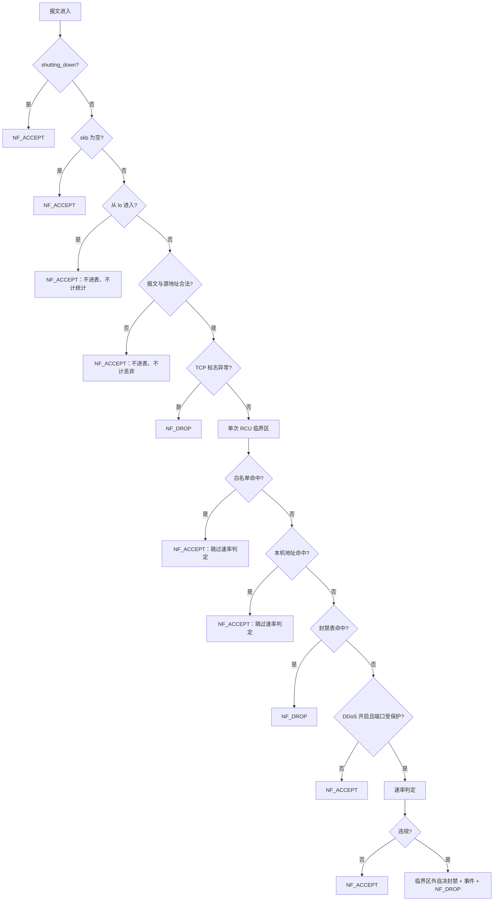
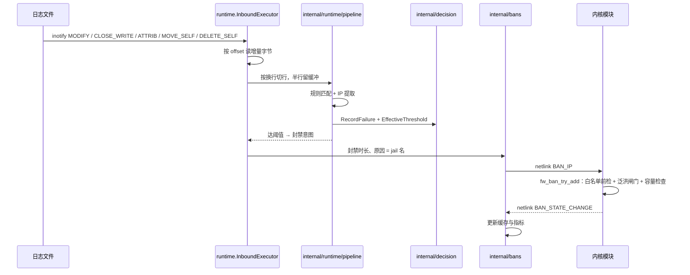
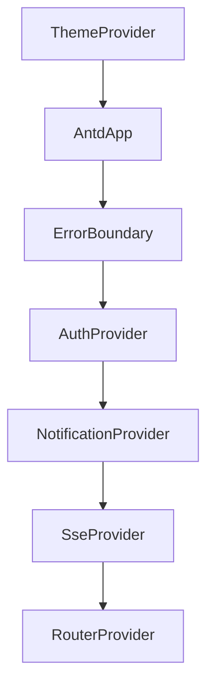
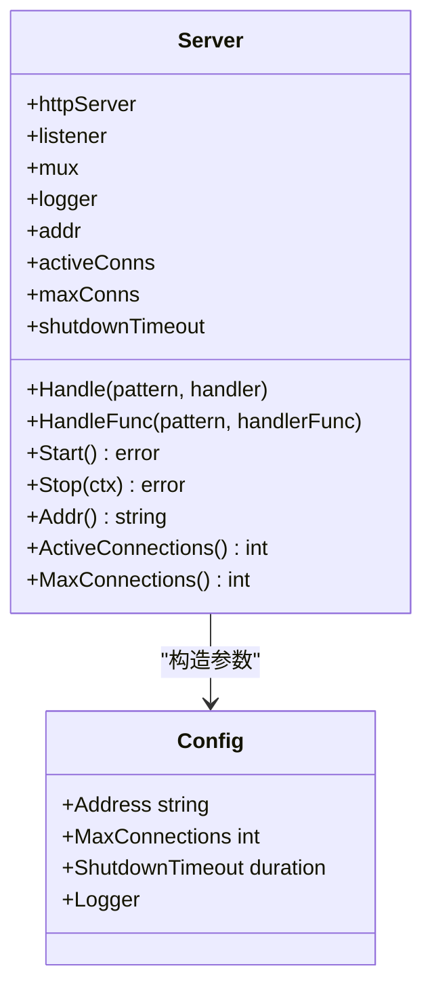
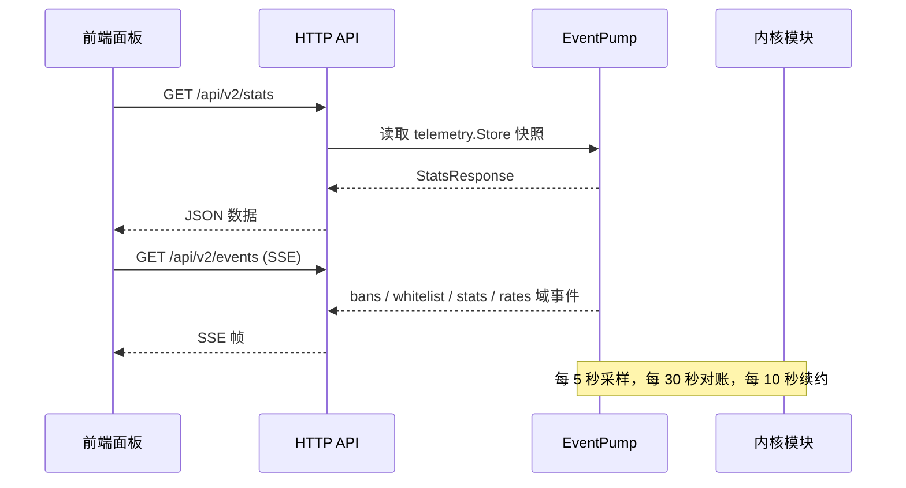
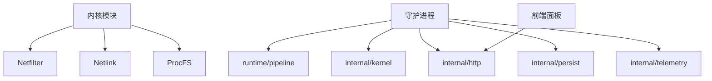

# 系统架构

<cite>
**本文引用的文件**   
- [README.md](file://README.md)
- [docs/zh/architecture/README.md](file://docs/zh/architecture/README.md)
- [docs/zh/architecture/kernel-module.md](file://docs/zh/architecture/kernel-module.md)
- [docs/zh/architecture/daemon.md](file://docs/zh/architecture/daemon.md)
- [docs/zh/architecture/data-flow.md](file://docs/zh/architecture/data-flow.md)
- [src/kernel-module/fw_hook.c](file://src/kernel-module/fw_hook.c)
- [src/daemon/internal/runtime/pipeline.go](file://src/daemon/internal/runtime/pipeline.go)
- [src/daemon/internal/http/server.go](file://src/daemon/internal/http/server.go)
- [frontend/src/app/App.tsx](file://frontend/src/app/App.tsx)
</cite>

## 目录
1. [引言](#引言)
2. [项目结构](#项目结构)
3. [核心组件](#核心组件)
4. [架构总览](#架构总览)
5. [详细组件分析](#详细组件分析)
6. [依赖关系分析](#依赖关系分析)
7. [性能与可扩展性](#性能与可扩展性)
8. [故障排查指南](#故障排查指南)
9. [结论](#结论)

## 引言
本仓库实现了一个“用户态智能判定 + 内核态高速封禁”的三层架构防火墙：内核模块负责报文判定与封禁表管理，守护进程负责日志采集、风险判定、威胁情报聚合、HTTP/SSE 面板服务，前端面板提供实时监控与配置管理。三者通过 Netlink（内核 ↔ 守护进程）、HTTP API（浏览器 ↔ 面板）、ProcFS（运维 ↔ 内核）进行通信。

该文档面向开发者与运维人员，既给出高层架构图，也深入到内核钩子、守护进程流水线、前端 Provider 组合根等关键实现，帮助理解数据流向、处理流程与关键设计权衡。

**章节来源**
- [README.md:10-31](file://README.md#L10-L31)

## 项目结构
仓库按空间与职责切分：
- `src/kernel-module/`：C 语言内核模块，注册 netfilter 钩子，维护封禁表、白名单、速率表、端口位图、统计与 procfs/netlink 接口。
- `src/daemon/`：Go 守护进程，包含日志采集、规则解析、失败窗口判定、决策引擎、netlink 客户端、HTTP 服务器、SSE 事件流、指标导出、SQLite 历史库、威胁情报源等。
- `frontend/`：React 19 + TypeScript 前端，内嵌于守护进程静态资源中，消费 REST 与 SSE。
- `contract/`：Python 契约定义与生成代码，冻结 netlink、HTTP、procfs 三端接口。
- `config/`：YAML 配置文件模板，覆盖默认值与各服务场景。
- `scripts/`、`tests/`、`grafana/`、`debian/`：构建脚本、端到端测试、监控仪表盘与打包元信息。

```mermaid
graph TB
subgraph "内核空间"
KHook["Netfilter 钩子<br/>fw_hook.c"]
KBan["封禁表 / 白名单 / 速率表"]
KProc["ProcFS 13 个条目"]
KNL["Netlink 内核侧"]
end
subgraph "用户空间"
DIngest["日志采集与解析<br/>internal/ingest + internal/logparse"]
DPipe["流水线与判定<br/>internal/runtime/pipeline"]
DBans["封禁缓存与动作<br/>internal/bans"]
DHTTP["HTTP / SSE / metrics<br/>internal/http"]
DKClient["Netlink 客户端与事件泵<br/>internal/kernel"]
end
subgraph "浏览器"
FE["React 面板<br/>App.tsx + RouterProvider"]
end
FE --> DHTTP
DHTTP --> DKClient
DKClient < --> KNL
DIngest --> DPipe --> DBans --> DKClient
KHook --> KBan
KBan --> KProc
```

**图表来源**
- [docs/zh/architecture/README.md:20-54](file://docs/zh/architecture/README.md#L20-L54)
- [docs/zh/architecture/daemon.md:32-57](file://docs/zh/architecture/daemon.md#L32-L57)
- [docs/zh/architecture/kernel-module.md:33-52](file://docs/zh/architecture/kernel-module.md#L33-L52)

**章节来源**
- [docs/zh/architecture/README.md:12-18](file://docs/zh/architecture/README.md#L12-L18)
- [docs/zh/architecture/daemon.md:20-31](file://docs/zh/architecture/daemon.md#L20-L31)

## 核心组件
- 内核模块：在 `NF_INET_PRE_ROUTING` 拦截入站报文，依次短路判断环回、合法性、白名单、本机地址、封禁表；若开启 DDoS 检测且目的端口受保护，则进入速率判定，违规时自决封禁并丢包。
- 守护进程：单 goroutine 顺序执行“读字节 → 切行 → 规则匹配 → 失败计数 → 阈值判定 → 产生封禁意图 → 经 netlink 下发”，同时运行 netlink 接收回路、事件泵、HTTP 服务器。
- 前端面板：基于 React 19 + Ant Design，Provider 组合根决定主题、认证、通知、SSE、路由的嵌套顺序，页面消费 REST 与 SSE 数据。

**章节来源**
- [docs/zh/architecture/kernel-module.md:54-156](file://docs/zh/architecture/kernel-module.md#L54-L156)
- [docs/zh/architecture/daemon.md:58-110](file://docs/zh/architecture/daemon.md#L58-L110)
- [frontend/src/app/App.tsx:10-26](file://frontend/src/app/App.tsx#L10-L26)

## 架构总览
系统由两个运行组件构成：内核模块负责报文判定与表管理，守护进程负责日志监控、决策与对外接口。面板是守护进程内嵌的静态资源。两者之间必须走 netlink；procfs 是给人和运维用的接口，不是守护进程的内部通道。

```mermaid
graph TB
subgraph "用户空间"
Inotify["inotify 监控<br/>internal/ingest"]
Parse["切行 + 正则取 IP<br/>internal/logparse"]
Decide["失败窗口 + 阈值判定<br/>internal/decision"]
API["HTTP / SSE / metrics<br/>internal/http"]
Inotify --> Parse --> Decide
Decide --> Sink["internal/bans"]
API --> Sink
Sink --> NLC["internal/kernel"]
Decide --> Pump["kernel.EventPump"]
Pump --> API
end
subgraph "内核空间"
Hook["fw_hook_ipv4 / fw_hook_ipv6"]
WL["白名单：精确桶 + 子网链"]
Local["本机地址集合"]
Ban["封禁表：按前缀长度分层"]
Rate["速率表 + per-CPU 槽"]
Ports["受保护端口位图"]
ProcFS["procfs 13 个条目"]
Hook --> WL --> Ban
Hook --> Local --> Ban
Hook --> Ports --> Rate
Ban --> ProcFS
WL --> ProcFS
Rate --> ProcFS
end
NLC < --> |"netlink：命令 / 查询 / 事件"| KNL["fw_netlink.c"]
KNL --> Hook
KNL --> ProcFS
```

**图表来源**
- [docs/zh/architecture/README.md:20-54](file://docs/zh/architecture/README.md#L20-L54)

**章节来源**
- [docs/zh/architecture/README.md:12-18](file://docs/zh/architecture/README.md#L12-L18)

## 详细组件分析

### 内核模块：Netfilter 钩子与热路径
内核模块在 IPv4/IPv6 各注册一个钩子，优先级为 `NF_IP_PRI_FILTER - 1`，在 filter 表之前看到报文。热路径的关键是：
- 关闭中直接放行，避免卸载被新流量拖住。
- 环回接口直接放行，不进任何表、不计任何统计。
- 报文与源地址非法直接放行，不计丢弃。
- TCP 标志异常直接丢包并计入丢弃统计。
- 单次 RCU 临界区内完成白名单、本机地址、封禁表、速率四步判定。
- 自决封禁在临界区外执行，避免在 RCU 读侧做重活。



**图表来源**
- [docs/zh/architecture/kernel-module.md:69-131](file://docs/zh/architecture/kernel-module.md#L69-L131)
- [src/kernel-module/fw_hook.c:97-154](file://src/kernel-module/fw_hook.c#L97-L154)

**章节来源**
- [src/kernel-module/fw_hook.c:1-45](file://src/kernel-module/fw_hook.c#L1-L45)
- [src/kernel-module/fw_hook.c:77-95](file://src/kernel-module/fw_hook.c#L77-L95)
- [src/kernel-module/fw_hook.c:156-278](file://src/kernel-module/fw_hook.c#L156-L278)
- [src/kernel-module/fw_hook.c:280-411](file://src/kernel-module/fw_hook.c#L280-L411)
- [docs/zh/architecture/kernel-module.md:54-156](file://docs/zh/architecture/kernel-module.md#L54-L156)

### 守护进程：流水线与判定语义
守护进程的运行时模型把采集、解析、判定、封禁装配成单线程独占的执行体，内部无锁。Pipeline 持有每个 jail 的规则集、策略参数与失败窗口，对每行日志提取 IP，记录失败，计算有效阈值，并在失败窗口达到容量时产出封禁意图。



**图表来源**
- [docs/zh/architecture/data-flow.md:149-189](file://docs/zh/architecture/data-flow.md#L149-L189)
- [src/daemon/internal/runtime/pipeline.go:221-342](file://src/daemon/internal/runtime/pipeline.go#L221-L342)

**章节来源**
- [src/daemon/internal/runtime/pipeline.go:1-12](file://src/daemon/internal/runtime/pipeline.go#L1-L12)
- [src/daemon/internal/runtime/pipeline.go:25-79](file://src/daemon/internal/runtime/pipeline.go#L25-L79)
- [src/daemon/internal/runtime/pipeline.go:130-187](file://src/daemon/internal/runtime/pipeline.go#L130-L187)
- [src/daemon/internal/runtime/pipeline.go:221-342](file://src/daemon/internal/runtime/pipeline.go#L221-L342)
- [docs/zh/architecture/daemon.md:164-184](file://docs/zh/architecture/daemon.md#L164-L184)

### 前端面板：技术选型与 Provider 组合根
前端采用 React 19 + TypeScript，使用 Ant Design 组件库，并通过 Provider 组合根组织依赖顺序。外层到内层依次为：主题提供者、AntdApp、错误边界、认证提供者、通知提供者、SSE 提供者、路由提供者。顺序约束包括：
- NotificationProvider 必须在 AntdApp 之内，以获取主题感知的通知实例。
- SseProvider 必须在 AuthProvider 之内，未登录时不连接实时流，避免 401 退避重连。



**图表来源**
- [frontend/src/app/App.tsx:10-26](file://frontend/src/app/App.tsx#L10-L26)

**章节来源**
- [frontend/src/app/App.tsx:1-44](file://frontend/src/app/App.tsx#L1-L44)

### HTTP 服务器与连接限制
守护进程内嵌单个 HTTP 服务，承载面板、REST、SSE、指标。Server 封装监听器、路由器、安全头中间件、连接配额限制、优雅关停。默认监听地址为 `127.0.0.1:9119`，最大连接数默认 32，关停超时默认 5 秒。连接配额满时直接返回 503，不经过 mux，因此安全头中间件需放在配额外面。



**图表来源**
- [src/daemon/internal/http/server.go:14-73](file://src/daemon/internal/http/server.go#L14-L73)
- [src/daemon/internal/http/server.go:76-149](file://src/daemon/internal/http/server.go#L76-L149)

**章节来源**
- [src/daemon/internal/http/server.go:1-158](file://src/daemon/internal/http/server.go#L1-L158)
- [docs/zh/architecture/daemon.md:225-247](file://docs/zh/architecture/daemon.md#L225-L247)

### 数据流与组件间通信
- 用户态 → 内核：netlink 下发封禁、解封、白名单变更、配置、受保护端口位图；ProcFS 写 `/proc/firewall/bans`、`/proc/firewall/whitelist`、`/proc/firewall/config`。
- 内核 → 用户态：netlink 多播事件（DDoS、状态变更、命令结果、注册确认），单播查询响应（分页列表、统计、分析、速率）；ProcFS 只读条目输出统计与分析快照。
- 守护进程内部：ingest 主链路顺序执行，kernel-reactor 阻塞收包，event-pump 消费事件并周期采样对账，http-server 提供外部接口。



**图表来源**
- [docs/zh/architecture/data-flow.md:236-280](file://docs/zh/architecture/data-flow.md#L236-L280)
- [docs/zh/architecture/daemon.md:120-163](file://docs/zh/architecture/daemon.md#L120-L163)

**章节来源**
- [docs/zh/architecture/data-flow.md:13-45](file://docs/zh/architecture/data-flow.md#L13-L45)
- [docs/zh/architecture/data-flow.md:236-280](file://docs/zh/architecture/data-flow.md#L236-L280)

## 依赖关系分析
- 内核模块依赖 netfilter、netlink、procfs、RCU、定时器、per-CPU 内存。
- 守护进程依赖 Go 标准库、SQLite、YAML 解析、sys 调用；内部包之间通过消息或不可变快照传递，共享状态通过显式对象承载。
- 前端依赖 React、Ant Design、ECharts，产物由守护进程内嵌托管。



**图表来源**
- [docs/zh/architecture/daemon.md:32-57](file://docs/zh/architecture/daemon.md#L32-L57)
- [docs/zh/architecture/kernel-module.md:33-52](file://docs/zh/architecture/kernel-module.md#L33-L52)

**章节来源**
- [docs/zh/architecture/daemon.md:32-57](file://docs/zh/architecture/daemon.md#L32-L57)
- [docs/zh/architecture/kernel-module.md:33-52](file://docs/zh/architecture/kernel-module.md#L33-L52)

## 性能与可扩展性
- 内核热路径零自旋锁、单次 RCU 临界区、per-CPU 统计与速率槽，避免共享 cache line 写。
- 封禁表按前缀长度分层，常态一次哈希即命中；白名单精确桶 + 子网链，避免线性扫描。
- 守护进程主链路单 goroutine 顺序执行，段间无队列，避免背压丢包；事件泵周期采样与对账保证镜像一致性。
- 前端 Provider 组合根确保主题、认证、通知、SSE、路由的正确嵌套，减少渲染崩溃与无效重连。

**章节来源**
- [docs/zh/architecture/kernel-module.md:284-335](file://docs/zh/architecture/kernel-module.md#L284-L335)
- [docs/zh/architecture/daemon.md:58-110](file://docs/zh/architecture/daemon.md#L58-L110)
- [frontend/src/app/App.tsx:10-26](file://frontend/src/app/App.tsx#L10-L26)

## 故障排查指南
- 内核模块加载失败：检查模块参数校验、本机地址首次发现、钩子注册顺序；查看 dmesg 中 firewall 前缀日志。
- 守护进程启动失败：检查面板资源是否存在、procfs 是否可用、netlink 是否可打开；关注健康端点 `/health`、`/healthz`。
- 面板无法访问：检查 HTTP 绑定地址与端口、Basic Auth 凭据、SSE 令牌；确认 CSP 安全头与 SPA 路径。
- 封禁不生效：确认 netlink 注册成功、租约未被拒绝、事件泵已订阅；查看 `/api/v2/stats/sse-status` 与内核拒绝指令计数。
- 日志轮转异常：检查 log_max_size_mb、log_max_files 配置；确认日志写入 fd 与轮转逻辑。

**章节来源**
- [docs/zh/architecture/kernel-module.md:582-600](file://docs/zh/architecture/kernel-module.md#L582-L600)
- [docs/zh/architecture/daemon.md:262-268](file://docs/zh/architecture/daemon.md#L262-L268)
- [docs/zh/architecture/daemon.md:314-334](file://docs/zh/architecture/daemon.md#L314-L334)

## 结论
该系统通过三层架构实现了高性能、可扩展的防火墙能力：内核模块承担热路径判定与封禁，守护进程承担业务逻辑与对外接口，前端面板提供可视化与管理能力。关键设计包括 RCU 与 per-CPU 优化、单 goroutine 主链路、契约驱动的接口一致性、以及清晰的组件间通信机制。开发者可据此快速定位问题、扩展功能并保持系统稳定性。