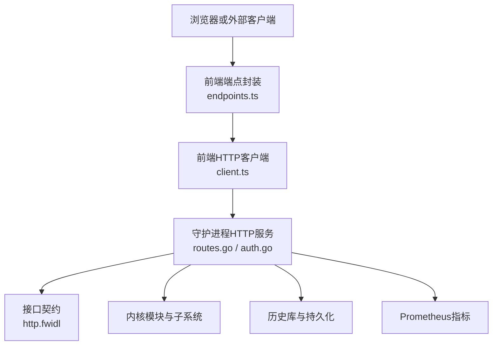
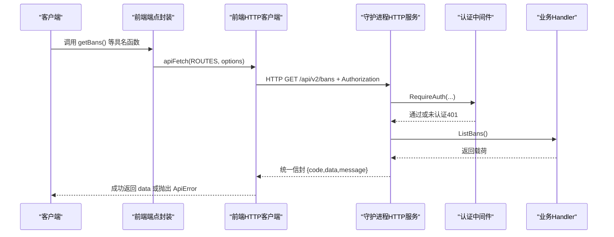
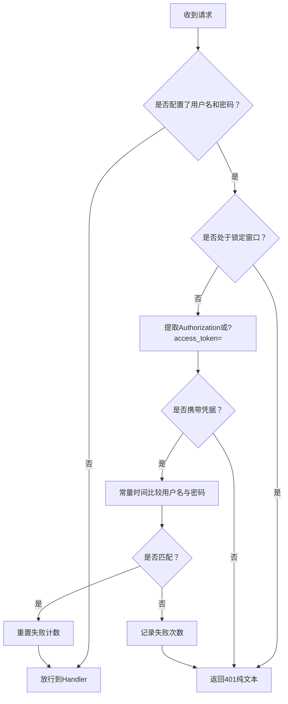
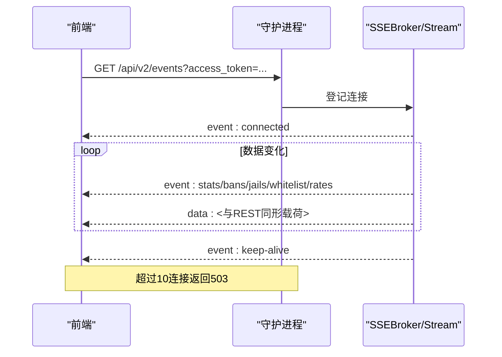
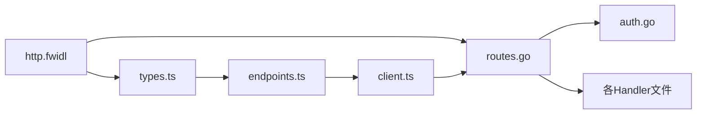

# HTTP REST API协议

<cite>
**本文引用的文件**   
- [README.md](file://README.md)
- [http.fwidl](file://contract/http.fwidl)
- [migration-api-v2.md](file://docs/zh/migration-api-v2.md)
- [routes.go](file://src/daemon/internal/http/routes.go)
- [auth.go](file://src/daemon/internal/http/auth.go)
- [sse_payload_test.go](file://src/daemon/internal/http/sse_payload_test.go)
- [endpoints.ts](file://frontend/src/api/endpoints.ts)
- [types.ts](file://frontend/src/api/types.ts)
- [client.ts](file://frontend/src/api/client.ts)
</cite>

## 目录
1. [引言](#引言)
2. [项目结构](#项目结构)
3. [核心组件](#核心组件)
4. [架构总览](#架构总览)
5. [详细端点与协议规范](#详细端点与协议规范)
6. [认证与授权](#认证与授权)
7. [会话管理与权限控制](#会话管理与权限控制)
8. [SSE实时事件推送](#sse实时事件推送)
9. [数据模型与字段约束](#数据模型与字段约束)
10. [错误码体系与异常处理](#错误码体系与异常处理)
11. [依赖关系分析](#依赖关系分析)
12. [性能与容量特性](#性能与容量特性)
13. [客户端集成指南](#客户端集成指南)
14. [API版本管理与迁移策略](#api版本管理与迁移策略)
15. [故障排查](#故障排查)
16. [结论](#结论)

## 引言
本文件面向使用本项目的后端守护进程、前端面板以及第三方集成方，系统化说明 HTTP REST API 的设计原则、端点规范、请求响应格式、认证授权机制、SSE 实时事件推送、数据模型、错误码体系、版本管理以及客户端集成最佳实践。

该守护进程提供：
- 基于 `/api/v2` 的 RESTful API；
- Basic 认证（支持查询参数透传）；
- 统一信封响应；
- 两条 SSE 流：事件流与日志流；
- Prometheus 指标端点；
- SPA 静态资源与健康检查。

**章节来源**
- [README.md:10-31](file://README.md#L10-L31)
- [README.md:120-131](file://README.md#L120-L131)

## 项目结构
HTTP API 相关代码分布在以下位置：
- 契约定义：`contract/http.fwidl`
- 守护进程路由与处理器：`src/daemon/internal/http/*`
- 前端端点封装与类型：`frontend/src/api/endpoints.ts`、`frontend/src/api/types.ts`
- 前端 HTTP 客户端：`frontend/src/api/client.ts`
- 迁移文档：`docs/zh/migration-api-v2.md`

**图表来源**
- [routes.go:79-233](file://src/daemon/internal/http/routes.go#L79-L233)
- [auth.go:22-69](file://src/daemon/internal/http/auth.go#L22-L69)
- [http.fwidl:44-49](file://contract/http.fwidl#L44-L49)
- [endpoints.ts:1-17](file://frontend/src/api/endpoints.ts#L1-L17)
- [client.ts:1-17](file://frontend/src/api/client.ts#L1-L17)

**章节来源**
- [http.fwidl:1-43](file://contract/http.fwidl#L1-L43)
- [routes.go:79-233](file://src/daemon/internal/http/routes.go#L79-L233)
- [endpoints.ts:1-17](file://frontend/src/api/endpoints.ts#L1-L17)

## 核心组件
- **契约层**：`http.fwidl` 是守护进程与前端之间的单一真相源，声明路由、认证语义、安全头、错误模型、业务码、SSE 上限与事件名。
- **路由注册层**：`routes.go` 把契约常量映射到具体 handler，并统一用 `RequireAuth` 包裹需认证的端点。
- **认证中间件**：`auth.go` 实现 Basic 认证、凭据来源选择、锁定保护、401 纯文本响应。
- **前端端点封装**：`endpoints.ts` 为每条契约路由暴露具名函数，集中构造路径、查询参数和 SSE URL。
- **前端类型镜像**：`types.ts` 与契约载荷逐字段对齐，由门禁工具校验。
- **前端HTTP客户端**：`client.ts` 负责 fetch、超时、Authorization 头、信封解包、错误分类。

**章节来源**
- [http.fwidl:44-153](file://contract/http.fwidl#L44-L153)
- [routes.go:79-233](file://src/daemon/internal/http/routes.go#L79-L233)
- [auth.go:22-116](file://src/daemon/internal/http/auth.go#L22-L116)
- [endpoints.ts:1-17](file://frontend/src/api/endpoints.ts#L1-L17)
- [types.ts:1-14](file://frontend/src/api/types.ts#L1-L14)
- [client.ts:1-17](file://frontend/src/api/client.ts#L1-L17)

## 架构总览
REST API 的请求流程如下：

**图表来源**
- [endpoints.ts:126-141](file://frontend/src/api/endpoints.ts#L126-L141)
- [client.ts:154-187](file://frontend/src/api/client.ts#L154-L187)
- [routes.go:105-117](file://src/daemon/internal/http/routes.go#L105-L117)
- [auth.go:22-69](file://src/daemon/internal/http/auth.go#L22-L69)

## 详细端点与协议规范

### 通用协议约定
- **API前缀**：`/api/v2`
- **成功响应**：统一信封 `{ code: 0, data: T, message: "" }`
- **失败响应**：统一信封 `{ code: 业务码, data: null, message: "原因" }`
- **健康检查例外**：`/api/v2/health` 与 `/api/v2/healthz` 不套信封，直接返回运行时快照，状态码即语义（200就绪、503未就绪）。
- **媒体类型**：JSON 请求体必须带 `Content-Type: application/json`；非 JSON 返回 415。
- **安全头**：所有响应统一施加 X-Content-Type-Options、X-Frame-Options、Content-Security-Policy、Cache-Control。

**章节来源**
- [http.fwidl:44-49](file://contract/http.fwidl#L44-L49)
- [http.fwidl:51-65](file://contract/http.fwidl#L51-L65)
- [http.fwidl:131-153](file://contract/http.fwidl#L131-L153)
- [http.fwidl:376-394](file://contract/http.fwidl#L376-L394)
- [http.fwidl:298-304](file://contract/http.fwidl#L298-L304)

### 无认证端点
| 方法 | 路径 | 说明 | 成功状态码 | 备注 |
|---|---|---|---|---|
| GET | `/api/v2/health` | 健康检查 | 200 | 载荷裸 RuntimeSnapshot |
| GET | `/api/v2/healthz` | 探针别名 | 200 | 同 health |
| GET | `/` | 重定向到 `/dashboard` | 303 | 保留 query string |
| GET | `/dashboard` | SPA外壳 | 200 | 静态壳 |
| GET | `/bans` | SPA外壳 | 200 | 静态壳 |
| GET | `/whitelist` | SPA外壳 | 200 | 静态壳 |
| GET | `/jails` | SPA外壳 | 200 | 静态壳 |
| GET | `/ddos` | SPA外壳 | 200 | 静态壳 |
| GET | `/logs` | SPA外壳 | 200 | 静态壳 |
| GET | `/settings` | SPA外壳 | 200 | 静态壳 |
| GET | `/static/*path` | 静态资源 | 200 | 未命中返回 404 纯文本 |
| GET | `/sw.js` | Service Worker | 200 | 不带交互式凭据 |

**章节来源**
- [http.fwidl:376-475](file://contract/http.fwidl#L376-L475)
- [routes.go:79-99](file://src/daemon/internal/http/routes.go#L79-L99)

### 需认证端点

#### 统计与系统
| 方法 | 路径 | 说明 | 成功状态码 | 关键行为 |
|---|---|---|---|---|
| GET | `/metrics` | Prometheus指标 | 200 | text/plain |
| GET | `/api/v2/stats` | 首屏总览 | 200 | 混合内核快照、历史库时间窗、进程状态 |
| GET | `/api/v2/stats/sse-status` | SSE连接诊断 | 200 | events/logs各自名额 |

**章节来源**
- [http.fwidl:477-485](file://contract/http.fwidl#L477-L485)
- [http.fwidl:513-521](file://contract/http.fwidl#L513-L521)
- [http.fwidl:748-754](file://contract/http.fwidl#L748-L754)
- [routes.go:96-103](file://src/daemon/internal/http/routes.go#L96-L103)
- [routes.go:149-154](file://src/daemon/internal/http/routes.go#L149-L154)
- [routes.go:201-202](file://src/daemon/internal/http/routes.go#L201-L202)

#### 封禁管理
| 方法 | 路径 | 请求体 | 成功状态码 | 说明 |
|---|---|---|---|---|
| GET | `/api/v2/bans` | 分页参数 page/page_size/sort_by | 200 | 返回 PaginatedResponse<BanResponse> |
| POST | `/api/v2/bans` | CreateBanRequest | 201 | 手工封禁；duration缺席/0=永久 |
| DELETE | `/api/v2/bans/:ip` | 无 | 200 | 解封单个IP |
| GET | `/api/v2/bans/:ip/detail` | 无 | 200 | 单IP封禁画像 |
| POST | `/api/v2/bans/unban-temporary` | 无 | 200 | 批量解除临时封禁 |
| POST | `/api/v2/bans/batch` | BatchBanRequest | 201 | 批量封禁，单次1..100条 |

**章节来源**
- [http.fwidl:523-577](file://contract/http.fwidl#L523-L577)
- [routes.go:105-117](file://src/daemon/internal/http/routes.go#L105-L117)
- [endpoints.ts:126-180](file://frontend/src/api/endpoints.ts#L126-L180)

#### Jail配置
| 方法 | 路径 | 请求体 | 成功状态码 | 说明 |
|---|---|---|---|---|
| GET | `/api/v2/jails` | 无 | 200 | 按配置顺序返回JailResponse数组 |
| PUT | `/api/v2/jails/:name` | UpdateJailRequest | 200 | 改启用状态；异步生效，不推SSE帧 |

**章节来源**
- [http.fwidl:579-596](file://contract/http.fwidl#L579-L596)
- [routes.go:119-123](file://src/daemon/internal/http/routes.go#L119-L123)
- [endpoints.ts:186-202](file://frontend/src/api/endpoints.ts#L186-L202)

#### 配置
| 方法 | 路径 | 请求体 | 成功状态码 | 说明 |
|---|---|---|---|---|
| GET | `/api/v2/config` | 无 | 200 | WebuiConfigResponse |
| PUT | `/api/v2/config` | UpdateConfigRequest | 200 | 提交部分字段，返回完整快照 |

**章节来源**
- [http.fwidl:598-616](file://contract/http.fwidl#L598-L616)
- [routes.go:125-129](file://src/daemon/internal/http/routes.go#L125-L129)
- [endpoints.ts:208-223](file://frontend/src/api/endpoints.ts#L208-L223)

#### 白名单
| 方法 | 路径 | 请求体 | 成功状态码 | 说明 |
|---|---|---|---|---|
| GET | `/api/v2/whitelist` | 无 | 200 | WhitelistEntry数组 |
| POST | `/api/v2/whitelist` | CreateWhitelistRequest | 201 | 新增CIDR或裸IP |
| DELETE | `/api/v2/whitelist/:cidr` | 无 | 200 | 移除白名单 |
| GET | `/api/v2/whitelist/recommendations` | min_bans/limit | 200 | 推荐数组本身，不另包信封 |

**章节来源**
- [http.fwidl:618-654](file://contract/http.fwidl#L618-L654)
- [routes.go:131-139](file://src/daemon/internal/http/routes.go#L131-L139)
- [endpoints.ts:229-268](file://frontend/src/api/endpoints.ts#L229-L268)

#### 速率
| 方法 | 路径 | 说明 | 成功状态码 |
|---|---|---|---|
| GET | `/api/v2/rates/current` | 当前速率表，按pps降序 | 200 |
| GET | `/api/v2/rates/history` | 速率历史环，时间升序 | 200 |
| GET | `/api/v2/rates/windows` | 短/中/长三档窗口快照 | 200 |

**章节来源**
- [http.fwidl:656-680](file://contract/http.fwidl#L656-L680)
- [routes.go:141-147](file://src/daemon/internal/http/routes.go#L141-L147)
- [endpoints.ts:274-290](file://frontend/src/api/endpoints.ts#L274-L290)

#### 威胁情报源
| 方法 | 路径 | 说明 | 成功状态码 |
|---|---|---|---|
| GET | `/api/v2/threat-feeds` | 列表与同步状态 | 200 |
| POST | `/api/v2/threat-feeds/sync` | 手动触发全量同步 | 200 |
| GET | `/api/v2/threat-feeds/:id` | 单个情报源详情 | 200 |

**章节来源**
- [http.fwidl:220-226](file://src/daemon/internal/http/routes.go#L220-L226)
- [migration-api-v2.md:53-59](file://docs/zh/migration-api-v2.md#L53-L59)
- [endpoints.ts:450-466](file://frontend/src/api/endpoints.ts#L450-L466)

#### 综合分析
| 方法 | 路径 | 说明 | 成功状态码 |
|---|---|---|---|
| GET | `/api/v2/analysis/summary` | 威胁等级+Top风险IP+活跃攻击摘要 | 200 |
| GET | `/api/v2/analysis/ip/:ip` | 单IP综合分析 | 200 |

**章节来源**
- [migration-api-v2.md:61-66](file://docs/zh/migration-api-v2.md#L61-L66)
- [routes.go:228-232](file://src/daemon/internal/http/routes.go#L228-L232)
- [endpoints.ts:472-480](file://frontend/src/api/endpoints.ts#L472-L480)

#### 多维风险引擎
| 方法 | 路径 | 说明 | 成功状态码 |
|---|---|---|---|
| GET | `/api/v2/risk/vectors` | 全部风险向量，按总风险降序 | 200 |
| GET | `/api/v2/risk/vectors/:ip` | 单IP七维风险向量 | 200 |
| GET | `/api/v2/risk/events/:ip` | 单IP攻击事件历史 | 200 |

**章节来源**
- [endpoints.ts:413-426](file://frontend/src/api/endpoints.ts#L413-L426)
- [routes.go:204-210](file://src/daemon/internal/http/routes.go#L204-L210)

#### 日志
| 方法 | 路径 | 说明 | 成功状态码 |
|---|---|---|---|
| GET | `/api/v2/logs` | 历史日志分页 | 200 |
| GET | `/api/v2/logs/stream` | 实时日志SSE流 | 200 |

**章节来源**
- [http.fwidl:500-511](file://contract/http.fwidl#L500-L511)
- [routes.go:212-218](file://src/daemon/internal/http/routes.go#L212-L218)
- [endpoints.ts:432-444](file://frontend/src/api/endpoints.ts#L432-L444)

## 认证与授权

### 认证方式
- **Basic认证**：Authorization头携带 base64(user:pass)。
- **SSE兼容认证**：EventSource不能设置请求头，因此SSE通过查询参数 `access_token` 传递相同格式的 base64(user:pass)。
- **半配置拒绝**：只配置 metrics_username 或 metrics_password 其中一项时，所有需认证端点一律返回 401。
- **双空放行**：两项都为空表示未配置认证，所有端点放行。

### 认证流程

**图表来源**
- [auth.go:22-69](file://src/daemon/internal/http/auth.go#L22-L69)
- [auth.go:77-116](file://src/daemon/internal/http/auth.go#L77-L116)

### 401响应形状
- 401不走统一信封，而是返回纯文本 `401 Unauthorized\n`。
- 有意不发 `WWW-Authenticate`，避免浏览器弹出原生对话框导致前端按钮永久转圈。

**章节来源**
- [http.fwidl:67-88](file://contract/http.fwidl#L67-L88)
- [http.fwidl:104-109](file://contract/http.fwidl#L104-L109)
- [auth.go:14-20](file://src/daemon/internal/http/auth.go#L14-L20)
- [auth.go:22-35](file://src/daemon/internal/http/auth.go#L22-L35)
- [auth.go:109-116](file://src/daemon/internal/http/auth.go#L109-L116)

## 会话管理与权限控制
本项目没有传统意义上的“登录会话”或“JWT令牌”。认证是每次请求独立验证：
- 每次REST请求携带 Authorization 或 access_token；
- 认证失败达到阈值后进入锁定窗口，期间即使凭据正确也拒绝；
- 前端通过 `probeAuth()` 探测凭据有效性，失败则走登出流程；
- 权限控制采用“需认证/无需认证”两组路由，没有细粒度角色或资源级鉴权。

**章节来源**
- [http.fwidl:67-88](file://contract/http.fwidl#L67-L88)
- [auth.go:36-69](file://src/daemon/internal/http/auth.go#L36-L69)
- [endpoints.ts:486-492](file://frontend/src/api/endpoints.ts#L486-L492)
- [client.ts:58-71](file://frontend/src/api/client.ts#L58-L71)

## SSE实时事件推送

### 两条SSE流
| 流 | 路径 | 最大连接数 | 事件名 | keepalive |
|---|---|---:|---|---:|
| 事件流 | `/api/v2/events` | 10 | connected, stats, bans, jails, whitelist, rates | 15秒 |
| 日志流 | `/api/v2/logs/stream` | 5 | connected, log, error | 15秒 |

### 事件载荷一致性
- 事件流中的 stats、bans、jails、whitelist、rates 帧的 data 必须与对应 REST 端点的载荷同源同形。
- 前端对每个域直接使用 REST 类型解析 SSE data，因此“帧的形状”不是实现细节，而是契约的一部分。

### 连接管理
- 超过上限返回 503，业务码 50003。
- `/api/v2/stats/sse-status` 分别报告 events 与 logs 的 current/max/limit_reached，不得用一条推断另一条。
- keepalive 事件文本为固定字符串，用于维持连接存活。

**图表来源**
- [http.fwidl:487-498](file://contract/http.fwidl#L487-L498)
- [http.fwidl:500-511](file://contract/http.fwidl#L500-L511)
- [http.fwidl:748-754](file://contract/http.fwidl#L748-L754)
- [sse_payload_test.go:77-157](file://src/daemon/internal/http/sse_payload_test.go#L77-L157)

**章节来源**
- [http.fwidl:487-511](file://contract/http.fwidl#L487-L511)
- [http.fwidl:748-754](file://contract/http.fwidl#L748-L754)
- [sse_payload_test.go:1-9](file://src/daemon/internal/http/sse_payload_test.go#L1-L9)
- [sse_payload_test.go:77-157](file://src/daemon/internal/http/sse_payload_test.go#L77-L157)
- [sse_payload_test.go:234-277](file://src/daemon/internal/http/sse_payload_test.go#L234-L277)

## 数据模型与字段约束

### 统一信封
- 成功：`code=0`，`data` 为业务载荷，`message=""`。
- 失败：`code!=0`，`data=null`，`message` 为人读原因。
- 前端 `ApiResponse<T>` 与契约 envelope 一一对应。

**章节来源**
- [http.fwidl:51-65](file://contract/http.fwidl#L51-L65)
- [types.ts:20-34](file://frontend/src/api/types.ts#L20-L34)

### 主要响应类型
- **RuntimeSnapshot**：健康检查裸载荷。
- **StatsResponse**：首屏总览，包含威胁等级、今日封禁、累计封禁、包统计等。
- **BanResponse/BanDetailResponse**：封禁条目与详情。
- **JailResponse**：Jail配置与运行时计数。
- **WebuiConfigResponse**：Web UI相关配置快照。
- **WhitelistEntry/WhitelistOperationResponse**：白名单条目与操作结果。
- **RateResponse/RateHistoryResponse/RateWindowSnapshot**：速率读数、历史与窗口。
- **RecidivismResponse/BanEffectivenessResponse**：复发统计与分级成效。
- **RiskVectorResponse/RiskEventResponse**：多维风险向量与事件。
- **HourlyHeatmap/PacketSizeDistributionResponse/TtlDistributionResponse**：分布与直方图。
- **ThreatFeedResponse/ThreatFeedListResponse/ThreatFeedSyncResult**：威胁情报源。
- **AnalysisSummaryResponse/AnalysisIpResponse**：综合分析。

**章节来源**
- [types.ts:40-50](file://frontend/src/api/types.ts#L40-L50)
- [types.ts:75-94](file://frontend/src/api/types.ts#L75-L94)
- [types.ts:100-143](file://frontend/src/api/types.ts#L100-L143)
- [types.ts:149-193](file://frontend/src/api/types.ts#L149-L193)
- [types.ts:199-222](file://frontend/src/api/types.ts#L199-L222)
- [types.ts:228-257](file://frontend/src/api/types.ts#L228-L257)
- [types.ts:263-391](file://frontend/src/api/types.ts#L263-L391)
- [types.ts:411-446](file://frontend/src/api/types.ts#L411-L446)
- [types.ts:452-539](file://frontend/src/api/types.ts#L452-L539)
- [types.ts:554-601](file://frontend/src/api/types.ts#L554-L601)
- [types.ts:607-633](file://frontend/src/api/types.ts#L607-L633)
- [types.ts:707-726](file://frontend/src/api/types.ts#L707-L726)

### 主要请求类型
- **CreateBanRequest**：ip/duration/reason；duration缺席/0=永久。
- **BatchBanRequest**：ips/duration/reason；单次1..100条。
- **UpdateJailRequest**：enabled。
- **UpdateConfigRequest**：可选字段集合。
- **CreateWhitelistRequest**：cidr。
- **LogQueryParams**：page/page_size/level/keyword/since。
- **PaginationParams**：page/page_size/sort_by。

**章节来源**
- [types.ts:732-793](file://frontend/src/api/types.ts#L732-L793)

## 错误码体系与异常处理

### HTTP状态码与错误形状
- **401**：纯文本 `401 Unauthorized\n`，不经信封。
- **404**：框架默认纯文本（路径不匹配），或信封业务码 404（资源不存在，如 Jail 不存在）。
- **405**：框架默认纯文本（Method Not Allowed）。
- **415**：Content-Type 不是 application/json。
- **422**：请求体不是合法 JSON 或字段类型不符。
- **500**：服务端内部错误。
- **503**：依赖未就绪或SSE名额已满。

**章节来源**
- [http.fwidl:90-128](file://contract/http.fwidl#L90-L128)
- [http.fwidl:164-222](file://contract/http.fwidl#L164-L222)

### 业务码
| 业务码 | HTTP状态 | 含义 |
|---:|---:|---|
| 0 | 200 | 成功 |
| 404 | 404 | Jail不存在 |
| 40001 | 400 | 封禁失败 |
| 40002 | 400 | 解封失败 |
| 40003 | 400 | 批量解封临时封禁失败/添加白名单失败 |
| 40004 | 400 | 更新配置失败/移除白名单失败 |
| 40005 | 400 | 批量封禁参数非法/日志查询参数非法 |
| 40006 | 400 | 封禁详情查询失败 |
| 40007 | 422 | 请求体非法 |
| 40008 | 415 | Content-Type非法 |
| 50002 | 500 | 服务端内部错误 |
| 50003 | 503 | 依赖未就绪/SSE名额满 |

**章节来源**
- [http.fwidl:155-222](file://contract/http.fwidl#L155-L222)
- [migration-api-v2.md:87-105](file://docs/zh/migration-api-v2.md#L87-L105)

### 前端错误分类
前端 `ApiError` 将错误分为：
- network：网络中断或服务未启动；
- timeout：请求超时；
- unauthorized：401；
- business：信封 code!=0；
- http：其余非2xx；
- parse：响应体不是合法JSON；
- aborted：调用方主动取消。

**章节来源**
- [client.ts:22-56](file://frontend/src/api/client.ts#L22-L56)
- [client.ts:154-205](file://frontend/src/api/client.ts#L154-L205)

## 依赖关系分析

**图表来源**
- [http.fwidl:1-43](file://contract/http.fwidl#L1-L43)
- [routes.go:79-233](file://src/daemon/internal/http/routes.go#L79-L233)
- [auth.go:22-116](file://src/daemon/internal/http/auth.go#L22-L116)
- [types.ts:1-14](file://frontend/src/api/types.ts#L1-L14)
- [endpoints.ts:1-17](file://frontend/src/api/endpoints.ts#L1-L17)
- [client.ts:1-17](file://frontend/src/api/client.ts#L1-L17)

**章节来源**
- [http.fwidl:1-43](file://contract/http.fwidl#L1-L43)
- [routes.go:79-233](file://src/daemon/internal/http/routes.go#L79-L233)
- [endpoints.ts:1-17](file://frontend/src/api/endpoints.ts#L1-L17)

## 性能与容量特性
- **SSE连接上限**：events 10，logs 5，各自独立计数；超过返回 503。
- **keepalive**：两条流均为 15秒。
- **stats缓存**：GET /api/v2/stats 对今日与自然日窗口做短期缓存，避免高频轮询造成数据库压力。
- **速率历史**：守护进程侧速率历史环容量约720点，采样节奏等于采样周期。
- **包大小/TTL分布**：累计口径，自模块加载起计数，不是时间窗口。

**章节来源**
- [http.fwidl:487-511](file://contract/http.fwidl#L487-L511)
- [http.fwidl:513-521](file://contract/http.fwidl#L513-L521)
- [http.fwidl:666-672](file://contract/http.fwidl#L666-L672)
- [http.fwidl:764-778](file://contract/http.fwidl#L764-L778)

## 客户端集成指南

### 基本步骤
1. 确定基础地址，例如 `http://<host>:9119`。
2. 若启用了认证，准备 `metrics_username` 与 `metrics_password`。
3. REST请求：
   - 使用 `Authorization: Basic base64(user:pass)`；
   - 或SSE使用 `?access_token=<base64(user:pass)>`。
4. 解析响应：
   - 除 `/api/v2/health` 与 `/api/v2/healthz` 外，统一解析 `{code,data,message}`；
   - 401 是纯文本，不要尝试 JSON.parse。
5. 错误处理：
   - 401：提示重新登录；
   - 业务错误：展示 message；
   - 网络/超时：可重试；
   - 503：检查依赖或SSE连接数。

### 前端SDK使用要点
- 所有路径来自 `ROUTES` 常量，不要手写 `/api/v…` 字面量。
- 路径参数由 `withParams` 编码，CIDR中的 `/` 会被转义。
- SSE URL 通过 `eventsStreamUrl()` 与 `logsStreamUrl()` 构造，自动拼接 access_token。
- 健康检查使用 `getHealth()` 与 `getHealthz()`，走裸JSON分支。

**章节来源**
- [endpoints.ts:1-17](file://frontend/src/api/endpoints.ts#L1-L17)
- [endpoints.ts:81-90](file://frontend/src/api/endpoints.ts#L81-L90)
- [endpoints.ts:498-514](file://frontend/src/api/endpoints.ts#L498-L514)
- [client.ts:1-17](file://frontend/src/api/client.ts#L1-L17)
- [client.ts:154-205](file://frontend/src/api/client.ts#L154-L205)

### 示例说明
由于本仓库强调“不输出具体代码片段”，此处以路径与行为描述代替示例正文：
- 获取封禁列表：调用 `getBans({page, page_size, sort_by})`，期望返回 `PaginatedResponse<BanResponse>`。
- 手工封禁：调用 `createBan({ip, duration?, reason?})`，成功返回 `BanOperationResponse`。
- 批量封禁：调用 `batchBan({ips, duration?, reason?})`，ips数量必须在1..100之间。
- 获取SSE状态：调用 `getSseStatus()`，分别读取 `events.limit_reached` 与 `logs.limit_reached`。

**章节来源**
- [endpoints.ts:126-180](file://frontend/src/api/endpoints.ts#L126-L180)
- [endpoints.ts:331-334](file://frontend/src/api/endpoints.ts#L331-L334)
- [http.fwidl:523-577](file://contract/http.fwidl#L523-L577)

## API版本管理与迁移策略

### 版本现状
- v1路由已删除，不再提供兼容层。
- v2路由前缀为 `/api/v2`。
- 健康检查从根路径迁移到 `/api/v2/health` 与 `/api/v2/healthz`。
- 新增威胁情报源与综合分析端点。

### 迁移建议
- 将所有 `/api/v1/*` 替换为 `/api/v2/*`。
- 健康检查改用 `ROUTES.GET_API_V2_HEALTH` 与 `ROUTES.GET_API_V2_HEALTHZ`。
- SSE地址常量同步更新。
- 新增端点使用 `getThreatFeeds()`、`syncThreatFeeds()`、`getThreatFeed(id)`、`getAnalysisSummary()`、`getAnalysisIp(ip)`。

### OpenAPI生成
契约生成器可从 `contract/http.fwidl` 生成 OpenAPI 3.0.3 规范，产物位于 `contract/generated/openapi.json`。

**章节来源**
- [migration-api-v2.md:1-19](file://docs/zh/migration-api-v2.md#L1-L19)
- [migration-api-v2.md:20-49](file://docs/zh/migration-api-v2.md#L20-L49)
- [migration-api-v2.md:51-66](file://docs/zh/migration-api-v2.md#L51-L66)
- [migration-api-v2.md:107-129](file://docs/zh/migration-api-v2.md#L107-L129)
- [migration-api-v2.md:131-155](file://docs/zh/migration-api-v2.md#L131-L155)

## 故障排查

### 常见问题
- **登录后按钮永久转圈**：可能是认证被锁定。连续失败达到阈值后进入锁定窗口，期间正确凭据也会被拒。
- **SSE连不上或频繁断开**：检查是否超过连接上限；查看 `/api/v2/stats/sse-status` 中 `limit_reached`。
- **401但浏览器弹对话框**：本项目刻意不发 `WWW-Authenticate`，如果看到原生对话框，说明请求未经过应用内表单逻辑。
- **SSE数据与REST不一致**：确认帧载荷是否与对应REST端点同源同形；测试用例会强制核对。
- **健康检查返回503**：表示守护进程未就绪，不是普通业务错误。

### 排查步骤
1. 先调 `/api/v2/health` 判断服务是否就绪。
2. 再调 `/api/v2/bans` 或 `/api/v2/jails` 验证认证。
3. 若401，检查凭据是否同时配置 username 与 password。
4. 若SSE异常，查看 `/api/v2/stats/sse-status`。
5. 若业务失败，查看信封中的 `code` 与 `message`。

**章节来源**
- [http.fwidl:67-88](file://contract/http.fwidl#L67-L88)
- [http.fwidl:104-109](file://contract/http.fwidl#L104-L109)
- [http.fwidl:748-754](file://contract/http.fwidl#L748-L754)
- [auth.go:36-69](file://src/daemon/internal/http/auth.go#L36-L69)
- [client.ts:154-187](file://frontend/src/api/client.ts#L154-L187)

## 结论
本项目的 HTTP REST API 以 `contract/http.fwidl` 为唯一真相源，通过守护进程路由注册与前端端点封装形成强一致契约。认证采用 Basic 认证与查询参数透传，配合锁定保护；响应统一信封，健康检查作为特例；SSE 提供事件流与日志流两条独立通道，并与 REST 载荷保持同形。错误体系区分 HTTP 状态码与业务码，前端统一分类为 network、timeout、unauthorized、business、http、parse、aborted。v2 版本已完全替代 v1，迁移时应聚焦路径前缀、健康检查、SSE URL 与新增端点。