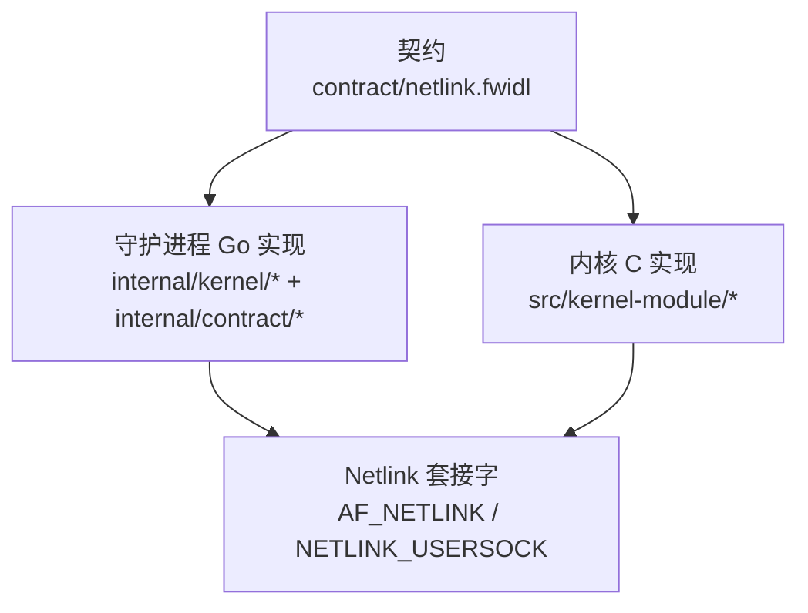
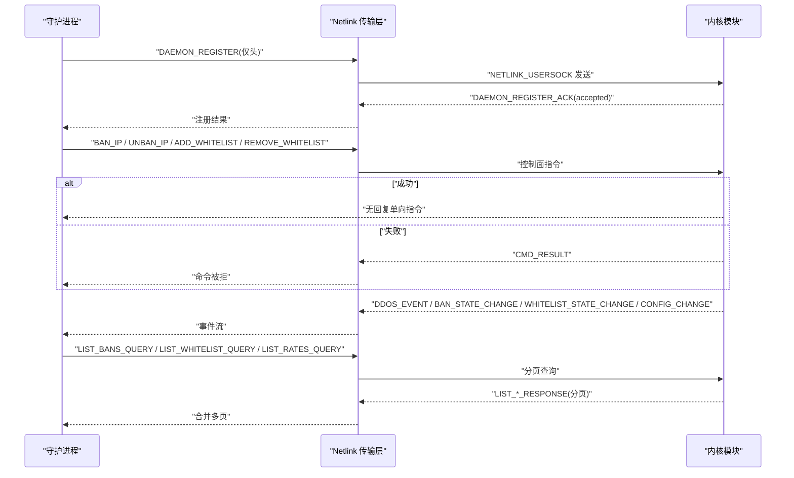
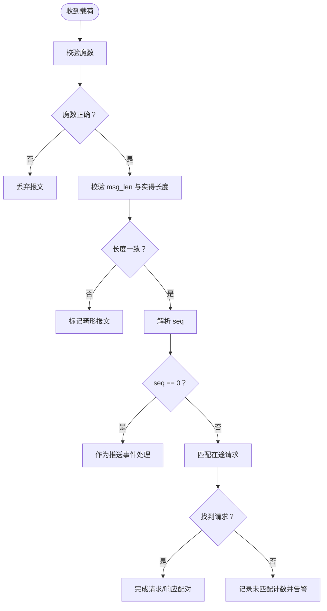
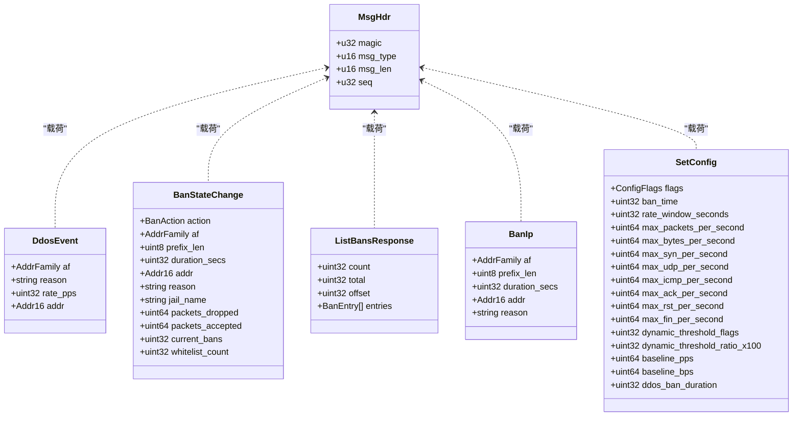
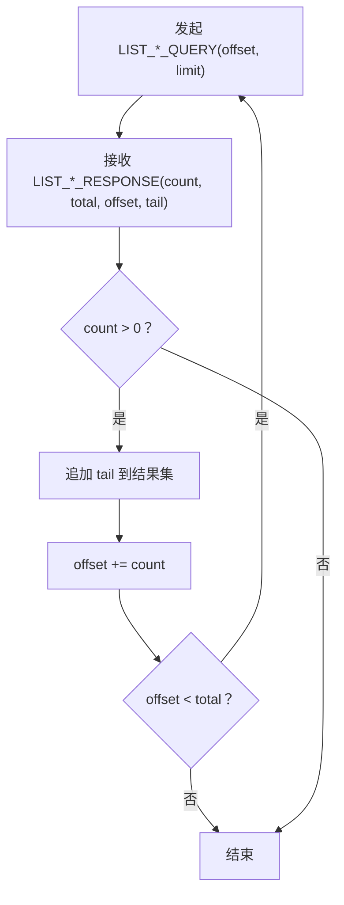
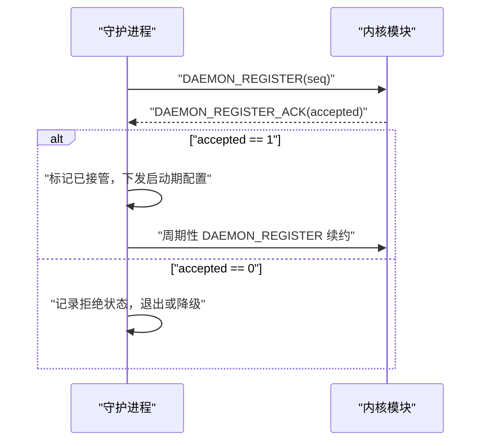
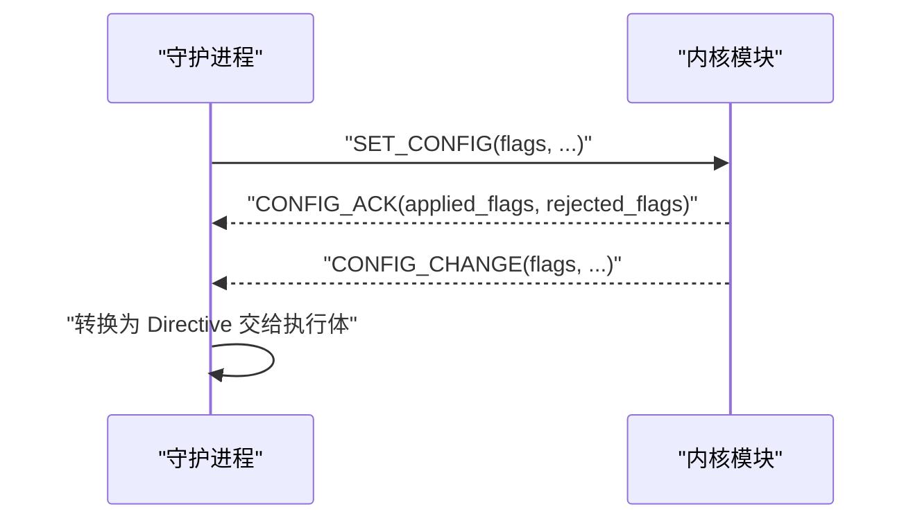
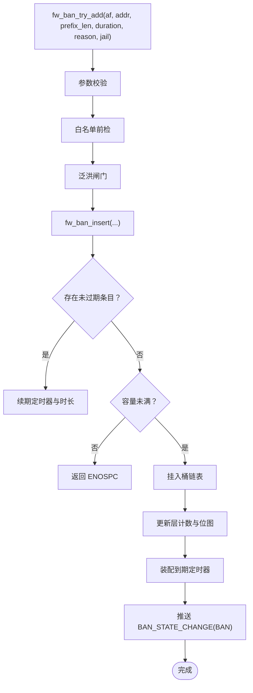
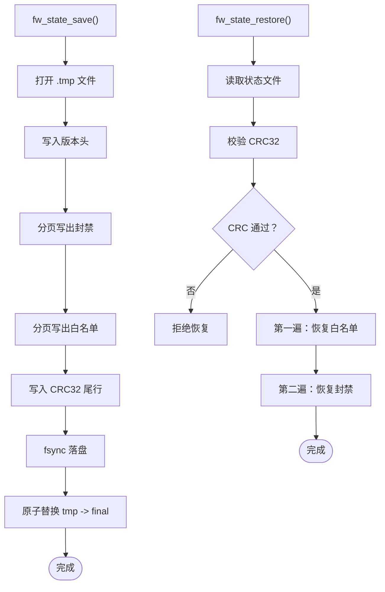
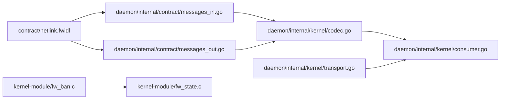

# Netlink内核通信协议

<cite>
**本文引用的文件**   
- [netlink.fwidl](file://contract/netlink.fwidl)
- [transport.go](file://src/daemon/internal/kernel/transport.go)
- [consumer.go](file://src/daemon/internal/kernel/consumer.go)
- [codec.go](file://src/daemon/internal/kernel/codec.go)
- [messages_in.go](file://src/daemon/internal/contract/messages_in.go)
- [messages_out.go](file://src/daemon/internal/contract/messages_out.go)
- [client_test.go](file://src/daemon/internal/kernel/client_test.go)
- [fw_ban.c](file://src/kernel-module/fw_ban.c)
- [fw_state.c](file://src/kernel-module/fw_state.c)
</cite>

## 目录
1. [引言](#引言)
2. [项目结构](#项目结构)
3. [核心组件](#核心组件)
4. [架构总览](#架构总览)
5. [详细组件分析](#详细组件分析)
6. [依赖关系分析](#依赖关系分析)
7. [性能与容量特性](#性能与容量特性)
8. [故障排查指南](#故障排查指南)
9. [结论](#结论)
10. [附录：套接字操作与调试](#附录套接字操作与调试)

## 引言
本文件面向“内核模块 ↔ 守护进程”的 Netlink 控制面通信，目标是建立一份可追溯、可验证、可操作的协议文档。协议以 IDL 为单一真相源，C 侧（内核）与 Go 侧（守护进程）均由同一份 `contract/netlink.fwidl` 生成或校验布局，从而保证消息头、魔数、字节序、字段偏移和分页语义在两端一致。

重点覆盖：
- 公共消息头、魔数校验、序列号配对规则。
- 所有消息类型的载荷结构与语义。
- 分页查询机制与页上限计算。
- 单守护进程注册与配置同步流程。
- 错误处理策略、时序图与调试方法。

## 项目结构
Netlink 协议相关代码分布在三个层次：
- 契约层：`contract/netlink.fwidl` 定义命名空间、魔数、枚举、结构体、消息类型及注释中的线格式约定。
- 守护进程侧：Go 实现包含传输层、事件泵、编解码器以及按方向分类的消息结构。
- 内核侧：C 实现包含封禁表、状态持久化、速率统计等数据结构的读取与序列化。

**图示来源**
- [netlink.fwidl:1-30](file://contract/netlink.fwidl#L1-L30)
- [transport.go:13-17](file://src/daemon/internal/kernel/transport.go#L13-L17)

**章节来源**
- [netlink.fwidl:1-30](file://contract/netlink.fwidl#L1-L30)
- [transport.go:13-17](file://src/daemon/internal/kernel/transport.go#L13-L17)

## 核心组件
- 公共消息头与魔数：所有自定义载荷以固定 12 字节头开始，首字段为魔数，随后是消息类型、含头长度、序列号。
- 传输层：守护进程通过 `AF_NETLINK` 原始套接字收发报文，封装 `nlmsghdr`，并订阅内核广播组。
- 事件泵：消费内核推送事件，周期采样统计、分析、速率表，并对账封禁镜像。
- 编解码器：按 IDL 生成的偏移表和布局解析/编码各消息类型。
- 内核封禁表：支持前缀封禁、RCU 并发读、桶锁、定时器到期解封，并提供分页遍历接口。
- 状态持久化：封禁与白名单快照保存/恢复，带 CRC 校验与容量限制。

**章节来源**
- [netlink.fwidl:108-133](file://contract/netlink.fwidl#L108-L133)
- [transport.go:146-261](file://src/daemon/internal/kernel/transport.go#L146-L261)
- [consumer.go:37-51](file://src/daemon/internal/kernel/consumer.go#L37-L51)
- [codec.go:10-118](file://src/daemon/internal/kernel/codec.go#L10-L118)
- [fw_ban.c:1-41](file://src/kernel-module/fw_ban.c#L1-L41)
- [fw_state.c:1-29](file://src/kernel-module/fw_state.c#L1-L29)

## 架构总览
下图展示内核与守护进程之间的主要交互路径：守护进程发起注册、下发指令、发起查询；内核推送事件、回显响应、拒绝命令。

**图示来源**
- [netlink.fwidl:56-81](file://contract/netlink.fwidl#L56-L81)
- [messages_out.go:406-413](file://src/daemon/internal/contract/messages_out.go#L406-L413)
- [messages_in.go:388-457](file://src/daemon/internal/contract/messages_in.go#L388-L457)
- [consumer.go:311-344](file://src/daemon/internal/kernel/consumer.go#L311-L344)

## 详细组件分析

### 公共消息头、魔数与序列号
- 魔数：固定值用于快速丢弃非本协议报文。
- 消息类型：IDL 中定义的 `MsgType`，涵盖事件、查询、响应、控制指令。
- 消息长度：含头的总长度，守护进程接收端会校验 `nlmsghdr` 声明长度与实得字节数。
- 序列号：
  - 请求/响应配对：守护进程发起的请求使用非零且当前在途唯一的 seq；内核对需要回复的类型原样回填。
  - 推送事件：内核自增 seq，不参与配对；守护进程不得用其匹配在途请求。
  - 违例处理：收到 seq=0 的回显响应视为协议违例；无法匹配在途请求需告警而非静默丢弃。

**图示来源**
- [netlink.fwidl:108-133](file://contract/netlink.fwidl#L108-L133)
- [codec.go:99-118](file://src/daemon/internal/kernel/codec.go#L99-L118)
- [transport.go:264-308](file://src/daemon/internal/kernel/transport.go#L264-L308)

**章节来源**
- [netlink.fwidl:108-133](file://contract/netlink.fwidl#L108-L133)
- [codec.go:99-118](file://src/daemon/internal/kernel/codec.go#L99-L118)
- [transport.go:264-308](file://src/daemon/internal/kernel/transport.go#L264-L308)

### 消息类型与载荷语义
- 内核 → 守护进程：
  - `DDOS_EVENT`：携带地址族、原因、触发速率、地址。
  - `BAN_STATE_CHANGE`：封禁动作、地址族、前缀长度、持续时间、累计包数、当前封禁数、白名单计数等。
  - `WHITELIST_STATE_CHANGE`：白名单动作、地址族、前缀长度、设备名、白名单计数。
  - `CMD_RESULT`：原始命令类型、负值错误码、地址族、地址。
  - `CONFIG_ACK`：实际生效标志位与被拒绝标志位。
  - `CONFIG_CHANGE`：与 `SET_CONFIG` 同布局的配置变更广播。
  - 列表响应：`LIST_BANS_RESPONSE`、`LIST_WHITELIST_RESPONSE`、`LIST_RATES_RESPONSE`，均含 count/total/offset 尾部变长数组。
  - `ANALYSIS_RESPONSE`：定长分析数据，包括包大小分布、TTL 分布、UDP 端口、ICMP 类型、扫描者、探测者。
  - `DAEMON_REGISTER_ACK`：接受或拒绝守护进程注册。
- 守护进程 → 内核：
  - `BAN_IP` / `UNBAN_IP`：封禁/解封 IP，共享载荷布局；前缀长度决定网段封禁能力。
  - `SET_CONFIG`：下发配置，字段与 `CONFIG_CHANGE` 一致。
  - `SET_PROTECTED_PORTS`：受保护端口位图，固定 8KB，位 i 表示端口 i 参与速率判定。
  - 分页查询：`LIST_BANS_QUERY`、`LIST_WHITELIST_QUERY`、`LIST_RATES_QUERY`，含 offset/limit。
  - 白名单变更：`ADD_WHITELIST` / `REMOVE_WHITELIST`。
  - 仅头指令：`STATS_QUERY`、`ANALYSIS_QUERY`、`DAEMON_REGISTER`。

**图示来源**
- [netlink.fwidl:108-133](file://contract/netlink.fwidl#L108-L133)
- [netlink.fwidl:139-191](file://contract/netlink.fwidl#L139-L191)
- [netlink.fwidl:218-237](file://contract/netlink.fwidl#L218-L237)
- [netlink.fwidl:381-420](file://contract/netlink.fwidl#L381-L420)

**章节来源**
- [netlink.fwidl:56-81](file://contract/netlink.fwidl#L56-L81)
- [netlink.fwidl:139-212](file://contract/netlink.fwidl#L139-L212)
- [netlink.fwidl:218-358](file://contract/netlink.fwidl#L218-L358)
- [netlink.fwidl:376-484](file://contract/netlink.fwidl#L376-L484)
- [messages_in.go:8-52](file://src/daemon/internal/contract/messages_in.go#L8-L52)
- [messages_in.go:54-127](file://src/daemon/internal/contract/messages_in.go#L54-L127)
- [messages_in.go:388-457](file://src/daemon/internal/contract/messages_in.go#L388-L457)
- [messages_out.go:7-55](file://src/daemon/internal/contract/messages_out.go#L7-L55)
- [messages_out.go:96-154](file://src/daemon/internal/contract/messages_out.go#L96-L154)

### 分页查询机制
分页查询用于避免单次 Netlink 报文超过 u16 长度上限（≤65535）。三类列表响应统一采用：
- 头部字段：count（本页条目数）、total（内核当前总数）、offset（本页起始下标）。
- 尾部变长数组：BanEntry / WhitelistEntry / RateEntry。
- 页上限计算：由 IDL 布局与 `MsgLenMax` 推导，守护进程侧通过 `MaxTailEntries()` 计算每页最大条目数。

**图示来源**
- [messages_in.go:388-457](file://src/daemon/internal/contract/messages_in.go#L388-L457)
- [messages_in.go:540-609](file://src/daemon/internal/contract/messages_in.go#L540-L609)
- [messages_in.go:664-739](file://src/daemon/internal/contract/messages_in.go#L664-L739)
- [client_test.go:87-163](file://src/daemon/internal/kernel/client_test.go#L87-L163)

**章节来源**
- [netlink.fwidl:230-237](file://contract/netlink.fwidl#L230-L237)
- [netlink.fwidl:264-270](file://contract/netlink.fwidl#L264-L270)
- [netlink.fwidl:302-310](file://contract/netlink.fwidl#L302-L310)
- [messages_in.go:388-457](file://src/daemon/internal/contract/messages_in.go#L388-L457)
- [messages_in.go:540-609](file://src/daemon/internal/contract/messages_in.go#L540-L609)
- [messages_in.go:664-739](file://src/daemon/internal/contract/messages_in.go#L664-L739)
- [client_test.go:87-163](file://src/daemon/internal/kernel/client_test.go#L87-L163)

### 单守护进程注册机制
- 守护进程通过 `DAEMON_REGISTER`（仅头）向内核申请唯一守护进程租约。
- 内核返回 `DAEMON_REGISTER_ACK`，其中 accepted=1 表示接管成功，accepted=0 表示已有活跃守护进程。
- 守护进程侧必须区分链路失败与明确拒绝：前者重试，后者退出以避免双面板。
- 注册成功后，守护进程才允许下发启动期配置；后续按周期续约租约。

**图示来源**
- [netlink.fwidl:360-370](file://contract/netlink.fwidl#L360-L370)
- [consumer.go:311-344](file://src/daemon/internal/kernel/consumer.go#L311-L344)
- [consumer.go:346-365](file://src/daemon/internal/kernel/consumer.go#L346-L365)

**章节来源**
- [netlink.fwidl:360-370](file://contract/netlink.fwidl#L360-L370)
- [consumer.go:311-344](file://src/daemon/internal/kernel/consumer.go#L311-L344)
- [consumer.go:346-365](file://src/daemon/internal/kernel/consumer.go#L346-L365)

### 配置同步流程
- 守护进程通过 `SET_CONFIG` 下发配置，内核返回 `CONFIG_ACK` 告知生效与被拒标志位。
- 内核也可通过 `CONFIG_CHANGE` 广播 procfs 写入导致的配置变更，载荷布局与 `SET_CONFIG` 一致。
- 守护进程将 `CONFIG_CHANGE` 转为反向指令，交由执行体采纳内核配置。

**图示来源**
- [netlink.fwidl:186-212](file://contract/netlink.fwidl#L186-L212)
- [messages_out.go:96-154](file://src/daemon/internal/contract/messages_out.go#L96-L154)
- [consumer.go:381-395](file://src/daemon/internal/kernel/consumer.go#L381-L395)

**章节来源**
- [netlink.fwidl:186-212](file://contract/netlink.fwidl#L186-L212)
- [messages_out.go:96-154](file://src/daemon/internal/contract/messages_out.go#L96-L154)
- [consumer.go:381-395](file://src/daemon/internal/kernel/consumer.go#L381-L395)

### 封禁与解封语义
- 封禁条目身份为 `(af, addr, prefix_len)` 三元组；前缀长度决定网段封禁能力。
- 内核热路径优先查精确层（/32 或 /128），再按位图遍历短前缀层。
- 添加路径查重、续期、容量检查、插入、位图维护、定时器装配、通知推送。
- 删除路径摘链、原子计数递减、位图释放、RCU 释放回调、通知推送。
- 泛洪闸门统一三条封禁路径（procfs、netlink、DDoS 自决）。

**图示来源**
- [fw_ban.c:506-531](file://src/kernel-module/fw_ban.c#L506-L531)
- [fw_ban.c:434-504](file://src/kernel-module/fw_ban.c#L434-L504)
- [fw_ban.c:393-409](file://src/kernel-module/fw_ban.c#L393-L409)

**章节来源**
- [fw_ban.c:1-41](file://src/kernel-module/fw_ban.c#L1-L41)
- [fw_ban.c:369-387](file://src/kernel-module/fw_ban.c#L369-L387)
- [fw_ban.c:434-504](file://src/kernel-module/fw_ban.c#L434-L504)
- [fw_ban.c:506-531](file://src/kernel-module/fw_ban.c#L506-L531)
- [fw_ban.c:533-570](file://src/kernel-module/fw_ban.c#L533-L570)

### 状态持久化与恢复
- 保存：分页收集封禁与白名单条目，写出行格式，末尾附加 CRC32 尾行，原子替换目标文件。
- 恢复：校验 CRC32，先恢复白名单后恢复封禁，保留容量检查与前缀语义。
- 安全：路径白名单、禁止 URL 转义与 shell 元字符、拒绝符号链接。

**图示来源**
- [fw_state.c:281-354](file://src/kernel-module/fw_state.c#L281-L354)
- [fw_state.c:542-653](file://src/kernel-module/fw_state.c#L542-L653)

**章节来源**
- [fw_state.c:1-29](file://src/kernel-module/fw_state.c#L1-L29)
- [fw_state.c:281-354](file://src/kernel-module/fw_state.c#L281-L354)
- [fw_state.c:542-653](file://src/kernel-module/fw_state.c#L542-L653)

## 依赖关系分析
- 契约层驱动守护进程与内核两侧的代码生成与布局校验。
- 守护进程侧：
  - `transport.go` 提供 Netlink 套接字收发、epoll 就绪观察、链路健康计数器。
  - `consumer.go` 组合根装配事件泵，负责注册、采样、对账、域通知。
  - `codec.go` 按类型分派载荷解码，校验魔数与长度。
  - `messages_in.go` / `messages_out.go` 定义各消息结构、偏移表、编解码逻辑。
- 内核侧：
  - `fw_ban.c` 实现封禁表数据结构、热路径查找、添加/删除、分页遍历。
  - `fw_state.c` 实现状态保存与恢复，含 CRC 校验与安全路径校验。

**图示来源**
- [netlink.fwidl:1-30](file://contract/netlink.fwidl#L1-L30)
- [messages_in.go:1-10](file://src/daemon/internal/contract/messages_in.go#L1-L10)
- [messages_out.go:1-10](file://src/daemon/internal/contract/messages_out.go#L1-L10)
- [codec.go:1-10](file://src/daemon/internal/kernel/codec.go#L1-L10)
- [consumer.go:1-21](file://src/daemon/internal/kernel/consumer.go#L1-L21)
- [transport.go:1-11](file://src/daemon/internal/kernel/transport.go#L1-L11)
- [fw_ban.c:1-53](file://src/kernel-module/fw_ban.c#L1-L53)
- [fw_state.c:1-45](file://src/kernel-module/fw_state.c#L1-L45)

**章节来源**
- [netlink.fwidl:1-30](file://contract/netlink.fwidl#L1-L30)
- [messages_in.go:1-10](file://src/daemon/internal/contract/messages_in.go#L1-L10)
- [messages_out.go:1-10](file://src/daemon/internal/contract/messages_out.go#L1-L10)
- [codec.go:1-10](file://src/daemon/internal/kernel/codec.go#L1-L10)
- [consumer.go:1-21](file://src/daemon/internal/kernel/consumer.go#L1-L21)
- [transport.go:1-11](file://src/daemon/internal/kernel/transport.go#L1-L11)
- [fw_ban.c:1-53](file://src/kernel-module/fw_ban.c#L1-L53)
- [fw_state.c:1-45](file://src/kernel-module/fw_state.c#L1-L45)

## 性能与容量特性
- 单条报文上限：u16 承载 `msg_len`，最大 65535 字节；守护进程接收缓冲取 128 KiB 以区分正常分页与非契约行为截断。
- 分页容量：各列表响应的尾部容量由 IDL 布局与 `MsgLenMax` 推导，守护进程测试断言页上限与契约一致。
- 内核封禁表容量：默认上限 65535，超限拒绝并递增拒绝计数；泛洪闸门限制每秒新增封禁数量。
- 速率统计历史：旧实现无分页导致单条响应可达数 MB，现强制分页避免 GFP_ATOMIC 大分配与 msg_len 回绕。

**章节来源**
- [transport.go:34-41](file://src/daemon/internal/kernel/transport.go#L34-L41)
- [client_test.go:183-207](file://src/daemon/internal/kernel/client_test.go#L183-L207)
- [fw_ban.c:1-41](file://src/kernel-module/fw_ban.c#L1-L41)
- [netlink.fwidl:295-301](file://contract/netlink.fwidl#L295-L301)

## 故障排查指南
- 魔数不匹配：守护进程解码器直接报错，内核侧应丢弃该报文。
- 长度不一致：守护进程 `TryRecv` 检测 `nlmsg_len` 与实得字节数矛盾，上报畸形报文。
- 序列号冲突：守护进程测试覆盖序号回绕跳过 0、重复 seq 映射为特定错误。
- 注册被拒：守护进程记录拒绝状态并退出，避免双面板；链路失败则重试。
- 命令被拒：内核通过 `CMD_RESULT` 通知失败原因，守护进程从镜像撤销并通知执行体。
- 分页异常：空页收尾、offset 不推进防御性终止、total 撒谎时靠空页收尾。

**章节来源**
- [codec.go:99-118](file://src/daemon/internal/kernel/codec.go#L99-L118)
- [transport.go:264-308](file://src/daemon/internal/kernel/transport.go#L264-L308)
- [client_test.go:20-36](file://src/daemon/internal/kernel/client_test.go#L20-L36)
- [client_test.go:38-76](file://src/daemon/internal/kernel/client_test.go#L38-L76)
- [consumer.go:311-344](file://src/daemon/internal/kernel/consumer.go#L311-L344)
- [consumer.go:499-549](file://src/daemon/internal/kernel/consumer.go#L499-L549)
- [client_test.go:123-163](file://src/daemon/internal/kernel/client_test.go#L123-L163)

## 结论
本 Netlink 协议以 IDL 为单一真相源，通过魔数、大端布局、紧凑结构、显式填充与分页约束，确保内核与守护进程在消息格式与语义上严格一致。守护进程侧的传输层、事件泵与编解码器共同保障可靠收发、事件消费、周期采样与对账；内核侧的封禁表与状态持久化提供高性能、并发安全的数据结构与恢复能力。单守护进程注册机制防止双面板冲突，配置同步流程保证控制面与数据面一致性。

## 附录：套接字操作与调试
- 套接字创建：使用 `AF_NETLINK` 与 `NETLINK_USERSOCK`，绑定 portid=0 由内核分配，groups=1 订阅内核广播组。
- 发送封装：守护进程内部补 `nlmsghdr`，`nlmsg_type` 与 `nlmsg_seq` 写 0，内核按自定义头里的 `msg_type` 分派。
- 接收处理：设置 `SO_RCVTIMEO`，使用 `MSG_TRUNC` 获取真实长度，区分截断与正常收完。
- 就绪观察：epoll 监听 socket 与 eventfd，链路断开立即打断等待。
- 调试建议：
  - 观察守护进程指标：发送/接收计数、发送/接收错误计数。
  - 检查注册状态：是否收到 `DAEMON_REGISTER_ACK` 且 accepted=1。
  - 核对分页：确认 `count/total/offset` 与尾部条目数一致。
  - 查看内核日志：封禁容量拒绝、泛洪闸门拒绝、白名单拒绝等。

**章节来源**
- [transport.go:146-261](file://src/daemon/internal/kernel/transport.go#L146-L261)
- [transport.go:206-231](file://src/daemon/internal/kernel/transport.go#L206-L231)
- [transport.go:264-308](file://src/daemon/internal/kernel/transport.go#L264-L308)
- [transport.go:310-397](file://src/daemon/internal/kernel/transport.go#L310-L397)