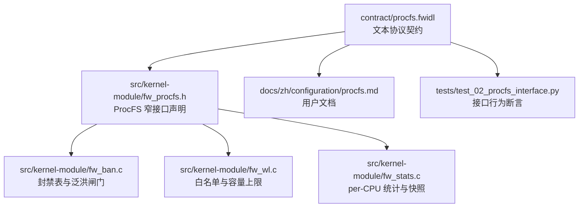
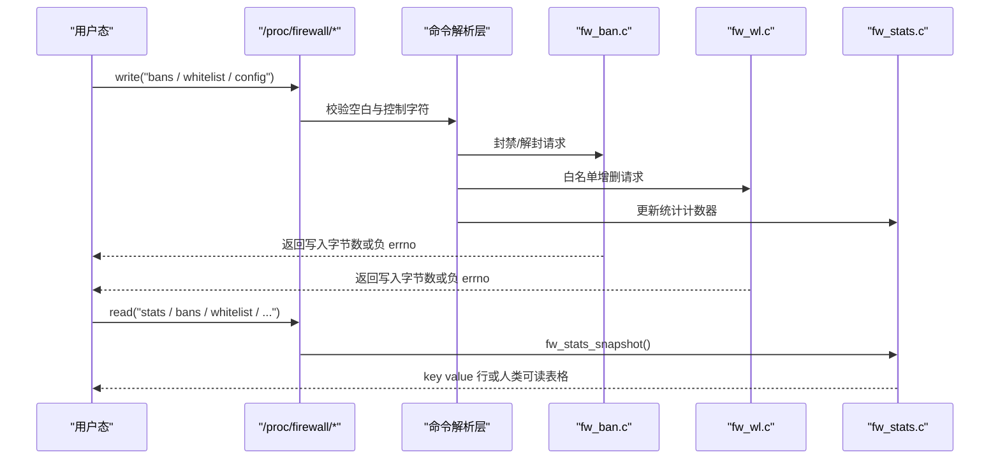
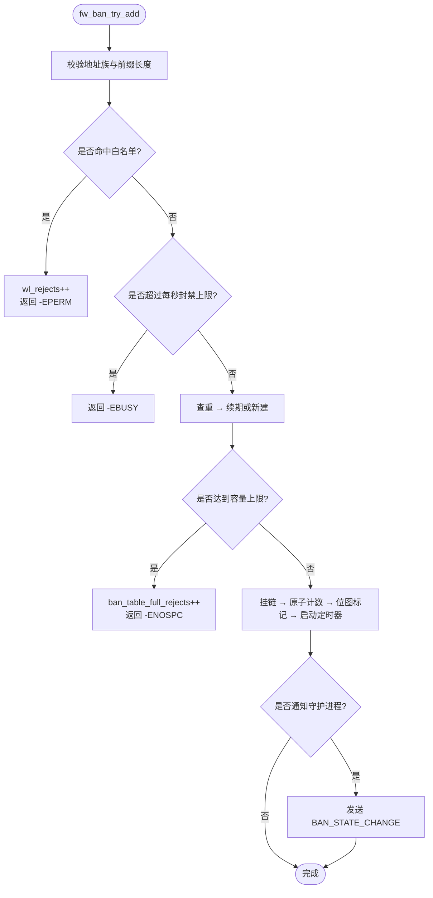
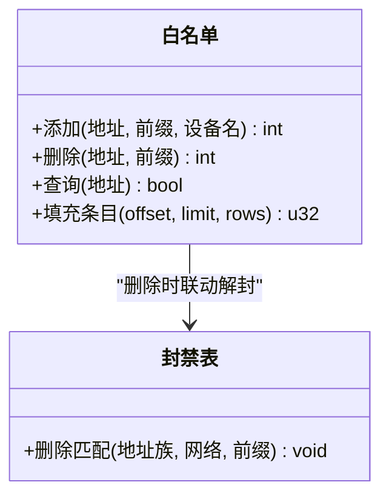
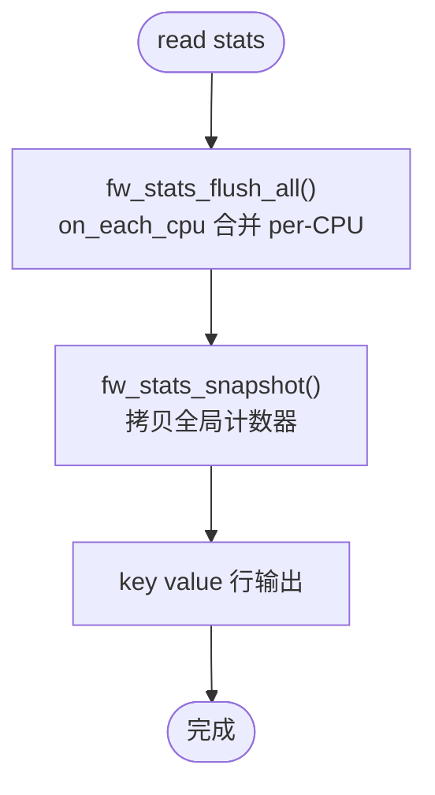
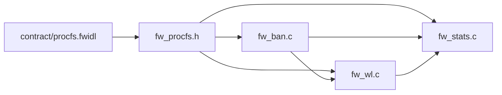

# ProcFS运维接口

<cite>
**本文引用的文件**   
- [contract/procfs.fwidl](file://contract/procfs.fwidl)
- [src/kernel-module/fw_procfs.h](file://src/kernel-module/fw_procfs.h)
- [src/kernel-module/fw_ban.c](file://src/kernel-module/fw_ban.c)
- [src/kernel-module/fw_wl.c](file://src/kernel-module/fw_wl.c)
- [src/kernel-module/fw_stats.c](file://src/kernel-module/fw_stats.c)
- [docs/zh/configuration/procfs.md](file://docs/zh/configuration/procfs.md)
- [tests/test_02_procfs_interface.py](file://tests/test_02_procfs_interface.py)
</cite>

## 目录
1. [简介](#简介)
2. [项目结构](#项目结构)
3. [核心组件](#核心组件)
4. [架构总览](#架构总览)
5. [详细组件分析](#详细组件分析)
6. [依赖关系分析](#依赖关系分析)
7. [性能与一致性](#性能与一致性)
8. [运维操作手册](#运维操作手册)
9. [故障排查指南](#故障排查指南)
10. [结论](#结论)

## 简介
本文件面向运维与内核模块开发者，系统性说明 Linux ProcFS 运维接口的实现原理、数据契约、读写语法、权限模型、动态重载机制、统计口径、热更新流程以及安全与性能注意事项。该接口以 `/proc/firewall` 为根目录，提供封禁、白名单、运行时配置、统计与分析等能力；其中 `stats` 是唯一机器可读的键值输出，其余只读条目属于人类可读表格，不承诺稳定格式。

## 项目结构
ProcFS 相关代码集中在内核模块侧，契约定义位于独立 IDL 文件，文档与测试分别维护在 docs 与 tests 目录：

**图示来源**
- [contract/procfs.fwidl:1-457](file://contract/procfs.fwidl#L1-L457)
- [src/kernel-module/fw_procfs.h:1-28](file://src/kernel-module/fw_procfs.h#L1-L28)
- [src/kernel-module/fw_ban.c:1-674](file://src/kernel-module/fw_ban.c#L1-L674)
- [src/kernel-module/fw_wl.c:1-311](file://src/kernel-module/fw_wl.c#L1-L311)
- [src/kernel-module/fw_stats.c:1-460](file://src/kernel-module/fw_stats.c#L1-L460)
- [docs/zh/configuration/procfs.md:1-270](file://docs/zh/configuration/procfs.md#L1-L270)
- [tests/test_02_procfs_interface.py:1-69](file://tests/test_02_procfs_interface.py#L1-L69)

**章节来源**
- [contract/procfs.fwidl:1-457](file://contract/procfs.fwidl#L1-L457)
- [src/kernel-module/fw_procfs.h:1-28](file://src/kernel-module/fw_procfs.h#L1-L28)

## 核心组件
- 契约层：`contract/procfs.fwidl` 冻结了 `/proc/firewall` 的文件名、权限、读写文法、字段名、容量上限与缺陷处置结论。
- 接口层：`fw_procfs.h` 声明创建与销毁 `/proc/firewall` 及其全部条目的入口，并强调 stats 的机器可读契约与 per-CPU 刷新纪律。
- 业务层：
  - `fw_ban.c`：封禁表（按前缀分层桶 + RCU + 定时器）、容量上限、泛洪闸门、分页遍历。
  - `fw_wl.c`：白名单（精确桶 + 子网链表）、容量上限、本机地址保护、联动解封。
  - `fw_stats.c`：per-CPU 计数、flush 合并、全局快照、UDP/ICMP 分布、扫描与探测聚合。

**章节来源**
- [contract/procfs.fwidl:30-164](file://contract/procfs.fwidl#L30-L164)
- [src/kernel-module/fw_procfs.h:1-28](file://src/kernel-module/fw_procfs.h#L1-L28)
- [src/kernel-module/fw_ban.c:1-674](file://src/kernel-module/fw_ban.c#L1-L674)
- [src/kernel-module/fw_wl.c:1-311](file://src/kernel-module/fw_wl.c#L1-L311)
- [src/kernel-module/fw_stats.c:1-460](file://src/kernel-module/fw_stats.c#L1-L460)

## 架构总览
ProcFS 是内核态与用户态之间的文本协议通道：用户通过 `write(2)` 下发命令，通过 `read(2)` 读取状态或统计；内核侧解析命令后调用封禁、白名单与统计子系统，必要时通过 netlink 向守护进程推送事件。

**图示来源**
- [contract/procfs.fwidl:18-26](file://contract/procfs.fwidl#L18-L26)
- [contract/procfs.fwidl:170-190](file://contract/procfs.fwidl#L170-L190)
- [src/kernel-module/fw_stats.c:376-392](file://src/kernel-module/fw_stats.c#L376-L392)

## 详细组件分析

### 封禁子系统（bans）
- 数据结构：按 IPv4/IPv6 分表，每表按前缀长度分层，短前缀层使用小桶数组，全长层复用主哈希桶；层内桶锁 + RCU 读路径，条目自带到期定时器。
- 容量上限：默认 65535，由模块参数控制；到限返回 `-ENOSPC` 并递增 `ban_table_full_rejects`。
- 泛洪闸门：统一封装为 `fw_ban_flood_allow()`，procfs、netlink、DDoS 自决三条路径共用，超阈值返回 `-EBUSY`。
- 白名单优先：插入前检查白名单，命中直接拒绝并计数。
- 读侧：支持 offset/limit 分页遍历，兼容 netlink 列表分页语义。

**图示来源**
- [src/kernel-module/fw_ban.c:429-531](file://src/kernel-module/fw_ban.c#L429-L531)
- [src/kernel-module/fw_ban.c:393-423](file://src/kernel-module/fw_ban.c#L393-L423)

**章节来源**
- [src/kernel-module/fw_ban.c:1-674](file://src/kernel-module/fw_ban.c#L1-L674)
- [contract/procfs.fwidl:45-50](file://contract/procfs.fwidl#L45-L50)
- [contract/procfs.fwidl:227-231](file://contract/procfs.fwidl#L227-L231)

### 白名单子系统（whitelist）
- 数据结构：精确主机条目进入哈希桶；子网条目同时进入哈希桶与子网链表；查找先查精确桶，再遍历子网链表。
- 容量上限：默认 65535，插入前在锁内原子检查，到限递增 `wl_reject_count` 并返回 `-ENOSPC`。
- 本机地址保护：不允许从白名单直接删除本机接口地址，返回 `-EPERM`。
- 联动解封：删除白名单时，解除落在其覆盖范围内的所有封禁。

**图示来源**
- [src/kernel-module/fw_wl.c:157-245](file://src/kernel-module/fw_wl.c#L157-L245)
- [src/kernel-module/fw_ban.c:577-611](file://src/kernel-module/fw_ban.c#L577-L611)

**章节来源**
- [src/kernel-module/fw_wl.c:1-311](file://src/kernel-module/fw_wl.c#L1-L311)
- [contract/procfs.fwidl:52-56](file://contract/procfs.fwidl#L52-L56)
- [contract/procfs.fwidl:233-237](file://contract/procfs.fwidl#L233-L237)

### 统计与分析子系统（stats、rates、udp_ports、icmp_types、pkt_sizes、ttl_dist、ip_frags、port_scanners、service_probes、protected_ports）
- per-CPU 设计：热路径仅写当前 CPU 槽，避免共享 cache line 竞争；读侧统一经 `fw_stats_flush_all()` 合并后再取快照。
- 机器可读契约：`stats` 的 13 个 key 名称与数值类型受契约约束，测试逐行断言值为十进制整数。
- 分析分布：UDP 端口与 ICMP 类型采用 per-CPU 直接映射槽 + flush 时并入全局哈希表；单次快照展示行数受常量限制。
- 速率表溢出：速率表满时有意放行新源地址，并通过 `rate_slot_spill` 观测溢出次数。

**图示来源**
- [src/kernel-module/fw_stats.c:338-392](file://src/kernel-module/fw_stats.c#L338-L392)
- [contract/procfs.fwidl:196-216](file://contract/procfs.fwidl#L196-L216)

**章节来源**
- [src/kernel-module/fw_stats.c:1-460](file://src/kernel-module/fw_stats.c#L1-L460)
- [contract/procfs.fwidl:92-164](file://contract/procfs.fwidl#L92-L164)
- [tests/test_02_procfs_interface.py:59-69](file://tests/test_02_procfs_interface.py#L59-L69)

## 依赖关系分析
- 契约驱动：`procfs.fwidl` 是单一真相源，生成物与文档必须与其一致；契约中记录的缺陷处置结论会被校验器核对源码锚点。
- 模块耦合：
  - `fw_procfs.h` 依赖 `fw_types.h` 提供的基础类型与常量。
  - `fw_ban.c` 依赖 `fw_wl.c`（白名单优先）、`fw_stats.c`（计数器）、`fw_netlink.h`（事件上报）。
  - `fw_wl.c` 依赖 `fw_local.h`（本机地址判定）、`fw_stats.c`（拒绝计数）。
  - `fw_stats.c` 依赖 `fw_rate.h`（速率表扫描与探测聚合）。

**图示来源**
- [contract/procfs.fwidl:1-457](file://contract/procfs.fwidl#L1-L457)
- [src/kernel-module/fw_procfs.h:1-28](file://src/kernel-module/fw_procfs.h#L1-L28)
- [src/kernel-module/fw_ban.c:1-674](file://src/kernel-module/fw_ban.c#L1-L674)
- [src/kernel-module/fw_wl.c:1-311](file://src/kernel-module/fw_wl.c#L1-L311)
- [src/kernel-module/fw_stats.c:1-460](file://src/kernel-module/fw_stats.c#L1-L460)

**章节来源**
- [contract/procfs.fwidl:1-457](file://contract/procfs.fwidl#L1-L457)
- [src/kernel-module/fw_procfs.h:1-28](file://src/kernel-module/fw_procfs.h#L1-L28)

## 性能与一致性
- 热路径零共享写：统计类计数走 per-CPU 槽，flush 时才合并到全局，降低多核并发下的缓存行竞争。
- 一致性保证：
  - 读侧统一调用 `fw_stats_snapshot()`，内部先 flush 再取快照，避免陈旧值。
  - 封禁与白名单均使用 RCU 与桶锁，读路径无锁遍历，写路径在细粒度锁内更新。
- 容量与溢出：
  - 封禁表与白名单有明确容量上限，到限返回错误并计数。
  - 速率表满时放行新源地址，通过 `rate_slot_spill` 暴露溢出观测。
- 稳定性约束：
  - `stats` 的 key 与数值类型不可随意变更，下游脚本与测试依赖其稳定性。
  - 其他只读条目标注为 unstable，允许排版变化，不应被当作机器可读接口。

**章节来源**
- [src/kernel-module/fw_stats.c:100-155](file://src/kernel-module/fw_stats.c#L100-L155)
- [src/kernel-module/fw_stats.c:338-392](file://src/kernel-module/fw_stats.c#L338-L392)
- [contract/procfs.fwidl:196-216](file://contract/procfs.fwidl#L196-L216)
- [contract/procfs.fwidl:227-273](file://contract/procfs.fwidl#L227-L273)

## 运维操作手册

### 文件清单与权限
- 可写文件：`bans`、`whitelist`、`config`，权限均为 `0600`，仅 root 可读写。
- 只读文件：`stats`（`0400`）、`rates`、`udp_ports`、`icmp_types`、`pkt_sizes`、`ttl_dist`、`ip_frags`、`port_scanners`、`service_probes`、`protected_ports`。

**章节来源**
- [contract/procfs.fwidl:71-164](file://contract/procfs.fwidl#L71-L164)
- [docs/zh/configuration/procfs.md:11-30](file://docs/zh/configuration/procfs.md#L11-L30)

### 写侧通用规则
- 一次 `write(2)` 一条命令，末尾可选换行。
- 成功返回写入字节数；失败返回负 errno，无文本错误通道。
- 分隔符为空格或制表符，不接受多余 token。
- 除制表符外，所有小于 `0x20` 的控制字符一律拒绝。

**章节来源**
- [contract/procfs.fwidl:18-26](file://contract/procfs.fwidl#L18-L26)
- [docs/zh/configuration/procfs.md:32-42](file://docs/zh/configuration/procfs.md#L32-L42)

### bans 操作
- 写法：
  - `<ip>`：使用内核默认时长封禁。
  - `<ip> <seconds>`：指定时长，范围 1..31536000。
  - `<ip> 0`：永久封禁。
  - `unban <ip>`：解封。
- 注意：
  - 时长必须是纯十进制数字。
  - `<ip>` 只接受单个地址，不认 CIDR；网段封禁需经守护进程 netlink。
  - `unban` 后不允许再跟其他参数。

**章节来源**
- [contract/procfs.fwidl:170-175](file://contract/procfs.fwidl#L170-L175)
- [docs/zh/configuration/procfs.md:44-59](file://docs/zh/configuration/procfs.md#L44-L59)

### whitelist 操作
- 写法：
  - `add <subnet>`：添加白名单。
  - `<subnet>`：省略动词即添加。
  - `remove <subnet>`：删除白名单。
- 注意：
  - `<subnet>` 可为地址或地址/前缀；无前缀时按地址族补齐。
  - 入表前归一化为网络地址，主机位清零。
  - 禁止加入特殊地址（如回环、链路本地等）。
  - 删除会联动解除覆盖范围内的封禁。

**章节来源**
- [contract/procfs.fwidl:182-186](file://contract/procfs.fwidl#L182-L186)
- [docs/zh/configuration/procfs.md:91-139](file://docs/zh/configuration/procfs.md#L91-L139)

### config 动态重载
- 读：查看运行时配置，包括默认封禁时长与条目计数。
- 写：仅支持 `ban_time <seconds>`，取值 1..31536000；非法参数返回 `-EINVAL`。
- 热更新：写成功后立即生效，无需重启模块。

**章节来源**
- [contract/procfs.fwidl:188-190](file://contract/procfs.fwidl#L188-L190)
- [docs/zh/configuration/procfs.md:140-163](file://docs/zh/configuration/procfs.md#L140-L163)

### stats 实时获取
- 格式：每行 `<key> <十进制整数>`，共 13 个 key。
- 关键字段：
  - `total_bans`、`total_unbans`：累计封禁/解封次数。
  - `whitelist_rejects`：白名单拒绝计数。
  - `ban_table_full_rejects`：封禁表容量拒绝计数。
  - `alloc_failures`：内存分配失败计数。
  - `packets_dropped`、`packets_accepted`：丢弃/放行包数。
  - `tcp_anomaly_dropped`：TCP 异常丢弃包数。
  - `cleanup_cycles`：恒为 0，保留兼容性。
  - `cleanup_expired_total`：到期摘除封禁总数。
  - `current_bans`、`current_whitelist`：当前条目数。
  - `recent_additions`：一秒窗口内新增封禁计数。

**章节来源**
- [contract/procfs.fwidl:196-216](file://contract/procfs.fwidl#L196-L216)
- [docs/zh/configuration/procfs.md:165-195](file://docs/zh/configuration/procfs.md#L165-L195)

### 其他只读条目
- `rates`：速率表头 + 明细行（地址、包数、字节数、窗口秒）。
- `udp_ports`：UDP 端口分布，含总量与明细。
- `icmp_types`：ICMP 类型与代码分布。
- `pkt_sizes`：包大小分布（固定区间 + 百分比）。
- `ttl_dist`：TTL 分布（固定区间 + 百分比）。
- `ip_frags`：IP 分片统计。
- `port_scanners`：端口扫描嫌疑地址（最多 20 条）。
- `service_probes`：服务探测嫌疑地址（最多 20 条）。
- `protected_ports`：受保护端口集合（守护进程下发，只读）。

**章节来源**
- [contract/procfs.fwidl:99-164](file://contract/procfs.fwidl#L99-L164)
- [docs/zh/configuration/procfs.md:197-229](file://docs/zh/configuration/procfs.md#L197-L229)

## 故障排查指南
- 写命令未生效：
  - 查看内核日志确认拒绝原因。
  - 检查目标是否被白名单保护。
  - 检查封禁表是否达到容量上限。
  - 使用 `tee` 观察写入返回值，非 0 表示内核返回负 errno。
- 常见 errno：
  - `-EINVAL`：参数非法或格式错误。
  - `-EBUSY`：泛洪闸门触发。
  - `-ENOMEM`：内存分配失败。
  - `-EPERM`：白名单保护或本机地址保护。
  - `-ENOSPC`：容量上限到达。

**章节来源**
- [docs/zh/configuration/procfs.md:251-270](file://docs/zh/configuration/procfs.md#L251-L270)
- [contract/procfs.fwidl:339-345](file://contract/procfs.fwidl#L339-L345)

## 结论
ProcFS 运维接口以契约为中心，将内核态的封禁、白名单与统计能力暴露给用户态。其设计强调：
- 契约冻结接口，生成物与文档必须同步。
- 热路径高性能，冷路径强一致性。
- 容量与溢出可观测，错误码可区分。
- 白名单优先、本机地址保护、泛洪闸门统一。
运维人员应严格遵循写侧文法与权限要求，优先使用 `stats` 进行监控，并将人类可读表格视为不稳定输出。