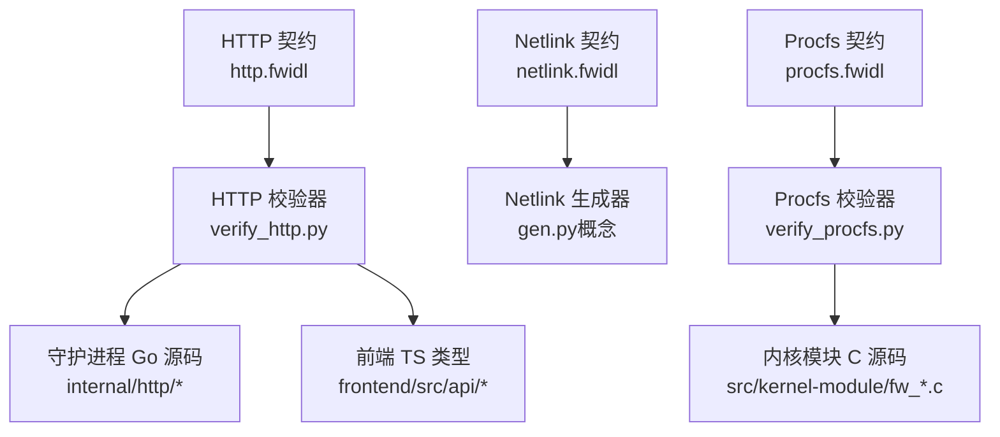
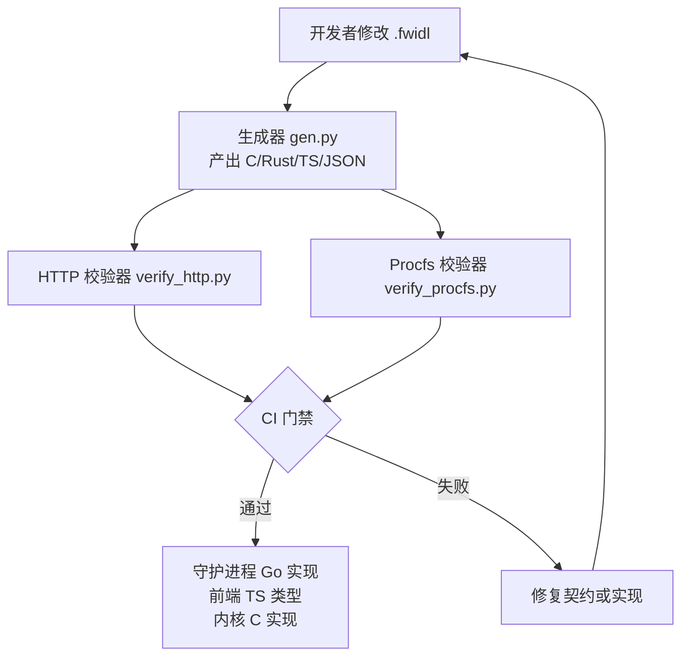
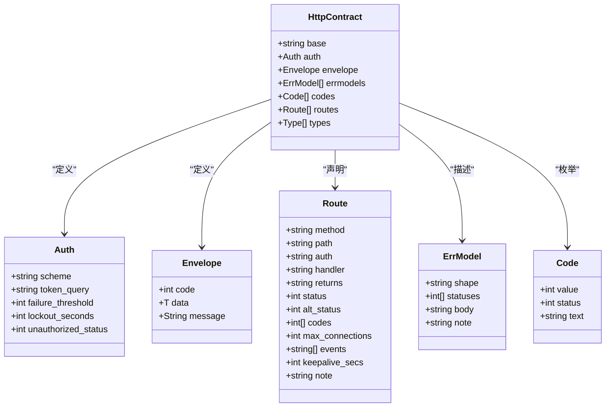
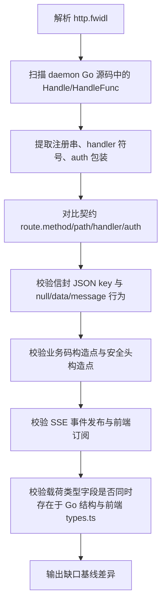
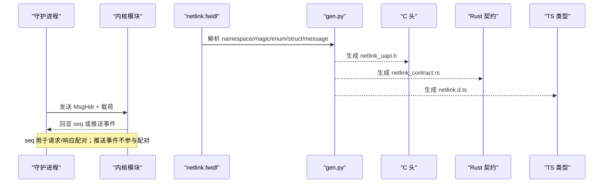
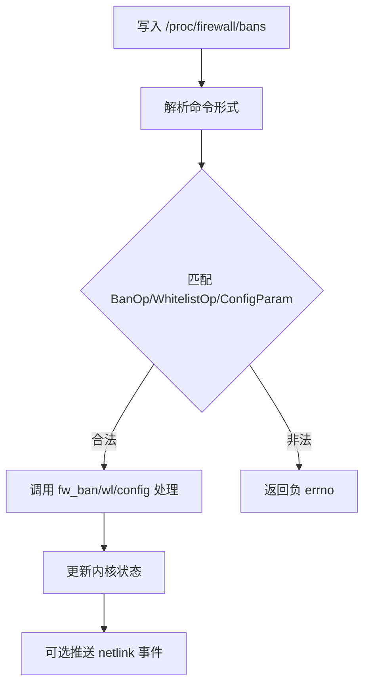
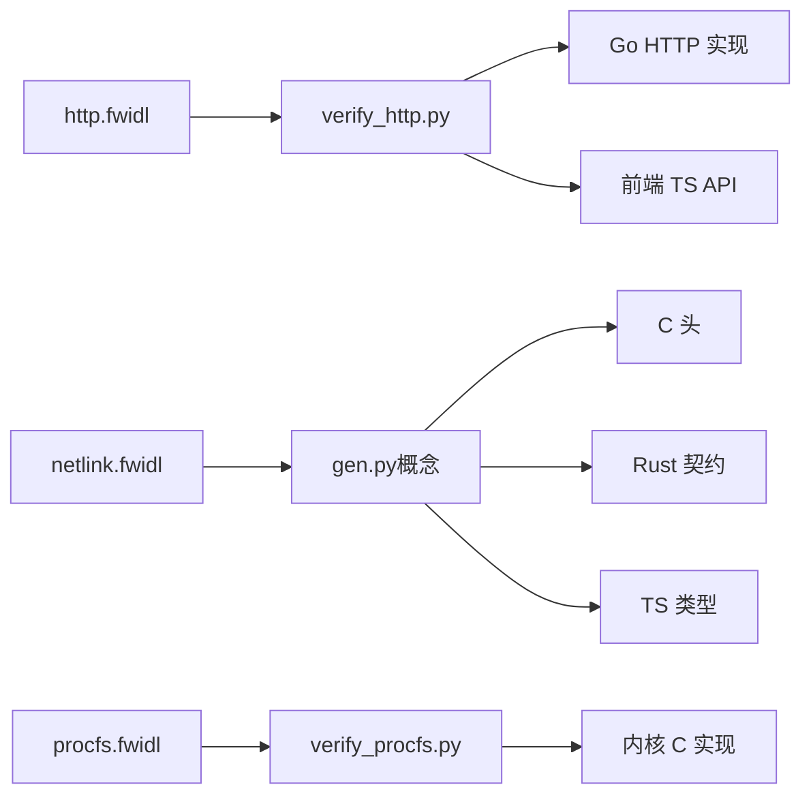

# 契约驱动开发系统

<cite>
**本文引用的文件**   
- [http.fwidl](file://contract/http.fwidl)
- [netlink.fwidl](file://contract/netlink.fwidl)
- [procfs.fwidl](file://contract/procfs.fwidl)
- [verify_http.py](file://contract/verify_http.py)
- [verify_procfs.py](file://contract/verify_procfs.py)
- [routes.go](file://src/daemon/internal/http/routes.go)
- [auth.go](file://src/daemon/internal/http/auth.go)
- [sse.go](file://src/daemon/internal/http/sse.go)
- [envelope.go](file://src/daemon/internal/http/envelope.go)
- [server.go](file://src/daemon/internal/http/server.go)
- [static.go](file://src/daemon/internal/http/static.go)
- [bans.go](file://src/daemon/internal/http/bans.go)
- [consumer.go](file://src/daemon/internal/kernel/consumer.go)
- [executor.go](file://src/daemon/internal/runtime/executor.go)
- [types.ts](file://frontend/src/api/types.ts)
- [endpoints.ts](file://frontend/src/api/endpoints.ts)
- [Makefile](file://Makefile)
</cite>

## 目录
1. [引言](#引言)
2. [项目结构](#项目结构)
3. [核心组件](#核心组件)
4. [架构总览](#架构总览)
5. [详细组件分析](#详细组件分析)
6. [依赖关系分析](#依赖关系分析)
7. [性能与可扩展性](#性能与可扩展性)
8. [故障排查指南](#故障排查指南)
9. [结论](#结论)
10. [附录：语法参考与最佳实践](#附录语法参考与最佳实践)

## 引言
本仓库的“契约驱动开发系统”围绕三份 `.fwidl` 契约展开：  
- `netlink.fwidl`：内核模块与守护进程之间的二进制 netlink 线格式契约。  
- `procfs.fwidl`：运维侧 `/proc/firewall/*` 文本接口契约。  
- `http.fwidl`：守护进程与前端之间的 HTTP API、路由表、JSON 载荷与安全头契约。

这套系统的目标是把“谁对什么数据负责”写进可被机械检查的文件，而不是散落在实现注释里；任何一处漂移（字段名、状态码、连接上限、布局偏移）都会让门禁失败，从而避免只在运行期才暴露的跨层不一致问题。

## 项目结构
契约相关代码集中在 `contract/` 目录：
- `*.fwidl`：人类可读的单一真相源。
- `generated/`：由生成器产出的 C/Rust/TS/JSON 等产物（当前仓库中该目录为空，说明生成步骤尚未执行或产物未提交）。
- `verify_*.py`：校验器，把契约与真实实现逐项核对。

**图示来源**  
- [http.fwidl:1-44](file://contract/http.fwidl#L1-L44)  
- [netlink.fwidl:1-30](file://contract/netlink.fwidl#L1-L30)  
- [procfs.fwidl:1-28](file://contract/procfs.fwidl#L1-L28)  
- [verify_http.py:1-77](file://contract/verify_http.py#L1-L77)  
- [verify_procfs.py:1-37](file://contract/verify_procfs.py#L1-L37)

**章节来源**  
- [http.fwidl:1-44](file://contract/http.fwidl#L1-L44)  
- [netlink.fwidl:1-30](file://contract/netlink.fwidl#L1-L30)  
- [procfs.fwidl:1-28](file://contract/procfs.fwidl#L1-L28)

## 核心组件
### 三份契约的职责边界
| 契约 | 职责 | 主要读者 | 关键约束 |
|---|---|---|---|
| `http.fwidl` | 路由表、鉴权语义、统一信封、业务码、SSE 事件、安全头、JSON 载荷 | 前端、Go 守护进程 | 注册串必须与 `Handle("METHOD /path", ...)` 逐字一致；每条路由必须有对应 handler 与 auth 组 |
| `netlink.fwidl` | 消息类型、结构体布局、字节序、分页参数、序列号配对 | 内核模块、守护进程 | 所有结构 packed、多字节整数大端、变长响应必须分页 |
| `procfs.fwidl` | 可写命令文法、只读 key/value 行、容量上限、缺陷处置锚点 | 运维脚本、内核 procfs 实现 | `machine` 文件 key 顺序与格式符不得随意改动 |

**章节来源**  
- [http.fwidl:1-44](file://contract/http.fwidl#L1-L44)  
- [netlink.fwidl:1-30](file://contract/netlink.fwidl#L1-L30)  
- [procfs.fwidl:1-28](file://contract/procfs.fwidl#L1-L28)

### 校验器与生成器
- `verify_http.py`：不只看契约自洽，还扫描 daemon 的 Go 源码和前端 TS 类型，核对路由注册、认证常量、SSE 上限、信封形状、业务码构造点、安全头、载荷字段、跨层字段。
- `verify_procfs.py`：核对 procfs 条目名与权限、stats key 与格式符、写命令 token、容量常量、defect where/fix 锚点，并尝试编译生成的 C 头。
- `gen.py`：在仓库中未找到具体实现，但契约注释明确它是 netlink 与 procfs 的 IDL 到 C/Rust/TS/JSON 的生成器。

**章节来源**  
- [verify_http.py:1-77](file://contract/verify_http.py#L1-L77)  
- [verify_procfs.py:1-37](file://contract/verify_procfs.py#L1-L37)  
- [netlink.fwidl:4-9](file://contract/netlink.fwidl#L4-L9)

## 架构总览
契约驱动流程可以理解为“定义 → 生成 → 校验 → 使用”的闭环：

**图示来源**  
- [http.fwidl:34-43](file://contract/http.fwidl#L34-L43)  
- [netlink.fwidl:4-9](file://contract/netlink.fwidl#L4-L9)  
- [verify_http.py:70-77](file://contract/verify_http.py#L70-L77)  
- [verify_procfs.py:34-37](file://contract/verify_procfs.py#L34-L37)

## 详细组件分析

### HTTP 契约与校验器
#### 设计要点
- 统一信封：成功时 `code=0`、`data` 存在；失败时 `data=null`、`message` 存在。
- 错误模型分三类：纯文本、框架默认、信封错误。
- SSE 两条流各自有连接上限：`/api/v2/events` 为 10，`/api/v2/logs/stream` 为 5。
- 安全头对所有路由生效，Web UI 分支有独立 CSP。
- 业务码与 HTTP 状态码是两套编号。

**图示来源**  
- [http.fwidl:44-167](file://contract/http.fwidl#L44-L167)  
- [http.fwidl:362-511](file://contract/http.fwidl#L362-L511)

#### 校验逻辑概览

**图示来源**  
- [verify_http.py:17-63](file://contract/verify_http.py#L17-L63)  
- [verify_http.py:348-680](file://contract/verify_http.py#L348-L680)

**章节来源**  
- [http.fwidl:44-167](file://contract/http.fwidl#L44-L167)  
- [http.fwidl:362-511](file://contract/http.fwidl#L362-L511)  
- [verify_http.py:17-63](file://contract/verify_http.py#L17-L63)  
- [verify_http.py:348-680](file://contract/verify_http.py#L348-L680)

### Netlink 契约与三端适配
#### 线格式约定
- 所有结构体 packed，无隐式填充。
- 多字节整数为大端。
- 需要填充的位置必须显式写出 `u8[N]`。
- 地址为裸字节数组，字符串为 NUL 结尾定长数组。
- 查询响应必须分页，长度受 `msg_len`（u16）限制。

**图示来源**  
- [netlink.fwidl:10-30](file://contract/netlink.fwidl#L10-L30)  
- [netlink.fwidl:108-133](file://contract/netlink.fwidl#L108-L133)

**章节来源**  
- [netlink.fwidl:10-30](file://contract/netlink.fwidl#L10-L30)  
- [netlink.fwidl:108-133](file://contract/netlink.fwidl#L108-L133)

### Procfs 契约与文本协议
#### 写侧与读侧
- 写侧一次 `write(2)` 一条命令，失败返回负 errno。
- 读侧 `stats` 是机器可读的 `key value` 行，其他列表文件标注为 unstable。
- 容量上限通过 `limit` 块声明，并由 `where` 指向源码常量。
- `defect` 块用 `status=open/fixed/retained` 表达契约断言。

**图示来源**  
- [procfs.fwidl:18-27](file://contract/procfs.fwidl#L18-L27)  
- [procfs.fwidl:170-190](file://contract/procfs.fwidl#L170-L190)

**章节来源**  
- [procfs.fwidl:18-27](file://contract/procfs.fwidl#L18-L27)  
- [procfs.fwidl:170-190](file://contract/procfs.fwidl#L170-L190)

### 三端代码生成机制与差异
虽然仓库中没有 `gen.py` 的具体实现，但从契约注释与校验器行为可以归纳出以下生成规则与适配策略：

| 目标端 | 生成物 | 适配重点 |
|---|---|---|
| C 侧 | `netlink_uapi.h`、`procfs_uapi.h` | packed 布局、宏路径/权限、静态断言、include guard |
| Rust 侧 | `netlink_contract.rs` | 按契约校验消息类型、字段偏移、字节序 |
| TS 侧 | `netlink.d.ts`、`http_contract.ts` | 类型名称、字段名、路由常量、SSE 事件名 |
| 机器可读清单 | `*_layout.json` | 供校验器比对键集合、宏集合、路径集合 |

**章节来源**  
- [netlink.fwidl:4-9](file://contract/netlink.fwidl#L4-L9)  
- [verify_procfs.py:449-515](file://contract/verify_procfs.py#L449-L515)

### 契约验证机制
#### HTTP 契约验证
- 路由注册串必须与 Go ServeMux 注册一致。
- 认证语义必须匹配 `RequireAuth`/`OptionalAuth`/无包装。
- 信封 JSON key 必须严格为 `code/data/message`。
- 业务码必须在源码中有构造点。
- 安全头必须在中间件中有构造点。
- SSE 事件名必须在发布侧与前端订阅侧都存在。
- 载荷字段必须同时存在于 Go 响应结构与前端 `types.ts`。

**章节来源**  
- [verify_http.py:17-63](file://contract/verify_http.py#L17-L63)  
- [verify_http.py:348-680](file://contract/verify_http.py#L348-L680)

#### Procfs 契约验证
- procfs 条目名与权限必须与契约一致。
- stats key 与 printf 格式符必须逐项一致。
- 写命令形式的固定 token 必须出现在解析代码中。
- limit entries 必须与源码常量一致。
- defect where/fix 锚点必须满足 `open/fixed/retained` 的状态语义。

**章节来源**  
- [verify_procfs.py:108-162](file://contract/verify_procfs.py#L108-L162)  
- [verify_procfs.py:165-262](file://contract/verify_procfs.py#L165-L262)  
- [verify_procfs.py:265-325](file://contract/verify_procfs.py#L265-L325)

### 版本管理与兼容性
- HTTP 契约以 `/api/v2` 前缀作为版本边界，路由注册串本身是锚点。
- netlink 契约通过 `magic`、`MsgType`、`seq` 区分消息族与请求/响应配对。
- procfs 契约通过 `read_format=machine/unstable/none` 表达稳定性承诺。
- 缺陷记录允许“有意保留”的兼容形态，但必须由 `reason` 解释且被校验器强制检查。

**章节来源**  
- [http.fwidl:44-49](file://contract/http.fwidl#L44-L49)  
- [netlink.fwidl:32-81](file://contract/netlink.fwidl#L32-L81)  
- [procfs.fwidl:66-70](file://contract/procfs.fwidl#L66-L70)

## 依赖关系分析

**图示来源**  
- [http.fwidl:34-43](file://contract/http.fwidl#L34-L43)  
- [netlink.fwidl:4-9](file://contract/netlink.fwidl#L4-L9)  
- [verify_http.py:89-127](file://contract/verify_http.py#L89-L127)  
- [verify_procfs.py:49-60](file://contract/verify_procfs.py#L49-L60)

**章节来源**  
- [http.fwidl:34-43](file://contract/http.fwidl#L34-L43)  
- [verify_http.py:89-127](file://contract/verify_http.py#L89-L127)  
- [verify_procfs.py:49-60](file://contract/verify_procfs.py#L49-L60)

## 性能与可扩展性
- HTTP SSE 已按域发布，避免旧实现中每个 tick 全量序列化；契约仍要求帧载荷与 REST 同源同形，防止前端按不同形状做分支。
- netlink 列表响应强制分页，避免历史上单条 84 字节 × 65535 条导致 msg_len 回绕与原子上下文分配数 MB 的问题。
- procfs stats 读取需 flush per-CPU 计数器，避免低速率下监控者读到陈旧值。

这些约束都写在契约中，并由校验器或生成器强制执行，而不是靠实现者自觉。

**章节来源**  
- [http.fwidl:487-511](file://contract/http.fwidl#L487-L511)  
- [netlink.fwidl:295-310](file://contract/netlink.fwidl#L295-L310)  
- [procfs.fwidl:347-353](file://contract/procfs.fwidl#L347-L353)

## 故障排查指南
### 常见契约漂移症状
| 现象 | 可能原因 | 定位方式 |
|---|---|---|
| 前端某个字段始终 undefined | HTTP 载荷字段未在 Go 结构体或前端 types.ts 中同步 | 查看 `verify_http.py` 的载荷字段核对 |
| 登录错密码后按钮永久转圈 | 401 走纯文本错误模型，不走信封 | 查看 `errmodel AUTH_UNAUTHORIZED` |
| SSE 日志流无限增长 | 日志流连接上限未实现或共用 events 上限 | 查看 `/api/v2/logs/stream` 的 `max_connections` |
| 白名单加进去删不掉 | netlink 路径未归一化地址 | 查看 `PROC_WHITELIST_NETLINK_NO_NORMALIZE` |
| stats 数字长期不变 | stats_show 未走 snapshot/flush | 查看 `PROC_STATS_STALE_NO_FLUSH` |

**章节来源**  
- [http.fwidl:90-128](file://contract/http.fwidl#L90-L128)  
- [http.fwidl:487-511](file://contract/http.fwidl#L487-L511)  
- [procfs.fwidl:449-455](file://contract/procfs.fwidl#L449-L455)  
- [procfs.fwidl:347-353](file://contract/procfs.fwidl#L347-L353)

### 如何运行契约检查
- HTTP 契约检查通常由 `make contract-check` 触发，内部调用 `verify_http.py`。
- Procfs 契约检查直接调用 `verify_procfs.py`，它会先加载 `procfs_layout.json`，再逐项核对实现。
- 若工具链缺失（如没有 `cc`），校验器会打印“跳过”，不会伪装成通过。

**章节来源**  
- [verify_http.py:70-77](file://contract/verify_http.py#L70-L77)  
- [verify_procfs.py:518-548](file://contract/verify_procfs.py#L518-L548)

## 结论
该项目的契约驱动体系不是单纯的“文档即代码”，而是把契约变成可执行的断言：  
- `.fwidl` 描述“应该是什么”。  
- `gen.py` 生成“机器能消费的表示”。  
- `verify_http.py` 与 `verify_procfs.py` 检查“实现是不是真的那样”。  
- 缺陷记录把历史问题、已知偏差和有意保留项纳入同一张表，防止契约悄悄撒谎。

对于维护者来说，最安全的做法是：**先改契约，再让生成器和校验器告诉你哪里没跟上**。

## 附录：语法参考与最佳实践

### HTTP 契约语法参考
- `httpproto`：声明 HTTP 契约包名。
- `namespace`：命名空间。
- `base`：API 前缀。
- `envelope`：统一信封形状。
- `auth`：认证方案、凭据查询参数、失败阈值、锁定时间、未授权状态码。
- `errmodel`：错误形状、状态码、body、note。
- `header`：全局安全头。
- `code`：业务码、HTTP 状态映射、文本说明。
- `route`：方法、路径、auth、handler、returns、status、alt_status、codes、max_connections、events、keepalive_secs、note。
- `type` / `request`：JSON 载荷与请求体字段。
- `defect`：缺陷名称、严重级别、状态、fix/where/reason/text。

**章节来源**  
- [http.fwidl:44-167](file://contract/http.fwidl#L44-L167)  
- [http.fwidl:362-511](file://contract/http.fwidl#L362-L511)  
- [http.fwidl:1042-1069](file://contract/http.fwidl#L1042-L1069)

### Netlink 契约语法参考
- `namespace`：命名空间。
- `magic`：消息魔数。
- `enum`：带宽度的枚举。
- `bits`：位标志。
- `alias`：别名数组。
- `struct`：packed 结构体。
- `message`：带 `type = MsgType::X` 的消息，或仅消息头的简写。
- 字段语法支持基本类型、字符串数组、类型数组、尾部变长元素。

**章节来源**  
- [netlink.fwidl:10-30](file://contract/netlink.fwidl#L10-L30)  
- [netlink.fwidl:32-133](file://contract/netlink.fwidl#L32-L133)

### Procfs 契约语法参考
- `textproto`：声明文本协议契约。
- `namespace`：命名空间。
- `root`：procfs 根路径。
- `enum`：命令语义枚举。
- `file`：proc 条目、权限、访问模式、读侧契约强度、摘要。
- `write`：命令形式到语义的映射。
- `key`：machine 可读文件的 key 与数值类型。
- `limit`：容量上限与源码锚点。
- `defect`：缺陷处置断言。

**章节来源**  
- [procfs.fwidl:18-28](file://contract/procfs.fwidl#L18-L28)  
- [procfs.fwidl:35-70](file://contract/procfs.fwidl#L35-L70)  
- [procfs.fwidl:166-216](file://contract/procfs.fwidl#L166-L216)  
- [procfs.fwidl:218-273](file://contract/procfs.fwidl#L218-L273)  
- [procfs.fwidl:275-457](file://contract/procfs.fwidl#L275-L457)

### 最佳实践建议
1. **字段名永远写线上 JSON key**，不要写语言结构体字段名。
2. **路由注册串就是锚点**，不要另建位置索引。
3. **SSE 帧载荷必须与 REST 同源同形**，否则前端无法统一消费。
4. **业务码与 HTTP 状态码分开管理**，不能混为一谈。
5. **defect 的 status 是断言**：open 要求现场仍在，fixed 要求旧现场消失且有 fix 证据，retained 要求 reason 与 where 注释存在。
6. **新增能力先写契约**，再让生成器与校验器暴露遗漏。
7. **向后兼容变更要显式记录**，不要静默漂移。