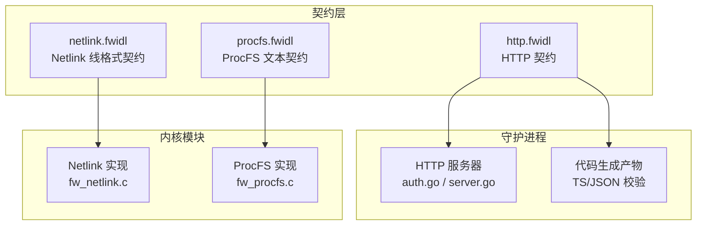
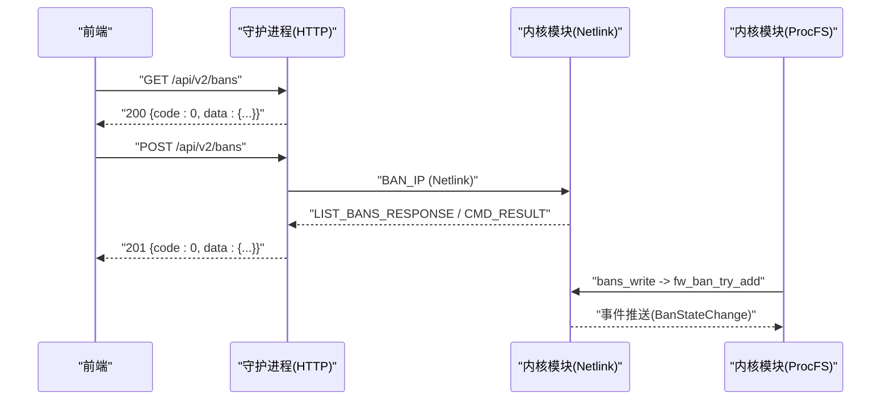
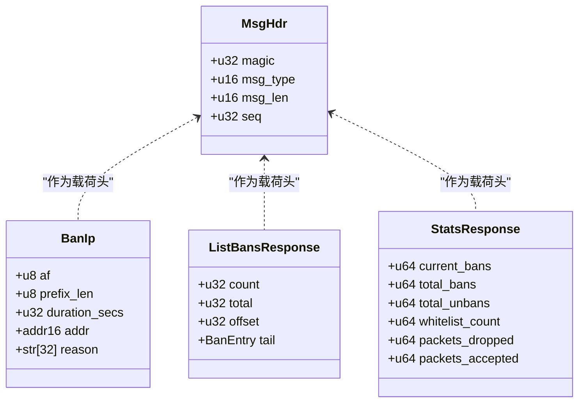
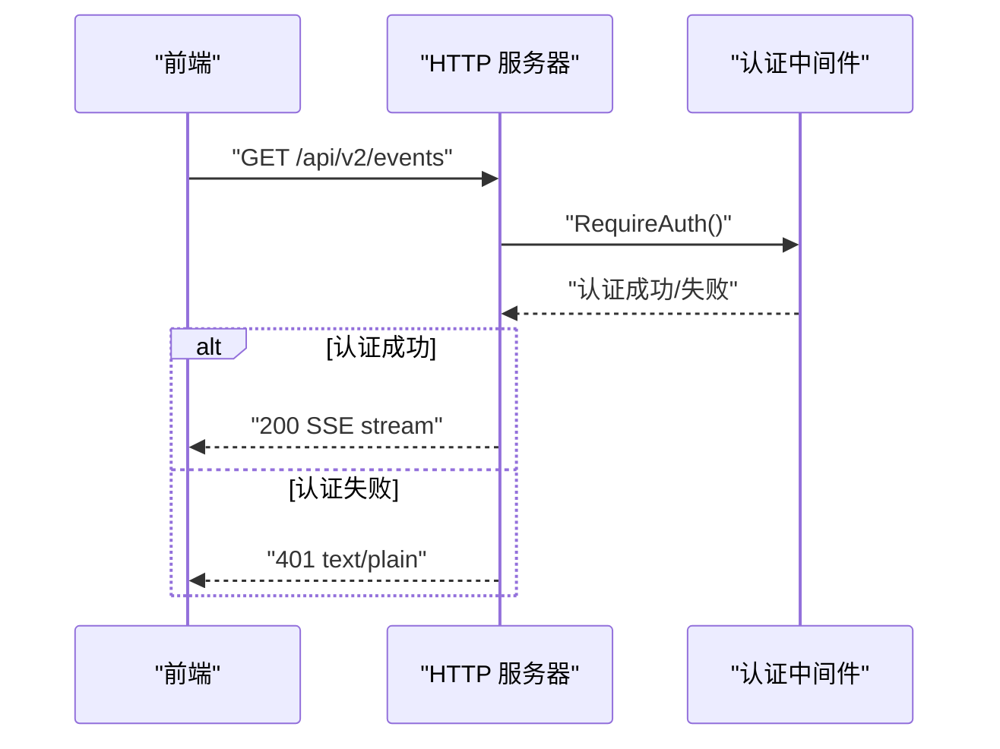
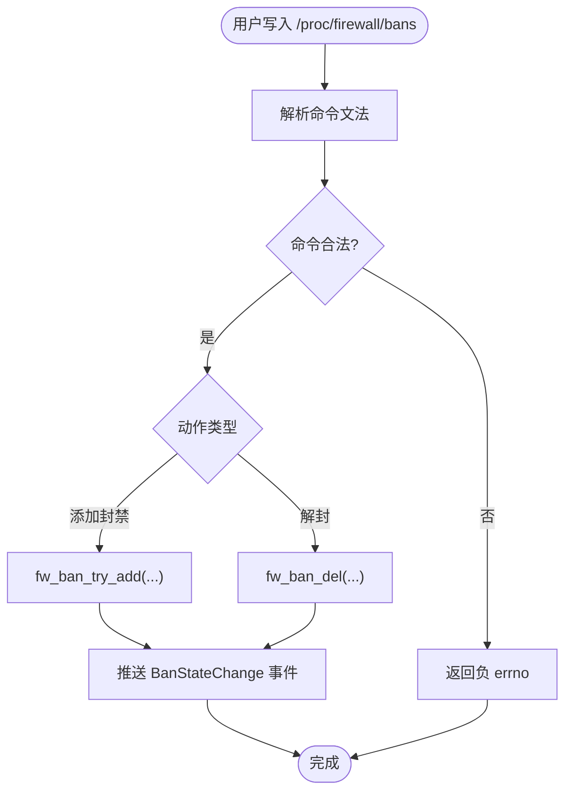
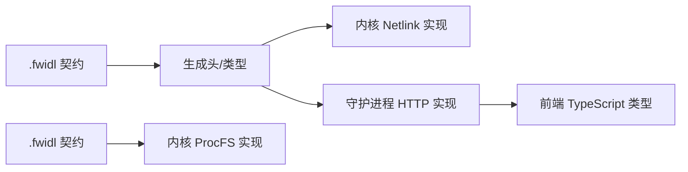

# 通信协议设计

<cite>
**本文引用的文件**   
- [contract/http.fwidl](file://contract/http.fwidl)
- [contract/netlink.fwidl](file://contract/netlink.fwidl)
- [contract/procfs.fwidl](file://contract/procfs.fwidl)
- [src/daemon/internal/http/auth.go](file://src/daemon/internal/http/auth.go)
- [src/daemon/internal/http/server.go](file://src/daemon/internal/http/server.go)
- [src/kernel-module/fw_netlink.c](file://src/kernel-module/fw_netlink.c)
- [src/kernel-module/fw_procfs.c](file://src/kernel-module/fw_procfs.c)
</cite>

## 目录
1. [引言](#引言)
2. [项目结构](#项目结构)
3. [核心组件](#核心组件)
4. [架构总览](#架构总览)
5. [详细组件分析](#详细组件分析)
6. [依赖关系分析](#依赖关系分析)
7. [性能与扩展性](#性能与扩展性)
8. [故障排查指南](#故障排查指南)
9. [结论](#结论)
10. [附录：契约驱动开发与迁移指南](#附录契约驱动开发与迁移指南)

## 引言
本文件面向“通信协议设计”目标，系统性说明防火墙守护进程、内核模块与前端之间的三类通信机制：
- Netlink 内核通信协议：内核模块与守护进程之间的高性能二进制控制面。
- HTTP REST API：守护进程对外暴露的 JSON API，承载 Web UI、运维脚本与第三方集成。
- ProcFS 运维接口：面向人类与轻量脚本的文本接口，用于快速诊断与运行时配置。

文档重点覆盖：
- 消息格式定义、序列化机制与版本兼容性保证。
- 契约驱动开发模式、`.fwidl` 语法规范与代码生成机制。
- 认证授权机制、错误处理策略与性能优化考虑。
- 协议时序图、消息格式示例与错误码定义。
- 协议扩展指南与兼容性迁移方案。

## 项目结构
仓库围绕“契约优先”组织：
- `contract/`：三份 `.fwidl` 契约文件，是各层协议的单一真相源；配套验证脚本与生成物目录。
- `src/daemon/internal/http/`：HTTP 服务器、鉴权、路由、SSE、信封等实现。
- `src/kernel-module/`：Netlink 与 ProcFS 内核侧实现，严格引用由契约生成的头文件。
- `frontend/`：前端 TypeScript 类型与 API 客户端，需与 HTTP 契约字段对齐。

**图表来源**
- [contract/http.fwidl:1-49](file://contract/http.fwidl#L1-L49)
- [contract/netlink.fwidl:1-30](file://contract/netlink.fwidl#L1-L30)
- [contract/procfs.fwidl:1-28](file://contract/procfs.fwidl#L1-L28)
- [src/daemon/internal/http/server.go:14-32](file://src/daemon/internal/http/server.go#L14-L32)
- [src/kernel-module/fw_netlink.c:1-36](file://src/kernel-module/fw_netlink.c#L1-L36)
- [src/kernel-module/fw_procfs.c:1-44](file://src/kernel-module/fw_procfs.c#L1-L44)

**章节来源**
- [contract/http.fwidl:1-49](file://contract/http.fwidl#L1-L49)
- [contract/netlink.fwidl:1-30](file://contract/netlink.fwidl#L1-L30)
- [contract/procfs.fwidl:1-28](file://contract/procfs.fwidl#L1-L28)
- [src/daemon/internal/http/server.go:14-32](file://src/daemon/internal/http/server.go#L14-L32)
- [src/kernel-module/fw_netlink.c:1-36](file://src/kernel-module/fw_netlink.c#L1-L36)
- [src/kernel-module/fw_procfs.c:1-44](file://src/kernel-module/fw_procfs.c#L1-L44)

## 核心组件
- Netlink 协议（内核 ↔ 守护进程）
  - 二进制线格式，所有结构 packed、多字节整数大端序、显式填充。
  - 支持请求/响应配对序列号、事件推送、分页查询、单守护进程互斥注册。
- HTTP REST API（守护进程 ↔ 前端）
  - 统一信封 `{code, data, message}`，成功 code=0，失败 data=null。
  - Basic 认证，支持 Authorization 头与 query token；失败返回纯文本 401。
  - SSE 长连接（events/logs），独立连接上限与 keepalive。
- ProcFS 运维接口（运维 ↔ 内核）
  - 文本命令文法与机器可读 stats 键值对；部分条目为 unstable 人类可读表格。
  - 写操作返回负 errno，无文本错误通道；读侧 key/value 类型冻结。

**章节来源**
- [contract/netlink.fwidl:21-30](file://contract/netlink.fwidl#L21-L30)
- [contract/http.fwidl:51-65](file://contract/http.fwidl#L51-L65)
- [contract/procfs.fwidl:18-27](file://contract/procfs.fwidl#L18-L27)

## 架构总览
整体数据流分为三条链路：
- 控制面：守护进程通过 Netlink 向内核下发封禁、解封、配置、白名单等操作，并接收状态变更与统计响应。
- 管理面：前端通过 HTTP REST API 调用守护进程，获取统计、封禁列表、Jail 配置、威胁情报等，并通过 SSE 订阅实时事件。
- 运维面：运维人员通过 `/proc/firewall/*` 查看统计、列表与配置，或写入命令进行封禁、解封、加白名单、修改默认时长。

**图表来源**
- [contract/http.fwidl:525-542](file://contract/http.fwidl#L525-L542)
- [contract/netlink.fwidl:56-81](file://contract/netlink.fwidl#L56-L81)
- [src/kernel-module/fw_netlink.c:737-753](file://src/kernel-module/fw_netlink.c#L737-L753)
- [src/kernel-module/fw_procfs.c:167-244](file://src/kernel-module/fw_procfs.c#L167-L244)

## 详细组件分析

### Netlink 内核通信协议
- 消息头与魔数
  - 公共头包含魔数、消息类型、长度、序列号；魔数不匹配即丢弃。
  - 序列号用于请求/响应配对；推送事件使用内核自增序列号，不参与配对。
- 主要消息类型
  - 控制类：BAN_IP、UNBAN_IP、SET_CONFIG、ADD_WHITELIST、REMOVE_WHITELIST、DAEMON_REGISTER。
  - 查询类：LIST_BANS_QUERY、LIST_WHITELIST_QUERY、LIST_RATES_QUERY、STATS_QUERY、ANALYSIS_QUERY。
  - 响应类：LIST_BANS_RESPONSE、LIST_WHITELIST_RESPONSE、LIST_RATES_RESPONSE、STATS_RESPONSE、ANALYSIS_RESPONSE、CONFIG_ACK、CMD_RESULT、DAEMON_REGISTER_ACK。
  - 事件类：DDOS_EVENT、BAN_STATE_CHANGE、WHITELIST_STATE_CHANGE、CONFIG_CHANGE。
- 序列化与布局
  - 所有结构 packed，多字节整数大端序，地址为裸字节数组，字符串定长且 NUL 结尾。
  - 分页：列表响应必须分页，offset/limit 语义一致，单页上限由 u16 msg_len 反推。
- 单守护进程互斥
  - 内核维护 portid 独占；新 daemon 注册前先探活旧 portid，避免崩溃后长期占用。

**图表来源**
- [contract/netlink.fwidl:128-133](file://contract/netlink.fwidl#L128-L133)
- [contract/netlink.fwidl:381-388](file://contract/netlink.fwidl#L381-L388)
- [contract/netlink.fwidl:231-237](file://contract/netlink.fwidl#L231-L237)
- [contract/netlink.fwidl:240-248](file://contract/netlink.fwidl#L240-L248)

**章节来源**
- [contract/netlink.fwidl:21-30](file://contract/netlink.fwidl#L21-L30)
- [contract/netlink.fwidl:56-81](file://contract/netlink.fwidl#L56-L81)
- [contract/netlink.fwidl:128-133](file://contract/netlink.fwidl#L128-L133)
- [contract/netlink.fwidl:231-248](file://contract/netlink.fwidl#L231-L248)
- [src/kernel-module/fw_netlink.c:118-171](file://src/kernel-module/fw_netlink.c#L118-L171)
- [src/kernel-module/fw_netlink.c:354-360](file://src/kernel-module/fw_netlink.c#L354-L360)

### HTTP REST API
- 统一信封
  - 成功：`{code: 0, data: T, message: ""}`。
  - 失败：`{code: 业务码, data: null, message: "原因"}`。
- 认证机制
  - Basic Auth，凭据来自 metrics_username/metrics_password；两者都为空视为未配置认证。
  - 支持 Authorization 头与 query token（SSE 场景）。
  - 连续失败阈值锁定，锁定期内拒绝所有请求（含正确凭据）。
- 安全头
  - 全局设置 X-Content-Type-Options、X-Frame-Options、Content-Security-Policy、Cache-Control。
- SSE 长连接
  - events 流最多 10 连接，logs 流最多 5 连接；keepalive 间隔 15 秒。
  - 事件域包括 connected、stats、bans、jails、whitelist、rates、log、error。

**图表来源**
- [contract/http.fwidl:81-88](file://contract/http.fwidl#L81-L88)
- [contract/http.fwidl:487-511](file://contract/http.fwidl#L487-L511)
- [src/daemon/internal/http/auth.go:36-69](file://src/daemon/internal/http/auth.go#L36-L69)
- [src/daemon/internal/http/server.go:63-71](file://src/daemon/internal/http/server.go#L63-L71)

**章节来源**
- [contract/http.fwidl:51-65](file://contract/http.fwidl#L51-L65)
- [contract/http.fwidl:81-88](file://contract/http.fwidl#L81-L88)
- [contract/http.fwidl:134-153](file://contract/http.fwidl#L134-L153)
- [contract/http.fwidl:487-511](file://contract/http.fwidl#L487-L511)
- [src/daemon/internal/http/auth.go:36-69](file://src/daemon/internal/http/auth.go#L36-L69)
- [src/daemon/internal/http/server.go:63-71](file://src/daemon/internal/http/server.go#L63-L71)

### ProcFS 运维接口
- 写侧命令文法
  - bans：`<ip>`、`<ip> <seconds>`、`<ip> 0`、`unban <ip>`。
  - whitelist：`add <subnet>`、`<subnet>`、`remove <subnet>`。
  - config：`ban_time <seconds>`。
- 读侧格式
  - stats：机器可读 `key value` 行，key 与数值类型冻结。
  - 其他文件：人类可读表格，标注 unstable，无稳定性承诺。
- 权限与错误
  - 写操作返回负 errno，无文本错误通道；错误信息仅进内核日志。
  - 控制字符除制表符外一律拒绝。

**图表来源**
- [contract/procfs.fwidl:170-190](file://contract/procfs.fwidl#L170-L190)
- [contract/procfs.fwidl:202-216](file://contract/procfs.fwidl#L202-L216)
- [src/kernel-module/fw_procfs.c:167-244](file://src/kernel-module/fw_procfs.c#L167-L244)
- [src/kernel-module/fw_procfs.c:567-585](file://src/kernel-module/fw_procfs.c#L567-L585)

**章节来源**
- [contract/procfs.fwidl:18-27](file://contract/procfs.fwidl#L18-L27)
- [contract/procfs.fwidl:170-190](file://contract/procfs.fwidl#L170-L190)
- [contract/procfs.fwidl:202-216](file://contract/procfs.fwidl#L202-L216)
- [src/kernel-module/fw_procfs.c:167-244](file://src/kernel-module/fw_procfs.c#L167-L244)
- [src/kernel-module/fw_procfs.c:567-585](file://src/kernel-module/fw_procfs.c#L567-L585)

## 依赖关系分析
- 契约到实现的单向依赖
  - `.fwidl` → 生成头/类型 → 内核/守护进程实现。
  - HTTP 契约约束前端 types.ts 与后端 Go 结构体字段一致性。
- 组件耦合
  - Netlink 内核模块依赖生成头，不再手抄结构体，避免契约漂移。
  - HTTP 服务器依赖认证中间件与安全头中间件，统一处理连接限制。
  - ProcFS 实现依赖内核统计与封禁/白名单模块，输出稳定 key/value。

**图表来源**
- [contract/netlink.fwidl:4-9](file://contract/netlink.fwidl#L4-L9)
- [contract/http.fwidl:34-42](file://contract/http.fwidl#L34-L42)
- [contract/procfs.fwidl:1-6](file://contract/procfs.fwidl#L1-L6)
- [src/kernel-module/fw_netlink.c:5-8](file://src/kernel-module/fw_netlink.c#L5-L8)

**章节来源**
- [contract/netlink.fwidl:4-9](file://contract/netlink.fwidl#L4-L9)
- [contract/http.fwidl:34-42](file://contract/http.fwidl#L34-L42)
- [contract/procfs.fwidl:1-6](file://contract/procfs.fwidl#L1-L6)
- [src/kernel-module/fw_netlink.c:5-8](file://src/kernel-module/fw_netlink.c#L5-L8)

## 性能与扩展性
- Netlink
  - 分页查询避免单次响应过大，msg_len 上限反推单页最大条目数。
  - 全局速率折算基于真实时间间隔，避免与守护进程轮询周期耦合。
- HTTP
  - SSE 事件驱动发布，仅在内容变化时序列化，避免重复序列化开销。
  - 连接限制在中间件外层，确保限额告知响应不受安全头影响。
- ProcFS
  - stats 读取前 flush per-CPU 计数器，避免陈旧读数。
  - 列表展示分页，避免单次 kmalloc 过大。

**章节来源**
- [src/kernel-module/fw_netlink.c:495-510](file://src/kernel-module/fw_netlink.c#L495-L510)
- [contract/http.fwidl:330-336](file://contract/http.fwidl#L330-L336)
- [src/daemon/internal/http/server.go:129-149](file://src/daemon/internal/http/server.go#L129-L149)
- [src/kernel-module/fw_procfs.c:567-585](file://src/kernel-module/fw_procfs.c#L567-L585)

## 故障排查指南
- HTTP 401 认证失败
  - 检查 Authorization 头或 query token 是否正确。
  - 确认 metrics_username/metrics_password 是否同时配置。
  - 注意锁定期内即使凭据正确也会被拒绝。
- Netlink 注册失败
  - 检查是否已有活跃守护进程；内核会返回 DaemonRegisterAck accepted=0。
  - 确认 CAP_NET_ADMIN 权限。
- ProcFS 写入失败
  - 检查命令文法是否符合契约；控制字符会被拒绝。
  - 错误仅返回负 errno，具体原因查看内核日志。

**章节来源**
- [src/daemon/internal/http/auth.go:36-69](file://src/daemon/internal/http/auth.go#L36-L69)
- [contract/netlink.fwidl:360-370](file://contract/netlink.fwidl#L360-L370)
- [contract/procfs.fwidl:339-345](file://contract/procfs.fwidl#L339-L345)

## 结论
本项目以契约驱动为核心，通过 `.fwidl` 明确定义 Netlink、HTTP、ProcFS 三类通信机制的消息格式、序列化规则与行为语义。实现层严格遵循契约，保障跨语言、跨进程、跨内核态的一致性。认证、错误处理、性能优化均在契约与实现中明确约定，便于扩展与维护。

## 附录：契约驱动开发与迁移指南

### .fwidl 语法规范
- 命名空间与基础定义
  - `namespace NAME` 声明协议命名空间。
  - `magic NAME = 0xHEX` 定义魔数。
  - `enum NAME : WIDTH { MEMBER = VALUE }` 定义枚举。
  - `bits NAME : WIDTH { MEMBER = BITPOS }` 定义位标志。
  - `alias NAME = WIDTH[N]` 定义别名数组。
  - `struct NAME { TYPE FIELD }` 定义结构体。
  - `message NAME { type = MsgType::X TYPE FIELD ... }` 定义带载荷消息。
  - `message NAME = MsgType::X` 定义仅头部消息。
- 线格式约定
  - 所有结构 packed，多字节整数大端序，显式填充，地址为裸字节数组，字符串定长且 NUL 结尾。

**章节来源**
- [contract/netlink.fwidl:10-29](file://contract/netlink.fwidl#L10-L29)

### 代码生成机制
- Netlink 契约生成
  - 生成 C 侧头文件供内核模块 include。
  - 生成 Rust/TS 侧类型供守护进程与前端校验。
  - 生成机器可读布局清单用于三端校验。
- HTTP 契约验证
  - 验证守护进程路由注册、认证语义、SSE 上限、信封形状、业务码、错误形状、安全头。
  - 验证前端 types.ts 与后端响应字段一致性。
- ProcFS 契约验证
  - 验证写命令文法、读侧 key/value 类型、容量上限与代码锚点。

**章节来源**
- [contract/netlink.fwidl:4-9](file://contract/netlink.fwidl#L4-L9)
- [contract/http.fwidl:34-42](file://contract/http.fwidl#L34-L42)
- [contract/procfs.fwidl:1-6](file://contract/procfs.fwidl#L1-L6)

### 版本兼容性与迁移
- 向后兼容原则
  - 新增字段应置于末尾，避免破坏现有布局。
  - 枚举值只增不减，历史取值保持兼容。
  - 分页参数语义保持一致，offset/limit 通用。
- 迁移建议
  - 逐步替换手写结构体为生成头，消除契约漂移。
  - 统一错误模型，收敛三种错误形状为信封。
  - 将 unstable 文本接口逐步迁移至机器可读契约。

**章节来源**
- [contract/netlink.fwidl:21-30](file://contract/netlink.fwidl#L21-L30)
- [contract/http.fwidl:94-128](file://contract/http.fwidl#L94-L128)
- [contract/procfs.fwidl:66-70](file://contract/procfs.fwidl#L66-L70)