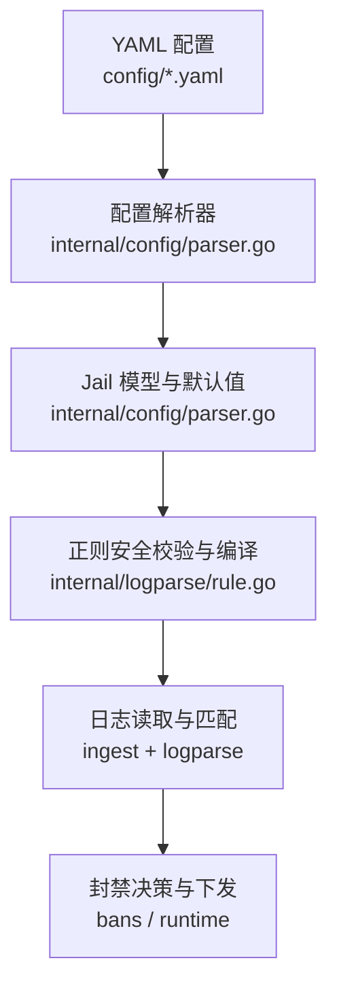
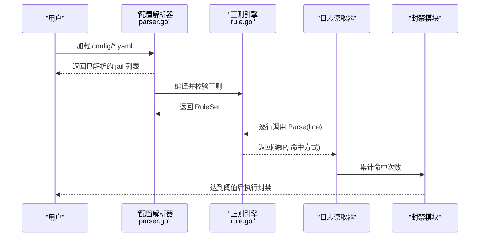
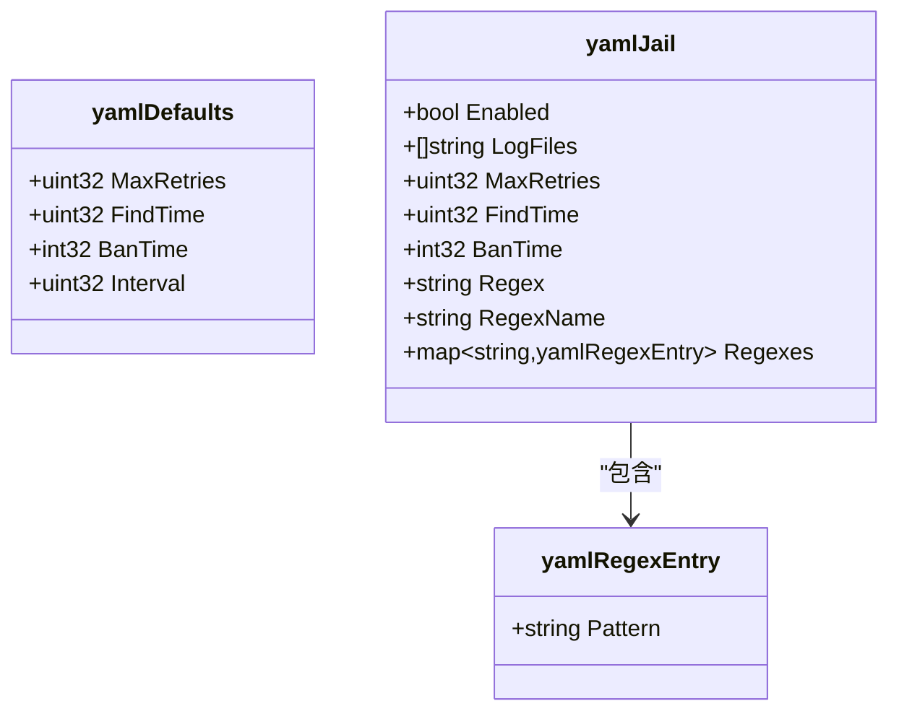
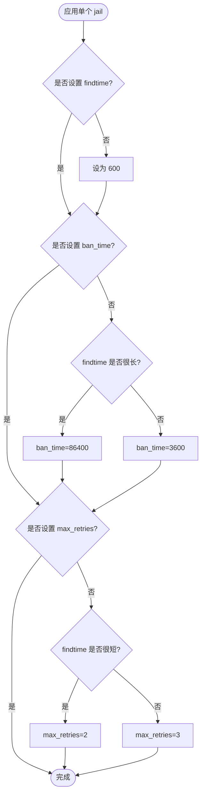
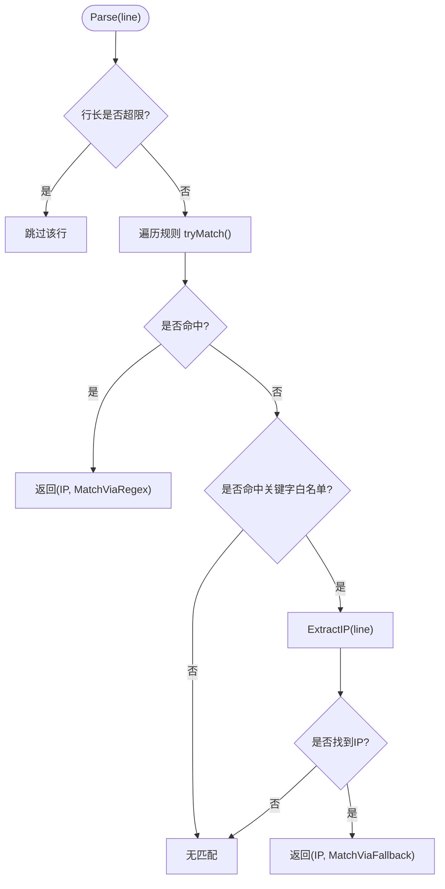
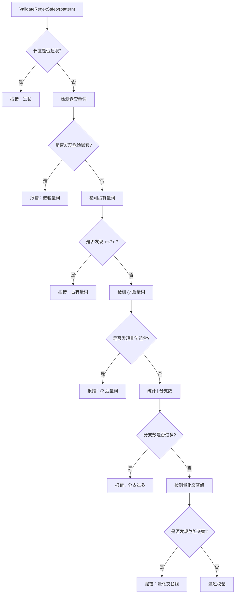
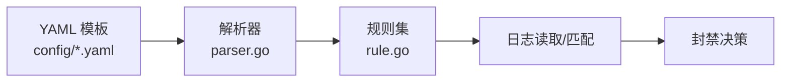

# Jail规则配置

<cite>
**本文引用的文件**   
- [config/default.yaml](file://config/default.yaml)
- [src/daemon/internal/config/parser.go](file://src/daemon/internal/config/parser.go)
- [src/daemon/internal/logparse/rule.go](file://src/daemon/internal/logparse/rule.go)
- [config/nginx.yaml](file://config/nginx.yaml)
- [config/apache.yaml](file://config/apache.yaml)
- [config/mysql.yaml](file://config/mysql.yaml)
- [config/redis.yaml](file://config/redis.yaml)
- [config/postfix.yaml](file://config/postfix.yaml)
- [config/dovecot.yaml](file://config/dovecot.yaml)
- [config/vsftpd.yaml](file://config/vsftpd.yaml)
- [config/frp.yaml](file://config/frp.yaml)
- [config/traefik.yaml](file://config/traefik.yaml)
- [config/wordpress.yaml](file://config/wordpress.yaml)
</cite>

## 目录
1. [简介](#简介)
2. [项目结构](#项目结构)
3. [核心组件](#核心组件)
4. [架构总览](#架构总览)
5. [详细组件分析](#详细组件分析)
6. [依赖关系分析](#依赖关系分析)
7. [性能与优化建议](#性能与优化建议)
8. [故障排查指南](#故障排查指南)
9. [结论](#结论)
10. [附录：服务模板与正则编写指南](#附录服务模板与正则编写指南)

## 简介
本文件面向需要为不同服务（SSH、Web、数据库、邮件、代理等）定义独立监控规则与封禁策略的运维与开发者。文档围绕以下目标展开：
- 解释 jail 的核心参数：log_files、regexes、max_retries、findtime、ban_time 的含义与优先级。
- 提供各服务的预定义规则模板，并说明如何基于模板自定义。
- 给出正则表达式语法要点、IP 地址提取模式与安全校验机制。
- 提供性能优化建议与常见问题排查方法。

## 项目结构
Jail 规则由 YAML 配置文件驱动，守护进程在启动或重载时解析这些配置，编译正则，构建每个 jail 的规则集，并在日志读取阶段对每行日志进行匹配与计数，最终触发封禁决策。

**图示来源**
- [config/default.yaml:32-53](file://config/default.yaml#L32-L53)
- [src/daemon/internal/config/parser.go:155-207](file://src/daemon/internal/config/parser.go#L155-L207)
- [src/daemon/internal/logparse/rule.go:35-127](file://src/daemon/internal/logparse/rule.go#L35-L127)

**章节来源**
- [config/default.yaml:1-198](file://config/default.yaml#L1-L198)
- [src/daemon/internal/config/parser.go:155-207](file://src/daemon/internal/config/parser.go#L155-L207)

## 核心组件
- 全局默认 defaults：为所有 jail 提供 max_retries、findtime、ban_time、interval 等默认值。
- jail 定义：每个服务一个 jail，包含 enabled、log_files、regexes 以及可覆盖的阈值参数。
- 正则规则：支持单条 regex 与多规则 regexes；每条规则含 name 与 pattern。
- 智能默认：当仅配置了 log_files 或极简规则时，系统会推断合理的 findtime、ban_time、max_retries。
- 正则安全校验：拒绝易导致回溯爆炸的正则，限制长度、分支数与危险组合。

**章节来源**
- [config/default.yaml:5-30](file://config/default.yaml#L5-L30)
- [config/default.yaml:32-53](file://config/default.yaml#L32-L53)
- [src/daemon/internal/config/parser.go:52-80](file://src/daemon/internal/config/parser.go#L52-L80)
- [src/daemon/internal/config/parser.go:473-497](file://src/daemon/internal/config/parser.go#L473-L497)
- [src/daemon/internal/logparse/rule.go:13-22](file://src/daemon/internal/logparse/rule.go#L13-L22)
- [src/daemon/internal/logparse/rule.go:135-191](file://src/daemon/internal/logparse/rule.go#L135-L191)

## 架构总览
下图展示从配置到封禁的关键流程：配置解析生成 jail 与规则集，日志读取阶段按规则匹配 IP，命中后进入计数与封禁判定。

**图示来源**
- [src/daemon/internal/config/parser.go:155-207](file://src/daemon/internal/config/parser.go#L155-L207)
- [src/daemon/internal/logparse/rule.go:108-127](file://src/daemon/internal/logparse/rule.go#L108-L127)

## 详细组件分析

### 配置结构与字段语义
- defaults
  - max_retries：默认重试次数，未显式设置时使用该值。
  - findtime：时间窗口（秒），用于统计失败次数。
  - ban_time：封禁时长（秒），-1 表示永久封禁。
  - interval：检查间隔（秒）。
  - metrics_*、log_file、history_db_path 等属于守护进程运行参数，不直接影响 jail 逻辑。
- jails.<name>
  - enabled：是否启用该 jail。
  - log_files：要监控的日志文件路径数组。
  - max_retries、findtime、ban_time：覆盖 defaults 的同名字段。
  - regex：单条正则（可选），可与 regexes 并存。
  - regex_name：为单条 regex 指定名称（可选）。
  - regexes：多条命名正则，每项含 pattern。

**图示来源**
- [src/daemon/internal/config/parser.go:31-80](file://src/daemon/internal/config/parser.go#L31-L80)

**章节来源**
- [config/default.yaml:5-30](file://config/default.yaml#L5-L30)
- [config/default.yaml:32-53](file://config/default.yaml#L32-L53)
- [src/daemon/internal/config/parser.go:52-80](file://src/daemon/internal/config/parser.go#L52-L80)

### 参数优先级与智能默认
- 优先级：jail 显式值 > defaults > 代码默认值。
- 智能默认 applySmartDefaults：
  - 若未设置 findtime，默认 600 秒。
  - 若未设置 ban_time：根据 findtime 长短选择 1 小时或 24 小时。
  - 若未设置 max_retries：根据 findtime 长短选择 2 或 3。
- 数值校验：
  - findtime 最小下限为 10 秒，但 findtimeOr 保证低于 60 秒回退到默认。
  - max_retries 小于 1 回退到 defaults。
  - ban_time 为 0 回退到 defaults。

**图示来源**
- [src/daemon/internal/config/parser.go:473-497](file://src/daemon/internal/config/parser.go#L473-L497)

**章节来源**
- [src/daemon/internal/config/parser.go:420-497](file://src/daemon/internal/config/parser.go#L420-L497)

### 正则规则与 IP 提取
- RuleSet.Parse 流程：
  - 先尝试所有已编译的正则，命中即返回源 IP 与 MatchViaRegex。
  - 若全部未命中，再走关键字回退（窄路径），仅在行内包含特定关键字时尝试提取 IP。
  - 关键字白名单包括 SSH 失败密码与常见认证失败关键词。
- tryMatch 优化：
  - 捕获组从后往前扫描，优先取最具体的组（通常是 IP）。
  - 先做长度与首字节快速检查，再进行完整 IP 校验，降低昂贵操作概率。
- 内置 sshd 默认模式：当 jail 没有可用正则时，使用内置模式作为回退。

**图示来源**
- [src/daemon/internal/logparse/rule.go:108-133](file://src/daemon/internal/logparse/rule.go#L108-L133)
- [src/daemon/internal/logparse/rule.go:50-77](file://src/daemon/internal/logparse/rule.go#L50-L77)

**章节来源**
- [src/daemon/internal/logparse/rule.go:13-22](file://src/daemon/internal/logparse/rule.go#L13-L22)
- [src/daemon/internal/logparse/rule.go:50-77](file://src/daemon/internal/logparse/rule.go#L50-L77)
- [src/daemon/internal/logparse/rule.go:108-133](file://src/daemon/internal/logparse/rule.go#L108-L133)

### 正则安全校验
- ValidateRegexSafety 拒绝以下情况：
  - 嵌套量词（如 (a+)+、(a*)*）。
  - 占有量词（++、*+）。
  - (? 后直接跟量词（非法组合）。
  - 分支数过多（| 数量超过上限）。
  - 被量化的交替组（如 (a|aa)+）。
- 同时限制正则长度与分支数，防止 ReDoS 攻击面。

**图示来源**
- [src/daemon/internal/logparse/rule.go:135-191](file://src/daemon/internal/logparse/rule.go#L135-L191)
- [src/daemon/internal/logparse/rule.go:193-261](file://src/daemon/internal/logparse/rule.go#L193-L261)

**章节来源**
- [src/daemon/internal/logparse/rule.go:135-191](file://src/daemon/internal/logparse/rule.go#L135-L191)
- [src/daemon/internal/logparse/rule.go:193-261](file://src/daemon/internal/logparse/rule.go#L193-L261)

## 依赖关系分析
- 配置层：default.yaml 与各服务模板（nginx、apache、mysql、redis、postfix、dovecot、vsftpd、frp、traefik、wordpress）提供 jail 定义。
- 解析层：parser.go 将 YAML 映射为内部 Config/Jail/RegexInfo，并进行校验与默认值填充。
- 规则层：rule.go 负责正则编译、安全校验与逐行匹配。
- 运行时：日志读取器与封禁模块消费 RuleSet 的输出，结合阈值进行封禁决策。

**图示来源**
- [config/default.yaml:32-53](file://config/default.yaml#L32-L53)
- [src/daemon/internal/config/parser.go:155-207](file://src/daemon/internal/config/parser.go#L155-L207)
- [src/daemon/internal/logparse/rule.go:108-127](file://src/daemon/internal/logparse/rule.go#L108-L127)

**章节来源**
- [config/default.yaml:32-53](file://config/default.yaml#L32-L53)
- [src/daemon/internal/config/parser.go:155-207](file://src/daemon/internal/config/parser.go#L155-L207)
- [src/daemon/internal/logparse/rule.go:108-127](file://src/daemon/internal/logparse/rule.go#L108-L127)

## 性能与优化建议
- 正则设计
  - 尽量使用明确的字面量与锚点，减少回溯空间。
  - 避免嵌套量词与量化交替组，以免触发 ValidateRegexSafety 拒绝。
  - 控制分支数（|）与模式长度，遵循安全上限。
- 日志路径
  - 合理选择 log_files，避免无关大日志造成 IO 压力。
  - 使用轮转工具确保日志文件大小可控。
- 阈值调优
  - findtime 不宜过短，否则容易误判；也不宜过长，否则延迟封禁。
  - ban_time 根据业务风险设定，敏感服务可考虑较长或永久封禁。
  - max_retries 与 findtime 配合：较短窗口下可适当收紧重试次数。
- 资源容量
  - 关注 capacity 段中的最大条目数，避免封禁表、白名单与速率表溢出。
  - 开启 DDoS 防护时，合理设置 max_rate_entries 与 max_bans_per_second。

[本节为通用指导，不直接分析具体文件]

## 故障排查指南
- 配置加载失败
  - 检查 YAML 键名拼写与缩进，严格模式下未知键会报错。
  - 确认 defaults 与 jail 字段类型正确（例如 ban_time 可为负数表示永久）。
- 正则不生效
  - 查看 ValidateRegexSafety 错误信息，修正嵌套量词、占有量词或分支过多问题。
  - 确认正则中确实包含能捕获 IP 的分组。
- 无法提取 IP
  - 若未命中任何正则，系统将尝试关键字回退；请确认日志行包含受支持关键字。
  - 检查日志格式是否与正则预期一致。
- 封禁异常
  - 核对 max_retries、findtime、ban_time 是否按预期生效。
  - 检查 trusted_ips 白名单是否包含本机或管理网段。
  - 观察 DDoS 防护开关与端口保护策略，避免误伤。

**章节来源**
- [src/daemon/internal/logparse/rule.go:135-191](file://src/daemon/internal/logparse/rule.go#L135-L191)
- [config/default.yaml:93-110](file://config/default.yaml#L93-L110)

## 结论
Jail 规则以 YAML 为中心，通过解析器生成规则集并由日志读取阶段进行高效匹配。合理设计正则、选择合适的阈值与日志路径，是平衡安全性与性能的关键。借助预定义模板与智能默认，可以快速为各类服务建立有效的防护策略，并通过安全校验与回退机制提升鲁棒性。

[本节为总结性内容，不直接分析具体文件]

## 附录：服务模板与正则编写指南

### 预定义服务模板概览
以下为仓库提供的服务模板及其关键思路（仅描述用途与匹配目标，不粘贴具体正则内容）：
- Nginx：监控访问禁止类错误日志，匹配客户端 IP。
- Apache：监控客户端被拒绝访问的错误日志，匹配客户端 IP。
- MySQL/MariaDB：监控数据库访问拒绝日志，需启用相关日志选项。
- Redis：监控未授权访问或密码错误日志，需启用相应日志级别。
- Postfix：监控 SASL 认证失败日志，匹配来源 IP。
- Dovecot：监控认证失败日志，匹配远程 IP。
- vsftpd：监控 FTP 登录失败日志，匹配客户端 IP。
- FRP：当前模板已停用，因原正则匹配的是成功连接而非失败场景。
- Traefik：监控错误日志中的客户端 IP。
- WordPress：监控认证失败日志（需插件支持），匹配来源 IP。

**章节来源**
- [config/nginx.yaml:1-14](file://config/nginx.yaml#L1-L14)
- [config/apache.yaml:1-14](file://config/apache.yaml#L1-L14)
- [config/mysql.yaml:1-15](file://config/mysql.yaml#L1-L15)
- [config/redis.yaml:1-15](file://config/redis.yaml#L1-L15)
- [config/postfix.yaml:1-14](file://config/postfix.yaml#L1-L14)
- [config/dovecot.yaml:1-14](file://config/dovecot.yaml#L1-L14)
- [config/vsftpd.yaml:1-14](file://config/vsftpd.yaml#L1-L14)
- [config/frp.yaml:1-18](file://config/frp.yaml#L1-L18)
- [config/traefik.yaml:1-14](file://config/traefik.yaml#L1-L14)
- [config/wordpress.yaml:1-15](file://config/wordpress.yaml#L1-L15)

### 自定义规则编写指南
- 基本结构
  - 在 jails.<name> 下定义 log_files 与 regexes。
  - 如需单条规则，可使用 regex 与 regex_name。
  - 推荐为每条规则命名，便于诊断与回显。
- 正则语法要点
  - 使用括号分组捕获 IP，并确保分组顺序合理（越靠后的捕获组通常越接近 IP）。
  - 避免嵌套量词与量化交替组，以免触发安全校验拒绝。
  - 控制分支数与模式长度，保持可读性与性能。
- IP 提取模式
  - IPv4：使用四段数字加点的形式，注意边界与长度限制。
  - IPv6：若日志中包含 IPv6，应使用更宽泛的模式并谨慎处理。
  - 若无法命中正则，系统将尝试关键字回退与通用 IP 提取。
- 阈值调参
  - findtime：建议至少 60 秒以上，避免瞬时抖动导致误判。
  - ban_time：根据服务敏感度设置，敏感服务可更长或永久。
  - max_retries：与 findtime 协同，短窗口下调低重试次数。

**章节来源**
- [src/daemon/internal/config/parser.go:303-373](file://src/daemon/internal/config/parser.go#L303-L373)
- [src/daemon/internal/logparse/rule.go:108-133](file://src/daemon/internal/logparse/rule.go#L108-L133)
- [src/daemon/internal/logparse/rule.go:135-191](file://src/daemon/internal/logparse/rule.go#L135-L191)