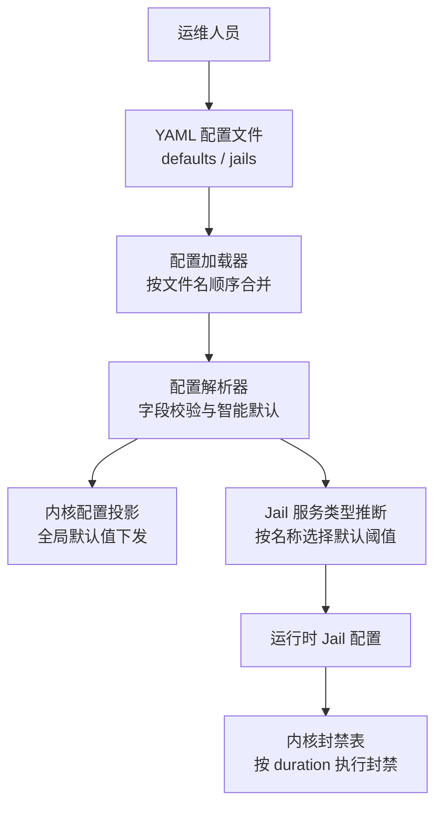
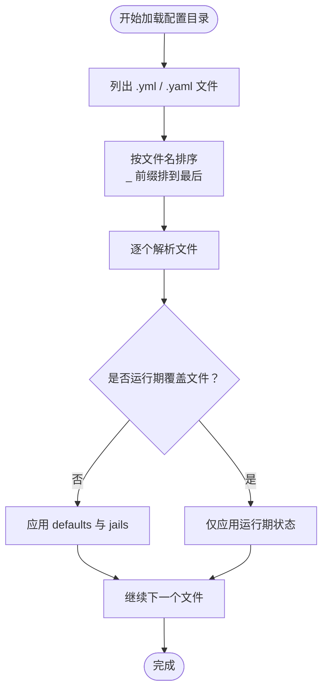
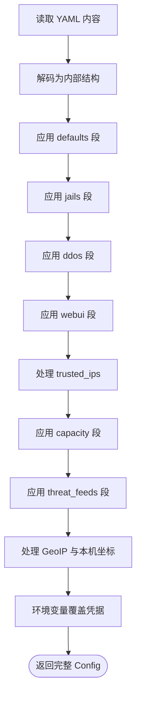
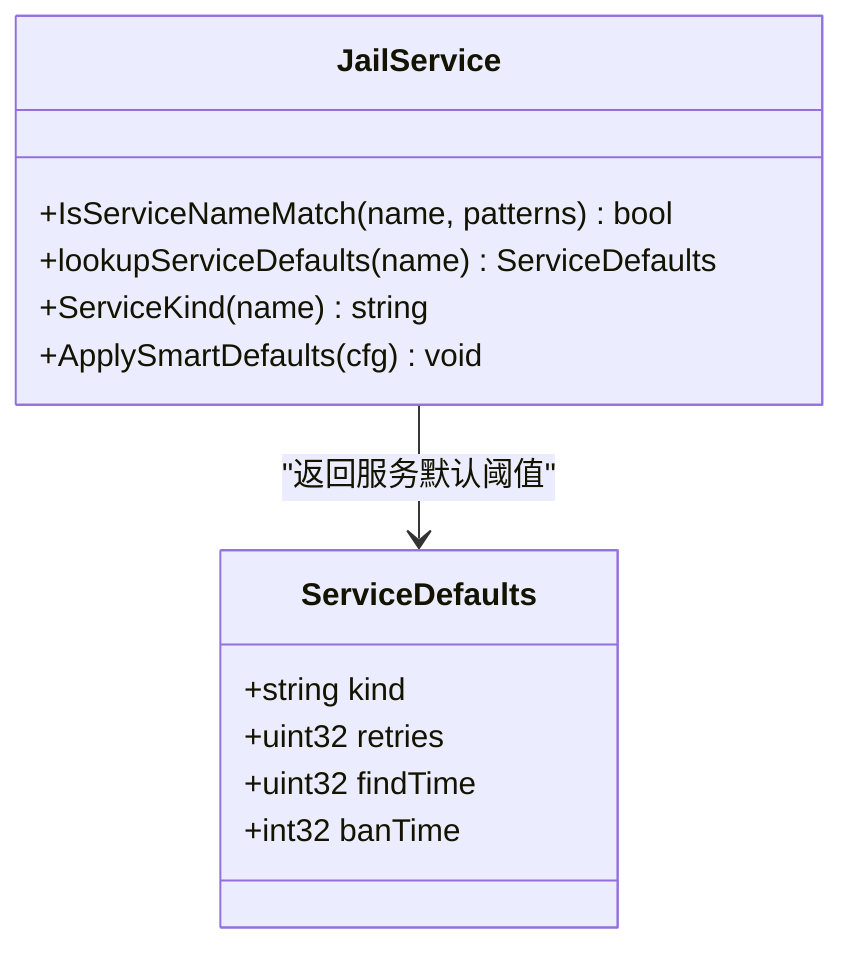
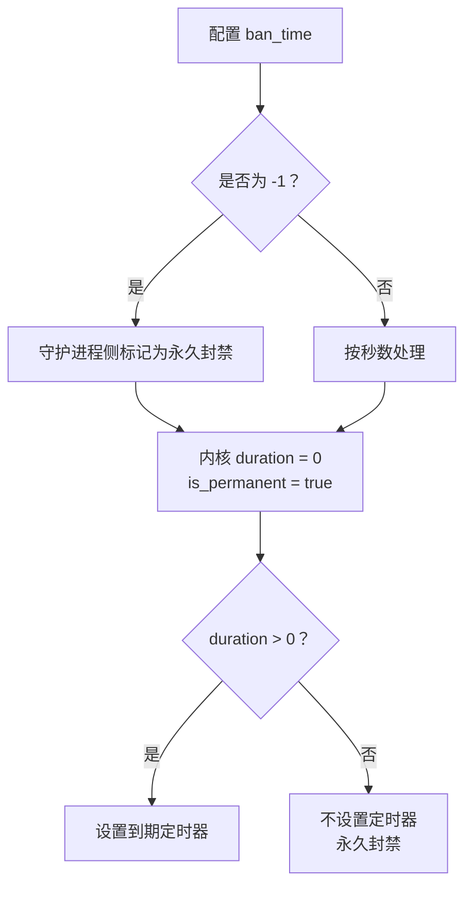
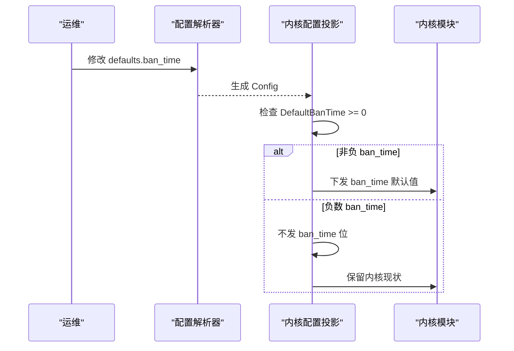
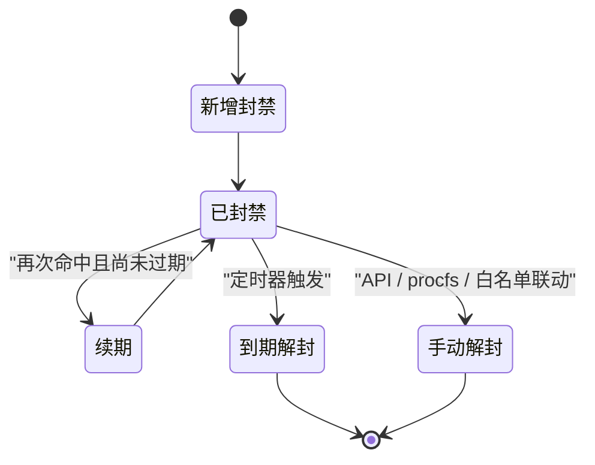
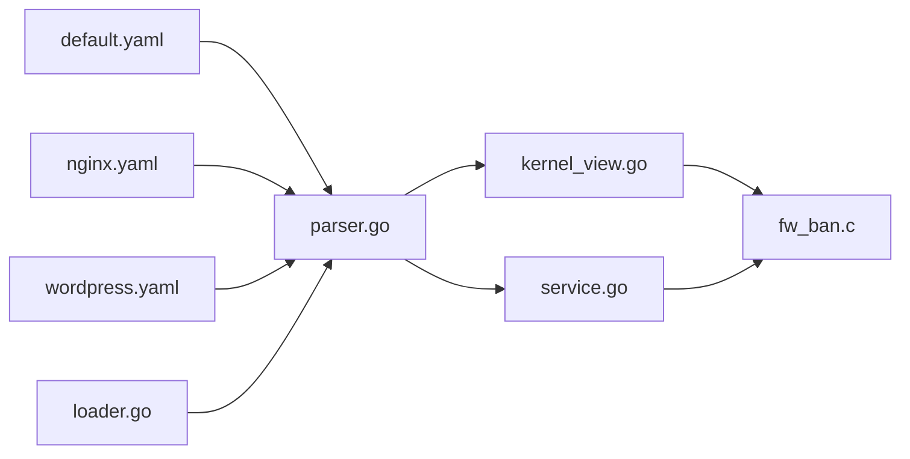

# 封禁策略配置

<cite>
**本文引用的文件**   
- [default.yaml](file://config/default.yaml)
- [nginx.yaml](file://config/nginx.yaml)
- [wordpress.yaml](file://config/wordpress.yaml)
- [loader.go](file://src/daemon/internal/config/loader.go)
- [parser.go](file://src/daemon/internal/config/parser.go)
- [kernel_view.go](file://src/daemon/internal/config/kernel_view.go)
- [service.go](file://src/daemon/internal/jail/service.go)
- [fw_ban.c](file://src/kernel-module/fw_ban.c)
</cite>

## 目录
1. [引言](#引言)
2. [项目结构](#项目结构)
3. [核心参数定义](#核心参数定义)
4. [配置加载与默认值机制](#配置加载与默认值机制)
5. [负数 ban_time 与永久封禁](#负数-ban_time-与永久封禁)
6. [与内核模块封禁机制的交互](#与内核模块封禁机制的交互)
7. [典型安全场景调优建议](#典型安全场景调优建议)
8. [依赖关系分析](#依赖关系分析)
9. [性能与容量特性](#性能与容量特性)
10. [故障排查要点](#故障排查要点)
11. [结论](#结论)

## 引言
本文聚焦于 Jail 封禁策略的核心配置项，重点说明 `max_retries`、`findtime`、`ban_time` 三个参数的含义、取值规则、默认值来源、智能推断逻辑，以及它们如何最终影响内核模块中的封禁行为。文档同时解释 `ban_time = -1` 表示永久封禁的特殊语义，并给出 SSH 暴力破解、Web 应用攻击等常见场景下的参数调优建议。

## 项目结构
Jail 封禁策略的配置入口是 YAML 配置文件，守护进程负责解析、合并、校验，并在必要时把全局默认值投影到内核模块；具体每个 jail 的阈值则由服务名智能推断或用户显式覆盖。

**图表来源**
- [loader.go:53-127](file://src/daemon/internal/config/loader.go#L53-L127)
- [parser.go:155-206](file://src/daemon/internal/config/parser.go#L155-L206)
- [kernel_view.go:5-41](file://src/daemon/internal/config/kernel_view.go#L5-L41)
- [service.go:9-19](file://src/daemon/internal/jail/service.go#L9-L19)

**章节来源**
- [loader.go:53-127](file://src/daemon/internal/config/loader.go#L53-L127)
- [parser.go:155-206](file://src/daemon/internal/config/parser.go#L155-L206)

## 核心参数定义

### max_retries：重试次数阈值
- **含义**：在 `findtime` 时间窗口内，同一源地址触发匹配正则的次数达到该值后，触发封禁。
- **数据类型**：无符号整数。
- **默认值来源**：
  - 若未显式设置，优先使用 `defaults.max_retries`。
  - 如果连 `defaults.max_retries` 也未设置，则走“智能默认”：短窗口（小于 300 秒）倾向于更保守的 `2`，长窗口倾向于 `3`。
- **特殊取值**：
  - 值为 `0` 时会被归一化为默认值，而不是真正允许“零次即封禁”。
- **配置位置**：
  - 全局默认：`defaults.max_retries`
  - 单个 jail：`jails.<name>.max_retries`

**章节来源**
- [parser.go:332-335](file://src/daemon/internal/config/parser.go#L332-L335)
- [parser.go:428-433](file://src/daemon/internal/config/parser.go#L428-L433)
- [parser.go:459-464](file://src/daemon/internal/config/parser.go#L459-L464)
- [parser.go:473-497](file://src/daemon/internal/config/parser.go#L473-L497)

### findtime：检测时间窗口
- **含义**：统计失败尝试的时间窗口长度，单位通常为秒。只有在该窗口内累计失败次数超过 `max_retries`，才认为是一次有效攻击。
- **数据类型**：无符号整数。
- **默认值来源**：
  - 若未显式设置，优先使用 `defaults.findtime`。
  - 如果 `defaults.findtime` 也未设置，智能默认会先设为 `600` 秒（约 10 分钟）。
  - 当 `ban_time` 明显更长时，智能默认会把 `findtime` 放宽到更长周期，避免封禁时长比检测窗口还短。
- **最小值保护**：
  - 解析阶段对过小值做保护，低于某个下限时会提升到安全值，防止窗口过短导致误判。
- **配置位置**：
  - 全局默认：`defaults.findtime`
  - 单个 jail：`jails.<name>.findtime`

**章节来源**
- [parser.go:336-339](file://src/daemon/internal/config/parser.go#L336-L339)
- [parser.go:435-443](file://src/daemon/internal/config/parser.go#L435-L443)
- [parser.go:452-457](file://src/daemon/internal/config/parser.go#L452-L457)
- [parser.go:473-497](file://src/daemon/internal/config/parser.go#L473-L497)

### ban_time：封禁时长
- **含义**：一次命中后封禁持续的时间。
- **数据类型**：有符号整数，支持负数。
- **默认值来源**：
  - 若未显式设置，优先使用 `defaults.ban_time`。
  - 如果 `defaults.ban_time` 也未设置，智能默认会根据 `findtime` 长短选择较短或较长的封禁时长。
- **特殊取值**：
  - `ban_time = -1`：表示永久封禁。
  - 其他正数值：单位为秒。
- **配置位置**：
  - 全局默认：`defaults.ban_time`
  - 单个 jail：`jails.<name>.ban_time`

**章节来源**
- [parser.go:340-343](file://src/daemon/internal/config/parser.go#L340-L343)
- [parser.go:445-450](file://src/daemon/internal/config/parser.go#L445-L450)
- [parser.go:466-471](file://src/daemon/internal/config/parser.go#L466-L471)
- [parser.go:473-497](file://src/daemon/internal/config/parser.go#L473-L497)

### 默认配置示例
出厂默认配置中，`defaults` 段给出了全局默认值，而 `sshd` jail 覆盖了这些默认值，体现“全局默认 + 服务级覆盖”的设计。

**章节来源**
- [default.yaml:7-11](file://config/default.yaml#L7-L11)
- [default.yaml:35-53](file://config/default.yaml#L35-L53)

## 配置加载与默认值机制

### 多文件合并顺序
配置目录中的 YAML 文件按文件名字母序合并，后加载的文件可以覆盖前一个文件的同名字段。以 `_` 开头的运行期覆盖文件最后合并，拥有最高优先级。

**图表来源**
- [loader.go:53-127](file://src/daemon/internal/config/loader.go#L53-L127)

**章节来源**
- [loader.go:11-15](file://src/daemon/internal/config/loader.go#L11-L15)
- [loader.go:53-127](file://src/daemon/internal/config/loader.go#L53-L127)

### 解析与校验流程
YAML 顶层包含 `defaults`、`jails`、`ddos`、`webui`、`trusted_ips`、`capacity`、`threat_feeds` 等段。解析过程按固定顺序应用这些段，并对未知字段启用严格模式时报错。

**图表来源**
- [parser.go:155-206](file://src/daemon/internal/config/parser.go#L155-L206)

**章节来源**
- [parser.go:13-29](file://src/daemon/internal/config/parser.go#L13-L29)
- [parser.go:155-206](file://src/daemon/internal/config/parser.go#L155-L206)

### 智能默认值与服务类型推断
系统会根据 jail 名称自动判断它属于哪类服务，例如 SSH、Web、FTP、邮件、FRP、数据库等，并为每类服务提供一组合理的默认阈值。用户显式写出的 `max_retries`、`findtime`、`ban_time` 会覆盖推断结果。

**图表来源**
- [service.go:9-19](file://src/daemon/internal/jail/service.go#L9-L19)
- [service.go:67-95](file://src/daemon/internal/jail/service.go#L67-L95)
- [service.go:109-134](file://src/daemon/internal/jail/service.go#L109-L134)

**章节来源**
- [service.go:9-19](file://src/daemon/internal/jail/service.go#L9-L19)
- [service.go:67-95](file://src/daemon/internal/jail/service.go#L67-L95)
- [service.go:109-134](file://src/daemon/internal/jail/service.go#L109-L134)

## 负数 ban_time 与永久封禁

### 配置层语义
在守护进程侧，`ban_time = -1` 表示“永久封禁”。这个语义由配置解析和智能默认逻辑共同维护，但不会直接作为普通秒数传给内核。

**章节来源**
- [parser.go:445-450](file://src/daemon/internal/config/parser.go#L445-L450)
- [parser.go:466-471](file://src/daemon/internal/config/parser.go#L466-L471)

### 内核层实现
内核模块中，封禁条目有一个“是否永久”标记。当封禁时长为 `0` 时，内核将其视为永久封禁；非永久封禁则通过定时器到期解封。因此，守护进程需要把“永久”语义映射到内核能理解的表达上，而不是直接把 `-1` 当作普通秒数发送。

**图表来源**
- [fw_ban.c:234-268](file://src/kernel-module/fw_ban.c#L234-L268)
- [fw_ban.c:434-504](file://src/kernel-module/fw_ban.c#L434-L504)

**章节来源**
- [kernel_view.go:34-36](file://src/daemon/internal/config/kernel_view.go#L34-L36)
- [fw_ban.c:234-268](file://src/kernel-module/fw_ban.c#L234-L268)
- [fw_ban.c:434-504](file://src/kernel-module/fw_ban.c#L434-L504)

## 与内核模块封禁机制的交互

### 全局默认值与内核配置投影
守护进程会把部分全局默认值投影成内核可接受的配置载荷，例如速率窗口、每秒最大包数、各协议速率上限、DDoS 自动封禁时长等。对于 `ban_time`，如果全局默认值是负数（永久），守护进程不会把它作为普通 `ban_time` 字段发给内核，而是把永久语义保留在具体封禁指令中。

**图表来源**
- [kernel_view.go:5-41](file://src/daemon/internal/config/kernel_view.go#L5-L41)
- [kernel_view.go:42-78](file://src/daemon/internal/config/kernel_view.go#L42-L78)

**章节来源**
- [kernel_view.go:5-41](file://src/daemon/internal/config/kernel_view.go#L5-L41)
- [kernel_view.go:42-78](file://src/daemon/internal/config/kernel_view.go#L42-L78)

### 封禁条目生命周期
内核封禁表支持精确 IP 和前缀网段封禁，并通过定时器管理到期解封。永久封禁条目没有到期定时器，除非手动解封或白名单联动。

**图表来源**
- [fw_ban.c:234-268](file://src/kernel-module/fw_ban.c#L234-L268)
- [fw_ban.c:274-329](file://src/kernel-module/fw_ban.c#L274-L329)
- [fw_ban.c:434-504](file://src/kernel-module/fw_ban.c#L434-L504)
- [fw_ban.c:533-570](file://src/kernel-module/fw_ban.c#L533-L570)

**章节来源**
- [fw_ban.c:234-268](file://src/kernel-module/fw_ban.c#L234-L268)
- [fw_ban.c:274-329](file://src/kernel-module/fw_ban.c#L274-L329)
- [fw_ban.c:434-504](file://src/kernel-module/fw_ban.c#L434-L504)
- [fw_ban.c:533-570](file://src/kernel-module/fw_ban.c#L533-L570)

## 典型安全场景调优建议

### SSH 暴力破解防护
SSH 通常面对高频、低延迟的字典攻击，适合相对严格的封禁策略。

- **推荐思路**：
  - `max_retries`：较低，例如 `2` 到 `5`，快速阻断批量尝试。
  - `findtime`：中等窗口，例如 `300` 到 `600` 秒，兼顾误报与漏报。
  - `ban_time`：较长或永久，例如 `900` 秒以上，甚至 `-1` 永久封禁。
- **仓库参考**：
  - 出厂默认中 `sshd` 使用了较严格的 `max_retries` 和永久封禁。
  - 服务类型推断中 SSH 类别默认阈值偏向严格。

**章节来源**
- [default.yaml:35-53](file://config/default.yaml#L35-L53)
- [service.go:75-95](file://src/daemon/internal/jail/service.go#L75-L95)

### Web 应用攻击防护
Web 应用可能面临扫描、路径探测、登录接口爆破等，流量更大、误报风险更高。

- **推荐思路**：
  - `max_retries`：较高，例如 `5` 到 `10`，减少正常用户短暂异常导致的误封。
  - `findtime`：较短窗口，例如 `300` 秒左右，快速发现短时突发扫描。
  - `ban_time`：中等时长，例如 `1800` 秒左右，平衡攻击成本与误伤恢复时间。
- **仓库参考**：
  - Nginx 与 WordPress 配置注释中明确标注了智能推断参数。
  - 服务类型推断中 WEB 类别默认阈值偏向宽松。

**章节来源**
- [nginx.yaml:1-14](file://config/nginx.yaml#L1-L14)
- [wordpress.yaml:1-15](file://config/wordpress.yaml#L1-L15)
- [service.go:75-95](file://src/daemon/internal/jail/service.go#L75-L95)

### FTP、邮件、数据库服务
这类服务通常连接数较少但敏感度高，建议采用介于 SSH 与 Web 之间的策略。

- **FTP**：
  - `max_retries`：中等，例如 `5`。
  - `findtime`：中等窗口，例如 `600` 秒。
  - `ban_time`：中等偏长，例如 `1800` 秒。
- **邮件服务**：
  - `max_retries`：中等，例如 `5`。
  - `findtime`：较短窗口，例如 `300` 秒。
  - `ban_time`：中等偏长，例如 `1800` 秒。
- **数据库服务**：
  - `max_retries`：较低，例如 `3`。
  - `findtime`：较短窗口，例如 `300` 秒。
  - `ban_time`：较长，例如 `3600` 秒。

**章节来源**
- [service.go:75-95](file://src/daemon/internal/jail/service.go#L75-L95)

## 依赖关系分析

**图表来源**
- [default.yaml:7-53](file://config/default.yaml#L7-L53)
- [nginx.yaml:1-14](file://config/nginx.yaml#L1-L14)
- [wordpress.yaml:1-15](file://config/wordpress.yaml#L1-L15)
- [loader.go:53-127](file://src/daemon/internal/config/loader.go#L53-L127)
- [parser.go:155-206](file://src/daemon/internal/config/parser.go#L155-L206)
- [kernel_view.go:42-78](file://src/daemon/internal/config/kernel_view.go#L42-L78)
- [service.go:109-134](file://src/daemon/internal/jail/service.go#L109-L134)
- [fw_ban.c:234-268](file://src/kernel-module/fw_ban.c#L234-L268)

**章节来源**
- [loader.go:53-127](file://src/daemon/internal/config/loader.go#L53-L127)
- [parser.go:155-206](file://src/daemon/internal/config/parser.go#L155-L206)
- [kernel_view.go:42-78](file://src/daemon/internal/config/kernel_view.go#L42-L78)
- [service.go:109-134](file://src/daemon/internal/jail/service.go#L109-L134)
- [fw_ban.c:234-268](file://src/kernel-module/fw_ban.c#L234-L268)

## 性能与容量特性
- 内核封禁表采用分层桶表、RCU 读路径和逐条定时器，适合高并发封禁查询。
- 封禁添加路径有泛洪闸门，限制每秒新增封禁数量，防止配置错误或攻击者触发大量封禁写入。
- 封禁表有容量上限，达到上限后会拒绝新封禁并增加拒绝计数。
- 永久封禁不设置到期定时器，减少定时器开销，但需要人工或白名单联动解封。

**章节来源**
- [fw_ban.c:1-41](file://src/kernel-module/fw_ban.c#L1-L41)
- [fw_ban.c:393-409](file://src/kernel-module/fw_ban.c#L393-L409)
- [fw_ban.c:479-484](file://src/kernel-module/fw_ban.c#L479-L484)
- [fw_ban.c:234-268](file://src/kernel-module/fw_ban.c#L234-L268)

## 故障排查要点
- **配置未生效**：检查是否被后加载文件覆盖，尤其是 `_` 前缀的运行期覆盖文件。
- **误封过多**：适当提高 `max_retries`，缩短 `findtime` 或延长 `ban_time`，并结合白名单。
- **封禁太短**：提高 `ban_time`，或对高危服务使用 `-1` 永久封禁。
- **永久封禁无法解封**：确认是否设置了 `ban_time = -1`，并通过 API、procfs 或白名单联动解封。
- **内核拒绝配置**：查看内核返回的拒绝位图，确认哪些字段越界或未下发。

**章节来源**
- [loader.go:11-15](file://src/daemon/internal/config/loader.go#L11-L15)
- [loader.go:53-127](file://src/daemon/internal/config/loader.go#L53-L127)
- [kernel_view.go:13-41](file://src/daemon/internal/config/kernel_view.go#L13-L41)
- [fw_ban.c:506-531](file://src/kernel-module/fw_ban.c#L506-L531)

## 结论
Jail 封禁策略的核心在于三层协作：YAML 配置提供意图，守护进程负责解析、合并、智能默认与内核投影，内核模块负责高效封禁与到期管理。`max_retries` 决定攻击判定强度，`findtime` 决定统计窗口，`ban_time` 决定封禁持续时间；其中 `ban_time = -1` 表示永久封禁，由守护进程在内核层映射为 `duration = 0` 的永久条目。不同服务应结合其攻击特征调整这三个参数，SSH 偏向严格，Web 偏向宽松，数据库和邮件服务居中。生产环境中建议配合白名单、日志分析和历史库，逐步收敛阈值，避免误封与漏封。