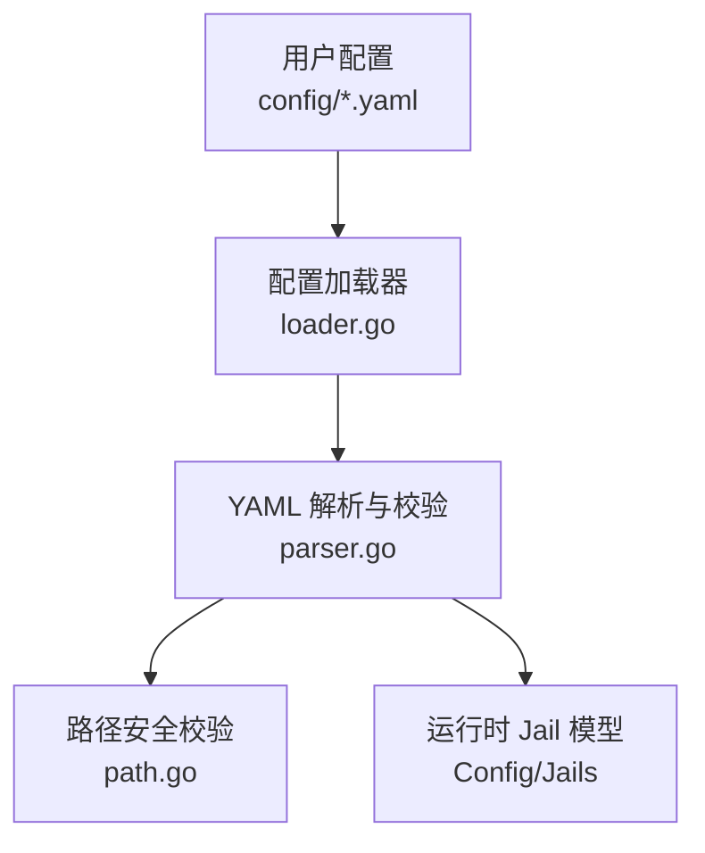
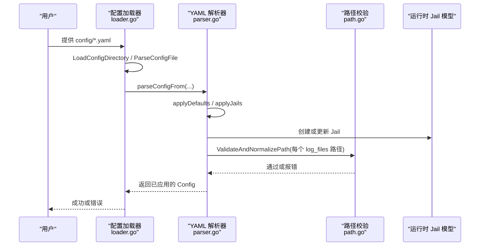
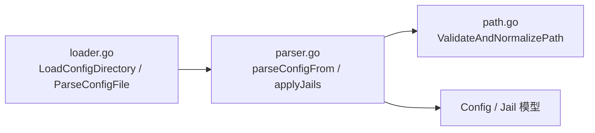

# 日志文件配置

<cite>
**本文引用的文件**   
- [parser.go](file://src/daemon/internal/config/parser.go)
- [loader.go](file://src/daemon/internal/config/loader.go)
- [path.go](file://src/daemon/internal/config/path.go)
- [default.yaml](file://config/default.yaml)
- [nginx.yaml](file://config/nginx.yaml)
- [apache.yaml](file://config/apache.yaml)
- [mysql.yaml](file://config/mysql.yaml)
- [postfix.yaml](file://config/postfix.yaml)
- [vsftpd.yaml](file://config/vsftpd.yaml)
</cite>

## 目录
1. [简介](#简介)
2. [项目结构](#项目结构)
3. [核心组件](#核心组件)
4. [架构总览](#架构总览)
5. [详细组件分析](#详细组件分析)
6. [依赖关系分析](#依赖关系分析)
7. [性能与轮转注意事项](#性能与轮转注意事项)
8. [故障排查指南](#故障排查指南)
9. [结论](#结论)

## 简介
本文聚焦于守护进程中的“Jail 日志文件”配置，说明如何通过 `log_files` 数组为每个 Jail 指定一个或多个日志路径，并解释其解析、校验、合并与默认行为。文档同时给出常见 Linux 发行版下认证日志的默认路径差异，以及多个服务的示例配置，帮助你在不同环境中快速启用日志监控与防护。

## 项目结构
与日志文件配置直接相关的代码位于守护进程的 Go 源码中，配置文件则集中在 `config/` 目录：
- 配置解析与校验逻辑：`src/daemon/internal/config/parser.go`
- 配置文件加载与目录合并逻辑：`src/daemon/internal/config/loader.go`
- 路径安全校验逻辑：`src/daemon/internal/config/path.go`
- 默认服务配置示例：`config/default.yaml`、`config/nginx.yaml`、`config/apache.yaml`、`config/mysql.yaml`、`config/postfix.yaml`、`config/vsftpd.yaml`

**图表来源**
- [loader.go:17-50](file://src/daemon/internal/config/loader.go#L17-L50)
- [parser.go:155-206](file://src/daemon/internal/config/parser.go#L155-L206)
- [path.go:10-52](file://src/daemon/internal/config/path.go#L10-L52)

**章节来源**
- [loader.go:17-129](file://src/daemon/internal/config/loader.go#L17-L129)
- [parser.go:155-206](file://src/daemon/internal/config/parser.go#L155-L206)
- [path.go:10-52](file://src/daemon/internal/config/path.go#L10-L52)

## 核心组件
- `yamlJail.LogFiles`：定义单个 Jail 要监控的日志文件列表，类型为字符串数组。
- `validateLogFiles`：对 `log_files` 进行数量上限校验，并将值写入对应 Jail。
- `applyJailDefinition`：在应用某个 Jail 定义时，若提供 `log_files`，则调用校验函数；否则保留已有值。
- `LoadConfigDirectory` / `ParseConfigFile`：负责读取 YAML 文件并按顺序合并，保证原子性（失败回滚）。
- `ValidateAndNormalizePath`：对路径做安全检查，包括路径遍历、URL 编码绕过、Shell 元字符、长度限制和符号链接规范化。

**章节来源**
- [parser.go:52-63](file://src/daemon/internal/config/parser.go#L52-L63)
- [parser.go:303-373](file://src/daemon/internal/config/parser.go#L303-L373)
- [parser.go:420-426](file://src/daemon/internal/config/parser.go#L420-L426)
- [loader.go:17-50](file://src/daemon/internal/config/loader.go#L17-L50)
- [loader.go:53-129](file://src/daemon/internal/config/loader.go#L53-L129)
- [path.go:10-52](file://src/daemon/internal/config/path.go#L10-L52)

## 架构总览
下图展示了从 YAML 配置到运行时 Jail 模型的完整流程，重点体现 `log_files` 的解析与校验。

**图表来源**
- [loader.go:17-50](file://src/daemon/internal/config/loader.go#L17-L50)
- [loader.go:53-129](file://src/daemon/internal/config/loader.go#L53-L129)
- [parser.go:155-206](file://src/daemon/internal/config/parser.go#L155-L206)
- [parser.go:277-373](file://src/daemon/internal/config/parser.go#L277-L373)
- [path.go:10-52](file://src/daemon/internal/config/path.go#L10-L52)

## 详细组件分析

### `log_files` 配置语法
- 字段位置：每个 Jail 下的 `log_files`。
- 类型：字符串数组，支持一个或多个路径。
- 作用：声明该 Jail 需要监控的日志文件路径集合。
- 数量限制：超过系统上限时会报错。
- 合并规则：同名 Jail 后到优先；只覆盖显式给出的字段。

参考示例：
- 单路径：Nginx 仅监控 `/var/log/nginx/error.log`。
- 多路径：MySQL/MariaDB 同时监控 MySQL 与 MariaDB 的错误日志。
- 跨发行版兼容：SSH 同时列出 Debian/Ubuntu 与 RHEL/CentOS 的认证日志路径。

**章节来源**
- [parser.go:52-63](file://src/daemon/internal/config/parser.go#L52-L63)
- [parser.go:303-373](file://src/daemon/internal/config/parser.go#L303-L373)
- [parser.go:420-426](file://src/daemon/internal/config/parser.go#L420-L426)
- [nginx.yaml:4-13](file://config/nginx.yaml#L4-L13)
- [mysql.yaml:4-14](file://config/mysql.yaml#L4-L14)
- [default.yaml:35-53](file://config/default.yaml#L35-L53)

### 不同 Linux 发行版的默认认证日志路径
- Debian/Ubuntu：`/var/log/auth.log`
- RHEL/CentOS：`/var/log/secure`

默认 SSH Jail 同时包含这两个路径，以兼容不同发行版。

**章节来源**
- [default.yaml:35-53](file://config/default.yaml#L35-L53)

### 日志文件路径的安全要求
所有日志路径都会经过统一的路径校验，拒绝不安全路径：
- 禁止路径遍历（如 `..`）
- 禁止 URL 编码绕过
- 禁止 Shell 元字符（如 `|&;$`()<>{} `）
- 路径长度上限
- 对已存在路径解析符号链接，防止通过软链接逃逸

这些检查发生在配置解析阶段，非法路径会直接导致配置加载失败。

**章节来源**
- [path.go:10-52](file://src/daemon/internal/config/path.go#L10-L52)

### 日志文件的权限要求
当前配置层不强制检查目标日志文件的实际文件系统权限；它只校验路径本身的安全性。因此，守护进程能否读取日志取决于运行时的进程权限与操作系统文件权限设置。建议：
- 确保守护进程有权限读取配置的日志路径。
- 避免将敏感日志放在权限过宽的位置。
- 使用最小权限原则管理日志目录与文件。

[本节为通用运维建议，未直接分析具体代码文件]

### 日志轮转处理
配置层没有内置日志轮转策略；日志轮转通常由系统的 `logrotate` 或其他日志管理工具负责。需要注意：
- 轮转后新文件应继承原路径，以便守护进程继续监控。
- 如果轮转策略改变了文件名或移动了文件，需同步更新 `log_files`。
- 轮转期间可能出现短暂的文件不可用，守护进程应在读取失败时按既有重试机制处理。

[本节为通用运维建议，未直接分析具体代码文件]

### 性能影响
- `log_files` 数量越多，守护进程需要打开和监控的句柄越多。
- 单个日志文件过大可能增加 I/O 压力。
- 正则匹配数量与复杂度会影响 CPU 消耗。
- 合理拆分日志、控制文件大小、精简正则表达式有助于降低开销。

[本节为通用性能建议，未直接分析具体代码文件]

### 常见服务日志路径配置示例
- Nginx：监控 `/var/log/nginx/error.log`
- Apache：监控 `/var/log/apache2/error.log`
- MySQL/MariaDB：监控 `/var/log/mysql/error.log` 与 `/var/log/mariadb/mariadb.log`
- Postfix：监控 `/var/log/mail.log` 与 `/var/log/maillog`
- vsftpd：监控 `/var/log/vsftpd.log` 与 `/var/log/auth.log`

**章节来源**
- [nginx.yaml:4-13](file://config/nginx.yaml#L4-L13)
- [apache.yaml:4-13](file://config/apache.yaml#L4-L13)
- [mysql.yaml:4-14](file://config/mysql.yaml#L4-L14)
- [postfix.yaml:4-13](file://config/postfix.yaml#L4-L13)
- [vsftpd.yaml:4-13](file://config/vsftpd.yaml#L4-L13)

### 自定义日志文件的配置方法
如果你有自己的服务或自定义日志路径，可按以下步骤配置：
1. 在 `jails` 下新增一个 Jail 名称。
2. 在该 Jail 下添加 `log_files`，填入一个或多个日志路径。
3. 如需精确匹配攻击事件，可添加 `regexes` 正则表达式。
4. 保存配置并让守护进程重载（或通过目录加载自动生效）。

注意：
- 路径必须通过 `ValidateAndNormalizePath` 检查。
- `log_files` 数量不能超过系统上限。
- 同名 Jail 会被后续配置覆盖，但只覆盖显式字段。

**章节来源**
- [parser.go:303-373](file://src/daemon/internal/config/parser.go#L303-L373)
- [parser.go:420-426](file://src/daemon/internal/config/parser.go#L420-L426)
- [path.go:10-52](file://src/daemon/internal/config/path.go#L10-L52)

## 依赖关系分析
下图展示配置加载与解析的关键依赖关系：

**图表来源**
- [loader.go:17-50](file://src/daemon/internal/config/loader.go#L17-L50)
- [loader.go:53-129](file://src/daemon/internal/config/loader.go#L53-L129)
- [parser.go:155-206](file://src/daemon/internal/config/parser.go#L155-L206)
- [parser.go:277-373](file://src/daemon/internal/config/parser.go#L277-L373)
- [path.go:10-52](file://src/daemon/internal/config/path.go#L10-L52)

**章节来源**
- [loader.go:17-129](file://src/daemon/internal/config/loader.go#L17-L129)
- [parser.go:155-206](file://src/daemon/internal/config/parser.go#L155-L206)
- [path.go:10-52](file://src/daemon/internal/config/path.go#L10-L52)

## 性能与轮转注意事项
- 控制 `log_files` 数量：避免为单个 Jail 配置过多路径。
- 控制日志文件大小：配合系统日志轮转工具，避免单文件过大。
- 精简正则表达式：减少 CPU 消耗。
- 避免频繁重载配置：仅在必要时触发重载。
- 监控守护进程资源占用：关注文件句柄数、内存与 CPU。

[本节为通用运维建议，未直接分析具体代码文件]

## 故障排查指南
- 配置解析失败：检查 YAML 语法与字段拼写。
- 路径校验失败：确认路径不含 `..`、URL 编码绕过、Shell 元字符，且长度不超过上限。
- 权限不足：确认守护进程能读取目标日志文件。
- 轮转后无法读取：确认轮转后文件路径与守护进程配置一致。
- 正则不匹配：检查正则表达式是否与服务日志格式匹配。

**章节来源**
- [path.go:10-52](file://src/daemon/internal/config/path.go#L10-L52)
- [parser.go:420-426](file://src/daemon/internal/config/parser.go#L420-L426)

## 结论
`log_files` 是 Jail 日志监控的核心配置项。通过数组形式支持多路径监控，结合路径安全校验与配置合并规则，可以在不同 Linux 发行版和服务环境下灵活启用日志防护。生产部署中，建议结合系统日志轮转工具、最小权限原则与合理的正则表达式，平衡安全性与性能。