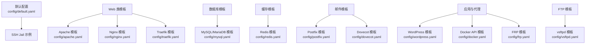
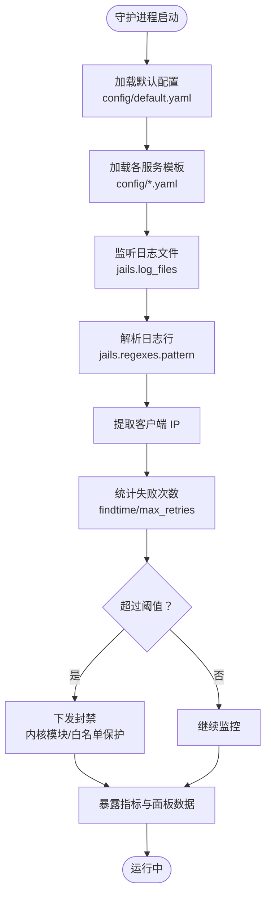
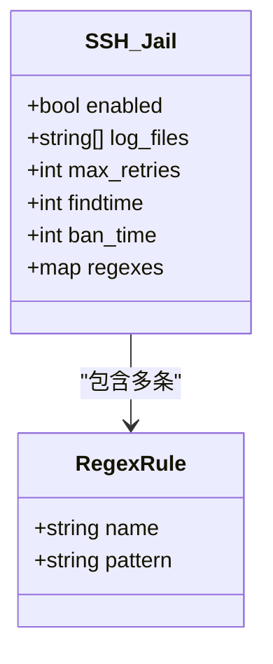
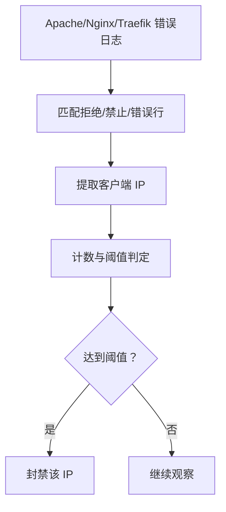
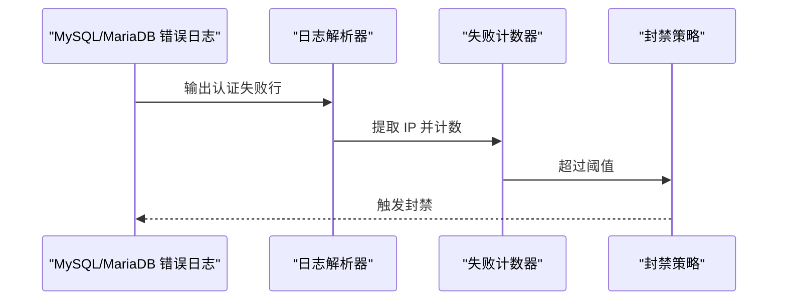
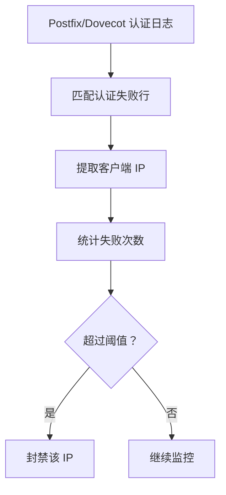
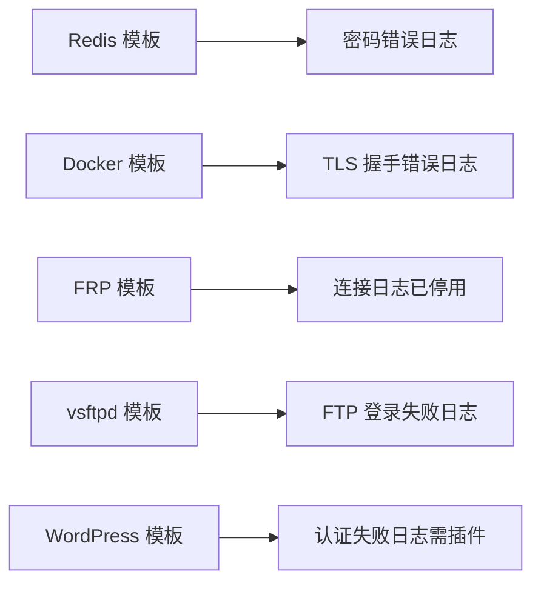
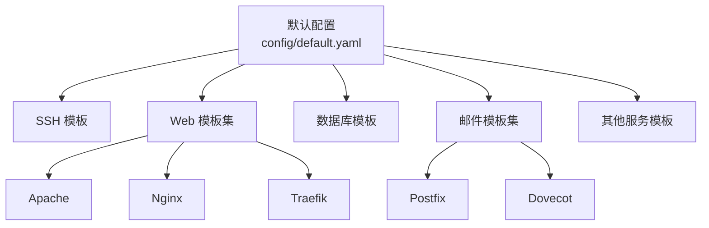

# 服务模板配置

<cite>
**本文引用的文件**   
- [default.yaml](file://config/default.yaml)
- [apache.yaml](file://config/apache.yaml)
- [nginx.yaml](file://config/nginx.yaml)
- [mysql.yaml](file://config/mysql.yaml)
- [postfix.yaml](file://config/postfix.yaml)
- [dovecot.yaml](file://config/dovecot.yaml)
- [docker.yaml](file://config/docker.yaml)
- [frp.yaml](file://config/frp.yaml)
- [redis.yaml](file://config/redis.yaml)
- [traefik.yaml](file://config/traefik.yaml)
- [vsftpd.yaml](file://config/vsftpd.yaml)
- [wordpress.yaml](file://config/wordpress.yaml)
</cite>

## 目录
1. [引言](#引言)
2. [项目结构](#项目结构)
3. [核心组件](#核心组件)
4. [架构总览](#架构总览)
5. [详细组件分析](#详细组件分析)
6. [依赖关系分析](#依赖关系分析)
7. [性能与容量建议](#性能与容量建议)
8. [故障排查指南](#故障排查指南)
9. [结论](#结论)
10. [附录：常见服务模板清单](#附录常见服务模板清单)

## 引言
本文面向需要为不同服务创建独立 Jail 规则的用户，基于默认配置中的 SSH 模板，系统说明如何为 Web 服务器、数据库、邮件服务等构建可复用的防护模板。文档同时给出 Apache/Nginx 访问日志、MySQL 错误日志、Postfix 邮件日志等常见服务的预定义配置示例，并指导如何根据业务需求调整监控规则与封禁策略。

## 项目结构
Jail 相关配置集中在 `config` 目录下：
- `default.yaml`：全局默认值与 SSH 示例 jail，是所有其他 jail 的基线。
- 各服务模板（如 `apache.yaml`、`nginx.yaml`、`mysql.yaml`、`postfix.yaml`、`dovecot.yaml`、`redis.yaml`、`traefik.yaml`、`vsftpd.yaml`、`wordpress.yaml`、`docker.yaml`、`frp.yaml`）：按服务维度拆分，便于按需启用或替换。

**图表来源**
- [default.yaml:32-53](file://config/default.yaml#L32-L53)
- [apache.yaml:4-13](file://config/apache.yaml#L4-L13)
- [nginx.yaml:4-13](file://config/nginx.yaml#L4-L13)
- [mysql.yaml:4-14](file://config/mysql.yaml#L4-L14)
- [postfix.yaml:4-13](file://config/postfix.yaml#L4-L13)
- [dovecot.yaml:4-13](file://config/dovecot.yaml#L4-L13)
- [redis.yaml:5-14](file://config/redis.yaml#L5-L14)
- [traefik.yaml:4-13](file://config/traefik.yaml#L4-L13)
- [vsftpd.yaml:4-13](file://config/vsftpd.yaml#L4-L13)
- [wordpress.yaml:5-14](file://config/wordpress.yaml#L5-L14)
- [docker.yaml:4-13](file://config/docker.yaml#L4-L13)
- [frp.yaml:4-17](file://config/frp.yaml#L4-L17)

**章节来源**
- [default.yaml:1-53](file://config/default.yaml#L1-L53)

## 核心组件
围绕“Jail 模板”的核心概念如下：
- 全局默认值：在 `defaults` 中定义，包括重试次数、时间窗口、封禁时长、检查间隔、指标端口与认证、日志路径、历史库路径等。
- Jail 定义：每个服务一个 jail，包含是否启用、日志文件列表、可选覆盖参数、以及用于提取攻击源 IP 的正则表达式集合。
- 正则表达式：通过捕获组提取客户端 IP，作为封禁依据；同一 jail 可定义多条规则以覆盖多种失败场景。

关键要点：
- 若未显式设置某项参数，将继承 `defaults` 中的值。
- `regexes` 中的 pattern 必须能匹配到目标日志行，并通过捕获组提取出 IPv4 地址。
- `log_files` 支持多路径，便于兼容不同发行版或容器化部署的日志位置。

**章节来源**
- [default.yaml:7-30](file://config/default.yaml#L7-L30)
- [default.yaml:32-53](file://config/default.yaml#L32-L53)

## 架构总览
下图展示从日志采集到封禁决策的整体流程，以及各服务模板在其中的角色。

**图表来源**
- [default.yaml:7-30](file://config/default.yaml#L7-L30)
- [default.yaml:32-53](file://config/default.yaml#L32-L53)

## 详细组件分析

### SSH 模板（参考基线）
SSH 模板展示了如何使用内置正则模式匹配多种失败场景，并演示了永久封禁的配置方式。

- 监控日志：auth.log 或 secure（兼容 Debian/Ubuntu 与 RHEL/CentOS）。
- 规则类型：无效用户、密码失败、连接关闭。
- 封禁策略：可设置为永久封禁（负数表示永久）。

**图表来源**
- [default.yaml:36-53](file://config/default.yaml#L36-L53)

**章节来源**
- [default.yaml:36-53](file://config/default.yaml#L36-L53)

### Web 服务器模板（Apache/Nginx/Traefik）
- Apache：监控错误日志，匹配“客户端被拒绝访问”的场景。
- Nginx：监控错误日志，匹配“访问被规则禁止”的场景。
- Traefik：监控错误日志，匹配“处理请求时发生错误”的场景。

共同点：
- 均基于错误日志定位恶意扫描或暴力尝试。
- 使用智能推断参数（注释中标注），可根据业务调整 findtime/ban_time。

**图表来源**
- [apache.yaml:4-13](file://config/apache.yaml#L4-L13)
- [nginx.yaml:4-13](file://config/nginx.yaml#L4-L13)
- [traefik.yaml:4-13](file://config/traefik.yaml#L4-L13)

**章节来源**
- [apache.yaml:1-14](file://config/apache.yaml#L1-L14)
- [nginx.yaml:1-14](file://config/nginx.yaml#L1-L14)
- [traefik.yaml:1-14](file://config/traefik.yaml#L1-L14)

### 数据库模板（MySQL/MariaDB）
- 监控 MySQL/MariaDB 错误日志。
- 匹配“Access denied for user...”场景，注意默认可能不记录认证失败，需开启相应日志选项。

**图表来源**
- [mysql.yaml:4-14](file://config/mysql.yaml#L4-L14)

**章节来源**
- [mysql.yaml:1-15](file://config/mysql.yaml#L1-L15)

### 邮件服务模板（Postfix/Dovecot）
- Postfix：监控 SASL 认证失败，防止中继滥用。
- Dovecot：监控 IMAP/POP3 认证失败，防止账户暴力破解。

**图表来源**
- [postfix.yaml:4-13](file://config/postfix.yaml#L4-L13)
- [dovecot.yaml:4-13](file://config/dovecot.yaml#L4-L13)

**章节来源**
- [postfix.yaml:1-14](file://config/postfix.yaml#L1-L14)
- [dovecot.yaml:1-14](file://config/dovecot.yaml#L1-L14)

### 其他服务模板（Redis/Docker/FRP/vsftpd/WordPress）
- Redis：监控密码错误日志，需确保已开启相应日志级别。
- Docker：监控 TLS 握手错误，防范未授权 API 访问。
- FRP：当前模板已停用（原正则匹配成功连接而非失败），不建议直接启用。
- vsftpd：监控 FTP 登录失败日志。
- WordPress：依赖插件输出认证失败日志，再结合 Web 服务器错误日志进行匹配。

**图表来源**
- [redis.yaml:5-14](file://config/redis.yaml#L5-L14)
- [docker.yaml:4-13](file://config/docker.yaml#L4-L13)
- [frp.yaml:4-17](file://config/frp.yaml#L4-L17)
- [vsftpd.yaml:4-13](file://config/vsftpd.yaml#L4-L13)
- [wordpress.yaml:5-14](file://config/wordpress.yaml#L5-L14)

**章节来源**
- [redis.yaml:1-15](file://config/redis.yaml#L1-L15)
- [docker.yaml:1-14](file://config/docker.yaml#L1-L14)
- [frp.yaml:1-18](file://config/frp.yaml#L1-L18)
- [vsftpd.yaml:1-14](file://config/vsftpd.yaml#L1-L14)
- [wordpress.yaml:1-15](file://config/wordpress.yaml#L1-L15)

## 依赖关系分析
- 所有服务模板都依赖 `default.yaml` 的全局默认值；当模板未显式覆盖时，将继承默认的重试次数、时间窗口、封禁时长等。
- 各模板之间相互独立，可按需启用或禁用，避免互相干扰。
- 部分服务（如 MySQL、Redis）需要在服务自身配置中开启认证失败日志，否则模板无法命中规则。

**图表来源**
- [default.yaml:7-30](file://config/default.yaml#L7-L30)
- [apache.yaml:4-13](file://config/apache.yaml#L4-L13)
- [nginx.yaml:4-13](file://config/nginx.yaml#L4-L13)
- [traefik.yaml:4-13](file://config/traefik.yaml#L4-L13)
- [postfix.yaml:4-13](file://config/postfix.yaml#L4-L13)
- [dovecot.yaml:4-13](file://config/dovecot.yaml#L4-L13)

**章节来源**
- [default.yaml:7-30](file://config/default.yaml#L7-L30)

## 性能与容量建议
- 合理设置 `findtime` 与 `ban_time`：过短可能导致漏判，过长可能造成误伤。建议先采用模板注释中的“智能推断参数”，再根据实际告警量调优。
- 控制 `max_retries`：对高频但低危害的服务可适当提高阈值，降低误封概率。
- 关注指标端口与绑定地址：生产环境务必配置认证凭据，并将指标端口绑定到合适的地址。
- 容量上限：封禁表、白名单、速率表等均有最大条目限制，应根据业务规模评估并调整。

[本节为通用建议，不直接分析具体文件]

## 故障排查指南
常见问题与定位思路：
- 规则未命中：
  - 确认 `log_files` 路径正确且守护进程有读取权限。
  - 检查服务是否已开启认证失败日志（如 MySQL、Redis）。
  - 验证 `regexes.pattern` 是否能匹配到真实日志行，并确保捕获组能提取出 IPv4 地址。
- 频繁误封：
  - 适当增大 `findtime` 与 `max_retries`。
  - 将可信 IP 加入白名单，避免运维或内网流量被封禁。
- 面板不可用或指标缺失：
  - 检查 `metrics_port` 与 `metrics_bind_address` 配置是否正确。
  - 确认已配置 HTTP 认证凭据（生产环境必填）。

**章节来源**
- [default.yaml:7-30](file://config/default.yaml#L7-L30)
- [default.yaml:54-62](file://config/default.yaml#L54-L62)
- [default.yaml:93-110](file://config/default.yaml#L93-L110)

## 结论
通过 `default.yaml` 提供的 SSH 模板与全局默认值，可以快速为各类服务创建独立的 Jail 规则。各服务模板覆盖了 Web、数据库、邮件、缓存、代理与 FTP 等常见场景，便于按需启用与扩展。实际部署中，应结合业务特征调整时间窗口、封禁时长与重试阈值，并配合白名单与威胁情报提升整体防护效果。

[本节为总结性内容，不直接分析具体文件]

## 附录：常见服务模板清单
- Web 服务器
  - Apache：监控错误日志，匹配客户端被拒绝访问。
  - Nginx：监控错误日志，匹配访问被规则禁止。
  - Traefik：监控错误日志，匹配处理请求时的错误。
- 数据库
  - MySQL/MariaDB：监控错误日志，匹配认证失败。
- 邮件服务
  - Postfix：监控 SASL 认证失败。
  - Dovecot：监控 IMAP/POP3 认证失败。
- 其他
  - Redis：监控密码错误。
  - Docker：监控 TLS 握手错误。
  - FRP：当前模板已停用。
  - vsftpd：监控 FTP 登录失败。
  - WordPress：依赖插件输出认证失败日志。

**章节来源**
- [apache.yaml:1-14](file://config/apache.yaml#L1-L14)
- [nginx.yaml:1-14](file://config/nginx.yaml#L1-L14)
- [traefik.yaml:1-14](file://config/traefik.yaml#L1-L14)
- [mysql.yaml:1-15](file://config/mysql.yaml#L1-L15)
- [postfix.yaml:1-14](file://config/postfix.yaml#L1-L14)
- [dovecot.yaml:1-14](file://config/dovecot.yaml#L1-L14)
- [redis.yaml:1-15](file://config/redis.yaml#L1-L15)
- [docker.yaml:1-14](file://config/docker.yaml#L1-L14)
- [frp.yaml:1-18](file://config/frp.yaml#L1-L18)
- [vsftpd.yaml:1-14](file://config/vsftpd.yaml#L1-L14)
- [wordpress.yaml:1-15](file://config/wordpress.yaml#L1-L15)