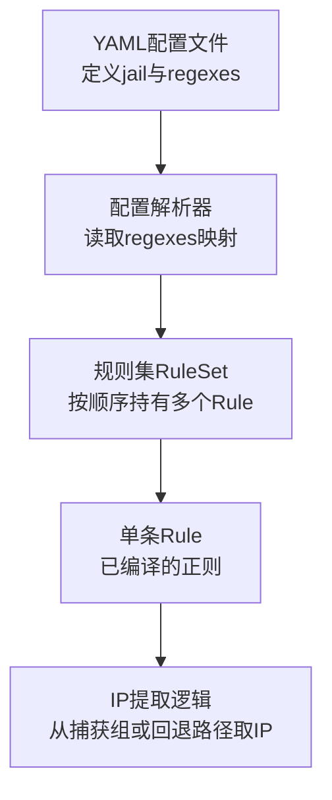
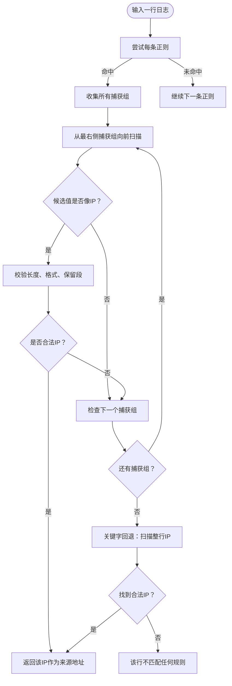
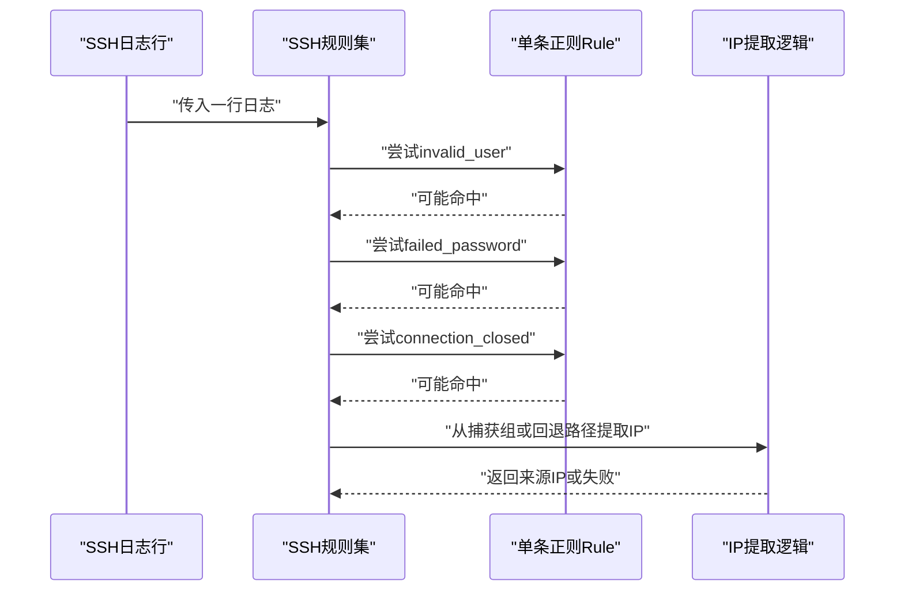
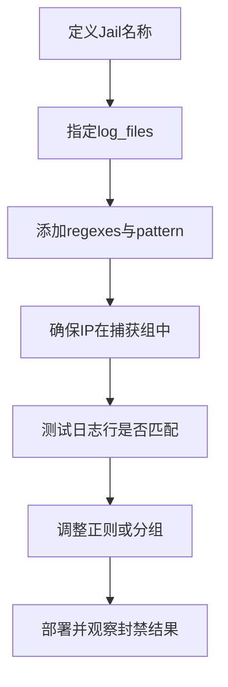
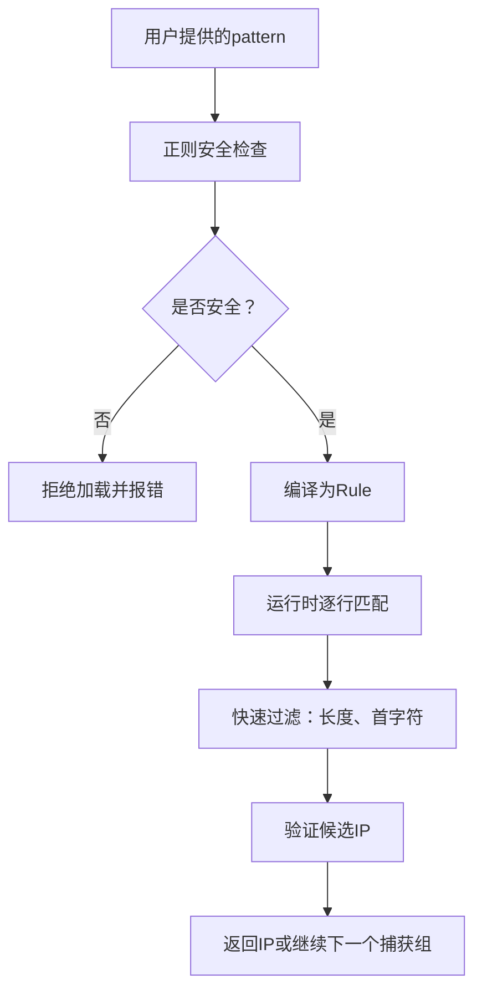
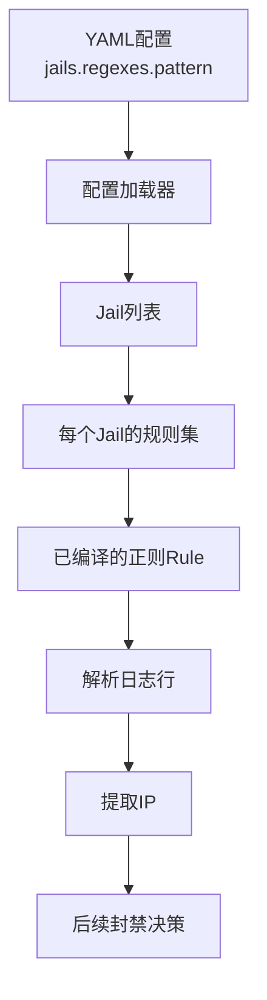

# 正则表达式模式

<cite>
**本文引用的文件**   
- [default.yaml](file://config/default.yaml)
- [parser.go](file://src/daemon/internal/config/parser.go)
- [rule.go](file://src/daemon/internal/logparse/rule.go)
- [ip.go](file://src/daemon/internal/logparse/ip.go)
</cite>

## 目录
1. [简介](#简介)
2. [项目结构中的正则位置](#项目结构中的正则位置)
3. [pattern字段的正则语法与IP分组约定](#pattern字段的正则语法与ip分组约定)
4. [内置SSH攻击模式解析示例](#内置ssh攻击模式解析示例)
5. [如何编写自定义正则表达式](#如何编写自定义正则表达式)
6. [正则安全校验与性能优化建议](#正则安全校验与性能优化建议)
7. [调试技巧](#调试技巧)
8. [架构与数据流总览](#架构与数据流总览)
9. [常见问题排查](#常见问题排查)
10. [结论](#结论)

## 简介
本文聚焦于Jail的正则表达式模式，目标是帮助你在不同服务日志中准确提取来源IP，并据此触发封禁。文档重点包括：
- `pattern`字段使用的正则语法。
- IP地址提取分组的工作机制。
- 内置SSH攻击模式（`invalid_user`、`failed_password`、`connection_closed`）的解析说明。
- 如何为其他服务日志编写自定义正则。
- 正则性能优化与ReDoS防护。
- 实用调试方法。

## 项目结构中的正则位置
项目中Jail的正则定义主要位于YAML配置文件中，例如默认SSH Jail的正则在默认配置里；其他服务的正则分别放在对应服务的配置文件中。运行时，这些正则会被加载到守护进程内部，编译成不可变的规则对象，再用于逐行解析日志。

**图表来源**
- [default.yaml:35-52](file://config/default.yaml#L35-L52)
- [parser.go:52-80](file://src/daemon/internal/config/parser.go#L52-L80)
- [parser.go:344-365](file://src/daemon/internal/config/parser.go#L344-L365)
- [rule.go:35-88](file://src/daemon/internal/logparse/rule.go#L35-L88)

**章节来源**
- [default.yaml:35-52](file://config/default.yaml#L35-L52)
- [parser.go:52-80](file://src/daemon/internal/config/parser.go#L52-L80)
- [parser.go:344-365](file://src/daemon/internal/config/parser.go#L344-L365)

## pattern字段的正则语法与IP分组约定
### 支持的语法
- `pattern`字段使用Go标准库正则语法。
- 每个命名规则（如`invalid_user`）对应一个独立的正则字符串。
- 同一Jail下可以定义多条正则，系统会按顺序尝试匹配。

### IP地址提取分组
系统并不要求你把IP放在某个固定编号的捕获组中，而是采用“从右向左扫描所有捕获组”的策略：
1. 对一行日志执行正则匹配。
2. 如果命中，系统从最后一个捕获组开始向前检查。
3. 对每个候选捕获值做长度、首字符、合法性等快速过滤。
4. 第一个能解析为合法且非保留段IP的捕获组即被视为来源IP。

这意味着：
- 如果你只把IP放在一个捕获组中，它会被自动识别。
- 如果你同时捕获用户名和IP，IP通常应放在更靠后的捕获组，以便被优先选中。
- 如果没有捕获组，系统还会走关键字回退路径，在整行中扫描IP。

**图表来源**
- [rule.go:50-77](file://src/daemon/internal/logparse/rule.go#L50-L77)
- [rule.go:108-133](file://src/daemon/internal/logparse/rule.go#L108-L133)
- [ip.go:17-33](file://src/daemon/internal/logparse/ip.go#L17-L33)

**章节来源**
- [rule.go:50-77](file://src/daemon/internal/logparse/rule.go#L50-L77)
- [rule.go:108-133](file://src/daemon/internal/logparse/rule.go#L108-L133)
- [ip.go:17-33](file://src/daemon/internal/logparse/ip.go#L17-L33)

## 内置SSH攻击模式解析示例
默认SSH Jail定义了三个常用SSH失败模式：
- `invalid_user`：匹配无效用户登录尝试。
- `failed_password`：匹配密码失败，包含可选的“无效用户”前缀。
- `connection_closed`：匹配因无效用户导致的连接关闭。

这三个模式的共同点是：
- 都通过固定的文本片段定位SSH日志事件。
- 都使用一个捕获组包裹IP地址。
- 系统会从该捕获组中提取IP。

**图表来源**
- [default.yaml:46-52](file://config/default.yaml#L46-L52)
- [rule.go:108-133](file://src/daemon/internal/logparse/rule.go#L108-L133)

**章节来源**
- [default.yaml:46-52](file://config/default.yaml#L46-L52)
- [rule.go:108-133](file://src/daemon/internal/logparse/rule.go#L108-L133)

## 如何编写自定义正则表达式
### 基本步骤
1. 确定你要监控的服务日志文件路径。
2. 在对应Jail的`regexes`下添加一条或多条`pattern`。
3. 确保正则中包含至少一个捕获组，且该捕获组最终匹配的是来源IP。
4. 如果无法用正则精确匹配，可依赖关键字回退路径，但最好仍提供明确正则以提高准确率。

### 常见服务示例参考
项目中已有多个服务的正则示例，可作为模板参考：
- FRP：从连接信息中提取客户端IP。
- MySQL：从拒绝访问日志中提取客户端IP。
- Postfix：从SASL认证失败日志中提取客户端IP。
- vsftpd：从登录失败日志中提取客户端IP。

**图表来源**
- [parser.go:52-80](file://src/daemon/internal/config/parser.go#L52-L80)
- [parser.go:344-365](file://src/daemon/internal/config/parser.go#L344-L365)

**章节来源**
- [parser.go:52-80](file://src/daemon/internal/config/parser.go#L52-L80)
- [parser.go:344-365](file://src/daemon/internal/config/parser.go#L344-L365)

## 正则安全校验与性能优化建议
### ReDoS防护
系统会对正则进行安全检查，拒绝可能导致指数级回溯的模式，包括：
- 嵌套量词，例如组内有量词后整组再量化。
- 占有量词。
- 量化的交替组。
- 非法的量词组合。
- 模式过长或分支过多。

这些限制旨在防止恶意或错误正则导致CPU占用飙升。

### 性能优化建议
- 尽量让正则尽早失败：把固定前缀放在前面，减少回溯空间。
- 避免过度使用贪婪量词和复杂嵌套。
- 控制正则数量：同一Jail下的正则越多，每行日志需要尝试的次数越多。
- 优先使用明确的文本片段定位，而不是宽泛的通配。
- 如果日志很长，系统有行长上限，超长行不会进入完整解析流程。

**图表来源**
- [rule.go:141-191](file://src/daemon/internal/logparse/rule.go#L141-L191)
- [rule.go:50-77](file://src/daemon/internal/logparse/rule.go#L50-L77)

**章节来源**
- [rule.go:141-191](file://src/daemon/internal/logparse/rule.go#L141-L191)
- [rule.go:50-77](file://src/daemon/internal/logparse/rule.go#L50-L77)

## 调试技巧
### 确认正则是否生效
- 检查Jail是否正确启用。
- 确认`log_files`指向正确的日志路径。
- 确认正则确实匹配目标日志行。
- 观察是否成功提取到IP。

### 常见问题
- 正则未匹配：可能是日志格式变化，需要更新`pattern`。
- 提取到错误IP：检查捕获组顺序，确保IP是最合适的候选。
- 性能问题：检查是否存在危险正则结构，或正则数量过多。
- 长日志未解析：超过行长上限的行不会被解析。

### 推荐调试流程
1. 复制一条真实日志行。
2. 用本地正则工具测试你的`pattern`。
3. 确认IP出现在期望的捕获组。
4. 将正则加入Jail配置并重启或重载。
5. 观察是否出现预期封禁。

**章节来源**
- [rule.go:10-11](file://src/daemon/internal/logparse/rule.go#L10-L11)
- [rule.go:141-191](file://src/daemon/internal/logparse/rule.go#L141-L191)

## 架构与数据流总览
下图展示从YAML配置到日志解析再到IP提取的整体流程：

**图表来源**
- [default.yaml:35-52](file://config/default.yaml#L35-L52)
- [parser.go:277-373](file://src/daemon/internal/config/parser.go#L277-L373)
- [rule.go:79-127](file://src/daemon/internal/logparse/rule.go#L79-L127)

**章节来源**
- [default.yaml:35-52](file://config/default.yaml#L35-L52)
- [parser.go:277-373](file://src/daemon/internal/config/parser.go#L277-L373)
- [rule.go:79-127](file://src/daemon/internal/logparse/rule.go#L79-L127)

## 常见问题排查
### 为什么我的正则没有匹配到IP？
- 检查是否遗漏捕获组。
- 检查捕获组内容是否确实是IP。
- 检查日志格式是否与正则一致。
- 检查是否触发了正则安全检查。

### 为什么提取到了错误的IP？
- 如果有多个捕获组，确认IP是否在最右侧的合适位置。
- 检查是否有其他数字串被误判为IP。
- 使用关键字回退时，确认整行中第一个合法IP是否符合预期。

### 为什么正则加载失败？
- 检查是否包含危险结构，如嵌套量词、占有量词、非法量词组合。
- 检查正则是否过长或分支过多。
- 检查YAML语法是否正确。

**章节来源**
- [rule.go:141-191](file://src/daemon/internal/logparse/rule.go#L141-L191)
- [rule.go:50-77](file://src/daemon/internal/logparse/rule.go#L50-L77)
- [ip.go:17-33](file://src/daemon/internal/logparse/ip.go#L17-L33)

## 结论
Jail的正则模式以`pattern`字段为核心，通过捕获组提取IP，并在必要时回退到关键字扫描。内置SSH模式提供了常见攻击场景的参考实现，而自定义正则则需要遵循明确的分组约定与安全规范。合理设计正则、控制复杂度、利用系统提供的安全检查，可以帮助你稳定地从各类服务日志中提取攻击源IP，并触发准确的封禁决策。