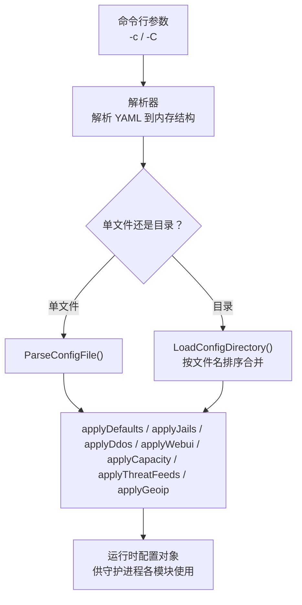
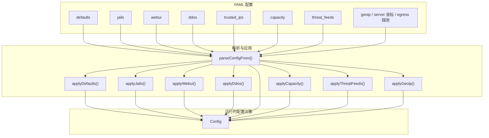
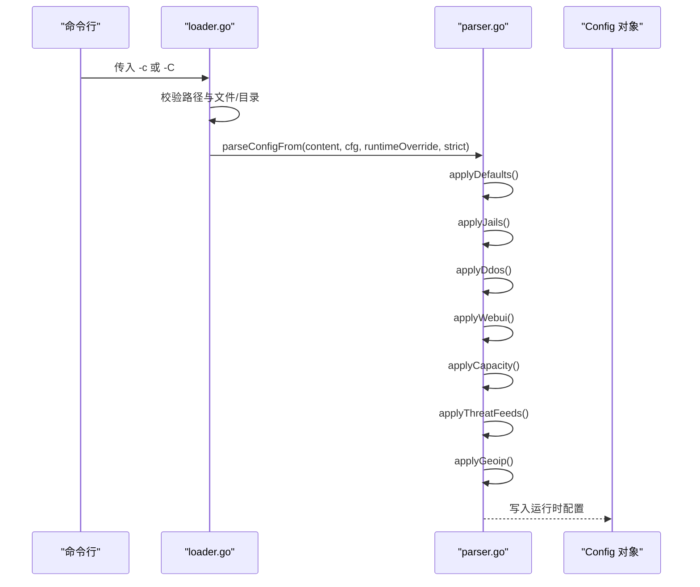

# YAML配置语法

<cite>
**本文引用的文件**   
- [default.yaml](file://config/default.yaml)
- [examples.md](file://docs/zh/configuration/examples.md)
- [parser.go](file://src/daemon/internal/config/parser.go)
- [loader.go](file://src/daemon/internal/config/loader.go)
- [args.go](file://src/daemon/internal/config/args.go)
</cite>

## 目录
1. [简介](#简介)
2. [项目结构](#项目结构)
3. [核心组件](#核心组件)
4. [架构总览](#架构总览)
5. [详细组件分析](#详细组件分析)
6. [依赖关系分析](#依赖关系分析)
7. [性能与容量注意事项](#性能与容量注意事项)
8. [故障排查指南](#故障排查指南)
9. [结论](#结论)
10. [附录：完整字段参考表](#附录完整字段参考表)

## 简介
本文面向系统管理员，系统化说明防火墙守护进程的 YAML 配置文件语法。内容覆盖全局默认值、Jail 服务监控、Web UI 面板、DDoS 防护、可信 IP 白名单、容量限制、威胁情报源等所有配置段，明确每个配置项的数据类型、取值范围、默认值与作用域，并提供示例与最佳实践，帮助正确编写和维护配置文件。

## 项目结构
YAML 配置由守护进程在启动或重载时读取，支持两种加载方式：
- 单文件模式：通过命令行参数指定单个 YAML 文件路径。
- 目录模式：指定目录后按字母序合并多个 YAML 文件；以 `_` 开头的运行期覆盖文件最后合并，拥有最终覆盖权。

**图示来源**
- [args.go:23-60](file://src/daemon/internal/config/args.go#L23-L60)
- [loader.go:17-51](file://src/daemon/internal/config/loader.go#L17-L51)
- [loader.go:53-128](file://src/daemon/internal/config/loader.go#L53-L128)
- [parser.go:155-206](file://src/daemon/internal/config/parser.go#L155-L206)

**章节来源**
- [args.go:23-60](file://src/daemon/internal/config/args.go#L23-L60)
- [loader.go:17-51](file://src/daemon/internal/config/loader.go#L17-L51)
- [loader.go:53-128](file://src/daemon/internal/config/loader.go#L53-L128)

## 核心组件
YAML 顶层结构包含以下段落：
- defaults：全局默认值，作用于所有 Jail，除非被具体 Jail 覆盖。
- jails：定义需要监控的服务（Jail），包括日志文件、正则表达式、阈值和集群检测等。
- webui：Web 管理面板相关设置，如 SSE 推送间隔、速率告警阈值等。
- ddos：DDoS 防护开关与阈值，以及内核侧参数。
- trusted_ips：可信 IP/CIDR 白名单，启动时下发至内核。
- capacity：容量上限，控制封禁表、白名单、速率表和本地缓存大小。
- threat_feeds：威胁情报源列表，自动拉取并增强判定。
- geoip_db_path、server_latitude/server_longitude、geoip_detect_egress/geoip_egress_probe_url：可选的地理信息与出口探测配置。

**章节来源**
- [parser.go:16-29](file://src/daemon/internal/config/parser.go#L16-L29)
- [default.yaml:1-198](file://config/default.yaml#L1-L198)

## 架构总览
下图展示配置从 YAML 到运行时对象的映射关系，以及各段如何影响守护进程行为。

**图示来源**
- [parser.go:155-206](file://src/daemon/internal/config/parser.go#L155-L206)
- [parser.go:209-275](file://src/daemon/internal/config/parser.go#L209-L275)
- [parser.go:277-405](file://src/daemon/internal/config/parser.go#L277-L405)
- [parser.go:499-559](file://src/daemon/internal/config/parser.go#L499-L559)
- [parser.go:561-591](file://src/daemon/internal/config/parser.go#L561-L591)
- [parser.go:593-635](file://src/daemon/internal/config/parser.go#L593-L635)

## 详细组件分析

### defaults 全局默认值
作用域：为所有 Jail 提供默认行为，除非 Jail 显式覆盖。  
关键字段与语义：
- max_retries：重试次数，类型为无符号整数；0 表示回退到默认值。
- findtime：统计窗口时长（秒）；小于 10 会被提升到最小值，且若小于 60 会回退到默认。
- ban_time：封禁时长（秒）；0 表示回退到默认；负数表示永久封禁。
- interval：检查间隔（秒）。
- metrics_port / metrics_bind_address / metrics_username / metrics_password：指标端口、监听地址与认证凭据。
- log_file / log_level：守护进程独立日志路径与级别。
- history_db_path / history_retention_days：历史库路径与保留天数；路径为空则关闭分析相关功能。
- log_destination / log_format / log_max_size_mb / log_max_files：日志目标、格式与轮转参数。

默认值与校验要点：
- findtime 最小有效值为 10，但内部还会用“至少 60”的规则进行回退保护。
- ban_time 为 0 时使用默认值；负数用于永久封禁。
- 日志目标与格式仅接受特定枚举值，非法值将导致配置失败。

最佳实践：
- 生产环境务必设置 metrics_username 与 metrics_password，并在绑定非回环地址时启用认证。
- 如需面板分析能力，必须设置 history_db_path 并创建对应目录。

**章节来源**
- [parser.go:32-50](file://src/daemon/internal/config/parser.go#L32-L50)
- [parser.go:209-275](file://src/daemon/internal/config/parser.go#L209-L275)
- [parser.go:428-471](file://src/daemon/internal/config/parser.go#L428-L471)
- [default.yaml:7-31](file://config/default.yaml#L7-L31)

### jails 服务监控
作用域：针对每个服务（Jail）独立监控日志、匹配攻击并触发封禁。  
关键字段与语义：
- enabled：是否启用该 Jail。
- log_files：日志文件路径数组；数量有上限。
- regex / regex_name：单条自定义正则及其名称。
- regexes：多条命名正则的映射，每条含 pattern。
- cluster：集群扫描检测配置，包括前缀长度、时间窗口、最小 IP 数、每 IP 最大连接数、封禁时长等。
- max_retries / findtime / ban_time：覆盖 defaults 中的默认值。

智能推断：
- 当只给出 log_files 或 regex 时，系统会为新建 Jail 应用智能默认值：findtime 默认 10 分钟，ban_time 根据 findtime 选择 1 小时或 24 小时，max_retries 根据 findtime 长短选择 2 或 3。

约束与校验：
- log_files 数量超过上限会报错。
- 正则数量超过上限会报错。
- 同名 Jail 后加载优先；运行期覆盖文件中未定义的 Jail 名会被忽略并告警。

最佳实践：
- 使用 regexes 而非单条 regex，便于分类与审计。
- 对数据库类服务，确保服务已开启认证失败日志记录。
- 使用 cluster 段先以 audit_only 模式观察，再切换到封禁。

**章节来源**
- [parser.go:52-80](file://src/daemon/internal/config/parser.go#L52-L80)
- [parser.go:277-405](file://src/daemon/internal/config/parser.go#L277-L405)
- [parser.go:473-497](file://src/daemon/internal/config/parser.go#L473-L497)
- [default.yaml:35-53](file://config/default.yaml#L35-L53)
- [examples.md:6-100](file://docs/zh/configuration/examples.md#L6-L100)

### webui 面板设置
作用域：Web 管理面板的行为与显示阈值。  
关键字段与语义：
- sse_push_interval：SSE 推送间隔（秒）。
- rate_warning_pps / rate_critical_pps：PPS 警告与严重阈值。
- rate_warning_syn / rate_critical_syn：SYN 速率警告与严重阈值。
- max_syn_per_second / max_udp_per_second / max_icmp_per_second / max_ack_per_second / max_rst_per_second / max_fin_per_second：协议专项阈值。
- static_threshold / dynamic_threshold / ddos_detection：DDoS 检测开关。
- max_ban_entries / max_whitelist_entries / max_rate_entries / max_local_ip_cache：面板侧容量提示。
- clear_logs_at：日志页过滤起点（ISO 时间戳字符串），随 webui 段落盘持久化。

最佳实践：
- 合理设置 PPS/SYN 阈值，避免误报；结合 ddos.static_threshold 与 ddos.dynamic_threshold 协同调参。
- 谨慎调整面板容量字段，通常与 capacity 保持一致。

**章节来源**
- [parser.go:104-127](file://src/daemon/internal/config/parser.go#L104-L127)
- [parser.go:524-548](file://src/daemon/internal/config/parser.go#L524-L548)
- [default.yaml:54-61](file://config/default.yaml#L54-L61)

### ddos 防护参数
作用域：DDoS 检测与自动封禁策略，部分参数同步到内核模块。  
关键字段与语义：
- enabled：总开关。
- global_conn_rate：全局每秒最大连接数。
- auto_ban_duration / auto_ban_threshold：自动封禁时长与超阈值次数。
- check_interval：检测间隔（秒）。
- baseline_warmup_samples：动态阈值预热样本数。
- max_syn_per_second / max_udp_per_second / max_icmp_per_second / max_ack_per_second / max_rst_per_second / max_fin_per_second：协议专项阈值。
- static_threshold / dynamic_threshold / ddos_detection：静态阈值、动态阈值与总检测开关。
- max_bans_per_second / max_rate_entries：内核侧泛洪保护与速率表条目上限。
- protect_open_ports：是否仅对外监听端口参与速率判定。

最佳实践：
- 公网服务器建议开启 protect_open_ports，聚焦真实暴露面。
- 动态阈值适合流量波动大的场景，需配合足够的 warmup samples。
- 合理设置 max_rate_entries 以匹配并发源 IP 规模。

**章节来源**
- [parser.go:82-102](file://src/daemon/internal/config/parser.go#L82-L102)
- [parser.go:499-522](file://src/daemon/internal/config/parser.go#L499-L522)
- [default.yaml:63-91](file://config/default.yaml#L63-L91)

### trusted_ips 白名单
作用域：启动时自动加入内核白名单，防止误封。  
语法与行为：
- 支持单 IP 与 CIDR 格式。
- 改此段需重启守护进程；热重载不重下发。
- 一条写错只会跳过该条目并告警，不会阻止守护进程启动。

最佳实践：
- 将运维跳板机、负载均衡与健康检查来源加入白名单。
- 使用 CIDR 聚合网段，减少条目数量。

**章节来源**
- [parser.go:21-21](file://src/daemon/internal/config/parser.go#L21-L21)
- [default.yaml:93-101](file://config/default.yaml#L93-L101)
- [examples.md:169-178](file://docs/zh/configuration/examples.md#L169-L178)

### capacity 容量限制
作用域：用户自定义上限，控制内核与守护进程侧数据结构大小。  
关键字段与语义：
- max_ban_entries：封禁表最大条目数。
- max_whitelist_entries：白名单最大条目数。
- max_rate_entries：速率表最大条目数。
- max_local_ip_cache：本地 IP 缓存最大条目数。

最佳实践：
- 根据业务并发与攻击规模调整，避免过小导致频繁淘汰或过大造成内存压力。
- 与 ddos.max_rate_entries 保持协调。

**章节来源**
- [parser.go:129-135](file://src/daemon/internal/config/parser.go#L129-L135)
- [parser.go:550-559](file://src/daemon/internal/config/parser.go#L550-L559)
- [default.yaml:103-110](file://config/default.yaml#L103-L110)

### threat_feeds 威胁情报源
作用域：自动拉取公网威胁情报，高置信度 IP 直接封禁，跳过窗口计数。  
关键字段与语义：
- enabled：总开关。
- refresh_interval：自动刷新间隔（秒），默认 86400。
- http_timeout：单次拉取的 HTTP 超时（秒）。
- max_retries：拉取失败后的重试次数。
- sources：情报源列表，每项含 name、url、enabled、category、confidence。

行为与默认：
- 若 sources 为空，使用内置默认源（例如 IPsum、FireHOL Level 1）。
- 提供完整 sources 列表时会替换默认值。

最佳实践：
- 保守源（如 FireHOL Level 1）可长期启用；高风险源建议先关闭或降低 confidence。
- 定期审查 source.enabled 与 confidence，平衡误报与漏报。

**章节来源**
- [parser.go:137-153](file://src/daemon/internal/config/parser.go#L137-L153)
- [parser.go:561-591](file://src/daemon/internal/config/parser.go#L561-L591)
- [default.yaml:123-168](file://config/default.yaml#L123-L168)

### geoip 与本机坐标、出口探测
作用域：可选的地理信息与出口 IP 探测，用于攻击地图与定位。  
关键字段与语义：
- geoip_db_path：City 级 GeoIP 库路径；留空或不存在则禁用地理分布功能。
- server_latitude / server_longitude：本机经纬度，必须成对给出；纬度范围 [-90, 90]，经度范围 [-180, 180]。
- geoip_detect_egress：是否启用出口 IP 探测（默认关闭）。
- geoip_egress_probe_url：探测地址，必须以 http:// 或 https:// 开头，主机名非空，长度有限制。

行为与校验：
- 只写一个坐标会拒绝加载。
- 探测 URL 严格校验，不允许空白与控制字符。

最佳实践：
- 地图功能需下载 City 级库；Country 库不含经纬度不可用。
- 云主机内网地址无法离线推导出公网出口，可启用 geoip_detect_egress 并核对日志中的探测目标。

**章节来源**
- [parser.go:593-635](file://src/daemon/internal/config/parser.go#L593-L635)
- [parser.go:637-706](file://src/daemon/internal/config/parser.go#L637-L706)
- [default.yaml:112-121](file://config/default.yaml#L112-L121)
- [default.yaml:170-198](file://config/default.yaml#L170-L198)

## 依赖关系分析
配置解析流程的关键依赖如下：
- 命令行参数决定加载模式（单文件或目录）。
- loader.go 负责文件存在性、类型与顺序处理，并调用 parser.go 解析。
- parser.go 将 YAML 解码为内存结构，并按顺序应用 defaults、jails、ddos、webui、trusted_ips、capacity、threat_feeds、geoip。
- 环境变量覆盖放在 YAML 全部应用之后，优先级最高。

**图示来源**
- [args.go:23-60](file://src/daemon/internal/config/args.go#L23-L60)
- [loader.go:17-51](file://src/daemon/internal/config/loader.go#L17-L51)
- [loader.go:53-128](file://src/daemon/internal/config/loader.go#L53-L128)
- [parser.go:155-206](file://src/daemon/internal/config/parser.go#L155-L206)

**章节来源**
- [args.go:23-60](file://src/daemon/internal/config/args.go#L23-L60)
- [loader.go:17-51](file://src/daemon/internal/config/loader.go#L17-L51)
- [loader.go:53-128](file://src/daemon/internal/config/loader.go#L53-L128)
- [parser.go:155-206](file://src/daemon/internal/config/parser.go#L155-L206)

## 性能与容量注意事项
- 速率表与封禁表容量直接影响并发处理能力；建议根据峰值并发与攻击规模评估 max_rate_entries 与 max_ban_entries。
- DDoS 检测频率（check_interval）与阈值（global_conn_rate、协议专项阈值）需结合业务基线调优。
- 威胁情报刷新间隔不宜过短，避免频繁网络请求；http_timeout 与 max_retries 需考虑网络稳定性。
- GeoIP 库体积较大，City 级库会影响内存占用；仅在需要地图功能时启用。

[本节为通用指导，不涉及具体文件分析]

## 故障排查指南
常见问题与定位方法：
- 未知字段报错：严格模式下未知顶层键会直接报错；可使用 --no-strict 临时放宽，但建议修正配置。
- 日志目标或格式非法：log_destination 与 log_format 仅接受特定枚举值，错误值会导致配置失败。
- 坐标不完整：server_latitude 与 server_longitude 必须成对给出，否则拒绝加载。
- 探测 URL 非法：必须以 http:// 或 https:// 开头，且主机名非空；空白或控制字符会被拒绝。
- 白名单未生效：修改 trusted_ips 需重启守护进程；热重载不重下发。
- 面板分析端点返回 503：history_db_path 为空或未就绪时，分析相关功能整体禁用。

**章节来源**
- [parser.go:246-258](file://src/daemon/internal/config/parser.go#L246-L258)
- [parser.go:593-635](file://src/daemon/internal/config/parser.go#L593-L635)
- [parser.go:670-706](file://src/daemon/internal/config/parser.go#L670-L706)
- [examples.md:169-178](file://docs/zh/configuration/examples.md#L169-L178)

## 结论
YAML 配置采用分层设计：defaults 提供全局默认，jails 定义服务监控，webui 与 ddos 分别控制面板与防护策略，trusted_ips 与 capacity 提供安全与容量保障，threat_feeds 增强威胁感知，geoip 与坐标探测辅助可视化与定位。遵循本文的字段说明、取值范围与最佳实践，可构建稳定、可观测且易维护的防火墙配置。

[本节为总结性内容，不涉及具体文件分析]

## 附录：完整字段参考表

### defaults 全局默认值
- max_retries：无符号整数；0 表示回退默认。
- findtime：无符号整数（秒）；最小有效值受保护，小于 60 可能回退默认。
- ban_time：有符号整数（秒）；0 表示回退默认；负数表示永久封禁。
- interval：无符号整数（秒）。
- metrics_port：无符号整数（端口）。
- metrics_bind_address：字符串；0.0.0.0 表示所有接口，127.0.0.1 表示仅本地。
- metrics_username / metrics_password：字符串；生产环境必填。
- log_file：字符串；NULL 或留空表示仅 syslog。
- log_level：无符号整数；0=NONE, 1=ERR, 2=WARN, 3=INFO, 4=DEBUG。
- log_destination：枚举；syslog/file/both/journal。
- log_format：枚举；plain/json。
- log_max_size_mb / log_max_files：无符号整数。
- history_db_path：字符串；为空则关闭分析功能。
- history_retention_days：无符号整数。

**章节来源**
- [parser.go:32-50](file://src/daemon/internal/config/parser.go#L32-L50)
- [parser.go:209-275](file://src/daemon/internal/config/parser.go#L209-L275)
- [default.yaml:7-31](file://config/default.yaml#L7-L31)

### jails 服务监控
- enabled：布尔。
- log_files：字符串数组；数量有上限。
- regex：字符串；单条正则。
- regex_name：字符串；自定义正则名称。
- regexes：映射；key 为名称，value 含 pattern。
- cluster：对象；enabled/audit_only/prefix_v4/prefix_v6/window/min_ips/max_per_ip/ban_time。
- max_retries / findtime / ban_time：覆盖 defaults。

**章节来源**
- [parser.go:52-80](file://src/daemon/internal/config/parser.go#L52-L80)
- [parser.go:277-405](file://src/daemon/internal/config/parser.go#L277-L405)
- [parser.go:473-497](file://src/daemon/internal/config/parser.go#L473-L497)
- [default.yaml:35-53](file://config/default.yaml#L35-L53)

### webui 面板设置
- sse_push_interval：无符号整数（秒）。
- rate_warning_pps / rate_critical_pps：无符号整数（包/秒）。
- rate_warning_syn / rate_critical_syn：无符号整数（包/秒）。
- max_syn_per_second / max_udp_per_second / max_icmp_per_second / max_ack_per_second / max_rst_per_second / max_fin_per_second：无符号整数。
- static_threshold / dynamic_threshold / ddos_detection：布尔。
- max_ban_entries / max_whitelist_entries / max_rate_entries / max_local_ip_cache：无符号整数。
- clear_logs_at：字符串（ISO 时间戳）。

**章节来源**
- [parser.go:104-127](file://src/daemon/internal/config/parser.go#L104-L127)
- [parser.go:524-548](file://src/daemon/internal/config/parser.go#L524-L548)
- [default.yaml:54-61](file://config/default.yaml#L54-L61)

### ddos 防护参数
- enabled：布尔。
- global_conn_rate：无符号整数。
- auto_ban_duration / auto_ban_threshold：无符号整数。
- check_interval：无符号整数（秒）。
- baseline_warmup_samples：无符号整数。
- max_syn_per_second / max_udp_per_second / max_icmp_per_second / max_ack_per_second / max_rst_per_second / max_fin_per_second：无符号整数。
- static_threshold / dynamic_threshold / ddos_detection：布尔。
- max_bans_per_second / max_rate_entries：无符号整数。
- protect_open_ports：布尔。

**章节来源**
- [parser.go:82-102](file://src/daemon/internal/config/parser.go#L82-L102)
- [parser.go:499-522](file://src/daemon/internal/config/parser.go#L499-L522)
- [default.yaml:63-91](file://config/default.yaml#L63-L91)

### trusted_ips 白名单
- trusted_ips：字符串数组；支持单 IP 与 CIDR。

**章节来源**
- [parser.go:21-21](file://src/daemon/internal/config/parser.go#L21-L21)
- [default.yaml:93-101](file://config/default.yaml#L93-L101)

### capacity 容量限制
- max_ban_entries / max_whitelist_entries / max_rate_entries / max_local_ip_cache：无符号整数。

**章节来源**
- [parser.go:129-135](file://src/daemon/internal/config/parser.go#L129-L135)
- [parser.go:550-559](file://src/daemon/internal/config/parser.go#L550-L559)
- [default.yaml:103-110](file://config/default.yaml#L103-L110)

### threat_feeds 威胁情报源
- enabled：布尔。
- refresh_interval：无符号整数（秒）。
- http_timeout：无符号整数（秒）。
- max_retries：整数。
- sources：数组；每项含 name/url/enabled/category/confidence。

**章节来源**
- [parser.go:137-153](file://src/daemon/internal/config/parser.go#L137-L153)
- [parser.go:561-591](file://src/daemon/internal/config/parser.go#L561-L591)
- [default.yaml:123-168](file://config/default.yaml#L123-L168)

### geoip 与本机坐标、出口探测
- geoip_db_path：字符串；City 级库路径。
- server_latitude / server_longitude：浮点数；必须成对；纬度 [-90, 90]，经度 [-180, 180]。
- geoip_detect_egress：布尔。
- geoip_egress_probe_url：字符串；必须以 http:// 或 https:// 开头，主机名非空，长度受限。

**章节来源**
- [parser.go:593-635](file://src/daemon/internal/config/parser.go#L593-L635)
- [parser.go:637-706](file://src/daemon/internal/config/parser.go#L637-L706)
- [default.yaml:112-121](file://config/default.yaml#L112-L121)
- [default.yaml:170-198](file://config/default.yaml#L170-L198)