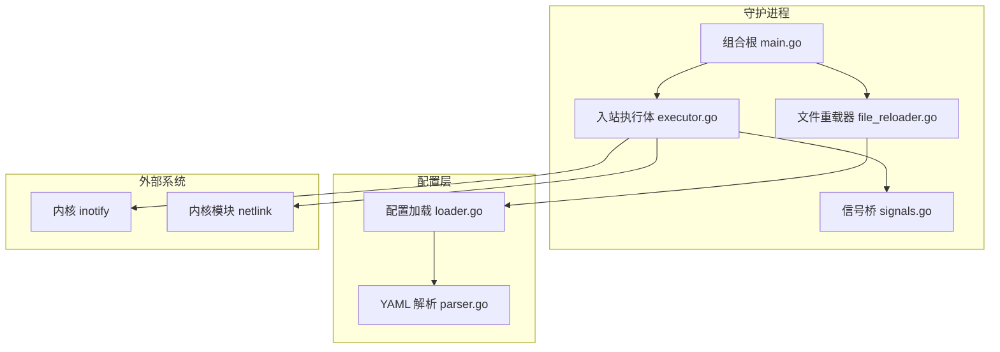
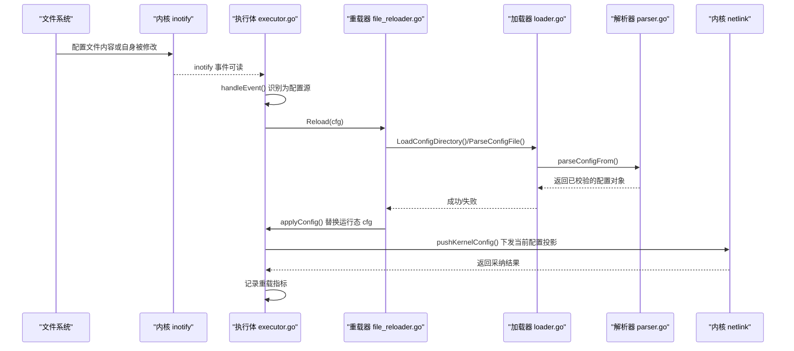
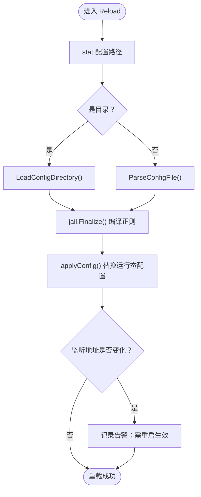
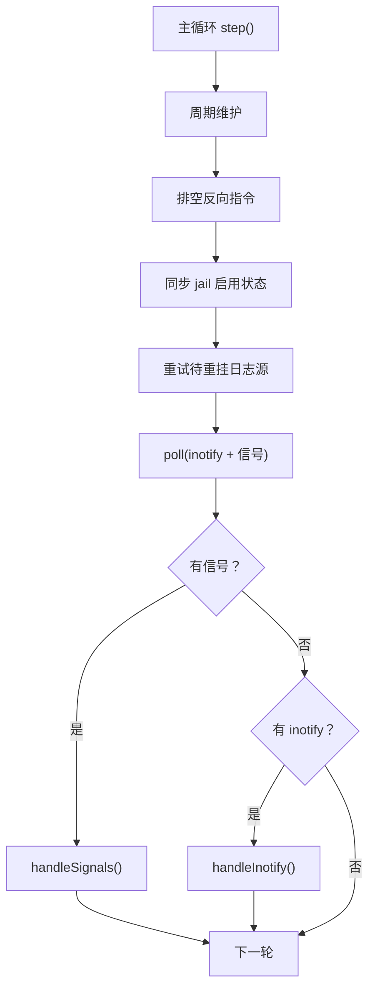
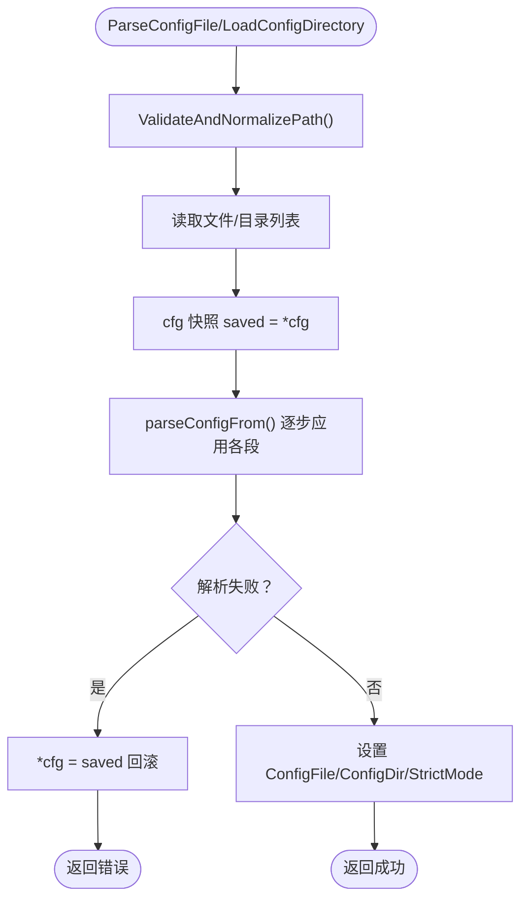
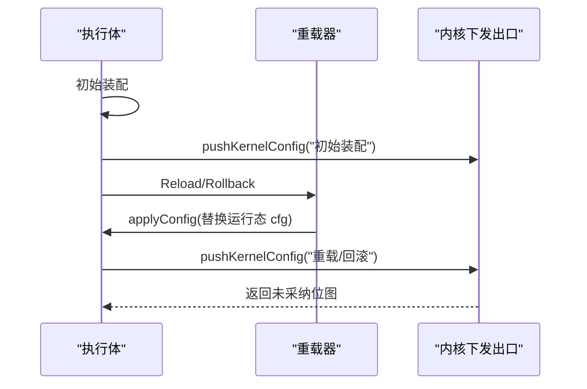
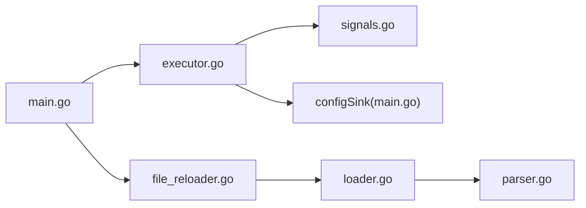

# 动态配置重载

<cite>
**本文引用的文件**   
- [file_reloader.go](file://src/daemon/internal/runtime/file_reloader.go)
- [executor.go](file://src/daemon/internal/runtime/executor.go)
- [signals.go](file://src/daemon/internal/runtime/signals.go)
- [loader.go](file://src/daemon/internal/config/loader.go)
- [parser.go](file://src/daemon/internal/config/parser.go)
- [main.go](file://src/daemon/cmd/firewall-daemon/main.go)
- [test_17_config_reload.py](file://tests/test_17_config_reload.py)
</cite>

## 目录
1. [引言](#引言)
2. [项目结构](#项目结构)
3. [核心组件](#核心组件)
4. [架构总览](#架构总览)
5. [详细组件分析](#详细组件分析)
6. [依赖关系分析](#依赖关系分析)
7. [性能与并发考虑](#性能与并发考虑)
8. [故障排查指南](#故障排查指南)
9. [结论](#结论)

## 引言
本文面向守护进程的动态配置重载机制，重点说明：
- inotify 如何监听配置文件变更并触发热重载。
- SIGHUP、SIGUSR1 等信号与文件变更的触发条件。
- 哪些配置可热重载生效，哪些需要重启服务。
- 配置解析、校验、回滚策略与错误处理。
- 重载生命周期、并发安全与性能影响。
- 最佳实践与常见问题定位方法。

## 项目结构
动态配置重载涉及“运行时执行体”“配置加载与解析”“信号桥接”“守护进程组合根”四个层次：
- 运行时执行体负责主循环、inotify 事件分发、信号处理与重载调度。
- 配置加载与解析负责 YAML 读取、合并、默认值填充、严格模式校验与原子性回滚。
- 信号桥接把系统信号转成非阻塞 fd，并入 poll 统一等待。
- 守护进程组合根装配各组件，决定配置来源（单文件或目录），并把重载器注入执行体。



**图表来源**
- [main.go:446-450](file://src/daemon/cmd/firewall-daemon/main.go#L446-L450)
- [executor.go:276-320](file://src/daemon/internal/runtime/executor.go#L276-L320)
- [signals.go:54-68](file://src/daemon/internal/runtime/signals.go#L54-L68)
- [file_reloader.go:24-58](file://src/daemon/internal/runtime/file_reloader.go#L24-L58)
- [loader.go:17-50](file://src/daemon/internal/config/loader.go#L17-L50)
- [parser.go:155-207](file://src/daemon/internal/config/parser.go#L155-L207)

**章节来源**
- [main.go:446-450](file://src/daemon/cmd/firewall-daemon/main.go#L446-L450)
- [executor.go:276-320](file://src/daemon/internal/runtime/executor.go#L276-L320)
- [signals.go:54-68](file://src/daemon/internal/runtime/signals.go#L54-L68)
- [file_reloader.go:24-58](file://src/daemon/internal/runtime/file_reloader.go#L24-L58)
- [loader.go:17-50](file://src/daemon/internal/config/loader.go#L17-L50)
- [parser.go:155-207](file://src/daemon/internal/config/parser.go#L155-L207)

## 核心组件
- 文件重载器：负责从磁盘重新加载配置、调用 jail 后处理、应用新配置到运行态，并提供回滚能力。
- 入站执行体：维护主循环，统一等待 inotify 与信号；在检测到配置文件变化或收到 SIGHUP/SIGUSR1 时触发重载或回滚。
- 信号桥：将 SIGTERM/SIGINT、SIGHUP、SIGUSR1 转为可读 fd，避免 Go 运行时信号处理与 poll 冲突。
- 配置加载器：支持单文件与目录模式，按文件名序列合并，保证原子性与严格模式一致性。
- YAML 解析器：完成 defaults/jails/ddos/webui/capacity/threat_feeds/geoip 等段解析，提供严格模式与智能默认。

**章节来源**
- [file_reloader.go:12-58](file://src/daemon/internal/runtime/file_reloader.go#L12-L58)
- [executor.go:225-320](file://src/daemon/internal/runtime/executor.go#L225-L320)
- [signals.go:12-68](file://src/daemon/internal/runtime/signals.go#L12-L68)
- [loader.go:11-50](file://src/daemon/internal/config/loader.go#L11-L50)
- [parser.go:13-207](file://src/daemon/internal/config/parser.go#L13-L207)

## 架构总览
下图展示一次“配置文件变更 → inotify 唤醒 → 重载 → 内核下发”的完整流程。



**图表来源**
- [executor.go:483-510](file://src/daemon/internal/runtime/executor.go#L483-L510)
- [file_reloader.go:24-58](file://src/daemon/internal/runtime/file_reloader.go#L24-L58)
- [loader.go:17-50](file://src/daemon/internal/config/loader.go#L17-L50)
- [parser.go:155-207](file://src/daemon/internal/config/parser.go#L155-L207)
- [main.go:766-800](file://src/daemon/cmd/firewall-daemon/main.go#L766-L800)

## 详细组件分析

### 文件重载器：Reload 与 Rollback
- Reload 从 Default() 起步，再根据路径是目录还是文件分别调用目录加载或单文件解析；随后执行 jail.Finalize 编译正则，最后用 applyConfig 替换运行态配置。
- Rollback 优先读取与配置来源相邻的 config.yaml.rollback 备份；若不存在则退化为 Reload。
- applyConfig 会检查 HTTP 监听地址是否变化：若变化仅告警，不重绑端口，需重启守护进程才生效。



**图表来源**
- [file_reloader.go:24-58](file://src/daemon/internal/runtime/file_reloader.go#L24-L58)
- [file_reloader.go:94-106](file://src/daemon/internal/runtime/file_reloader.go#L94-L106)

**章节来源**
- [file_reloader.go:24-58](file://src/daemon/internal/runtime/file_reloader.go#L24-L58)
- [file_reloader.go:61-91](file://src/daemon/internal/runtime/file_reloader.go#L61-L91)
- [file_reloader.go:94-106](file://src/daemon/internal/runtime/file_reloader.go#L94-L106)

### 入站执行体：主循环、信号与 inotify
- 主循环 step 顺序：到期维护 → 排空反向指令 → 同步 jail 启用状态 → 重试待重挂源 → poll 等待 → 分派信号与 inotify。
- handleSignals 处理三类控制信号：终止、重载、回滚。
- handleInotify 读取事件，handleEvent 区分“配置源”和“日志源”。配置源的内容变化或自身消失触发 reloadConfig。
- reconcileWatches 对齐监视集合，确保只监控当前配置声明的路径。



**图表来源**
- [executor.go:356-376](file://src/daemon/internal/runtime/executor.go#L356-L376)
- [executor.go:434-462](file://src/daemon/internal/runtime/executor.go#L434-L462)
- [executor.go:464-510](file://src/daemon/internal/runtime/executor.go#L464-L510)
- [executor.go:670-717](file://src/daemon/internal/runtime/executor.go#L670-L717)

**章节来源**
- [executor.go:356-376](file://src/daemon/internal/runtime/executor.go#L356-L376)
- [executor.go:434-462](file://src/daemon/internal/runtime/executor.go#L434-L462)
- [executor.go:464-510](file://src/daemon/internal/runtime/executor.go#L464-L510)
- [executor.go:670-717](file://src/daemon/internal/runtime/executor.go#L670-L717)

### 信号桥：SIGHUP 与 SIGUSR1
- SignalSource 使用自管道把系统信号转为非阻塞 fd，供 poll 统一等待。
- 关注信号：SIGTERM/SIGINT（终止）、SIGHUP（重载）、SIGUSR1（回滚）。
- classifySignal 映射到内部枚举，PollRead 非阻塞取出并分类。

```mermaid
classDiagram
class SignalSource {
+FD() int
+PollRead() (kind, ok, err)
+Close() void
-pump() void
-ch chan os.Signal
-done chan struct{}
-r int
-w int
}
class SignalKind {
<<enum>>
+Terminate
+Reload
+Rollback
}
SignalSource --> SignalKind : "分类"
```

**图表来源**
- [signals.go:12-22](file://src/daemon/internal/runtime/signals.go#L12-L22)
- [signals.go:54-68](file://src/daemon/internal/runtime/signals.go#L54-L68)
- [signals.go:88-100](file://src/daemon/internal/runtime/signals.go#L88-L100)
- [signals.go:102-124](file://src/daemon/internal/runtime/signals.go#L102-L124)

**章节来源**
- [signals.go:12-22](file://src/daemon/internal/runtime/signals.go#L12-L22)
- [signals.go:54-68](file://src/daemon/internal/runtime/signals.go#L54-L68)
- [signals.go:88-100](file://src/daemon/internal/runtime/signals.go#L88-L100)
- [signals.go:102-124](file://src/daemon/internal/runtime/signals.go#L102-L124)

### 配置加载与解析：原子性、严格模式与合并语义
- ParseConfigFile/LoadConfigDirectory 均先快照 cfg，解析失败整体回滚，保证原子性。
- 目录模式按文件名排序合并，运行期覆盖文件（前缀 `_`）排在最后，拥有最终发言权。
- strict 参数贯穿入口，启动与重载必须一致，否则会出现“能启动不能重载”的不一致。
- parseConfigFrom 依次应用 defaults → jails → ddos → webui → trusted_ips → capacity → threat_feeds → geoip，并在最后进行凭据环境变量覆盖。



**图表来源**
- [loader.go:17-50](file://src/daemon/internal/config/loader.go#L17-L50)
- [loader.go:53-128](file://src/daemon/internal/config/loader.go#L53-L128)
- [parser.go:155-207](file://src/daemon/internal/config/parser.go#L155-L207)

**章节来源**
- [loader.go:17-50](file://src/daemon/internal/config/loader.go#L17-L50)
- [loader.go:53-128](file://src/daemon/internal/config/loader.go#L53-L128)
- [parser.go:155-207](file://src/daemon/internal/config/parser.go#L155-L207)

### 配置热重载的生命周期与内核下发
- 初始装配：执行体创建后立即 pushKernelConfig，让内核尽快按守护进程配置运行。
- 重载路径：文件变化或 SIGHUP → reloadConfig → Replacer.Reload → applyConfig → pushKernelConfig。
- 回滚路径：SIGUSR1 → rollbackConfig → Replacer.Rollback → applyConfig → pushKernelConfig。
- 内核下发出口 configSink.ApplyConfig 对 client 为空的情况按“未装配、跳过下发”处理，不阻断重载本身。



**图表来源**
- [executor.go:316-320](file://src/daemon/internal/runtime/executor.go#L316-L320)
- [executor.go:456-460](file://src/daemon/internal/runtime/executor.go#L456-L460)
- [main.go:766-800](file://src/daemon/cmd/firewall-daemon/main.go#L766-L800)

**章节来源**
- [executor.go:316-320](file://src/daemon/internal/runtime/executor.go#L316-L320)
- [executor.go:456-460](file://src/daemon/internal/runtime/executor.go#L456-L460)
- [main.go:766-800](file://src/daemon/cmd/firewall-daemon/main.go#L766-L800)

## 依赖关系分析
- 执行体依赖重载器、内核下发出口、统计 sink、jail 启用状态源与 SSE 快照通知。
- 重载器依赖配置加载与解析，以及 jail 后处理。
- 守护进程组合根负责装配所有依赖，并决定配置来源（单文件或目录）。



**图表来源**
- [main.go:446-450](file://src/daemon/cmd/firewall-daemon/main.go#L446-L450)
- [executor.go:158-184](file://src/daemon/internal/runtime/executor.go#L158-L184)
- [file_reloader.go:24-58](file://src/daemon/internal/runtime/file_reloader.go#L24-L58)
- [loader.go:17-50](file://src/daemon/internal/config/loader.go#L17-L50)
- [parser.go:155-207](file://src/daemon/internal/config/parser.go#L155-L207)

**章节来源**
- [main.go:446-450](file://src/daemon/cmd/firewall-daemon/main.go#L446-L450)
- [executor.go:158-184](file://src/daemon/internal/runtime/executor.go#L158-L184)
- [file_reloader.go:24-58](file://src/daemon/internal/runtime/file_reloader.go#L24-L58)
- [loader.go:17-50](file://src/daemon/internal/config/loader.go#L17-L50)
- [parser.go:155-207](file://src/daemon/internal/config/parser.go#L155-L207)

## 性能与并发考虑
- 主循环串行化：执行体由单个 goroutine 驱动，避免锁竞争；inotify 与信号通过 poll 统一等待，减少上下文切换。
- inotify 事件计数口径：一次唤醒计一次，而非事件条数，避免洪泛放大。
- 配置重载原子性：解析失败回滚到快照，避免部分字段污染运行态。
- 内核下发可空：client 为空时跳过下发，不阻断重载；失败时由调用方决定是否记 warn 或上报。
- 指标与观测：重载成功次数通过 Prometheus 指标暴露，便于自动化验证与回归测试。

**章节来源**
- [executor.go:378-407](file://src/daemon/internal/runtime/executor.go#L378-L407)
- [executor.go:464-481](file://src/daemon/internal/runtime/executor.go#L464-L481)
- [loader.go:38-50](file://src/daemon/internal/config/loader.go#L38-L50)
- [main.go:766-800](file://src/daemon/cmd/firewall-daemon/main.go#L766-L800)
- [test_17_config_reload.py:18-29](file://tests/test_17_config_reload.py#L18-L29)

## 故障排查指南
- 重载未触发：
  - 确认配置来源是否正确：目录模式下重载器应接收目录路径，而不是空串。
  - 检查 inotify 事件是否到达：观察 metrics 中 inotify 事件计数是否增长。
  - 查看重载指标 firewall_daemon_config_reloads_total 是否增加。
- 无效配置导致守护进程退出：
  - 重载失败不应退出进程；若退出，检查是否有其他错误路径（如 inotify 初始化失败）。
- 端口变更后未生效：
  - 如果 defaults.metrics_port/metrics_bind_address 改变，HTTP 服务器不会重绑，需重启守护进程。
- 回滚未生效：
  - 目录模式下回滚备份文件应与配置来源相邻；否则回滚会退化为 Reload。
- 自持重载风暴：
  - 集成测试断言静置期间重载计数不变，防止回写触发自身 inotify 监视。

**章节来源**
- [file_reloader.go:94-106](file://src/daemon/internal/runtime/file_reloader.go#L94-L106)
- [executor.go:483-510](file://src/daemon/internal/runtime/executor.go#L483-L510)
- [test_17_config_reload.py:86-100](file://tests/test_17_config_reload.py#L86-L100)
- [test_17_config_reload.py:144-167](file://tests/test_17_config_reload.py#L144-L167)

## 结论
该实现以“执行体主循环 + inotify + 信号桥”为核心，配合“重载器 + 配置加载/解析”形成完整的动态配置重载链路。其关键特性包括：
- 原子性加载与严格模式一致性。
- 目录与单文件两种配置来源的统一处理。
- 重载与回滚双通道，且与内核下发出口解耦。
- 明确的“可热重载”与“需重启”边界（例如 HTTP 监听地址变更需重启）。
- 完善的指标与集成测试保障，便于运维与自动化验证。