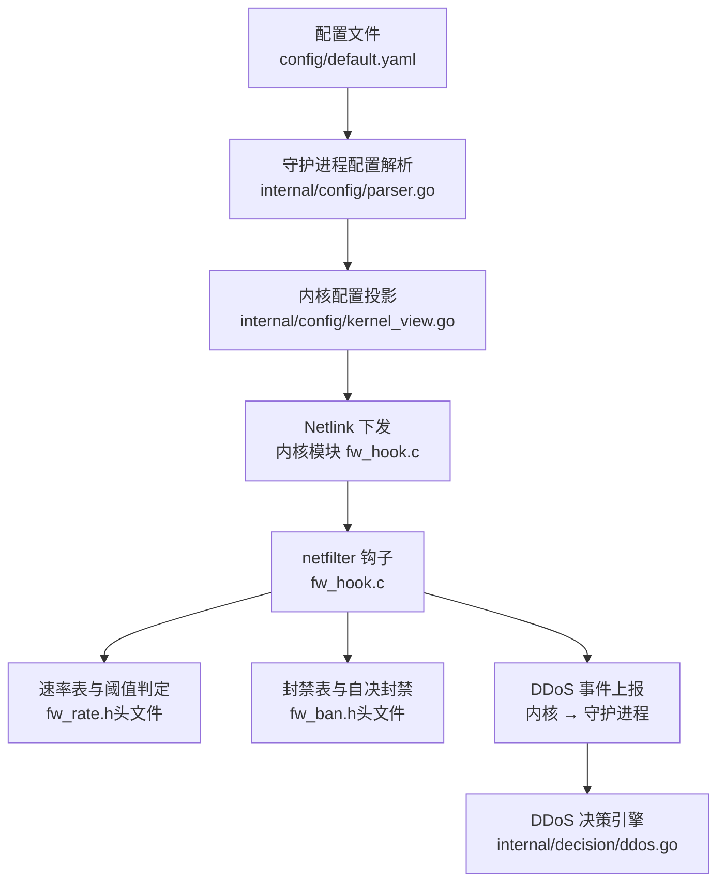
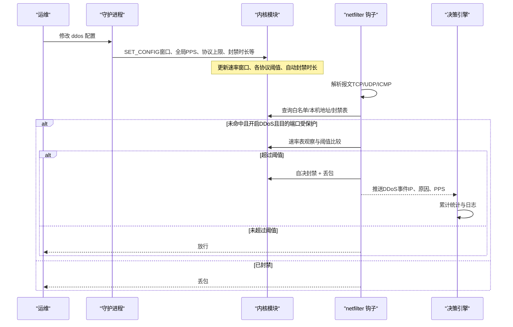
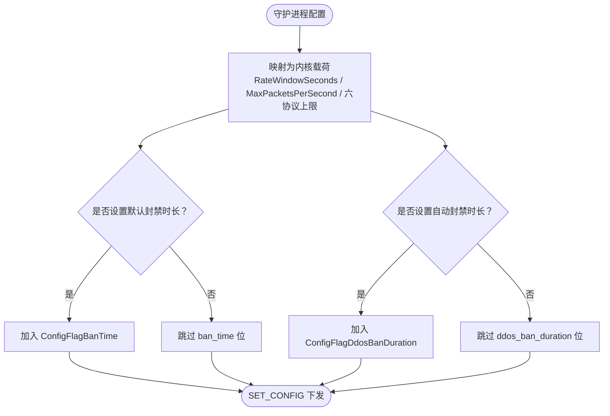
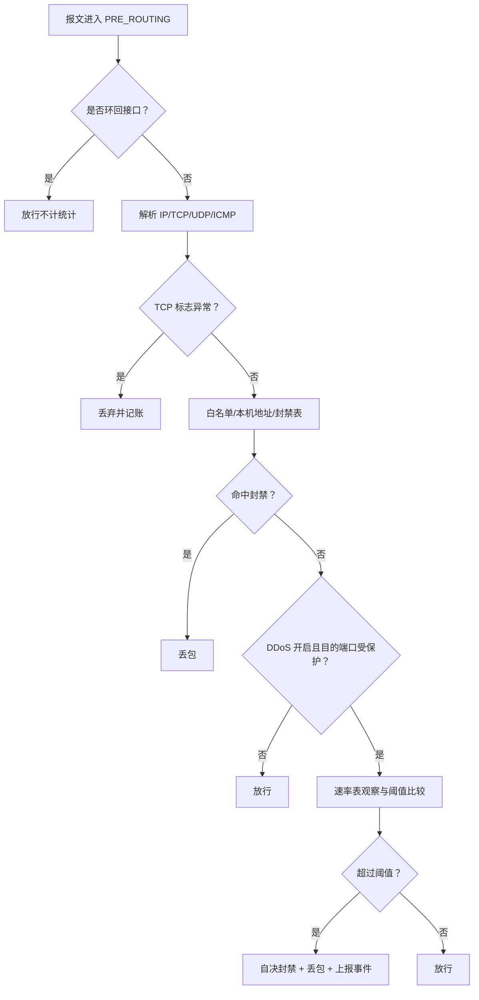
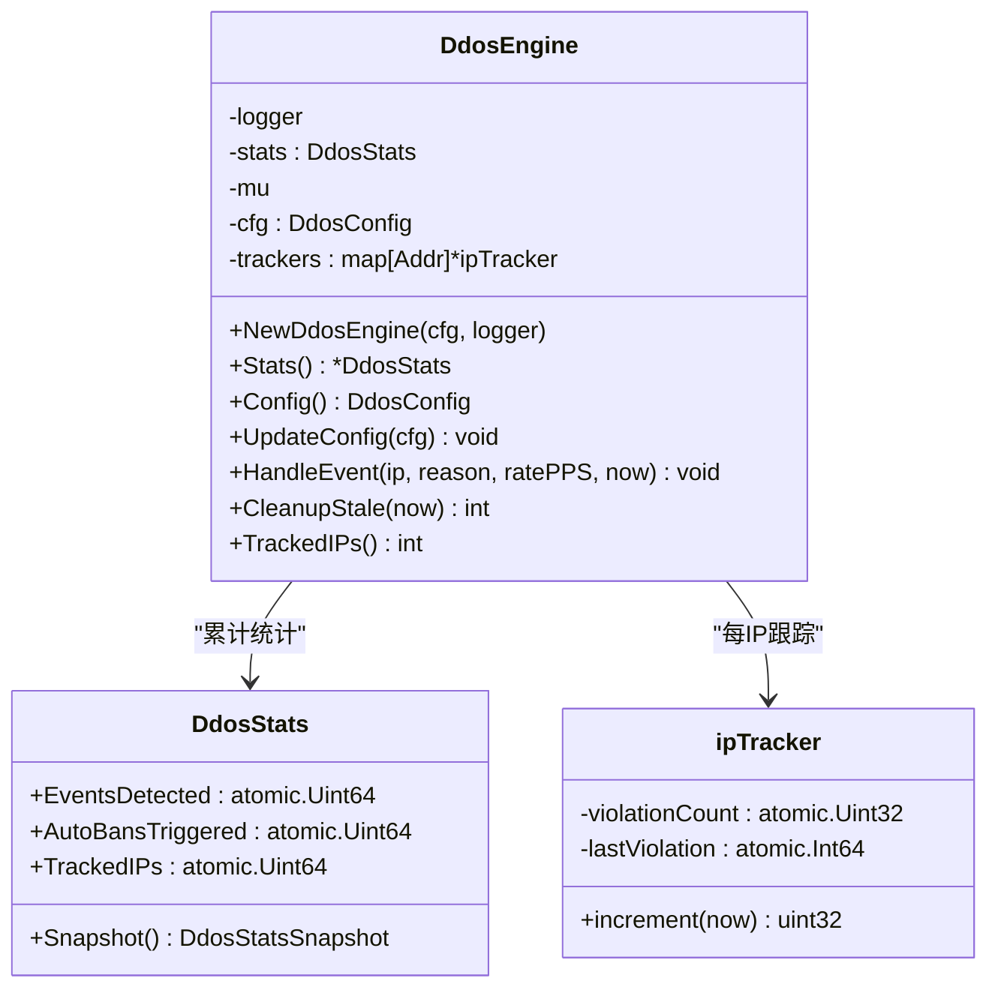

# DDoS防护配置

<cite>
**本文引用的文件**   
- [default.yaml](file://config/default.yaml)
- [parser.go](file://src/daemon/internal/config/parser.go)
- [kernel_view.go](file://src/daemon/internal/config/kernel_view.go)
- [fw_hook.c](file://src/kernel-module/fw_hook.c)
- [ddos.go](file://src/daemon/internal/decision/ddos.go)
</cite>

## 目录
1. [简介](#简介)
2. [项目结构](#项目结构)
3. [核心组件](#核心组件)
4. [架构总览](#架构总览)
5. [详细组件分析](#详细组件分析)
6. [依赖关系分析](#依赖关系分析)
7. [性能与内存优化](#性能与内存优化)
8. [阈值调优指南](#阈值调优指南)
9. [故障排查](#故障排查)
10. [结论](#结论)

## 简介
本文件面向运维与安全工程师，系统化说明 DDoS 防护的配置项、检测算法参数、协议级速率限制、连接速率监控、自动封禁策略，以及不同业务场景下的阈值调优建议。文档同时给出内核态与守护进程侧的关键实现路径，帮助读者理解“配置如何下发到内核”“报文如何在热路径被判定与封禁”。

## 项目结构
DDoS 防护涉及三层：
- 配置层：YAML 定义默认值与业务覆盖；守护进程解析并投影为内核可接受的 SET_CONFIG 载荷。
- 守护进程决策层：接收内核推送的 DDoS 事件，统计与记录，不重复封禁。
- 内核态热路径：在 netfilter PRE_ROUTING 钩子中完成白名单/本机地址/封禁表/速率判定，并在超限时自决封禁。

**图表来源**
- [default.yaml:63-91](file://config/default.yaml#L63-L91)
- [parser.go:499-522](file://src/daemon/internal/config/parser.go#L499-L522)
- [kernel_view.go:42-77](file://src/daemon/internal/config/kernel_view.go#L42-L77)
- [fw_hook.c:104-154](file://src/kernel-module/fw_hook.c#L104-L154)
- [ddos.go:57-101](file://src/daemon/internal/decision/ddos.go#L57-L101)

**章节来源**
- [default.yaml:63-91](file://config/default.yaml#L63-L91)
- [parser.go:499-522](file://src/daemon/internal/config/parser.go#L499-L522)
- [kernel_view.go:42-77](file://src/daemon/internal/config/kernel_view.go#L42-L77)
- [fw_hook.c:104-154](file://src/kernel-module/fw_hook.c#L104-L154)
- [ddos.go:57-101](file://src/daemon/internal/decision/ddos.go#L57-L101)

## 核心组件
- 配置模型与解析：YAML 中的 ddos 段字段由守护进程解析为内部配置对象，供 API、WebUI 与内核下发使用。
- 内核配置投影：将守护进程的 DDoS 配置映射为内核 SET_CONFIG 载荷，仅携带内核能识别的位与字段。
- 内核热路径：在 IPv4/IPv6 钩子中解析报文、提取 TCP 标志或 UDP/ICMP 信息，按目的端口受保护集合进行速率判定，超限则自决封禁并丢包。
- 决策引擎：接收内核 DDoS 事件，累计统计与日志，不重复封禁。

关键配置入口位于全局 defaults 与 ddos 段，涵盖开关、阈值、容量与行为控制。

**章节来源**
- [default.yaml:63-91](file://config/default.yaml#L63-L91)
- [parser.go:82-102](file://src/daemon/internal/config/parser.go#L82-L102)
- [kernel_view.go:5-41](file://src/daemon/internal/config/kernel_view.go#L5-L41)
- [fw_hook.c:10-44](file://src/kernel-module/fw_hook.c#L10-L44)
- [ddos.go:31-68](file://src/daemon/internal/decision/ddos.go#L31-L68)

## 架构总览
下图展示一次典型 DDoS 防护流程：从配置加载、内核下发，到报文进入钩子、速率判定与自决封禁，再到守护进程统计。

**图表来源**
- [kernel_view.go:42-77](file://src/daemon/internal/config/kernel_view.go#L42-L77)
- [fw_hook.c:104-154](file://src/kernel-module/fw_hook.c#L104-L154)
- [ddos.go:103-129](file://src/daemon/internal/decision/ddos.go#L103-L129)

## 详细组件分析

### 配置模型与解析（守护进程）
- YAML 中 ddos 段包含：开关、全局连接速率、自动封禁时长与阈值、检测间隔、各协议速率上限、静态/动态阈值开关、容量与端口保护策略等。
- 解析器将显式字段写入守护进程配置对象；未给出的字段保持默认或继承 defaults。

重点要点：
- 所有 ddos 相关布尔与数值字段均通过 applyDdos 应用。
- WebUI 也暴露一组显示与编辑字段，便于前端展示当前生效值。

**章节来源**
- [default.yaml:63-91](file://config/default.yaml#L63-L91)
- [parser.go:82-102](file://src/daemon/internal/config/parser.go#L82-L102)
- [parser.go:499-522](file://src/daemon/internal/config/parser.go#L499-L522)
- [parser.go:524-548](file://src/daemon/internal/config/parser.go#L524-L548)

### 内核配置投影（守护进程 → 内核）
守护进程把 ddos 配置投影为内核 SET_CONFIG 载荷，带以下关键字段：
- 速率窗口秒数：对应检查间隔。
- 最大每秒包数：全局连接速率。
- 六个协议上限：SYN、UDP、ICMP、ACK、RST、FIN。
- 默认封禁时长与 DDoS 自动封禁时长：仅在非零时下发。

注意：
- dynamic_threshold 在内核契约中与 ratio_x100 绑定，当前配置模型只有布尔，因此不在投影表中直接下发，避免误改内核启用状态。
- 永久封禁语义（-1）留在每条封禁指令中，不通过 ban_time 位下发。

**图表来源**
- [kernel_view.go:42-77](file://src/daemon/internal/config/kernel_view.go#L42-L77)

**章节来源**
- [kernel_view.go:5-41](file://src/daemon/internal/config/kernel_view.go#L5-L41)
- [kernel_view.go:42-77](file://src/daemon/internal/config/kernel_view.go#L42-L77)

### 内核热路径与协议阈值（内核模块）
- 钩子位置：NF_INET_PRE_ROUTING，优先级在 filter 之前。
- 判定顺序：环回接口豁免 → 白名单/本机地址 → 封禁表 → 若开启 DDoS 且目的端口受保护 → 速率判定 → 违规自决封禁并丢包。
- 协议处理：
  - TCP：提取 SYN/ACK/RST/FIN 标志，异常组合直接丢弃并记账。
  - UDP：取目的端口参与速率判定。
  - ICMP/ICMPv6：类型/代码分布全量记录；仅 Echo Request 参与 flood 判定，并将 ICMPv6 Echo Request 映射为 IPPROTO_ICMP 以共用阈值。
- 目的端口受保护：由守护进程扫描对外监听端口后下发位图，仅该集合参与速率判定，降低内部流量误判风险。

**图表来源**
- [fw_hook.c:10-44](file://src/kernel-module/fw_hook.c#L10-L44)
- [fw_hook.c:104-154](file://src/kernel-module/fw_hook.c#L104-L154)
- [fw_hook.c:156-278](file://src/kernel-module/fw_hook.c#L156-L278)
- [fw_hook.c:280-410](file://src/kernel-module/fw_hook.c#L280-L410)

**章节来源**
- [fw_hook.c:10-44](file://src/kernel-module/fw_hook.c#L10-L44)
- [fw_hook.c:104-154](file://src/kernel-module/fw_hook.c#L104-L154)
- [fw_hook.c:156-278](file://src/kernel-module/fw_hook.c#L156-L278)
- [fw_hook.c:280-410](file://src/kernel-module/fw_hook.c#L280-L410)

### DDoS 决策引擎（守护进程）
- 职责：接收内核推送的 DDoS 事件，累计统计（检测总数、自动封禁触发数、跟踪 IP 数），输出日志与快照。
- 不重复封禁：内核已完成封禁，守护进程只做观测与统计。
- 每 IP 跟踪：维护最近违规时间与次数，支持清理长时间未活动条目，防止内存无限增长。

**图表来源**
- [ddos.go:18-29](file://src/daemon/internal/decision/ddos.go#L18-L29)
- [ddos.go:31-55](file://src/daemon/internal/decision/ddos.go#L31-L55)
- [ddos.go:57-101](file://src/daemon/internal/decision/ddos.go#L57-L101)
- [ddos.go:103-164](file://src/daemon/internal/decision/ddos.go#L103-L164)

**章节来源**
- [ddos.go:31-68](file://src/daemon/internal/decision/ddos.go#L31-L68)
- [ddos.go:103-164](file://src/daemon/internal/decision/ddos.go#L103-L164)

## 依赖关系分析
- 守护进程配置解析依赖 YAML 结构与默认值；applyDdos 将 ddos 段映射到守护进程配置对象。
- 内核配置投影依赖契约位与内核校验规则；某些字段（如 dynamic_threshold、baseline）因内核契约限制而不直接下发。
- 内核热路径依赖端口受保护集合、速率表、封禁表与统计模块。
- 决策引擎依赖守护进程配置快照与内核事件通道。

**图表来源**
- [default.yaml:63-91](file://config/default.yaml#L63-L91)
- [parser.go:499-522](file://src/daemon/internal/config/parser.go#L499-L522)
- [kernel_view.go:42-77](file://src/daemon/internal/config/kernel_view.go#L42-L77)
- [fw_hook.c:104-154](file://src/kernel-module/fw_hook.c#L104-L154)
- [ddos.go:57-101](file://src/daemon/internal/decision/ddos.go#L57-L101)

**章节来源**
- [parser.go:499-522](file://src/daemon/internal/config/parser.go#L499-L522)
- [kernel_view.go:5-41](file://src/daemon/internal/config/kernel_view.go#L5-L41)
- [fw_hook.c:10-44](file://src/kernel-module/fw_hook.c#L10-L44)
- [ddos.go:57-101](file://src/daemon/internal/decision/ddos.go#L57-L101)

## 性能与内存优化
- 内核热路径优化：
  - RCU 临界区只进一次，减少锁竞争。
  - per-CPU 槽位存放端口去重集合与统计，避免共享 cache line 写。
  - 对硬件校验报文跳过软件校验和，降低 CPU 开销。
- 速率表与封禁表容量：
  - 通过 max_rate_entries 控制并发源 IP 数量。
  - 通过 max_bans_per_second 限制每秒新增封禁次数，防泛洪。
- 守护进程侧：
  - 决策引擎定期清理长时间未活动的每 IP 跟踪条目，避免内存无限增长。
  - 历史库与指标端口按需启用，减少不必要 I/O 与网络开销。

**章节来源**
- [fw_hook.c:10-44](file://src/kernel-module/fw_hook.c#L10-L44)
- [ddos.go:138-164](file://src/daemon/internal/decision/ddos.go#L138-L164)
- [default.yaml:82-91](file://config/default.yaml#L82-L91)

## 阈值调优指南

### 配置项总览（ddos 段）
- 开关与模式
  - enabled：DDoS 防护总开关。
  - static_threshold：静态阈值检测开关。
  - dynamic_threshold：动态阈值检测开关（当前内核契约限制，需配合倍数字段后才下发）。
  - ddos_detection：DDoS 检测总开关。
- 速率与窗口
  - global_conn_rate：全局每秒最大连接数。
  - check_interval：检测间隔（秒），映射为内核速率窗口秒数。
- 协议专项阈值
  - max_syn_per_second：SYN flood 阈值。
  - max_udp_per_second：UDP flood 阈值。
  - max_icmp_per_second：ICMP flood 阈值（仅 Echo Request 参与判定）。
  - max_ack_per_second：ACK flood 阈值。
  - max_rst_per_second：RST flood 阈值。
  - max_fin_per_second：FIN flood 阈值。
- 自动封禁策略
  - auto_ban_duration：自动封禁时长（秒）。
  - auto_ban_threshold：超阈值几次后封禁（守护进程统计维度）。
- 容量与保护面
  - max_bans_per_second：每秒最大封禁添加次数。
  - max_rate_entries：速率表最大条目数。
  - protect_open_ports：仅对外监听端口参与速率判定。

**章节来源**
- [default.yaml:63-91](file://config/default.yaml#L63-L91)
- [parser.go:82-102](file://src/daemon/internal/config/parser.go#L82-L102)
- [kernel_view.go:42-77](file://src/daemon/internal/config/kernel_view.go#L42-L77)

### 高流量网站
- 目标：保障 HTTP/HTTPS 服务在高并发下稳定，同时抵御 SYN/ACK/UDP/ICMP 泛洪。
- 建议：
  - 提高 global_conn_rate 与 max_ack_per_second，匹配正常峰值 QPS。
  - 适度提升 max_syn_per_second，但结合 CDN/WAF 前置清洗。
  - 缩短 check_interval 以提升灵敏度，同时评估 CPU 占用。
  - 开启 protect_open_ports，聚焦公网端口，避免内部流量误判。
  - 根据攻击频率调整 auto_ban_duration 与 auto_ban_threshold。

### 游戏服务器
- 目标：低延迟、抗 UDP 泛洪与连接风暴。
- 建议：
  - 提高 max_udp_per_second，匹配游戏心跳与状态同步流量。
  - 适度收紧 max_syn_per_second 与 max_rst_per_second，抑制恶意握手。
  - 使用较短 check_interval 与较低 auto_ban_threshold，快速响应突发。
  - 关注 ICMP 阈值，防止探测与放大攻击。

### 物联网平台
- 目标：海量设备接入，易受 UDP/ICMP 泛洪与慢速连接攻击。
- 建议：
  - 提高 max_udp_per_second 与 max_icmp_per_second，适应设备上报与心跳。
  - 合理设置 global_conn_rate，避免被大量短连接打满。
  - 开启 protect_open_ports，仅对设备接入端口进行速率判定。
  - 延长 auto_ban_duration，降低频繁解封带来的抖动。

### 静态阈值与动态阈值
- 静态阈值：基于固定阈值判断，适合已知流量基线的场景。
- 动态阈值：基于基线×倍数判断，适合流量波动较大的场景；当前内核契约要求 ratio_x100 非零才启用，配置模型尚未提供倍数字段，故 dynamic_threshold 暂不下发。
- 实践建议：
  - 先以静态阈值稳定运行，观察告警与误报。
  - 待基线稳定后，再引入动态阈值（待内核契约补齐倍数字段）。

**章节来源**
- [default.yaml:63-91](file://config/default.yaml#L63-L91)
- [kernel_view.go:23-41](file://src/daemon/internal/config/kernel_view.go#L23-L41)

## 故障排查
- 配置未生效
  - 检查 ddos.enabled 与 ddos_detection 是否为 true。
  - 确认 applyDdos 已将字段写入守护进程配置对象。
- 内核拒绝部分配置
  - 查看内核返回的拒绝位图，确认哪些位未被接受（例如 ban_time 范围、rate_window 范围、八个速率上限非零）。
  - 注意 dynamic_threshold 与 baseline 不在投影表中下发。
- 误封或漏封
  - 核对 protect_open_ports 与对外监听端口集合是否正确。
  - 检查白名单与本机地址豁免逻辑。
  - 观察内核热路径判定顺序与协议异常丢弃逻辑。
- 性能问题
  - 评估 max_rate_entries 与 max_bans_per_second 是否过小导致拥塞。
  - 检查决策引擎是否及时清理长时间未活动条目。

**章节来源**
- [kernel_view.go:5-41](file://src/daemon/internal/config/kernel_view.go#L5-L41)
- [fw_hook.c:10-44](file://src/kernel-module/fw_hook.c#L10-L44)
- [ddos.go:138-164](file://src/daemon/internal/decision/ddos.go#L138-L164)

## 结论
DDoS 防护在本项目中由守护进程与内核模块协同实现：守护进程负责配置解析、内核配置投影与事件统计；内核模块在 netfilter 钩子中完成高效的热路径判定与自决封禁。通过合理配置全局连接速率、协议专项阈值、检测窗口与自动封禁策略，并结合 protect_open_ports 收窄防护面，可在不同业务场景中取得良好的防护效果与性能平衡。对于动态阈值，建议在基线稳定后再引入，并确保内核契约补齐倍数字段后统一下发。