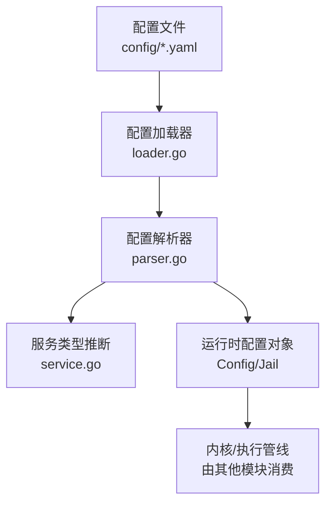
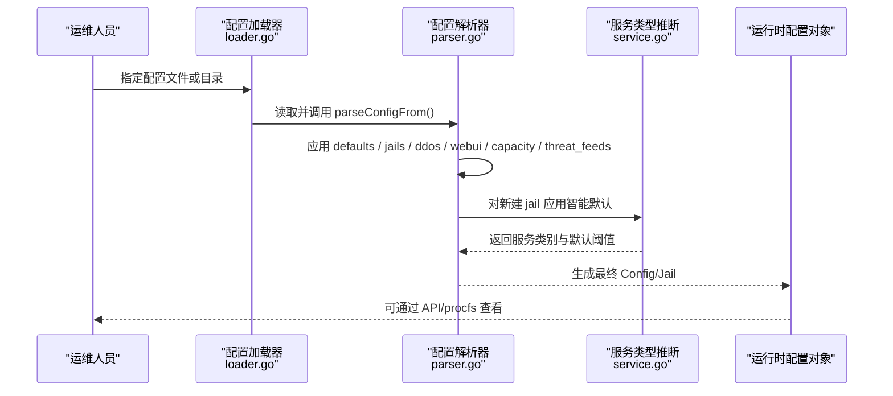
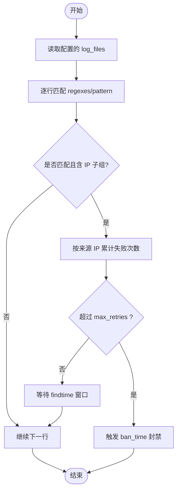
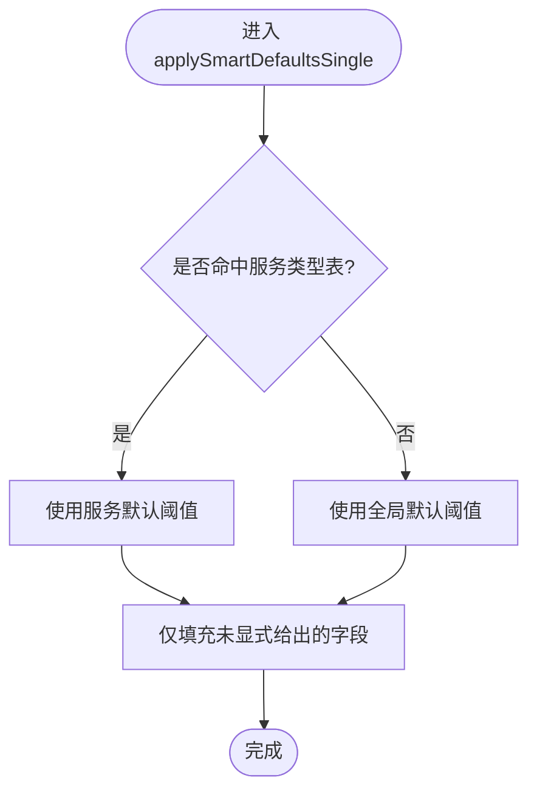
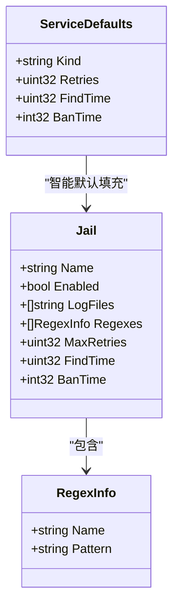
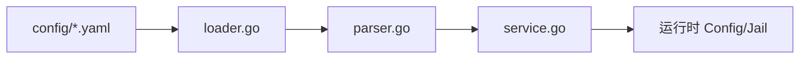

# Jail安全策略

<cite>
**本文引用的文件**   
- [default.yaml](file://config/default.yaml)
- [nginx.yaml](file://config/nginx.yaml)
- [mysql.yaml](file://config/mysql.yaml)
- [vsftpd.yaml](file://config/vsftpd.yaml)
- [postfix.yaml](file://config/postfix.yaml)
- [dovecot.yaml](file://config/dovecot.yaml)
- [frp.yaml](file://config/frp.yaml)
- [examples.md](file://docs/zh/configuration/examples.md)
- [parser.go](file://src/daemon/internal/config/parser.go)
- [loader.go](file://src/daemon/internal/config/loader.go)
- [service.go](file://src/daemon/internal/jail/service.go)
</cite>

## 目录
1. [简介](#简介)
2. [项目结构](#项目结构)
3. [核心组件](#核心组件)
4. [架构总览](#架构总览)
5. [详细组件分析](#详细组件分析)
6. [依赖关系分析](#依赖关系分析)
7. [性能与容量考虑](#性能与容量考虑)
8. [故障排查指南](#故障排查指南)
9. [结论](#结论)
10. [附录：不同安全级别配置示例](#附录不同安全级别配置示例)

## 简介
本文件面向“Jail 安全策略”的规划、编写与优化，覆盖日志文件监听、正则表达式匹配规则、失败重试次数等关键参数，并给出 SSH、FTP、SMTP 等常见服务的预定义策略模板与自定义服务配置方法。同时提供严格模式、平衡模式、宽松模式的对比示例，以及策略效果评估与持续优化的实践建议。

## 项目结构
仓库中与 Jail 策略直接相关的代码和配置集中在以下位置：
- 配置目录 `config/`：包含默认全局配置与各服务的预置 jail 配置。
- 守护进程配置解析 `src/daemon/internal/config/`：负责 YAML 解析、校验、合并与智能默认值填充。
- 服务类型推断 `src/daemon/internal/jail/service.go`：根据 jail 名称推断服务类别与默认阈值。
- 中文文档 `docs/zh/configuration/examples.md`：真实可用的配置示例与说明。

**图示来源**
- [loader.go:53-128](file://src/daemon/internal/config/loader.go#L53-L128)
- [parser.go:155-206](file://src/daemon/internal/config/parser.go#L155-L206)
- [service.go:109-134](file://src/daemon/internal/jail/service.go#L109-L134)

**章节来源**
- [loader.go:53-128](file://src/daemon/internal/config/loader.go#L53-L128)
- [parser.go:155-206](file://src/daemon/internal/config/parser.go#L155-L206)
- [service.go:109-134](file://src/daemon/internal/jail/service.go#L109-L134)

## 核心组件
- 全局默认值与能力开关：位于 `defaults` 段，影响所有未显式覆盖的 jail，包括重试次数、时间窗口、封禁时长、指标端口、日志路径与历史库等。
- Jail 定义：每个服务一个 jail，支持多日志源、多条正则、集群检测等。
- 服务类型推断：根据 jail 名称命中内置服务名表，自动套用更贴合该服务场景的默认阈值。
- 配置加载与合并：支持单文件与目录加载，按字母序合并，运行期覆盖文件最后生效。

**章节来源**
- [default.yaml:1-31](file://config/default.yaml#L1-L31)
- [parser.go:13-29](file://src/daemon/internal/config/parser.go#L13-L29)
- [service.go:9-19](file://src/daemon/internal/jail/service.go#L9-L19)
- [loader.go:53-128](file://src/daemon/internal/config/loader.go#L53-L128)

## 架构总览
Jail 策略从 YAML 配置到运行时生效的关键流程如下：

**图示来源**
- [loader.go:17-51](file://src/daemon/internal/config/loader.go#L17-L51)
- [parser.go:155-206](file://src/daemon/internal/config/parser.go#L155-L206)
- [parser.go:277-373](file://src/daemon/internal/config/parser.go#L277-L373)
- [service.go:109-134](file://src/daemon/internal/jail/service.go#L109-L134)

## 详细组件分析

### 日志文件监听与正则匹配
- 日志文件监听：每个 jail 通过 `log_files` 指定一个或多个日志路径；系统会校验数量上限并保存为列表。
- 正则匹配：支持两种写法：
  - `regex`: 单条正则，可配合 `regex_name` 命名。
  - `regexes`: 多条正则映射，键为规则名，值为 `pattern`。
- IP 提取：正则中需包含能捕获客户端 IP 的子组，以便后续计数与封禁。

**图示来源**
- [parser.go:303-373](file://src/daemon/internal/config/parser.go#L303-L373)
- [parser.go:420-426](file://src/daemon/internal/config/parser.go#L420-L426)

**章节来源**
- [parser.go:303-373](file://src/daemon/internal/config/parser.go#L303-L373)
- [parser.go:420-426](file://src/daemon/internal/config/parser.go#L420-L426)

### 失败重试次数、时间窗口与封禁时长
- `max_retries`：在 `findtime` 窗口内允许的最大失败次数。
- `findtime`：统计失败次数的滑动时间窗口，最小值有保护逻辑。
- `ban_time`：封禁时长，负数表示永久封禁。
- 智能默认：若只写 `log_files` 与 `regexes`，系统会根据服务类型推断合理默认值；用户显式字段不会被覆盖。

**图示来源**
- [service.go:109-134](file://src/daemon/internal/jail/service.go#L109-L134)
- [parser.go:473-497](file://src/daemon/internal/config/parser.go#L473-L497)

**章节来源**
- [service.go:67-95](file://src/daemon/internal/jail/service.go#L67-L95)
- [service.go:109-134](file://src/daemon/internal/jail/service.go#L109-L134)
- [parser.go:473-497](file://src/daemon/internal/config/parser.go#L473-L497)

### 常见服务的预定义策略模板
- SSH（sshd）：监控认证失败与无效用户登录，通常采用较严格的阈值与较长封禁时长。
- FTP（vsftpd）：监控 FTP 认证失败，防止暴力破解。
- SMTP（postfix/dovecot）：监控邮件 SASL 认证失败，防止中继滥用与账户爆破。
- Web（nginx/apache/http）：监控访问禁止、恶意扫描等日志。
- 数据库（mysql/mariadb/postgres）：监控数据库访问拒绝与认证失败。
- FRP：仓库示例已停用，原因是原正则匹配成功连接而非失败。

下表汇总各预置 jail 的日志源与正则要点（不展示具体正则内容，仅提供路径与用途说明）：

| 服务 | 配置文件 | 日志文件 | 正则用途 |
| --- | --- | --- | --- |
| SSH | [default.yaml](file://config/default.yaml) | `/var/log/auth.log`、`/var/log/secure` | 无效用户、密码失败、连接关闭等 SSH 攻击模式 |
| FTP | [vsftpd.yaml](file://config/vsftpd.yaml) | `/var/log/vsftpd.log`、`/var/log/auth.log` | FTP 登录失败 |
| SMTP(Postfix) | [postfix.yaml](file://config/postfix.yaml) | `/var/log/mail.log`、`/var/log/maillog` | SASL 认证失败 |
| SMTP(Dovecot) | [dovecot.yaml](file://config/dovecot.yaml) | `/var/log/mail.log`、`/var/log/dovecot.log` | Dovecot 认证失败 |
| Web(Nginx) | [nginx.yaml](file://config/nginx.yaml) | `/var/log/nginx/error.log` | 访问被禁止的规则命中 |
| 数据库(MySQL) | [mysql.yaml](file://config/mysql.yaml) | `/var/log/mysql/error.log`、`/var/log/mariadb/mariadb.log` | 访问拒绝与认证失败 |
| FRP | [frp.yaml](file://config/frp.yaml) | `/var/log/frp.log` | 示例已停用（正则匹配成功连接） |

**章节来源**
- [default.yaml:35-53](file://config/default.yaml#L35-L53)
- [vsftpd.yaml:1-14](file://config/vsftpd.yaml#L1-L14)
- [postfix.yaml:1-14](file://config/postfix.yaml#L1-L14)
- [dovecot.yaml:1-14](file://config/dovecot.yaml#L1-L14)
- [nginx.yaml:1-14](file://config/nginx.yaml#L1-L14)
- [mysql.yaml:1-15](file://config/mysql.yaml#L1-L15)
- [frp.yaml:1-18](file://config/frp.yaml#L1-L18)

### 自定义服务的策略配置方法
- 创建新 jail：在 `jails` 下新增条目，填写 `enabled`、`log_files`、`regexes`。
- 命名约定：若名称命中内置服务名表（如 `ssh`、`http`、`ftp`、`mail`、`frp`、`mysql`、`postgres`），将自动获得更贴合的服务默认阈值；否则回退到全局默认。
- 正则编写要点：
  - 使用 `regexes` 映射组织多条规则，每条规则以 `pattern` 描述。
  - 确保正则中包含能捕获客户端 IP 的子组。
  - 注意 YAML 字符串转义（双引号中反斜杠需加倍）。
- 阈值设置：
  - 若未显式给出 `max_retries`、`findtime`、`ban_time`，将根据服务类型或全局默认智能填充。
  - 显式字段优先于智能默认，避免被覆盖。

**图示来源**
- [parser.go:52-80](file://src/daemon/internal/config/parser.go#L52-L80)
- [service.go:67-95](file://src/daemon/internal/jail/service.go#L67-L95)

**章节来源**
- [parser.go:52-80](file://src/daemon/internal/config/parser.go#L52-L80)
- [parser.go:303-373](file://src/daemon/internal/config/parser.go#L303-L373)
- [service.go:9-19](file://src/daemon/internal/jail/service.go#L9-L19)
- [service.go:109-134](file://src/daemon/internal/jail/service.go#L109-L134)

## 依赖关系分析
- 配置加载器 `loader.go` 负责文件存在性、类型检查与目录扫描，并按文件名序列合并多个 YAML。
- 配置解析器 `parser.go` 负责 YAML 解码、字段校验、defaults/jails/ddos/webui/capacity/threat_feeds 等段的合并与应用。
- 服务类型推断 `service.go` 根据 jail 名称匹配服务类别，提供默认阈值。
- 预置配置文件 `config/*.yaml` 作为输入，驱动上述模块生成运行时配置。

**图示来源**
- [loader.go:53-128](file://src/daemon/internal/config/loader.go#L53-L128)
- [parser.go:155-206](file://src/daemon/internal/config/parser.go#L155-L206)
- [service.go:109-134](file://src/daemon/internal/jail/service.go#L109-L134)

**章节来源**
- [loader.go:53-128](file://src/daemon/internal/config/loader.go#L53-L128)
- [parser.go:155-206](file://src/daemon/internal/config/parser.go#L155-L206)
- [service.go:109-134](file://src/daemon/internal/jail/service.go#L109-L134)

## 性能与容量考虑
- 正则数量与日志文件数量均有限制，超出上限会报错，避免过度消耗资源。
- 全局容量配置（capacity）限制封禁表、白名单、速率表与本地 IP 缓存条目数。
- DDoS 防护相关参数（如每秒最大封禁添加次数、速率表条目数）影响内核侧处理压力。
- 指标端口与绑定地址用于暴露 Prometheus 指标，生产环境应启用认证并限制监听范围。

**章节来源**
- [parser.go:297-300](file://src/daemon/internal/config/parser.go#L297-L300)
- [parser.go:345-366](file://src/daemon/internal/config/parser.go#L345-L366)
- [parser.go:420-426](file://src/daemon/internal/config/parser.go#L420-L426)
- [default.yaml:103-110](file://config/default.yaml#L103-L110)
- [default.yaml:63-91](file://config/default.yaml#L63-L91)

## 故障排查指南
- 配置语法错误：YAML 解析失败时不会修改已有配置，便于回滚。
- 未知字段：严格模式下未知顶层字段会报错；宽松模式忽略未知键。
- 运行期覆盖文件：以下划线开头的文件由守护进程管理，仅承载运行期状态（如 jail 开关），遇到未定义的 jail 名会忽略并告警。
- 日志路径与权限：确保 `log_files` 指向的路径存在且守护进程可读。
- 正则不匹配：确认正则中包含 IP 子组，且日志格式与服务版本一致。

**章节来源**
- [loader.go:17-51](file://src/daemon/internal/config/loader.go#L17-L51)
- [loader.go:53-128](file://src/daemon/internal/config/loader.go#L53-L128)
- [parser.go:155-206](file://src/daemon/internal/config/parser.go#L155-L206)
- [parser.go:303-373](file://src/daemon/internal/config/parser.go#L303-L373)

## 结论
Jail 安全策略通过“日志监听 + 正则匹配 + 阈值判定”的组合实现精细化防护。借助服务类型推断与智能默认，运维可在保证安全性的前提下快速落地策略；通过严格/平衡/宽松三种安全级别，可在不同业务场景中权衡误报与漏报。结合容量与 DDoS 参数调优，可实现稳定高效的防护体系。

## 附录：不同安全级别配置示例
以下示例基于仓库中的真实配置与文档说明，聚焦 SSH、FTP、SMTP 三类服务，分别展示严格模式、平衡模式、宽松模式的差异。为避免泄露敏感信息，示例仅列出关键字段与取值思路，不粘贴完整正则内容。

- 严格模式
  - 特点：较短 `findtime`、较低 `max_retries`、较长 `ban_time`，适合公网暴露面较大的服务。
  - 参考：SSH 在默认配置中设置了较短窗口与较长封禁，体现强防护倾向。
  - 适用：SSH、FTP、SMTP 等易受暴力破解的服务。

- 平衡模式
  - 特点：中等 `findtime` 与 `max_retries`，`ban_time` 适中，兼顾误报与响应速度。
  - 参考：Web 类服务（如 Nginx）默认阈值偏向平衡，既防扫描又避免频繁误封。
  - 适用：Web 服务器、内部服务。

- 宽松模式
  - 特点：较长 `findtime`、较高 `max_retries`、较短 `ban_time`，降低误报风险。
  - 参考：数据库类服务默认阈值相对保守，减少因正常批量操作导致的误判。
  - 适用：数据库、缓存服务等对误报敏感的场景。

下表给出三类服务的策略对比（字段含义见前文）：

| 服务 | 严格模式 | 平衡模式 | 宽松模式 |
| --- | --- | --- | --- |
| SSH | 短窗口、低重试、长封禁 | 中窗口、中重试、中封禁 | 长窗口、高重试、短封禁 |
| FTP | 短窗口、低重试、长封禁 | 中窗口、中重试、中封禁 | 长窗口、高重试、短封禁 |
| SMTP | 短窗口、低重试、长封禁 | 中窗口、中重试、中封禁 | 长窗口、高重试、短封禁 |

实际配置参考：
- SSH：[default.yaml](file://config/default.yaml)
- FTP：[vsftpd.yaml](file://config/vsftpd.yaml)
- SMTP(Postfix/Dovecot)：[postfix.yaml](file://config/postfix.yaml)、[dovecot.yaml](file://config/dovecot.yaml)
- Web(Nginx)：[nginx.yaml](file://config/nginx.yaml)
- 数据库(MySQL)：[mysql.yaml](file://config/mysql.yaml)
- 示例说明：[examples.md](file://docs/zh/configuration/examples.md)

**章节来源**
- [default.yaml:35-53](file://config/default.yaml#L35-L53)
- [vsftpd.yaml:1-14](file://config/vsftpd.yaml#L1-L14)
- [postfix.yaml:1-14](file://config/postfix.yaml#L1-L14)
- [dovecot.yaml:1-14](file://config/dovecot.yaml#L1-L14)
- [nginx.yaml:1-14](file://config/nginx.yaml#L1-L14)
- [mysql.yaml:1-15](file://config/mysql.yaml#L1-L15)
- [examples.md:1-242](file://docs/zh/configuration/examples.md#L1-L242)