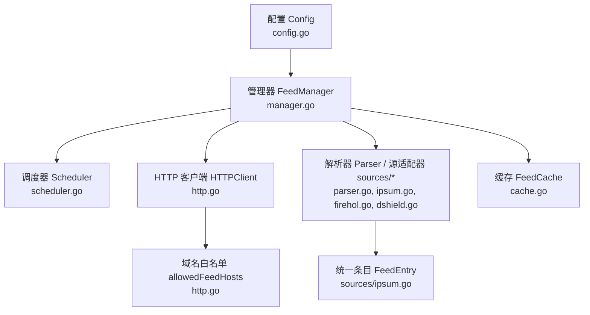
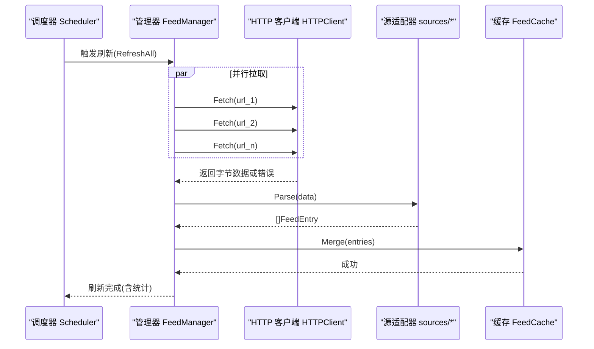
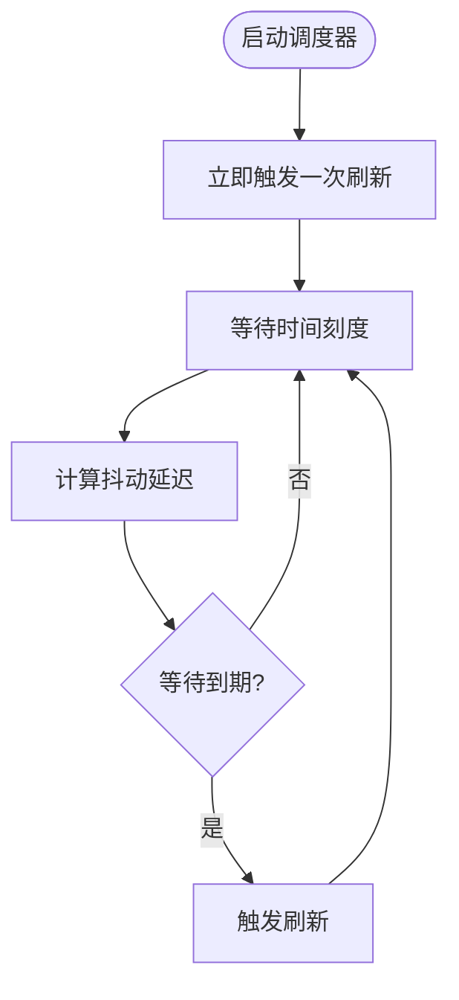
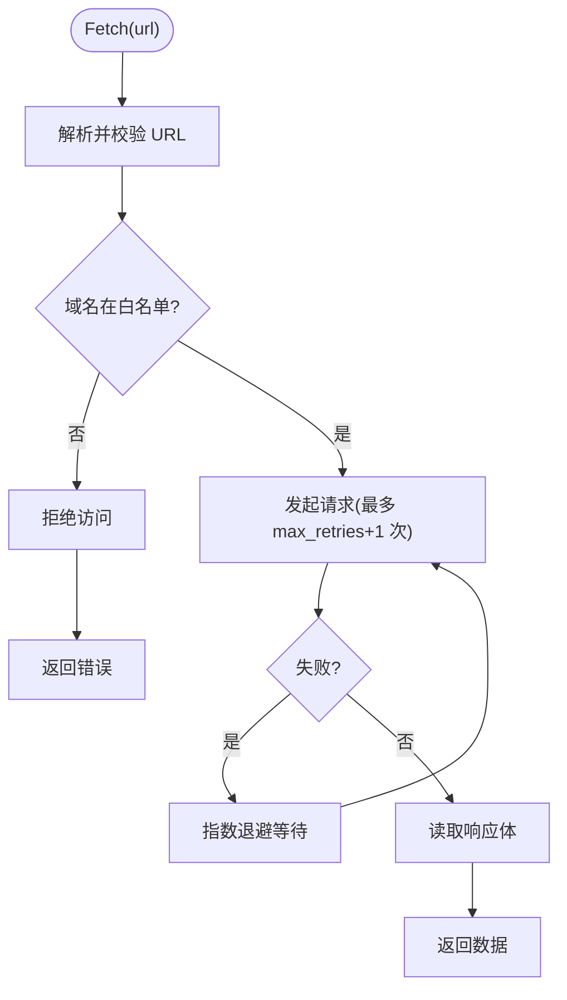
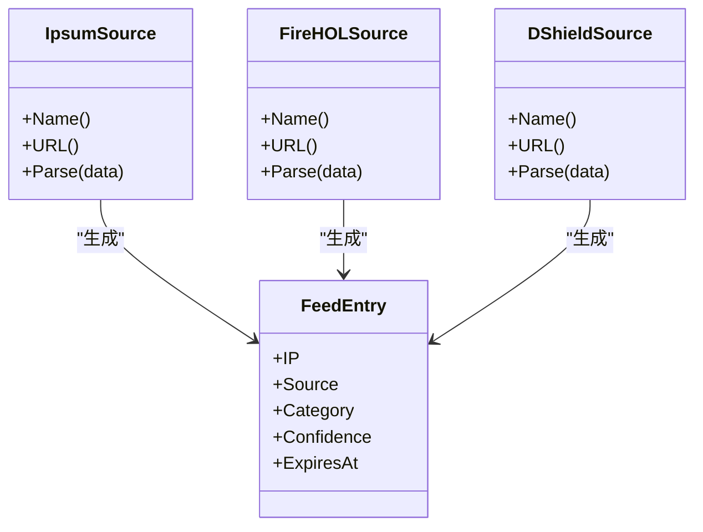
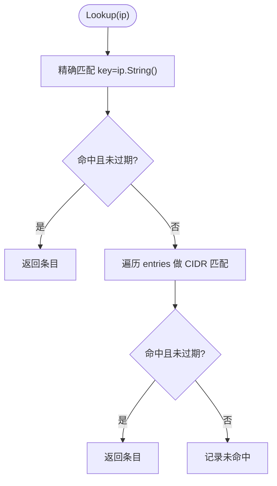
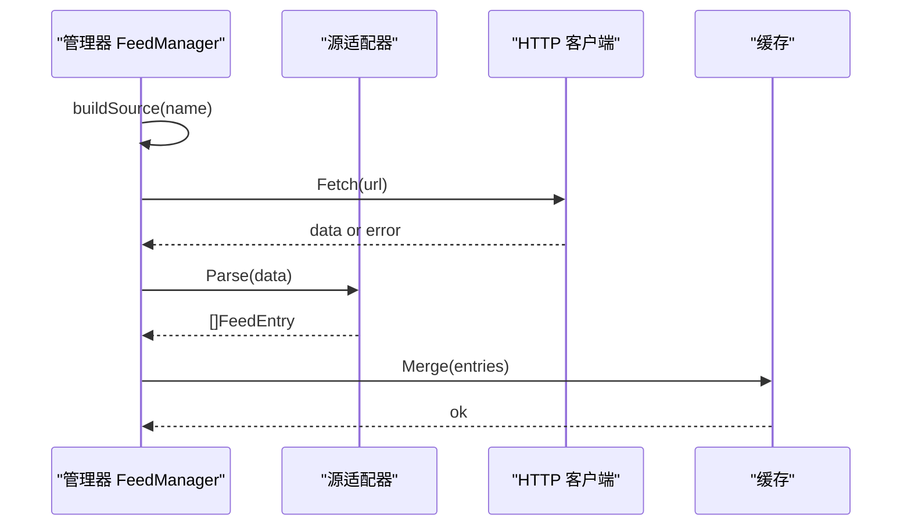
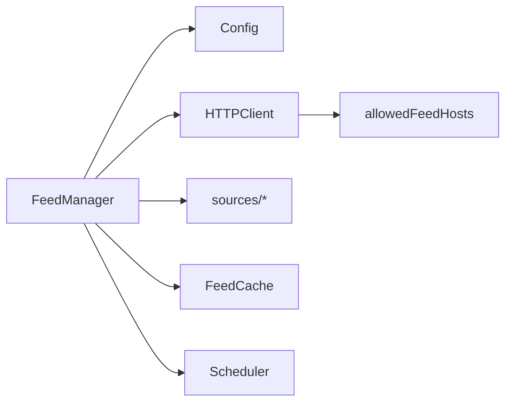

# 威胁情报配置

<cite>
**本文引用的文件**   
- [threat-feeds.md](file://docs/zh/configuration/threat-feeds.md)
- [config.go](file://src/daemon/internal/threatfeeds/config.go)
- [types.go](file://src/daemon/internal/threatfeeds/types.go)
- [manager.go](file://src/daemon/internal/threatfeeds/manager.go)
- [scheduler.go](file://src/daemon/internal/threatfeeds/scheduler.go)
- [http.go](file://src/daemon/internal/threatfeeds/http.go)
- [cache.go](file://src/daemon/internal/threatfeeds/cache.go)
- [parser.go](file://src/daemon/internal/threatfeeds/parser.go)
- [ipsum.go](file://src/daemon/internal/threatfeeds/sources/ipsum.go)
- [firehol.go](file://src/daemon/internal/threatfeeds/sources/firehol.go)
- [dshield.go](file://src/daemon/internal/threatfeeds/sources/dshield.go)
</cite>

## 目录
1. [引言](#引言)
2. [项目结构](#项目结构)
3. [核心组件](#核心组件)
4. [架构总览](#架构总览)
5. [详细组件分析](#详细组件分析)
6. [依赖关系分析](#依赖关系分析)
7. [性能与容量规划](#性能与容量规划)
8. [多源聚合策略与冲突处理](#多源聚合策略与冲突处理)
9. [自定义情报源扩展指南](#自定义情报源扩展指南)
10. [不同安全需求下的组合推荐](#不同安全需求下的组合推荐)
11. [故障排查](#故障排查)
12. [结论](#结论)

## 引言
本文件面向需要配置和使用防火墙威胁情报系统的运维与安全工程师，系统说明如何启用和配置内置情报源（IPsum、FireHOL、DShield 等），如何设置置信度阈值、更新频率、HTTP 超时与重试机制，如何实现多源聚合、优先级排序、去重与冲突处理，以及如何扩展自定义情报源。文档同时给出在不同安全需求下的情报源组合建议与性能优化要点。

## 项目结构
威胁情报子系统位于守护进程内部模块中，采用“配置—调度—拉取—解析—缓存—查询”的分层设计：
- 配置层：定义全局开关、刷新间隔、HTTP 超时、重试次数以及各情报源的元信息。
- 调度层：定时触发刷新，支持抖动防惊群。
- 拉取层：带 HTTPS 白名单校验、重定向限制、指数退避重试的 HTTP 客户端。
- 解析层：按源格式解析为统一条目模型。
- 缓存层：内存缓存，支持精确匹配与 CIDR 匹配，提供统计与清理能力。
- 管理接口：并发刷新、统计查询、生命周期控制。

图表来源
- [config.go:19-31](file://src/daemon/internal/threatfeeds/config.go#L19-L31)
- [manager.go:20-41](file://src/daemon/internal/threatfeeds/manager.go#L20-L41)
- [scheduler.go:10-21](file://src/daemon/internal/threatfeeds/scheduler.go#L10-L21)
- [http.go:23-49](file://src/daemon/internal/threatfeeds/http.go#L23-L49)
- [cache.go:9-19](file://src/daemon/internal/threatfeeds/cache.go#L9-L19)
- [ipsum.go:12-26](file://src/daemon/internal/threatfeeds/sources/ipsum.go#L12-L26)

章节来源
- [threat-feeds.md:1-16](file://docs/zh/configuration/threat-feeds.md#L1-L16)
- [config.go:19-31](file://src/daemon/internal/threatfeeds/config.go#L19-L31)

## 核心组件
- 配置 Config 与 SourceConfig：声明是否启用、刷新间隔、HTTP 超时、最大重试次数，以及每个情报源的名称、URL、分类、默认置信度。
- 管理器 FeedManager：负责构建源适配器、并发刷新、合并结果、维护统计、暴露查询与生命周期方法。
- 调度器 Scheduler：按间隔触发刷新，加入随机抖动避免集群内同时拉取。
- HTTP 客户端 HTTPClient：强制 HTTPS、域名白名单、最多 3 次重定向、指数退避重试。
- 缓存 FeedCache：内存存储，支持精确 IP 与 CIDR 匹配，过期清理与统计。
- 源适配器 sources/*：实现统一 FeedSource 接口，将不同格式数据解析为统一 FeedEntry。

章节来源
- [config.go:5-31](file://src/daemon/internal/threatfeeds/config.go#L5-L31)
- [manager.go:20-91](file://src/daemon/internal/threatfeeds/manager.go#L20-L91)
- [scheduler.go:10-33](file://src/daemon/internal/threatfeeds/scheduler.go#L10-L33)
- [http.go:23-49](file://src/daemon/internal/threatfeeds/http.go#L23-L49)
- [cache.go:9-42](file://src/daemon/internal/threatfeeds/cache.go#L9-L42)
- [ipsum.go:21-26](file://src/daemon/internal/threatfeeds/sources/ipsum.go#L21-L26)

## 架构总览
下图展示一次完整的情报刷新流程：调度器触发 → 管理器并发拉取多个源 → HTTP 客户端执行带校验与重试的请求 → 源适配器解析为统一条目 → 缓存合并并统计 → 对外提供查询接口。

图表来源
- [manager.go:111-155](file://src/daemon/internal/threatfeeds/manager.go#L111-L155)
- [http.go:72-102](file://src/daemon/internal/threatfeeds/http.go#L72-L102)
- [ipsum.go:99-103](file://src/daemon/internal/threatfeeds/sources/ipsum.go#L99-L103)
- [firehol.go:23-27](file://src/daemon/internal/threatfeeds/sources/firehol.go#L23-L27)
- [dshield.go:84-88](file://src/daemon/internal/threatfeeds/sources/dshield.go#L84-L88)
- [cache.go:44-82](file://src/daemon/internal/threatfeeds/cache.go#L44-L82)

## 详细组件分析

### 配置与默认源
- 全局参数：
  - enabled：总开关，false 时不启动整个情报系统。
  - refresh_interval：自动刷新间隔，默认 24 小时。
  - http_timeout：单次拉取的 HTTP 超时，默认 30 秒。
  - max_retries：失败后重试次数，默认 3。
- 源参数：
  - name：唯一标识，如 ipsum、firehol_level1、dshield 等。
  - url：HTTPS 地址。
  - enabled：该源是否启用。
  - category：默认分类，可被解析器覆盖。
  - confidence：默认置信度，范围 [0.0, 1.0]。
- 默认内置源：
  - IPsum：质量高、每日更新，默认启用。
  - FireHOL Level 1：保守名单、误报低，默认启用。
  - DShield、Blocklist.de、Feodo Tracker：可选启用。

章节来源
- [threat-feeds.md:38-58](file://docs/zh/configuration/threat-feeds.md#L38-L58)
- [config.go:19-81](file://src/daemon/internal/threatfeeds/config.go#L19-L81)

### 调度与更新频率
- 调度器支持固定间隔 + 随机抖动，避免集群内多实例同时拉取造成拥塞。
- 首次立即触发，随后按 interval ± jitter 周期触发。
- 支持优雅停止与 context 取消。

图表来源
- [scheduler.go:35-64](file://src/daemon/internal/threatfeeds/scheduler.go#L35-L64)
- [scheduler.go:73-83](file://src/daemon/internal/threatfeeds/scheduler.go#L73-L83)

章节来源
- [scheduler.go:10-33](file://src/daemon/internal/threatfeeds/scheduler.go#L10-L33)
- [scheduler.go:35-83](file://src/daemon/internal/threatfeeds/scheduler.go#L35-L83)

### HTTP 超时、重试与 SSRF 防护
- 协议与域名白名单：仅允许 HTTPS，且目标域名必须在白名单中。
- 重定向限制：最多跟随 3 次重定向，每次重定向均校验目标 URL。
- 重试策略：指数退避（1s、2s、4s…），结合上下文取消。
- 用户代理与 Accept 头：便于服务端识别与日志追踪。

图表来源
- [http.go:51-65](file://src/daemon/internal/threatfeeds/http.go#L51-L65)
- [http.go:72-102](file://src/daemon/internal/threatfeeds/http.go#L72-L102)

章节来源
- [http.go:14-49](file://src/daemon/internal/threatfeeds/http.go#L14-L49)
- [http.go:51-102](file://src/daemon/internal/threatfeeds/http.go#L51-L102)

### 解析与统一条目模型
- 统一条目 FeedEntry：包含 IP（可为 CIDR）、来源、分类、置信度、过期时间。
- 解析器支持：
  - 纯 IP/CIDR 列表（忽略注释行）。
  - TSV 格式（首列为主键 IP/CIDR）。
- 过期时间：默认在解析时设置为当前时间 + 25 小时。

图表来源
- [ipsum.go:12-26](file://src/daemon/internal/threatfeeds/sources/ipsum.go#L12-L26)
- [ipsum.go:81-103](file://src/daemon/internal/threatfeeds/sources/ipsum.go#L81-L103)
- [firehol.go:5-27](file://src/daemon/internal/threatfeeds/sources/firehol.go#L5-L27)
- [dshield.go:66-88](file://src/daemon/internal/threatfeeds/sources/dshield.go#L66-L88)

章节来源
- [parser.go:20-79](file://src/daemon/internal/threatfeeds/parser.go#L20-L79)
- [ipsum.go:28-79](file://src/daemon/internal/threatfeeds/sources/ipsum.go#L28-L79)
- [dshield.go:11-64](file://src/daemon/internal/threatfeeds/sources/dshield.go#L11-L64)

### 缓存与查询
- 数据结构：map 存储，键为 IP 或 CIDR 字符串。
- 合并策略：原子替换，新数据优先覆盖旧数据；合并前复制未过期旧条目。
- 查询路径：先精确匹配 IP，再遍历 CIDR 匹配；跳过已过期条目。
- 统计指标：总条目数、有效条目数、精确命中、CIDR 命中、未命中、最后更新时间。

图表来源
- [cache.go:84-115](file://src/daemon/internal/threatfeeds/cache.go#L84-L115)

章节来源
- [cache.go:9-42](file://src/daemon/internal/threatfeeds/cache.go#L9-L42)
- [cache.go:44-82](file://src/daemon/internal/threatfeeds/cache.go#L44-L82)
- [cache.go:84-115](file://src/daemon/internal/threatfeeds/cache.go#L84-L115)
- [cache.go:117-173](file://src/daemon/internal/threatfeeds/cache.go#L117-L173)

### 管理器与并发刷新
- 构建源适配器：根据 name 映射到具体实现（ipsum、firehol_level1、dshield、blocklist_de、feodo）。
- 并发刷新：使用 goroutine 并发拉取所有源，最终汇总结果；单个源失败不影响其他源。
- 统计维护：每个源的刷新次数、错误次数、最近更新时间、条目数。
- 生命周期：StartScheduler 启动后台定时刷新；Stop 停止调度与上下文。

图表来源
- [manager.go:93-109](file://src/daemon/internal/threatfeeds/manager.go#L93-L109)
- [manager.go:111-155](file://src/daemon/internal/threatfeeds/manager.go#L111-L155)
- [manager.go:157-184](file://src/daemon/internal/threatfeeds/manager.go#L157-L184)

章节来源
- [manager.go:54-91](file://src/daemon/internal/threatfeeds/manager.go#L54-L91)
- [manager.go:111-155](file://src/daemon/internal/threatfeeds/manager.go#L111-L155)
- [manager.go:186-205](file://src/daemon/internal/threatfeeds/manager.go#L186-L205)
- [manager.go:212-225](file://src/daemon/internal/threatfeeds/manager.go#L212-L225)

## 依赖关系分析
- 管理器依赖：
  - 配置：决定启用哪些源及全局行为。
  - HTTP 客户端：负责网络拉取与安全校验。
  - 源适配器：按名称选择具体实现。
  - 缓存：持久化内存中的条目集合。
  - 调度器：定时触发刷新。
- 外部依赖：
  - 域名白名单：raw.githubusercontent.com、www.dshield.org、lists.blocklist.de、feodotracker.abuse.ch。

图表来源
- [manager.go:20-41](file://src/daemon/internal/threatfeeds/manager.go#L20-L41)
- [http.go:14-21](file://src/daemon/internal/threatfeeds/http.go#L14-L21)

章节来源
- [manager.go:20-91](file://src/daemon/internal/threatfeeds/manager.go#L20-L91)
- [http.go:14-21](file://src/daemon/internal/threatfeeds/http.go#L14-L21)

## 性能与容量规划
- CPU：并发拉取多个源主要受网络 IO 影响；解析阶段为纯 CPU 开销。
- 内存：内存缓存，无磁盘持久化；条目数量与单条大小决定内存占用。
- 查询延迟：精确匹配极快；CIDR 匹配需遍历条目，规模越大越慢。
- 建议：
  - 合理设置 refresh_interval，避免频繁刷新。
  - 控制启用的源数量与条目规模，优先使用精确 IP 而非大段 CIDR。
  - 监控缓存统计（精确命中、CIDR 命中、未命中）以评估命中率与性能。

章节来源
- [threat-feeds.md:191-196](file://docs/zh/configuration/threat-feeds.md#L191-L196)
- [cache.go:84-115](file://src/daemon/internal/threatfeeds/cache.go#L84-L115)

## 多源聚合策略与冲突处理
- 优先级排序：
  - 通过 confidence 字段体现来源可信度；更高置信度的条目更可能被用于封禁决策。
  - 可在上层策略中按 confidence 排序，优先采用高置信度条目。
- 去重机制：
  - 缓存以 IP 或 CIDR 字符串为键进行合并；相同键的新条目会覆盖旧条目。
  - 合并前保留未过期的旧条目，确保数据连续性。
- 冲突处理：
  - 同一 IP/CIDR 来自多个源时，后写入的条目覆盖先前条目；可通过提高某源的 confidence 来使其在策略层更具优势。
  - 若需严格区分来源，可利用 Source 与 Category 字段在上层策略中进行差异化处理。

章节来源
- [cache.go:44-82](file://src/daemon/internal/threatfeeds/cache.go#L44-L82)
- [ipsum.go:12-19](file://src/daemon/internal/threatfeeds/sources/ipsum.go#L12-L19)
- [config.go:5-17](file://src/daemon/internal/threatfeeds/config.go#L5-L17)

## 自定义情报源扩展指南
- 实现 FeedSource 接口：
  - Name()：返回源的唯一名称。
  - URL()：返回拉取地址（必须 HTTPS）。
  - Parse(data)：将原始数据解析为 []FeedEntry。
- 注册方式：
  - 在管理器中通过 switch 分支添加新的 name 映射到具体实现。
  - 在配置中添加对应 source 项，启用并设置 category 与 confidence。
- 最佳实践：
  - 保持数据格式稳定，尽量输出精确 IP 或最小必要 CIDR。
  - 设置合理的 expiresAt（例如 24~25 小时），避免长期无效数据污染缓存。
  - 对异常数据行进行容错处理，避免整批解析失败。

章节来源
- [ipsum.go:21-26](file://src/daemon/internal/threatfeeds/sources/ipsum.go#L21-L26)
- [manager.go:93-109](file://src/daemon/internal/threatfeeds/manager.go#L93-L109)
- [threat-feeds.md:150-179](file://docs/zh/configuration/threat-feeds.md#L150-L179)

## 不同安全需求下的组合推荐
- 低风险、低误报场景：
  - 启用 IPsum 与 FireHOL Level 1，confidence 设为较高值（如 0.8~0.85）。
  - 关闭 DShield、Blocklist.de、Feodo Tracker，减少误报面。
- 中等风险、平衡场景：
  - 启用 IPsum、FireHOL Level 1、DShield，confidence 分级（如 0.7~0.85）。
  - 适当缩短 refresh_interval（如 12 小时），提升时效性。
- 高风险、强防御场景：
  - 启用全部源，包括 Feodo Tracker（botnet C2），confidence 分层（如 0.7~0.9）。
  - 针对高价值业务，对高 confidence 条目直接封禁；对低 confidence 条目进入观察队列。
- 性能优化建议：
  - 控制启用的源数量，避免过多大段 CIDR。
  - 调整 refresh_interval 与 jitter，降低网络压力。
  - 监控缓存命中率与查询延迟，必要时精简条目或拆分策略。

章节来源
- [config.go:33-81](file://src/daemon/internal/threatfeeds/config.go#L33-L81)
- [threat-feeds.md:59-149](file://docs/zh/configuration/threat-feeds.md#L59-L149)

## 故障排查
- 情报源拉取失败：
  - 检查网络连接、DNS 解析、HTTPS 证书。
  - 确认域名在白名单中，且 URL 为 HTTPS。
  - 查看重试日志与错误信息。
- 情报未生效：
  - 确认 threat_feeds.enabled 与具体源 enabled 均为 true。
  - 手动触发重载或等待调度器刷新。
- 查询性能问题：
  - 关注 CIDR 匹配延迟，考虑减少 CIDR 比例或缩小条目规模。
  - 调整 refresh_interval 以降低缓存规模。

章节来源
- [threat-feeds.md:198-245](file://docs/zh/configuration/threat-feeds.md#L198-L245)
- [http.go:51-65](file://src/daemon/internal/threatfeeds/http.go#L51-L65)
- [http.go:72-102](file://src/daemon/internal/threatfeeds/http.go#L72-L102)

## 结论
威胁情报子系统通过清晰的配置模型、健壮的调度与拉取机制、统一的解析与缓存抽象，提供了可扩展、高性能、可观测的多源情报聚合能力。在实际部署中，应根据业务风险偏好选择合适的源组合与置信度阈值，并通过监控与调优保障整体性能与稳定性。