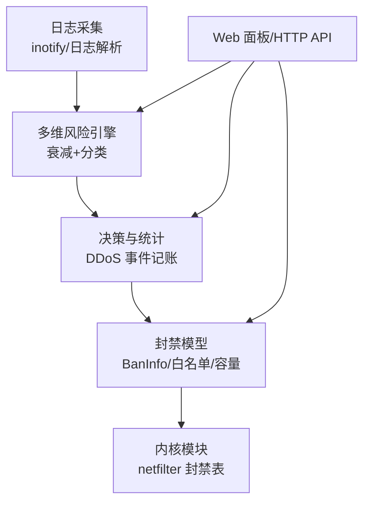
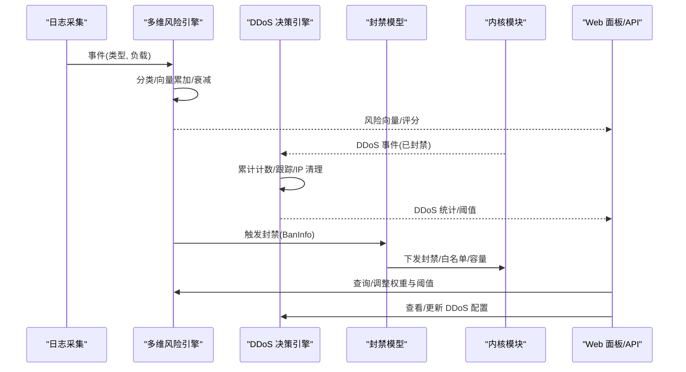
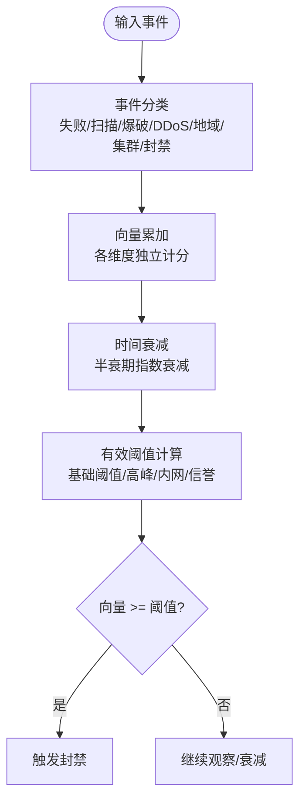
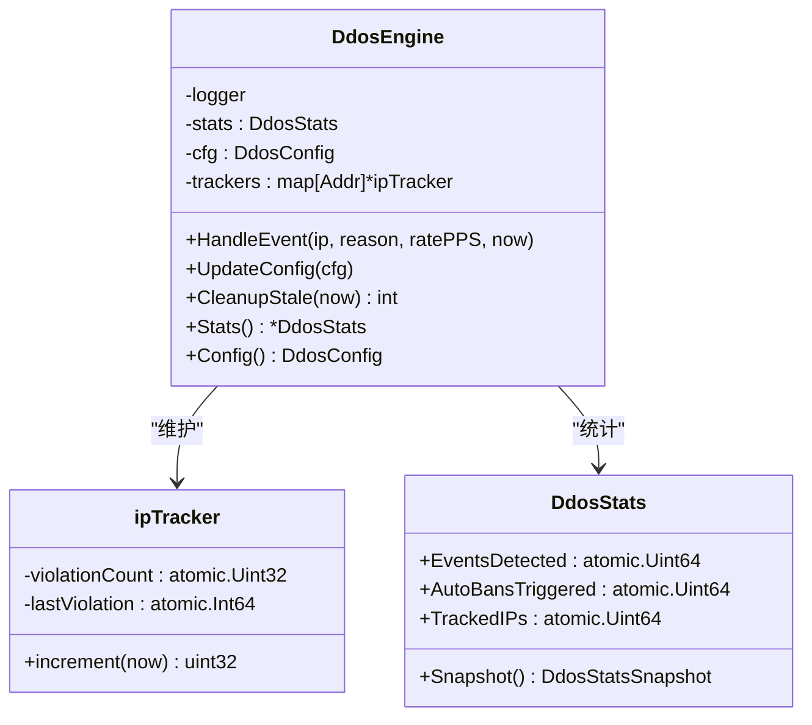
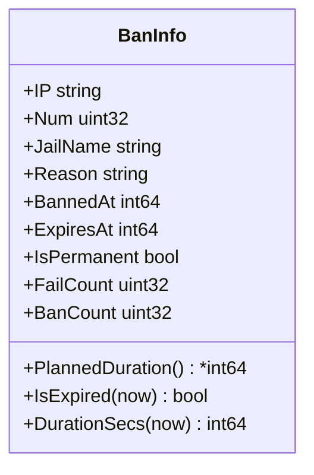
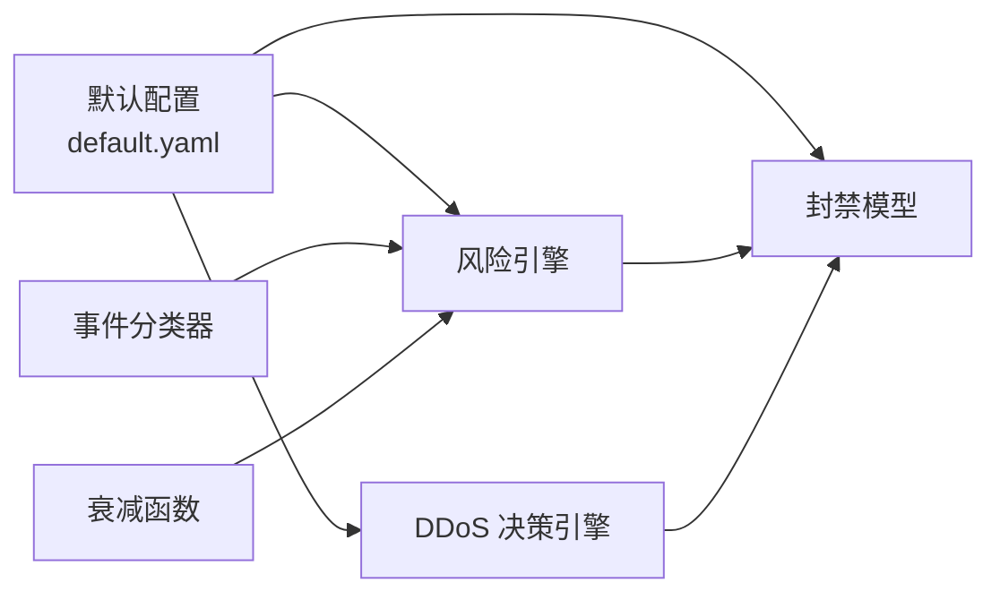

# 安全策略配置

<cite>
**本文引用的文件**   
- [README.md](file://README.md)
- [default.yaml](file://config/default.yaml)
- [engine_test.go](file://src/daemon/internal/risk/engine_test.go)
- [classifier.go](file://src/daemon/internal/risk/classifier.go)
- [decay.go](file://src/daemon/internal/risk/decay.go)
- [ddos.go](file://src/daemon/internal/decision/ddos.go)
- [ban.go](file://src/daemon/internal/bans/ban.go)
</cite>

## 目录
1. [引言](#引言)
2. [项目结构](#项目结构)
3. [核心组件](#核心组件)
4. [架构总览](#架构总览)
5. [详细组件分析](#详细组件分析)
6. [依赖关系分析](#依赖关系分析)
7. [性能与容量调优](#性能与容量调优)
8. [不同安全级别推荐配置](#不同安全级别推荐配置)
9. [效果评估与持续优化](#效果评估与持续优化)
10. [故障排查指南](#故障排查指南)
11. [结论](#结论)

## 引言
本文件面向“安全策略配置”，围绕风险评分算法参数调优、DDoS 防护阈值设置、自动封禁策略配置展开，并给出多维风险评估（频率检测、扫描识别、协议异常分析等）的配置要点。文档同时提供不同安全级别下的推荐配置与性能调优建议，以及效果评估与持续优化方法，帮助在保障业务可用性的前提下提升整体防护能力。

## 项目结构
本项目采用“用户态智能判定 + 内核态高速封禁”的三层架构：日志采集进入守护进程，由多维风险引擎进行衰减与分类计算，最终将封禁指令下发至内核模块生效。Web 面板与 HTTP API 用于监控、配置与可视化分析。

图示来源
- [README.md:10-31](file://README.md#L10-L31)

章节来源
- [README.md:10-31](file://README.md#L10-L31)

## 核心组件
- 多维风险引擎：负责事件分类、向量累加、时间衰减、有效阈值计算与封禁判定。
- DDoS 决策引擎：接收内核已触发的 DDoS 事件，进行累计计数、跟踪与清理，不重复下发封禁。
- 封禁数据模型：封装单条封禁信息、IP 校验、时长计算与过期判断。
- 默认配置：集中定义全局默认值、Jail 规则、Web UI、DDoS 防护、威胁情报源、容量上限等。

章节来源
- [engine_test.go:1-180](file://src/daemon/internal/risk/engine_test.go#L1-L180)
- [classifier.go:1-145](file://src/daemon/internal/risk/classifier.go#L1-L145)
- [decay.go:1-35](file://src/daemon/internal/risk/decay.go#L1-L35)
- [ddos.go:1-164](file://src/daemon/internal/decision/ddos.go#L1-L164)
- [ban.go:1-132](file://src/daemon/internal/bans/ban.go#L1-L132)
- [default.yaml:1-198](file://config/default.yaml#L1-L198)

## 架构总览
下图展示从日志到封禁的关键路径，以及 Web 面板对策略与状态的观测点。

图示来源
- [README.md:10-31](file://README.md#L10-L31)
- [engine_test.go:1-180](file://src/daemon/internal/risk/engine_test.go#L1-L180)
- [ddos.go:1-164](file://src/daemon/internal/decision/ddos.go#L1-L164)
- [ban.go:1-132](file://src/daemon/internal/bans/ban.go#L1-L132)

## 详细组件分析

### 多维风险引擎与评分算法
- 事件分类：根据事件类型与负载字段决定向量增量，支持认证失败、扫描、爆破、DDoS、地域异常、集群关联、历史封禁等多类场景。
- 向量衰减：按半衰期指数衰减，避免长期误判；通过天数差计算衰减因子。
- 阈值与判定：结合基础阈值、高峰时段、内网来源、信誉分数等计算有效阈值，并与当前向量比较决定是否封禁。
- 测试覆盖：包含记录事件、获取向量、有效阈值计算、封禁判定、信誉调整等用例与基准测试。

图示来源
- [classifier.go:15-145](file://src/daemon/internal/risk/classifier.go#L15-L145)
- [decay.go:5-35](file://src/daemon/internal/risk/decay.go#L5-L35)
- [engine_test.go:43-144](file://src/daemon/internal/risk/engine_test.go#L43-L144)

章节来源
- [classifier.go:15-145](file://src/daemon/internal/risk/classifier.go#L15-L145)
- [decay.go:5-35](file://src/daemon/internal/risk/decay.go#L5-L35)
- [engine_test.go:1-180](file://src/daemon/internal/risk/engine_test.go#L1-L180)

### DDoS 防护与自动封禁策略
- 事件处理：守护进程仅做统计与日志记录，实际封禁由内核完成；引擎维护每 IP 违规次数与最后违规时间。
- 阈值与清理：基于配置的自动封禁阈值进行累计计数；超过窗口期的条目被回收，防止内存增长。
- 统计快照：对外暴露事件总数、自动封禁数、跟踪 IP 数等指标，便于面板展示与告警。

图示来源
- [ddos.go:14-164](file://src/daemon/internal/decision/ddos.go#L14-L164)

章节来源
- [ddos.go:14-164](file://src/daemon/internal/decision/ddos.go#L14-L164)

### 封禁数据模型与行为
- 封禁信息：包含 IP、Jail 名、原因、封禁时间、过期时间、是否永久、失败次数、累计封禁次数等。
- 时长计算：区分计划时长与实际持续时间，永久封禁或时序不自洽时返回空值以避免误读。
- 过期判断：非永久封禁且到期后视为过期。
- IP 校验：IPv4/IPv6 校验与保留段拒绝，保证内核侧数据结构一致性。

图示来源
- [ban.go:82-132](file://src/daemon/internal/bans/ban.go#L82-L132)

章节来源
- [ban.go:1-132](file://src/daemon/internal/bans/ban.go#L1-L132)

### 默认配置项与安全策略映射
- 全局默认：重试次数、时间窗口、封禁时长、检查间隔、指标端口与监听地址、日志级别、历史库路径与保留天数。
- Web UI：SSE 推送间隔、速率警告与严重告警阈值（包/秒、SYN）。
- DDoS 防护：总开关、全局连接速率、自动封禁时长与阈值、检测间隔、协议专项阈值（SYN/UDP/ICMP/ACK/RST/FIN）、静态/动态阈值开关、内核参数（每秒最大封禁添加次数、速率表条目上限）、对外端口保护开关。
- 容量配置：封禁表、白名单、速率表、本地 IP 缓存的最大条目数。
- 威胁情报源：总开关、刷新间隔、HTTP 超时、重试次数、多源配置（名称、URL、启用、类别、置信度）。

章节来源
- [default.yaml:1-198](file://config/default.yaml#L1-L198)

## 依赖关系分析
- 风险引擎依赖事件分类器与衰减函数，输出向量与封禁判定。
- DDoS 决策引擎依赖配置与原子计数器，维护每 IP 跟踪状态。
- 封禁模型为上层策略与内核交互提供统一数据表示。
- 默认配置贯穿上述组件，作为运行时参数的唯一来源。

图示来源
- [default.yaml:1-198](file://config/default.yaml#L1-L198)
- [classifier.go:15-145](file://src/daemon/internal/risk/classifier.go#L15-L145)
- [decay.go:5-35](file://src/daemon/internal/risk/decay.go#L5-L35)
- [ddos.go:14-164](file://src/daemon/internal/decision/ddos.go#L14-L164)
- [ban.go:82-132](file://src/daemon/internal/bans/ban.go#L82-L132)

## 性能与容量调优
- 风险引擎
  - 半衰期固定为 7 天，若业务攻击周期较长可考虑延长衰减周期以降低频繁波动。
  - 分类器增量默认值适合通用场景；高频失败、扫描、爆破、DDoS 等场景可根据日志特征调整 payload 阈值以改变向量增量。
- DDoS 决策引擎
  - 自动封禁阈值应结合业务峰值 PPS/BPS 与协议分布设定；过高会漏报，过低易误伤。
  - 跟踪条目清理窗口为 5 分钟，适用于连续攻击间隔；如攻击间歇更长可适当增大窗口。
- 封禁模型
  - 计划时长与过期逻辑需与业务 SLA 对齐；永久封禁需谨慎使用，避免长期影响正常流量。
  - IP 校验严格拒绝环回、广播、组播、链路本地等地址，确保内核侧安全。
- 容量配置
  - 封禁表、白名单、速率表、本地 IP 缓存上限应与服务器内存和并发规模匹配；过大增加内存占用，过小导致丢条目。
  - 对外端口保护开关建议开启，聚焦公网可达端口的速率判定，减少内部流量误判。

章节来源
- [decay.go:5-35](file://src/daemon/internal/risk/decay.go#L5-L35)
- [classifier.go:36-145](file://src/daemon/internal/risk/classifier.go#L36-L145)
- [ddos.go:14-164](file://src/daemon/internal/decision/ddos.go#L14-L164)
- [ban.go:22-72](file://src/daemon/internal/bans/ban.go#L22-L72)
- [default.yaml:54-110](file://config/default.yaml#L54-L110)

## 不同安全级别推荐配置
以下为基于默认配置的分级建议，具体数值需结合业务基线与历史数据进行校准。

- 保守模式（低误报优先）
  - DDoS 防护：提高协议专项阈值（如 SYN/UDP/ICMP），降低自动封禁阈值触发敏感度，保持静态阈值开启、动态阈值关闭。
  - 风险引擎：维持默认分类增量，适当提高基础阈值，利用信誉分数与内网宽松策略降低误判。
  - 容量：适度降低速率表与封禁表上限，控制内存占用。
- 平衡模式（默认生产）
  - DDoS 防护：使用默认阈值，开启静态阈值，按需开启动态阈值；对外端口保护开启。
  - 风险引擎：使用默认权重与衰减；结合高峰时段与内网来源调整有效阈值。
  - 容量：按默认上限运行，观察命中情况再微调。
- 激进模式（高拦截优先）
  - DDoS 防护：下调协议专项阈值与自动封禁阈值，缩短自动封禁时长但提高触发频次；可开启动态阈值。
  - 风险引擎：提高高频失败、扫描、爆破、DDoS 的 payload 阈值对应的增量权重，使高风险更快达到阈值。
  - 容量：提高速率表与封禁表上限，确保高并发下不丢条目。

章节来源
- [default.yaml:54-110](file://config/default.yaml#L54-L110)
- [engine_test.go:43-144](file://src/daemon/internal/risk/engine_test.go#L43-L144)

## 效果评估与持续优化
- 评估指标
  - 封禁数量与命中率：观察 BanInfo 的计划时长与持续时间分布，识别过度封禁或封禁不足。
  - DDoS 统计：EventsDetected、AutoBansTriggered、TrackedIPs 的变化趋势，评估阈值合理性。
  - 风险向量：各维度向量变化与衰减曲线，确认高频事件是否被及时抑制。
- 优化方法
  - 基线测量：在业务平稳期收集 PPS/BPS、协议分布、失败率等基线，据此校准阈值。
  - A/B 对比：分阶段调整阈值与权重，对比误报率、漏报率与业务影响。
  - 自动化巡检：定期清理长时间未活动的跟踪条目，避免内存泄漏；监控容量上限接近告警。
  - 情报增强：启用可信威胁情报源，对高置信度 IP 直接封禁，减少窗口计数压力。

章节来源
- [ddos.go:31-164](file://src/daemon/internal/decision/ddos.go#L31-L164)
- [ban.go:104-132](file://src/daemon/internal/bans/ban.go#L104-L132)
- [default.yaml:123-169](file://config/default.yaml#L123-L169)

## 故障排查指南
- 面板不可访问或指标无数据
  - 检查 metrics_port 与 metrics_bind_address 是否正确绑定；如需局域网访问，请确保绑定地址与防火墙放行。
  - 若启用了认证，请确认凭据配置正确。
- DDoS 误封或漏封
  - 核对协议专项阈值与自动封禁阈值；观察 EventsDetected 与 AutoBansTriggered 是否同步增长。
  - 检查 protect_open_ports 是否开启，避免内部流量参与速率判定。
- 封禁不生效或时长异常
  - 核查 BanInfo 的 IsPermanent、ExpiresAt、BannedAt 是否自洽；计划时长为空时需检查构造逻辑。
  - 确认内核模块加载参数与容量上限是否足够。
- 风险评分不敏感
  - 检查分类器 payload 阈值是否与日志特征匹配；必要时调整增量权重。
  - 确认衰减半衰期与业务攻击周期是否匹配。

章节来源
- [default.yaml:1-110](file://config/default.yaml#L1-L110)
- [ddos.go:103-164](file://src/daemon/internal/decision/ddos.go#L103-L164)
- [ban.go:104-132](file://src/daemon/internal/bans/ban.go#L104-L132)
- [classifier.go:36-145](file://src/daemon/internal/risk/classifier.go#L36-L145)

## 结论
安全策略的核心在于“合理阈值 + 多维评估 + 持续优化”。通过默认配置快速上线，结合业务基线与历史数据逐步校准风险评分与 DDoS 阈值，并在不同安全级别下灵活切换策略强度。借助面板与 API 持续观测关键指标，配合威胁情报与容量规划，实现稳定、可控、可扩展的安全防护体系。