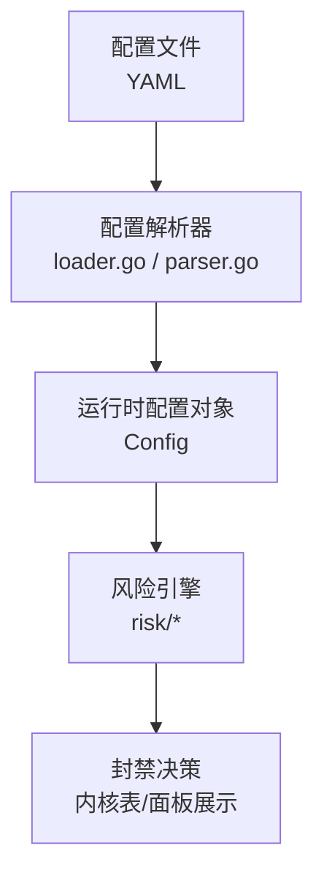
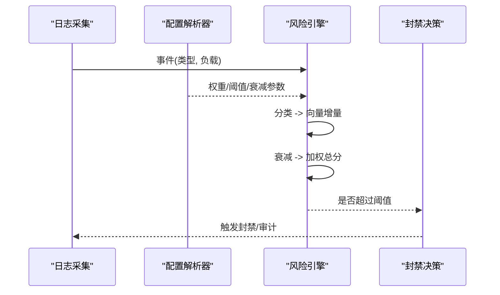
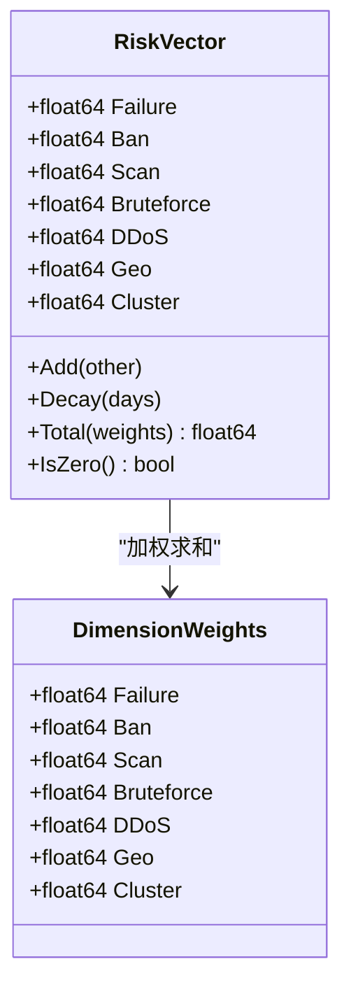
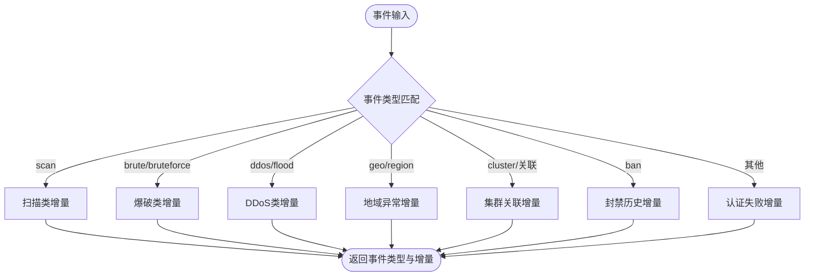
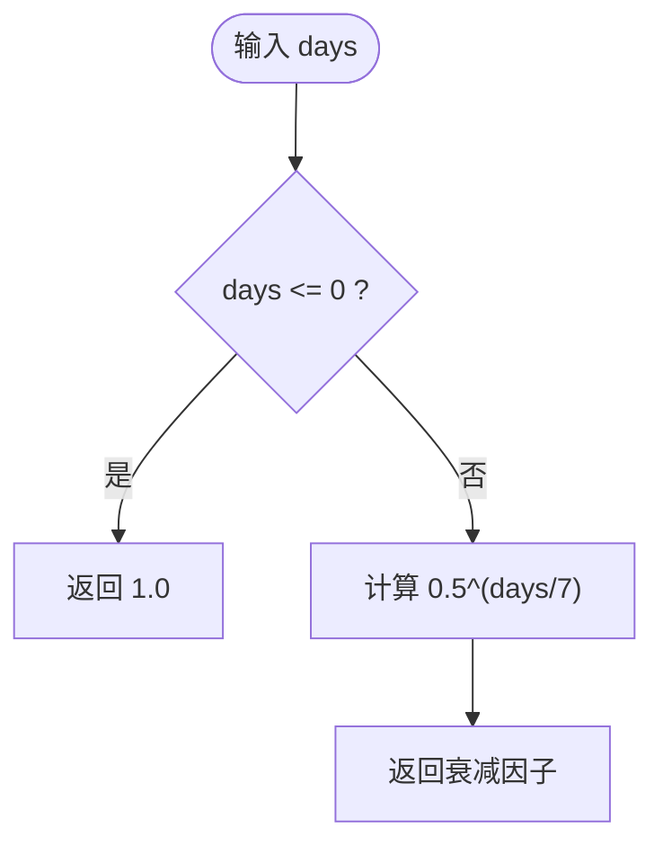
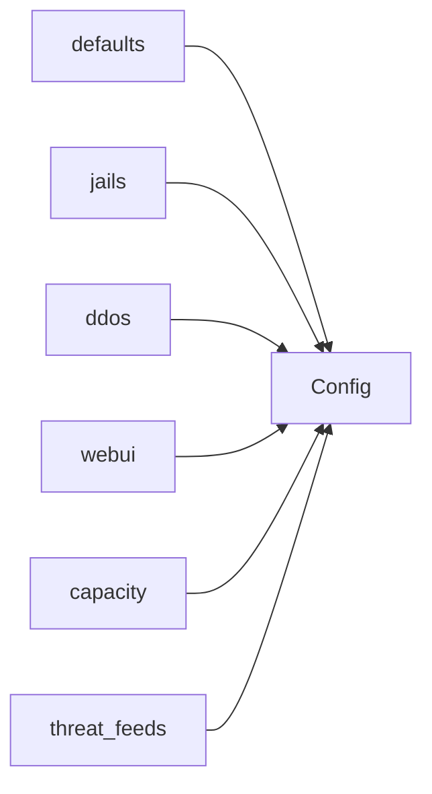
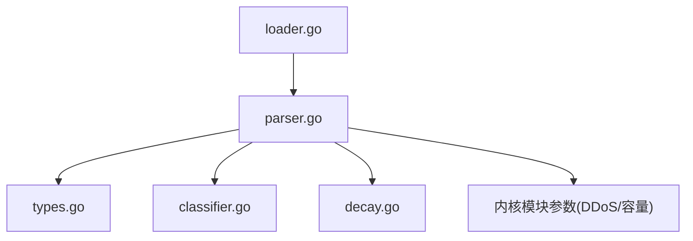

# 风险引擎配置

<cite>
**本文引用的文件**   
- [README.md](file://README.md)
- [default.yaml](file://config/default.yaml)
- [types.go](file://src/daemon/internal/risk/types.go)
- [classifier.go](file://src/daemon/internal/risk/classifier.go)
- [decay.go](file://src/daemon/internal/risk/decay.go)
- [loader.go](file://src/daemon/internal/config/loader.go)
- [parser.go](file://src/daemon/internal/config/parser.go)
</cite>

## 目录
1. [引言](#引言)
2. [项目结构](#项目结构)
3. [核心组件](#核心组件)
4. [架构总览](#架构总览)
5. [详细组件分析](#详细组件分析)
6. [依赖关系分析](#依赖关系分析)
7. [性能与误报控制](#性能与误报控制)
8. [故障排查指南](#故障排查指南)
9. [结论](#结论)
10. [附录：典型场景推荐配置](#附录典型场景推荐配置)

## 引言
本文件面向“多维风险引擎”的配置与调优，覆盖频率检测阈值、扫描识别参数、协议异常分析设置；说明风险评分权重调整、时间衰减因子配置、攻击分类规则定制；并给出 Web 服务器、数据库服务器、API 网关等典型部署环境的推荐值与调优建议。文档同时提供性能优化与误报率控制的最佳实践，帮助在保障安全性的前提下降低对业务的影响。

## 项目结构
风险引擎相关能力由守护进程中的“风险计算模块”和“配置解析模块”共同实现：
- 风险计算模块负责事件分类、向量衰减、加权总分计算与阈值判定。
- 配置解析模块负责加载 YAML 配置，将全局默认值、Jail（服务）级策略、DDoS 防护、Web UI、容量、威胁情报等合并为运行时配置。

图示来源
- [loader.go:17-50](file://src/daemon/internal/config/loader.go#L17-L50)
- [parser.go:155-207](file://src/daemon/internal/config/parser.go#L155-L207)
- [types.go:44-93](file://src/daemon/internal/risk/types.go#L44-L93)

章节来源
- [README.md:10-31](file://README.md#L10-L31)
- [loader.go:17-50](file://src/daemon/internal/config/loader.go#L17-L50)
- [parser.go:155-207](file://src/daemon/internal/config/parser.go#L155-L207)

## 核心组件
- 多维风险向量与权重
  - 风险向量包含失败、封禁历史、扫描、爆破、DDoS、地域异常、集群关联等维度，每个维度独立衰减与加权求和。
  - 权重可通过配置调整，默认均为 1.0。
- 事件分类器
  - 根据日志事件类型与负载字段，将原始事件映射到具体风险维度，并给出该事件的向量增量。
- 时间衰减
  - 采用指数衰减模型，半衰期为 7 天；随时间推移，历史风险逐渐降低，避免永久误判。
- 配置系统
  - 支持 defaults、jails、ddos、webui、capacity、threat_feeds 等段；支持目录合并与运行期覆盖文件。

章节来源
- [types.go:44-130](file://src/daemon/internal/risk/types.go#L44-L130)
- [classifier.go:15-144](file://src/daemon/internal/risk/classifier.go#L15-L144)
- [decay.go:5-34](file://src/daemon/internal/risk/decay.go#L5-L34)
- [parser.go:13-153](file://src/daemon/internal/config/parser.go#L13-L153)

## 架构总览
风险引擎的输入来自日志采集与协议解析，输出为风险评分与自动封禁决策。配置通过 YAML 驱动，影响事件分类、阈值、衰减与权重。

图示来源
- [classifier.go:15-34](file://src/daemon/internal/risk/classifier.go#L15-L34)
- [types.go:82-93](file://src/daemon/internal/risk/types.go#L82-L93)
- [decay.go:19-34](file://src/daemon/internal/risk/decay.go#L19-L34)
- [parser.go:171-207](file://src/daemon/internal/config/parser.go#L171-L207)

## 详细组件分析

### 多维风险向量与权重
- 风险向量字段
  - failure、ban、scan、bruteforce、ddos、geo、cluster。
- 向量操作
  - Add：累加新事件带来的增量。
  - Decay：按天数应用指数衰减。
  - Total：按 DimensionWeights 计算加权总分。
- 权重配置
  - DimensionWeights 各字段对应风险维度，默认均为 1.0，可结合业务侧重点调整。

图示来源
- [types.go:44-130](file://src/daemon/internal/risk/types.go#L44-L130)

章节来源
- [types.go:44-130](file://src/daemon/internal/risk/types.go#L44-L130)

### 事件分类与向量增量
- 分类逻辑
  - 根据事件类型字符串匹配 scan、brute/bruteforce、ddos/flood、geo/region、cluster/关联、ban，否则归为 failure。
- 向量增量
  - 不同类别有不同默认增量，并根据负载字段（如 ports、rate、pps、foreign、malicious、permanent）提升或保持基础增量。

图示来源
- [classifier.go:15-34](file://src/daemon/internal/risk/classifier.go#L15-L34)
- [classifier.go:36-144](file://src/daemon/internal/risk/classifier.go#L36-L144)

章节来源
- [classifier.go:15-144](file://src/daemon/internal/risk/classifier.go#L15-L144)

### 时间衰减因子
- 半衰期
  - HalfLifeDays = 7 天。
- 衰减公式
  - DecayFactor(days) = 0.5^(days/HalfLifeDays)。
- 使用方式
  - RiskVector.Decay 在每个维度上乘以 DecayFactor(days)，用于缓解长期累积导致的误判。

图示来源
- [decay.go:5-34](file://src/daemon/internal/risk/decay.go#L5-L34)

章节来源
- [decay.go:5-34](file://src/daemon/internal/risk/decay.go#L5-L34)

### 配置系统与关键参数
- 全局默认 defaults
  - findtime、ban_time、interval、metrics_port、log_file、history_db_path 等。
- Jail 级策略
  - log_files、max_retries、findtime、ban_time、regexes、cluster。
- DDoS 防护
  - global_conn_rate、auto_ban_duration、auto_ban_threshold、check_interval、各协议每秒上限、静态/动态阈值开关、保护对外端口等。
- Web UI
  - SSE 推送间隔、速率告警阈值、容量显示上限等。
- 容量 capacity
  - 封禁表、白名单、速率表、本地 IP 缓存条目上限。
- 威胁情报 threat_feeds
  - 启用开关、刷新间隔、HTTP 超时、重试次数、源列表（名称、URL、启用、类别、置信度）。

图示来源
- [parser.go:13-153](file://src/daemon/internal/config/parser.go#L13-L153)
- [parser.go:171-207](file://src/daemon/internal/config/parser.go#L171-L207)

章节来源
- [default.yaml:1-198](file://config/default.yaml#L1-L198)
- [parser.go:13-153](file://src/daemon/internal/config/parser.go#L13-L153)
- [parser.go:171-207](file://src/daemon/internal/config/parser.go#L171-L207)

## 依赖关系分析
- 配置解析依赖
  - loader.go 负责文件/目录加载、排序与原子回滚。
  - parser.go 负责 YAML 解码、字段校验、默认值与应用。
- 风险引擎依赖
  - types.go 定义向量与权重。
  - classifier.go 实现事件分类与增量计算。
  - decay.go 提供衰减函数。
- 外部集成
  - 威胁情报源通过 threat_feeds 配置注入风险判定（高置信度 IP 直接封禁）。
  - DDoS 防护参数同步至内核模块，限制速率与封禁速度。

图示来源
- [loader.go:17-50](file://src/daemon/internal/config/loader.go#L17-L50)
- [parser.go:155-207](file://src/daemon/internal/config/parser.go#L155-L207)
- [types.go:44-130](file://src/daemon/internal/risk/types.go#L44-L130)
- [classifier.go:15-144](file://src/daemon/internal/risk/classifier.go#L15-L144)
- [decay.go:5-34](file://src/daemon/internal/risk/decay.go#L5-L34)

章节来源
- [loader.go:17-50](file://src/daemon/internal/config/loader.go#L17-L50)
- [parser.go:155-207](file://src/daemon/internal/config/parser.go#L155-L207)

## 性能与误报控制
- 频率检测阈值
  - 通过 defaults.findtime 与 jail.findtime 控制统计窗口；max_retries 决定窗口内触发封禁的次数。
  - 建议：高频服务提高 findtime，降低 max_retries；低频服务缩短 findtime，提高 max_retries。
- 扫描识别参数
  - 分类器中 scan 增量受 payload.ports 与 payload.path 影响；可在业务侧减少误报路径（如健康检查）以避免被归类为扫描。
- 协议异常分析
  - DDoS 防护的各协议每秒上限（SYN/UDP/ICMP/ACK/RST/FIN）需按业务流量基线设定；开启 static_threshold 作为保守策略，dynamic_threshold 适合有稳定基线的场景。
- 风险评分权重调整
  - 若某维度频繁误报（如 geo），可降低其权重；若某维度漏报严重（如 ddos），可提高其权重。
- 时间衰减因子
  - 半衰期固定为 7 天；若业务需要更快遗忘历史风险，应结合更严格的阈值与权重，而非修改半衰期常量。
- 容量与吞吐
  - capacity.max_*_entries 与 ddos.max_bans_per_second、ddos.max_rate_entries 需与 CPU/内存资源匹配；过高会导致内存压力，过低会丢包或延迟。
- 威胁情报
  - 高置信度源可直接封禁，减少计数开销；但需平衡误报风险，必要时关闭低置信度源。

[本节为通用指导，不直接分析具体文件]

## 故障排查指南
- 配置未生效
  - 检查 defaults/jails/ddos/webui/capacity/threat_feeds 段是否存在拼写错误；严格模式下未知字段会报错。
  - 确认目录加载顺序与运行期覆盖文件（前缀 _）是否正确合并。
- 历史库不可用
  - history_db_path 为空时，面板分析页会返回“依赖未就绪”。
- DDoS 阈值不合理
  - 观察 webui 速率告警阈值与内核模块同步参数；若频繁告警，适当提高阈值或开启动态阈值。
- 威胁情报拉取失败
  - 检查 refresh_interval、http_timeout、max_retries 与各 source.enabled/confidence；网络连通性与 HTTPS 证书需正常。

章节来源
- [loader.go:17-50](file://src/daemon/internal/config/loader.go#L17-L50)
- [parser.go:155-207](file://src/daemon/internal/config/parser.go#L155-L207)
- [default.yaml:1-198](file://config/default.yaml#L1-L198)

## 结论
多维风险引擎通过“事件分类 + 向量衰减 + 加权总分”的方式，将多源信号转化为统一的风险评分，并结合配置化的阈值与权重进行自动封禁。合理的配置需要在安全性与可用性之间取得平衡：通过频率窗口、扫描与协议异常参数控制检测灵敏度，通过权重与衰减调节历史影响，通过容量与 DDoS 参数保障性能与稳定性。

[本节为总结性内容，不直接分析具体文件]

## 附录：典型场景推荐配置

- Web 服务器（Nginx/Apache）
  - 频率检测：findtime=600s，max_retries=3；SSH 等敏感服务 ban_time=-1（永久）。
  - 扫描识别：关注 payload.path 的目录遍历特征，避免健康检查路径被误判。
  - 协议异常：static_threshold=true，max_syn_per_second=2000，max_udp_per_second=10000，max_icmp_per_second=500。
  - 权重建议：scan、bruteforce 略高于默认；geo 适度降低以减少误报。
  - 参考配置位置：[default.yaml:35-53](file://config/default.yaml#L35-L53)、[default.yaml:65-91](file://config/default.yaml#L65-L91)

- 数据库服务器（MySQL/Redis）
  - 频率检测：findtime=300s，max_retries=2；连接失败与认证失败更敏感。
  - 扫描识别：端口扫描阈值较低，payload.ports>100 即显著提升风险。
  - 协议异常：降低 UDP/ICMP 上限，聚焦 TCP 连接异常；开启 protect_open_ports=true。
  - 权重建议：failure、bruteforce、scan 权重上调；geo 谨慎调整。
  - 参考配置位置：[default.yaml:65-91](file://config/default.yaml#L65-L91)

- API 网关（Traefik/Nginx Ingress）
  - 频率检测：findtime=600s，max_retries=3；针对 401/403 等鉴权失败事件加强分类。
  - 扫描识别：关注 payload.path 中的探测路径（如 admin、api/v1/debug）。
  - 协议异常：提高 max_ack_per_second、max_rst_per_second 以容忍正常重传；DDoS 检测开启。
  - 权重建议：ddos、bruteforce 权重上调；geo 视业务区域而定。
  - 参考配置位置：[default.yaml:65-91](file://config/default.yaml#L65-L91)

- 通用调优建议
  - 先启用 static_threshold，观察告警与封禁效果；再评估 dynamic_threshold 的基线稳定性。
  - 逐步调整权重，每次只改一个维度，观察风险总分与封禁命中率变化。
  - 合理设置 capacity 与 ddos.max_bans_per_second，避免峰值期间封禁队列拥塞。
  - 威胁情报源从低置信度开始，逐步放开高置信度源，监控误报率。

[本节为概念性指导，不直接分析具体文件]