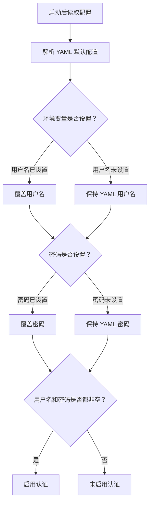
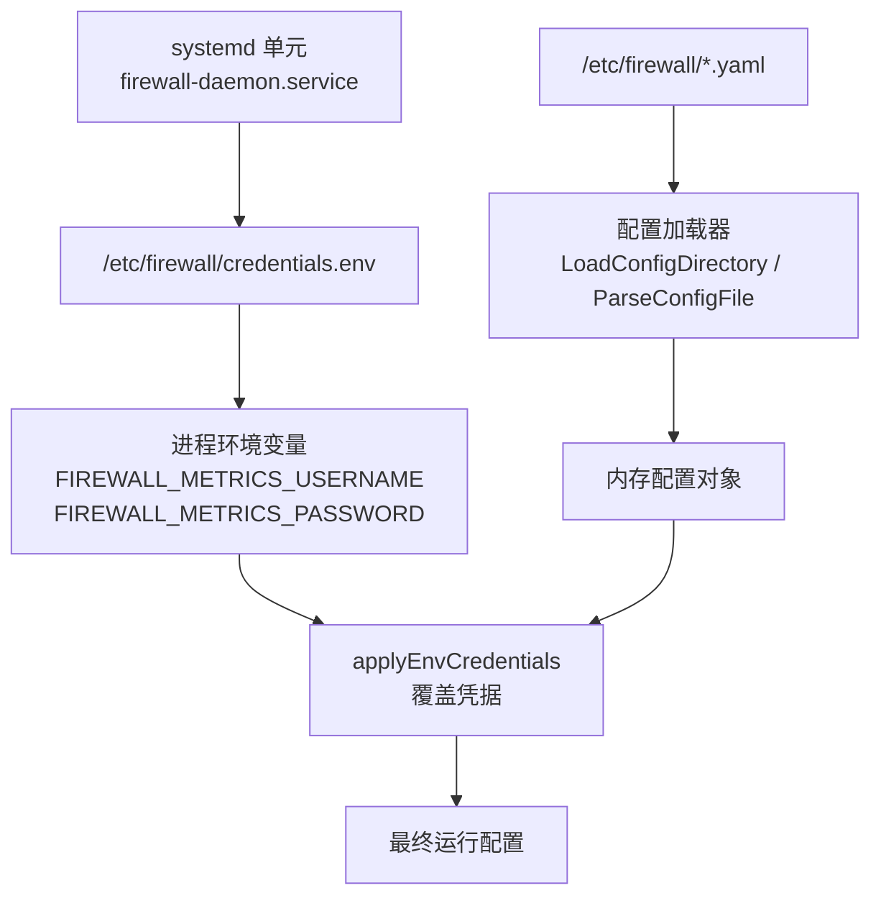
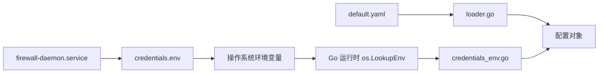

# 环境变量注入

<cite>
**本文引用的文件**   
- [credentials_env.go](file://src/daemon/internal/config/credentials_env.go)
- [default.yaml](file://config/default.yaml)
- [Makefile](file://Makefile)
- [SECURITY.md](file://SECURITY.md)
- [firewall-daemon.service](file://firewall-daemon.service)
- [loader.go](file://src/daemon/internal/config/loader.go)
</cite>

## 目录
1. [简介](#简介)
2. [项目结构中的相关位置](#项目结构中的相关位置)
3. [核心机制](#核心机制)
4. [架构总览](#架构总览)
5. [详细组件分析](#详细组件分析)
6. [依赖关系分析](#依赖关系分析)
7. [性能与行为特性](#性能与行为特性)
8. [安全最佳实践](#安全最佳实践)
9. [生产环境部署示例](#生产环境部署示例)
10. [故障排查](#故障排查)
11. [结论](#结论)

## 简介
本文件说明本项目中“通过环境变量覆盖配置文件敏感信息”的机制，重点围绕面板认证凭据（用户名、密码）如何从 `config/default.yaml` 迁移到运行时环境变量。该机制允许把真实凭据留在受保护的 `credentials.env` 文件中，由 systemd 的 `EnvironmentFile` 注入进程环境，再由守护进程在启动时读取并覆盖 YAML 中的默认值。

关键结论：
- 环境变量优先级高于配置文件中的默认值。
- 使用 `os.LookupEnv` 区分“未设置”和“显式设为空串”。
- 两项都空表示“未配置认证”，只填一项会被视为非法配置。
- `credentials.env` 是 systemd 环境变量文件，不是被程序直接解析的 YAML。

## 项目结构中的相关位置
| 文件 | 作用 |
|---|---|
| `src/daemon/internal/config/credentials_env.go` | 定义环境变量名、覆盖逻辑、来源判断和认证开关 |
| `config/default.yaml` | 提供默认配置，包括占位的用户名和密码 |
| `Makefile` | 安装阶段创建 `/etc/firewall/credentials.env` 模板，设置权限为 `0600` |
| `firewall-daemon.service` | 通过 `EnvironmentFile=-/etc/firewall/credentials.env` 注入环境变量 |
| `SECURITY.md` | 说明凭据不应提交进版本库，以及环境变量作为第二条来源的安全语义 |
| `src/daemon/internal/config/loader.go` | 负责加载 YAML 配置，体现“先解析配置，再应用环境变量”的顺序 |

**章节来源**
- [credentials_env.go:1-73](file://src/daemon/internal/config/credentials_env.go#L1-L73)
- [default.yaml:14-19](file://config/default.yaml#L14-L19)
- [Makefile:734-752](file://Makefile#L734-L752)
- [firewall-daemon.service:9-12](file://firewall-daemon.service#L9-L12)
- [SECURITY.md:96-107](file://SECURITY.md#L96-L107)
- [loader.go:17-50](file://src/daemon/internal/config/loader.go#L17-L50)

## 核心机制
### 环境变量名称
系统定义两个用于面板认证的环境变量：
- `FIREWALL_METRICS_USERNAME`
- `FIREWALL_METRICS_PASSWORD`

这两个变量命名遵循守护进程运维入口的统一前缀约定。

### 覆盖规则
- 如果某个环境变量存在，则用其值覆盖配置对象中的对应字段。
- 覆盖发生在 YAML 成功解析之后，因此 YAML 解析失败不会改变配置对象的原子性。
- 覆盖值不会写回磁盘；`PUT /config` 仅更新 Web UI 段补丁，不写入凭据。

### “未设置”与“显式空串”的区别
实现使用 `os.LookupEnv`，而不是 `os.Getenv`，从而保留以下语义：
- 没有设置环境变量：属于“未配置”。
- 设置了环境变量但值为空串：属于“显式关闭认证或显式覆盖 YAML”。

### 认证启用条件
只有用户名和密码都有非空值时，才认为启用了认证。  
如果两项都为空，则表示未配置认证；如果只有一项有值，则被视为非法配置。



**图表来源**
- [credentials_env.go:21-32](file://src/daemon/internal/config/credentials_env.go#L21-L32)
- [credentials_env.go:66-72](file://src/daemon/internal/config/credentials_env.go#L66-L72)

**章节来源**
- [credentials_env.go:15-32](file://src/daemon/internal/config/credentials_env.go#L15-L32)
- [credentials_env.go:46-72](file://src/daemon/internal/config/credentials_env.go#L46-L72)

## 架构总览
下图展示从 systemd 到守护进程的配置加载流程，以及环境变量如何覆盖 YAML 默认值。



**图表来源**
- [firewall-daemon.service:9-12](file://firewall-daemon.service#L9-L12)
- [Makefile:734-752](file://Makefile#L734-L752)
- [loader.go:53-127](file://src/daemon/internal/config/loader.go#L53-L127)
- [credentials_env.go:21-32](file://src/daemon/internal/config/credentials_env.go#L21-L32)

## 详细组件分析

### 凭据环境变量模块
该模块承担三项职责：
1. 定义环境变量常量。
2. 将环境变量值覆盖到配置对象。
3. 提供日志用的来源信息和认证开关判断。

```mermaid
classDiagram
class Config {
+string MetricsUsername
+string MetricsPassword
+CredentialSources() (username, password)
+AuthEnabled() bool
}
class CredentialSource {
<<enum>>
"环境变量"
"配置文件"
"未配置"
}
class CredentialsEnv {
+EnvMetricsUsername : string
+EnvMetricsPassword : string
+applyEnvCredentials(cfg) void
+credentialSource(value, envName) CredentialSource
}
Config --> CredentialSource : "返回来源"
CredentialsEnv --> Config : "覆盖凭据"
```

**图表来源**
- [credentials_env.go:15-32](file://src/daemon/internal/config/credentials_env.go#L15-L32)
- [credentials_env.go:34-72](file://src/daemon/internal/config/credentials_env.go#L34-L72)

**章节来源**
- [credentials_env.go:1-73](file://src/daemon/internal/config/credentials_env.go#L1-L73)

### 配置文件默认值
`config/default.yaml` 中的 `defaults` 段包含面板认证占位值。注释明确提示：
- 生产环境应通过 `/etc/firewall/credentials.env` 覆盖。
- 默认值是占位符，部署前应修改。
- 两项都留空即不启用认证。

这意味着默认 YAML 不应被视为生产凭据的最终来源。

**章节来源**
- [default.yaml:14-19](file://config/default.yaml#L14-L19)

### Makefile 安装的凭据文件模板
`make install` 的 `install-credentials` 目标会：
- 创建 `/etc/firewall` 目录。
- 若不存在则创建空的 `credentials.env`。
- 写入注释说明用途和命名。
- 设置权限为 `0600`。
- 设置属主为 `root:root`。
- 不生成任何真实凭据值。

这体现了“安装包不替运维决定口令”的原则。

**章节来源**
- [Makefile:734-752](file://Makefile#L734-L752)

### systemd 服务与环境变量注入
`firewall-daemon.service` 使用：
```text
EnvironmentFile=-/etc/firewall/credentials.env
```
其中 `-` 表示文件缺失时仍可启动，此时环境变量为空，守护进程回落到 YAML 默认值。

服务还包含多项安全加固选项，例如：
- `ProtectSystem=strict`
- `ReadOnlyPaths=/etc/firewall`
- `UMask=0077`
- 限制系统调用族
- 限制资源上限

这些选项共同降低守护进程暴露面。

**章节来源**
- [firewall-daemon.service:9-12](file://firewall-daemon.service#L9-L12)
- [firewall-daemon.service:19-43](file://firewall-daemon.service#L19-L43)

### 配置加载顺序
配置加载器负责：
- 校验路径。
- 检查是否为普通文件。
- 读取 YAML。
- 快照配置对象，保证解析失败时回滚。
- 按字母序合并多个 YAML。
- 将 `_` 前缀的运行期覆盖文件排在最后。

环境变量覆盖发生在 YAML 解析成功后，因此：
- YAML 解析错误不会污染配置对象。
- 环境变量是“第二来源”，优先级高于 YAML 默认值。

**章节来源**
- [loader.go:17-50](file://src/daemon/internal/config/loader.go#L17-L50)
- [loader.go:53-127](file://src/daemon/internal/config/loader.go#L53-L127)

## 依赖关系分析
环境变量注入依赖以下组件协作：



**图表来源**
- [firewall-daemon.service:9-12](file://firewall-daemon.service#L9-L12)
- [credentials_env.go:13-32](file://src/daemon/internal/config/credentials_env.go#L13-L32)
- [loader.go:17-50](file://src/daemon/internal/config/loader.go#L17-L50)

**章节来源**
- [credentials_env.go:13-32](file://src/daemon/internal/config/credentials_env.go#L13-L32)
- [loader.go:17-50](file://src/daemon/internal/config/loader.go#L17-L50)
- [firewall-daemon.service:9-12](file://firewall-daemon.service#L9-L12)

## 性能与行为特性
- 环境变量读取发生在配置加载完成后，开销极低。
- 不使用 `os.Getenv`，避免把“未设置”和“空字符串”混为一谈。
- 覆盖操作只修改内存中的配置对象，不落盘。
- 认证开关基于两个字段是否同时非空，判断简单且稳定。
- 日志来源函数只报告来源类型，不输出凭据值，降低泄露风险。

[本节为通用行为说明，不直接分析具体代码片段]

## 安全最佳实践

### 文件权限要求
| 对象 | 推荐权限 | 说明 |
|---|---:|---|
| `/etc/firewall` | `0700` | 仅 root 可访问配置目录 |
| `/etc/firewall/credentials.env` | `0600` | 仅 root 可读可写 |
| YAML 配置文件 | `0600` | 默认值可能含占位凭据，不应公开 |
| systemd 单元 | `0644` | 标准服务单元权限 |

Makefile 在安装凭据文件时强制 `chmod 600` 和 `chown root:root`。

**章节来源**
- [Makefile:734-752](file://Makefile#L734-L752)
- [SECURITY.md:96-107](file://SECURITY.md#L96-L107)

### 敏感信息保护
- 不要把真实用户名、密码写入 `config/default.yaml` 并提交到版本库。
- 不要把凭据写入脚本、日志、容器镜像层或构建产物。
- 把凭据当作密钥管理：最小授权、定期轮换、审计访问。
- 面板使用明文 Basic 认证且无内置 TLS，不应直接暴露在公网。

**章节来源**
- [SECURITY.md:90-107](file://SECURITY.md#L90-L107)
- [default.yaml:14-19](file://config/default.yaml#L14-L19)

### 环境变量命名规范
- 统一使用 `FIREWALL_` 前缀。
- 当前用于面板认证的变量：
  - `FIREWALL_METRICS_USERNAME`
  - `FIREWALL_METRICS_PASSWORD`
- 命名应与守护进程其他运维入口保持一致，便于运维人员识别。

**章节来源**
- [credentials_env.go:15-19](file://src/daemon/internal/config/credentials_env.go#L15-L19)

### 优先级关系
优先级从高到低：
1. systemd 注入的环境变量（来自 `credentials.env`）。
2. YAML 配置文件中的默认值。
3. 未设置时的“未配置认证”语义。

注意：
- 环境变量覆盖的是“真正设置过”的键。
- 显式设空等于有意关闭认证或覆盖 YAML，不是回退到 YAML。

**章节来源**
- [credentials_env.go:21-32](file://src/daemon/internal/config/credentials_env.go#L21-L32)
- [SECURITY.md:99-107](file://SECURITY.md#L99-L107)

## 生产环境部署示例

### 步骤一：安装并准备凭据文件
执行安装流程后，系统会准备 `/etc/firewall/credentials.env`，内容为注释掉的空键，权限为 `0600`，属主为 `root:root`。

**章节来源**
- [Makefile:734-752](file://Makefile#L734-L752)

### 步骤二：填写凭据
编辑 `/etc/firewall/credentials.env`，取消注释并填入真实用户名和密码。例如：
```text
FIREWALL_METRICS_USERNAME=实际用户名
FIREWALL_METRICS_PASSWORD=实际密码
```

如果希望显式关闭认证，可将某项设为空串：
```text
FIREWALL_METRICS_PASSWORD=
```

**章节来源**
- [SECURITY.md:99-107](file://SECURITY.md#L99-L107)

### 步骤三：确认 systemd 注入
确保服务单元中包含：
```text
EnvironmentFile=-/etc/firewall/credentials.env
```
该配置使 systemd 在启动守护进程前注入环境变量。

**章节来源**
- [firewall-daemon.service:9-12](file://firewall-daemon.service#L9-L12)

### 步骤四：验证认证状态
- 如果两个环境变量都有非空值：启用认证。
- 如果两个环境变量都为空：未启用认证。
- 如果只有一个环境变量有值：视为非法配置。

**章节来源**
- [credentials_env.go:66-72](file://src/daemon/internal/config/credentials_env.go#L66-L72)

### 步骤五：绑定地址与安全策略
- 如果绑定到 `127.0.0.1`，风险较低，但仍建议配置凭据。
- 如果绑定到 `0.0.0.0` 或其他非回环地址，必须配置凭据。
- 不建议直接暴露到公网；如需对外访问，应放在可信网络或使用反向代理加 TLS。

**章节来源**
- [SECURITY.md:90-98](file://SECURITY.md#L90-L98)
- [default.yaml:13-19](file://config/default.yaml#L13-L19)

## 故障排查

### 问题：面板未要求认证
可能原因：
- 两个环境变量都为空。
- 环境变量未通过 systemd 注入。
- `credentials.env` 不存在且未启用 fallback。
- YAML 中默认值被环境变量显式清空。

排查建议：
1. 检查 `/etc/firewall/credentials.env` 是否存在且权限正确。
2. 检查 systemd 单元是否包含 `EnvironmentFile=-/etc/firewall/credentials.env`。
3. 检查两个环境变量是否同时非空。
4. 查看守护进程日志中的认证来源信息。

**章节来源**
- [firewall-daemon.service:9-12](file://firewall-daemon.service#L9-L12)
- [credentials_env.go:66-72](file://src/daemon/internal/config/credentials_env.go#L66-L72)

### 问题：只配置了用户名或密码
现象：
- 系统判定为非法配置。
- 端点可能被拒绝。

原因：
- 认证契约要求用户名和密码同时存在。
- 只填一项不等于“部分认证”。

处理建议：
- 同时配置两个环境变量。
- 或者两个都留空以显式关闭认证。

**章节来源**
- [credentials_env.go:66-72](file://src/daemon/internal/config/credentials_env.go#L66-L72)

### 问题：环境变量没有覆盖 YAML
可能原因：
- 环境变量名不正确。
- systemd 未注入环境变量。
- 环境变量值为空，导致显式关闭认证。
- YAML 解析失败，但环境变量覆盖发生在解析成功后。

处理建议：
1. 核对环境变量名是否为 `FIREWALL_METRICS_USERNAME` 和 `FIREWALL_METRICS_PASSWORD`。
2. 重启 systemd 服务以重新加载环境变量。
3. 检查 YAML 解析日志。
4. 确认 `credentials.env` 权限为 `0600` 且属主为 `root`。

**章节来源**
- [credentials_env.go:21-32](file://src/daemon/internal/config/credentials_env.go#L21-L32)
- [loader.go:17-50](file://src/daemon/internal/config/loader.go#L17-L50)
- [Makefile:734-752](file://Makefile#L734-L752)

### 问题：日志中出现凭据
正常情况下，来源判断函数只输出来源类型，不输出凭据值。  
如果出现凭据，应检查：
- 自定义日志逻辑是否误打印配置对象。
- 是否把凭据写入调试输出。
- 是否把 `credentials.env` 内容直接记录到日志。

**章节来源**
- [credentials_env.go:34-64](file://src/daemon/internal/config/credentials_env.go#L34-L64)

## 结论
本项目的凭据注入机制采用“YAML 默认值 + 环境变量覆盖”的双来源设计：
- YAML 提供可版本化的默认配置。
- 环境变量提供生产环境的敏感信息注入能力。
- systemd 的 `EnvironmentFile` 负责把 `credentials.env` 注入进程环境。
- 守护进程使用 `os.LookupEnv` 精确区分“未设置”和“显式空串”。
- 认证启用需要用户名和密码同时非空。

生产部署时应：
- 将真实凭据放入 `/etc/firewall/credentials.env`。
- 设置文件权限为 `0600`，属主为 `root`。
- 不要提交真实凭据到版本库。
- 对非回环绑定强制启用认证。
- 通过反向代理和 TLS 保护面板访问。