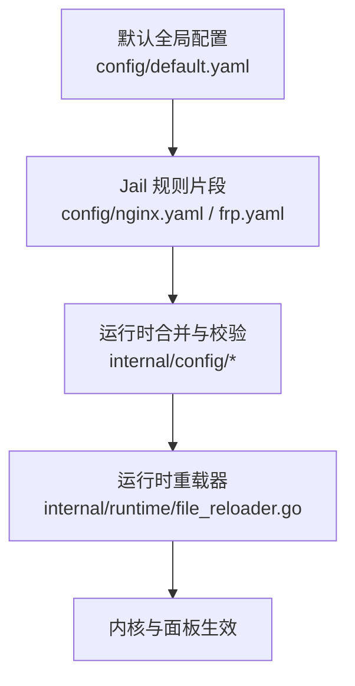
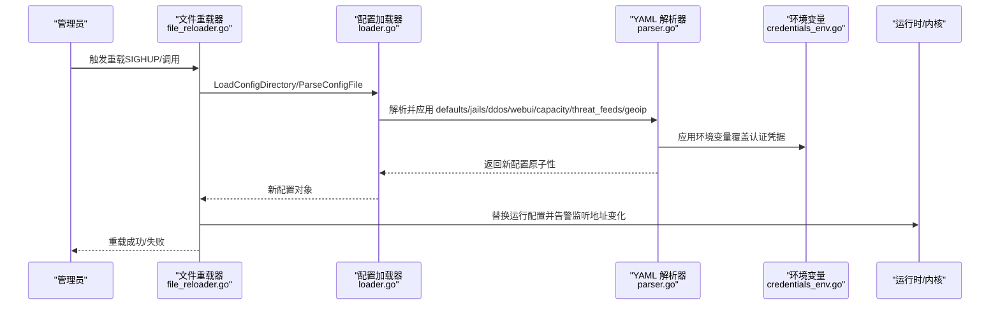
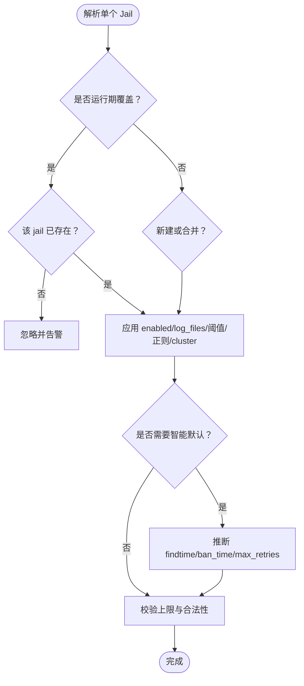
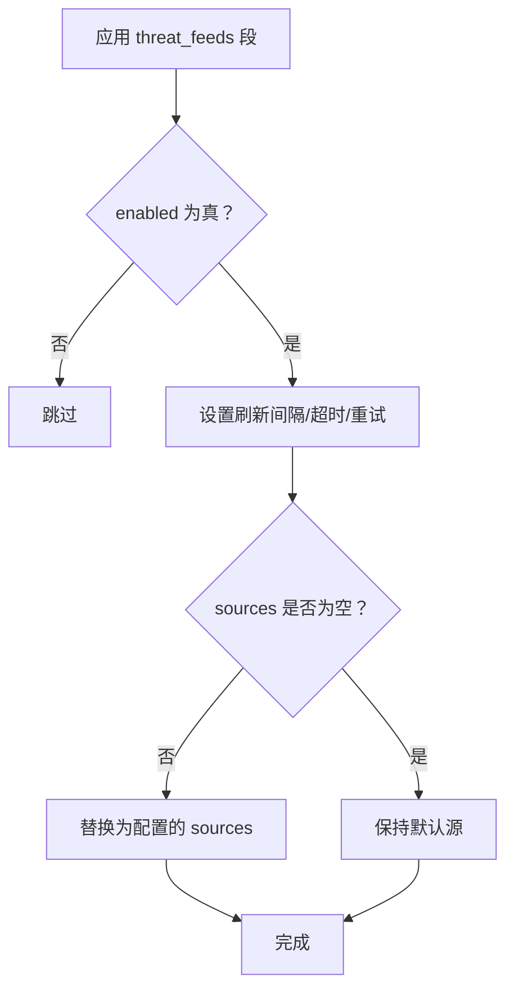
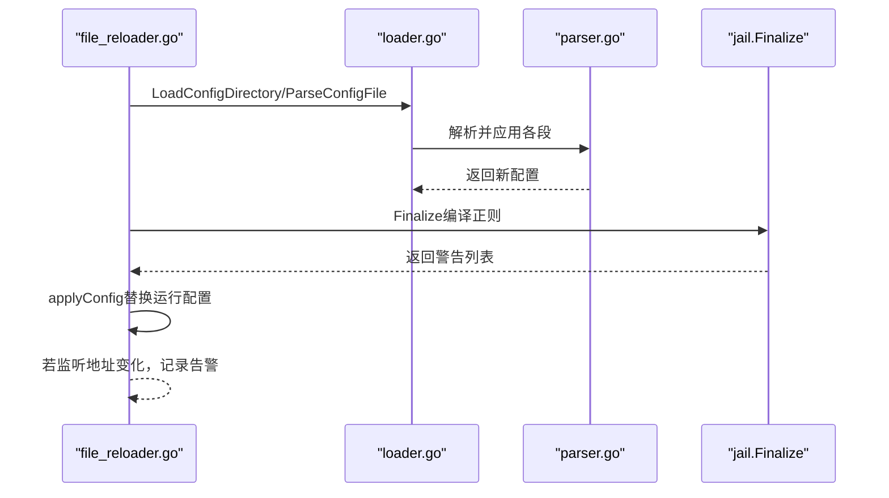
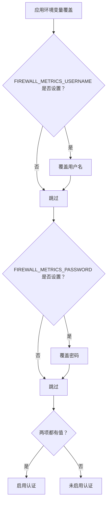
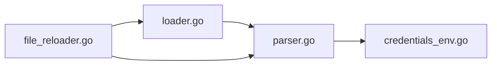

# 配置管理

<cite>
**本文引用的文件**   
- [default.yaml](file://config/default.yaml)
- [nginx.yaml](file://config/nginx.yaml)
- [frp.yaml](file://config/frp.yaml)
- [loader.go](file://src/daemon/internal/config/loader.go)
- [parser.go](file://src/daemon/internal/config/parser.go)
- [credentials_env.go](file://src/daemon/internal/config/credentials_env.go)
- [file_reloader.go](file://src/daemon/internal/runtime/file_reloader.go)
</cite>

## 目录
1. [简介](#简介)
2. [项目结构](#项目结构)
3. [核心组件](#核心组件)
4. [架构总览](#架构总览)
5. [详细组件分析](#详细组件分析)
6. [依赖关系分析](#依赖关系分析)
7. [性能与容量调优](#性能与容量调优)
8. [故障排查指南](#故障排查指南)
9. [结论](#结论)
10. [附录：配置模板与最佳实践](#附录配置模板与最佳实践)

## 简介
本文件面向系统管理员与安全运维人员，系统化说明防火墙守护进程的配置体系。内容覆盖 YAML 语法结构、全部配置项含义与用法、动态重载机制、环境变量注入、配置校验流程，以及 Jail 规则、威胁情报源、DDoS 防护、Web UI、可信 IP、容量上限、GeoIP 等高级能力。目标是帮助你在生产环境中安全、可审计地管理与优化配置。

## 项目结构
配置由“默认全局配置 + 服务级 jail 片段”组成：
- 默认全局配置位于 config/default.yaml，定义 defaults、jails、ddos、webui、trusted_ips、capacity、threat_feeds、geoip 等顶层段。
- 服务级 jail 片段（如 nginx.yaml、frp.yaml）以 jails 段提供最小化规则，配合默认值实现“智能推断”。

图表来源
- [default.yaml:1-198](file://config/default.yaml#L1-L198)
- [nginx.yaml:1-14](file://config/nginx.yaml#L1-L14)
- [frp.yaml:1-18](file://config/frp.yaml#L1-L18)
- [loader.go:17-129](file://src/daemon/internal/config/loader.go#L17-L129)
- [file_reloader.go:24-59](file://src/daemon/internal/runtime/file_reloader.go#L24-L59)

章节来源
- [default.yaml:1-198](file://config/default.yaml#L1-L198)
- [nginx.yaml:1-14](file://config/nginx.yaml#L1-L14)
- [frp.yaml:1-18](file://config/frp.yaml#L1-L18)

## 核心组件
- 配置解析与合并：负责读取 YAML、严格模式校验、defaults/jails/ddos/webui/capacity/threat_feeds/geoip 分段应用、运行期覆盖文件优先级处理。
- 环境变量注入：通过 FIREWALL_METRICS_USERNAME/FIREWALL_METRICS_PASSWORD 覆盖 Web UI 认证凭据。
- 动态重载：支持 SIGHUP 热重载与回滚，保证原子性、一致性、可观测性。
- Jail 规则引擎：支持 regex/regexes 两种写法、集群扫描检测、智能默认参数推断。
- 威胁情报源：支持多源拉取、分类、置信度、调度刷新。
- DDoS 防护：静态/动态阈值、协议专项阈值、端口保护策略、速率表容量。
- GeoIP：城市库路径、本机坐标、出口探测地址。

章节来源
- [parser.go:13-153](file://src/daemon/internal/config/parser.go#L13-L153)
- [credentials_env.go:1-73](file://src/daemon/internal/config/credentials_env.go#L1-L73)
- [file_reloader.go:24-107](file://src/daemon/internal/runtime/file_reloader.go#L24-L107)

## 架构总览
配置加载与重载的关键路径如下：

图表来源
- [file_reloader.go:24-59](file://src/daemon/internal/runtime/file_reloader.go#L24-L59)
- [loader.go:17-129](file://src/daemon/internal/config/loader.go#L17-L129)
- [parser.go:155-207](file://src/daemon/internal/config/parser.go#L155-L207)
- [credentials_env.go:21-32](file://src/daemon/internal/config/credentials_env.go#L21-L32)

## 详细组件分析

### YAML 配置结构与字段说明
顶层结构包含以下段：
- defaults：全局默认值，影响所有未显式覆盖的 jail 与系统行为。
- jails：每个服务的独立监控与封禁规则。
- ddos：DDoS 防护开关与阈值。
- webui：Web UI 展示与 SSE 推送相关阈值。
- trusted_ips：启动时加入内核白名单的可信 IP/CIDR。
- capacity：封禁表、白名单、速率表、本地缓存容量上限。
- threat_feeds：威胁情报源开关、刷新间隔、HTTP 超时、重试次数及 sources 列表。
- geoip_db_path/server_latitude/server_longitude/geoip_detect_egress/geoip_egress_probe_url：地理库与本机坐标、出口探测。

关键字段要点：
- defaults.log_level/log_destination/log_format/log_max_size_mb/log_max_files：日志级别、输出目标、格式、轮转大小与数量。
- defaults.history_db_path/history_retention_days：历史库开关与保留天数；留空则面板分析页不可用。
- jails.*.enabled/log_files/max_retries/findtime/ban_time/regex/regex_name/regexes/cluster：Jail 启用、日志文件、重试与时间窗口、正则表达式、集群扫描检测。
- ddos.enabled/global_conn_rate/auto_ban_duration/auto_ban_threshold/check_interval/static_threshold/dynamic_threshold/ddos_detection/max_bans_per_second/max_rate_entries/protect_open_ports：DDoS 总开关、连接率、自动封禁策略、检测间隔、算法开关、速率表容量、对外端口保护。
- webui.sse_push_interval/rate_warning_pps/rate_critical_pps/rate_warning_syn/rate_critical_syn：面板实时推送与速率告警阈值。
- threat_feeds.enabled/refresh_interval/http_timeout/max_retries/sources[].name/url/enabled/category/confidence：情报源总开关、调度与网络参数、各源启用与分类、置信度。
- trusted_ips[]：单 IP 或 CIDR，重启生效。
- capacity.max_ban_entries/max_whitelist_entries/max_rate_entries/max_local_ip_cache：容量上限。
- geoip_*：地理库路径、本机经纬度（必须成对）、是否开启出口探测、探测 URL。

章节来源
- [default.yaml:1-198](file://config/default.yaml#L1-L198)
- [parser.go:13-153](file://src/daemon/internal/config/parser.go#L13-L153)

### Jail 规则配置
- 支持两种正则声明方式：
  - regex：单条正则，可选 regex_name 命名。
  - regexes：多条命名正则映射。
- 智能默认：仅写 log_files/regex 时，系统会推断 findtime、ban_time、max_retries，避免误封。
- 集群扫描检测：cluster.enabled/audit_only/prefix_v4/prefix_v6/window/min_ips/max_per_ip/ban_time。
- 限制：jail 数量、正则数量、log_files 数量均有上限，超限将拒绝加载。

图表来源
- [parser.go:277-374](file://src/daemon/internal/config/parser.go#L277-L374)
- [parser.go:473-497](file://src/daemon/internal/config/parser.go#L473-L497)

章节来源
- [parser.go:277-374](file://src/daemon/internal/config/parser.go#L277-L374)
- [parser.go:473-497](file://src/daemon/internal/config/parser.go#L473-L497)
- [nginx.yaml:1-14](file://config/nginx.yaml#L1-L14)
- [frp.yaml:1-18](file://config/frp.yaml#L1-L18)

### 威胁情报源设置
- 总开关 enabled 控制整个情报系统。
- refresh_interval：自动刷新间隔（秒）。
- http_timeout：单次拉取 HTTP 超时（秒）。
- max_retries：拉取失败重试次数。
- sources：每条包含 name/url/enabled/category/confidence。
- 当 sources 非空时，替换默认源列表；否则使用内置默认。

图表来源
- [parser.go:561-591](file://src/daemon/internal/config/parser.go#L561-L591)

章节来源
- [parser.go:561-591](file://src/daemon/internal/config/parser.go#L561-L591)
- [default.yaml:123-168](file://config/default.yaml#L123-L168)

### 安全策略调优（DDoS 与 Web UI）
- DDoS：
  - global_conn_rate：全局每秒最大连接数。
  - auto_ban_duration/auto_ban_threshold：超阈值后自动封禁时长与次数。
  - check_interval：检测周期。
  - static_threshold/dynamic_threshold/ddos_detection：算法开关。
  - 协议专项阈值：SYN/UDP/ICMP/ACK/RST/FIN 每秒上限。
  - max_bans_per_second/max_rate_entries：封禁写入速率与速率表容量。
  - protect_open_ports：仅对外监听端口参与速率判定，减少内部流量误判。
- Web UI：
  - sse_push_interval：SSE 推送间隔。
  - rate_warning_pps/rate_critical_pps/rate_warning_syn/rate_critical_syn：面板速率告警阈值。
  - 其他 webui 段中的阈值用于前端展示与过滤。

章节来源
- [default.yaml:63-91](file://config/default.yaml#L63-L91)
- [parser.go:499-548](file://src/daemon/internal/config/parser.go#L499-L548)

### 可信 IP 与容量配置
- trusted_ips[]：守护进程启动时加入内核白名单，防止误封；修改需重启。
- capacity：
  - max_ban_entries：封禁表条目上限。
  - max_whitelist_entries：白名单条目上限。
  - max_rate_entries：速率表条目上限。
  - max_local_ip_cache：本地 IP 缓存条目上限。

章节来源
- [default.yaml:93-110](file://config/default.yaml#L93-L110)
- [parser.go:550-559](file://src/daemon/internal/config/parser.go#L550-L559)

### GeoIP 与本机坐标
- geoip_db_path：城市级 GeoIP 库路径；未设置则禁用地理分布功能。
- server_latitude/server_longitude：必须成对给出，范围 [-90,90] 与 [-180,180]；半份坐标会被拒绝。
- geoip_detect_egress：是否启动时探测出口 IP。
- geoip_egress_probe_url：探测地址，必须以 http(s) 开头且主机名非空。

章节来源
- [default.yaml:112-198](file://config/default.yaml#L112-L198)
- [parser.go:593-635](file://src/daemon/internal/config/parser.go#L593-L635)
- [parser.go:670-706](file://src/daemon/internal/config/parser.go#L670-L706)

### 动态配置重载机制
- 重载入口：
  - 单文件：ParseConfigFile。
  - 目录：LoadConfigDirectory，按文件名字母序合并，运行期覆盖文件（_ 前缀）最后合并。
- 原子性：任一文件解析失败，整体回滚到调用前快照。
- 正则编译失败不阻断重载：退化为关键字回退并记录警告。
- 监听地址变更告警：metrics_port/bind_address 改变不会在重载时重新绑定，需重启守护进程。

图表来源
- [file_reloader.go:24-59](file://src/daemon/internal/runtime/file_reloader.go#L24-L59)
- [file_reloader.go:94-107](file://src/daemon/internal/runtime/file_reloader.go#L94-L107)
- [loader.go:17-129](file://src/daemon/internal/config/loader.go#L17-L129)

章节来源
- [file_reloader.go:24-107](file://src/daemon/internal/runtime/file_reloader.go#L24-L107)
- [loader.go:17-129](file://src/daemon/internal/config/loader.go#L17-L129)

### 环境变量注入与认证
- 环境变量：
  - FIREWALL_METRICS_USERNAME
  - FIREWALL_METRICS_PASSWORD
- 语义：
  - 两项都空 = 未配置认证并放行。
  - 只填一项 = 非法，端点一律拒绝。
  - 真正设置过的变量（含显式设空）优先于 YAML。
- 日志可显示凭据来源（环境变量/配置文件/未配置），但绝不打印值。

图表来源
- [credentials_env.go:21-32](file://src/daemon/internal/config/credentials_env.go#L21-L32)
- [credentials_env.go:46-72](file://src/daemon/internal/config/credentials_env.go#L46-L72)

章节来源
- [credentials_env.go:1-73](file://src/daemon/internal/config/credentials_env.go#L1-L73)

### 配置验证流程
- 严格模式：未知顶层字段直接报错（可通过 --no-strict 关闭）。
- 路径校验：ValidateAndNormalizePath 确保路径合法。
- 类型与取值校验：
  - log_destination/log_format 枚举校验。
  - server_latitude/server_longitude 成对与范围校验。
  - geoip_egress_probe_url 协议与主机名校验。
- 业务上限：
  - jail 数量、正则数量、log_files 数量。
  - capacity 各项上限。
- 原子性：解析失败不修改 cfg，保证重载一致性。

章节来源
- [loader.go:17-51](file://src/daemon/internal/config/loader.go#L17-L51)
- [parser.go:155-207](file://src/daemon/internal/config/parser.go#L155-L207)
- [parser.go:209-275](file://src/daemon/internal/config/parser.go#L209-L275)
- [parser.go:420-450](file://src/daemon/internal/config/parser.go#L420-L450)
- [parser.go:593-635](file://src/daemon/internal/config/parser.go#L593-L635)
- [parser.go:670-706](file://src/daemon/internal/config/parser.go#L670-L706)

## 依赖关系分析
- loader.go 负责文件与目录加载、排序与运行期覆盖文件优先级。
- parser.go 负责 YAML 解码、分段应用、校验与默认值填充。
- credentials_env.go 提供环境变量覆盖与认证状态判断。
- file_reloader.go 串联加载、最终化（正则编译）与运行时替换。

图表来源
- [loader.go:17-129](file://src/daemon/internal/config/loader.go#L17-L129)
- [parser.go:155-207](file://src/daemon/internal/config/parser.go#L155-L207)
- [credentials_env.go:21-32](file://src/daemon/internal/config/credentials_env.go#L21-L32)
- [file_reloader.go:24-59](file://src/daemon/internal/runtime/file_reloader.go#L24-L59)

章节来源
- [loader.go:17-129](file://src/daemon/internal/config/loader.go#L17-L129)
- [parser.go:155-207](file://src/daemon/internal/config/parser.go#L155-L207)
- [credentials_env.go:21-32](file://src/daemon/internal/config/credentials_env.go#L21-L32)
- [file_reloader.go:24-59](file://src/daemon/internal/runtime/file_reloader.go#L24-L59)

## 性能与容量调优
- 速率表与封禁表容量：
  - 根据并发源 IP 规模调整 max_rate_entries 与 max_ban_entries。
  - 高吞吐场景建议提高 max_bans_per_second 以避免封禁写入被限流。
- DDoS 检测：
  - 静态阈值适合稳定环境；动态阈值适合波动较大的公网场景。
  - protect_open_ports 打开可减少内部流量误判，但需确保对外端口识别准确。
- 日志与历史库：
  - history_db_path 开启后，面板分析页可用；合理设置 retention 控制磁盘增长。
  - log_max_size_mb/log_max_files 控制日志轮转频率与留存量。
- GeoIP：
  - 仅在需要地图展示时启用 city.mmdb；避免不必要的 I/O。
  - geoip_detect_egress 默认关闭，按需开启以减少对外请求。

[本节为通用指导，不直接分析具体文件]

## 故障排查指南
- 重载失败：
  - 检查 YAML 语法与严格模式未知字段。
  - 确认路径与权限正确。
  - 查看正则编译警告；正则失败不会阻断重载，但对应 jail 会退化。
- 认证异常：
  - 确认环境变量 FIREWALL_METRICS_USERNAME/FIREWALL_METRICS_PASSWORD 同时设置或同时为空。
  - 若只设置一项，端点将被拒绝。
- 监听地址未生效：
  - metrics_port/bind_address 变更后需重启守护进程才会重新绑定。
- GeoIP 地图异常：
  - 确认 server_latitude/server_longitude 成对且范围合法。
  - 确认 geoip_egress_probe_url 以 http(s) 开头且主机名非空。
- 威胁情报未更新：
  - 检查 enabled、refresh_interval、http_timeout、max_retries 与各 source.enabled。
  - 观察日志中拉取失败与重试信息。

章节来源
- [file_reloader.go:24-59](file://src/daemon/internal/runtime/file_reloader.go#L24-L59)
- [file_reloader.go:94-107](file://src/daemon/internal/runtime/file_reloader.go#L94-L107)
- [credentials_env.go:46-72](file://src/daemon/internal/config/credentials_env.go#L46-L72)
- [parser.go:593-635](file://src/daemon/internal/config/parser.go#L593-L635)
- [parser.go:670-706](file://src/daemon/internal/config/parser.go#L670-L706)

## 结论
本配置体系以 defaults 为基础、jails 为中心，结合 DDoS、威胁情报、GeoIP、Web UI 与容量上限，形成完整的安全策略闭环。通过严格校验、原子重载与环境变量注入，既保证了安全性与可审计性，也提供了灵活的生产调优空间。建议在灰度环境先行验证，再滚动发布至生产。

[本节为总结性内容，不直接分析具体文件]

## 附录：配置模板与最佳实践
- 最小可用模板：
  - 仅填写 defaults.log_file 与至少一个 jail 的 log_files，其余使用智能默认。
  - 示例参考：config/nginx.yaml（最小 jail 片段）。
- 推荐实践：
  - 将敏感凭据放入环境变量，不在仓库中提交明文。
  - 使用目录模式组织配置，按字母序拆分 base/override 文件。
  - 在生产关闭 geoip_detect_egress，除非确需自动探测出口。
  - 定期审查 threat_feeds.sources 的 enabled 与 confidence，平衡覆盖率与误报。
  - 根据业务峰值调整 capacity 与 ddos.max_rate_entries，避免容量瓶颈。
  - 对关键服务（SSH、Nginx、FRP 等）分别维护 jail 片段，便于隔离与回滚。

章节来源
- [default.yaml:1-198](file://config/default.yaml#L1-L198)
- [nginx.yaml:1-14](file://config/nginx.yaml#L1-L14)
- [frp.yaml:1-18](file://config/frp.yaml#L1-L18)