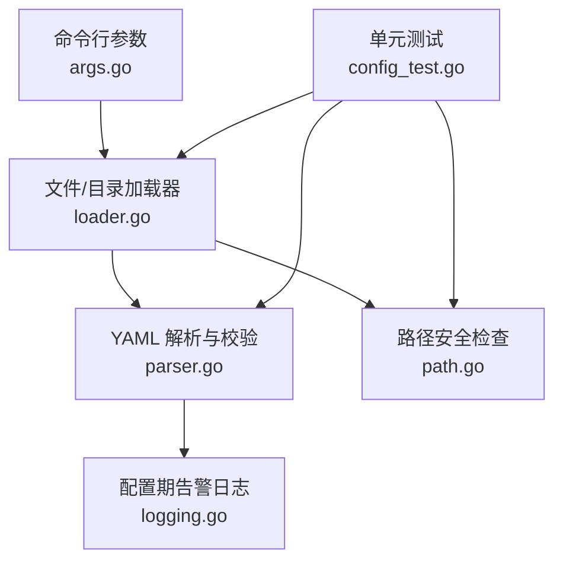
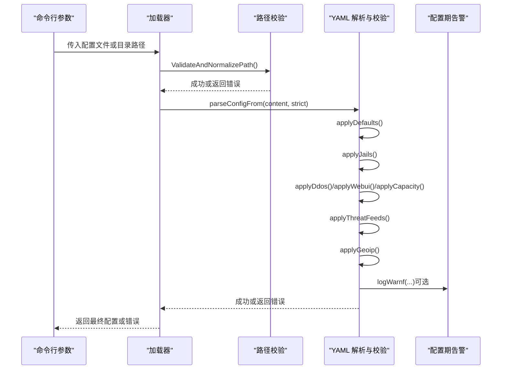
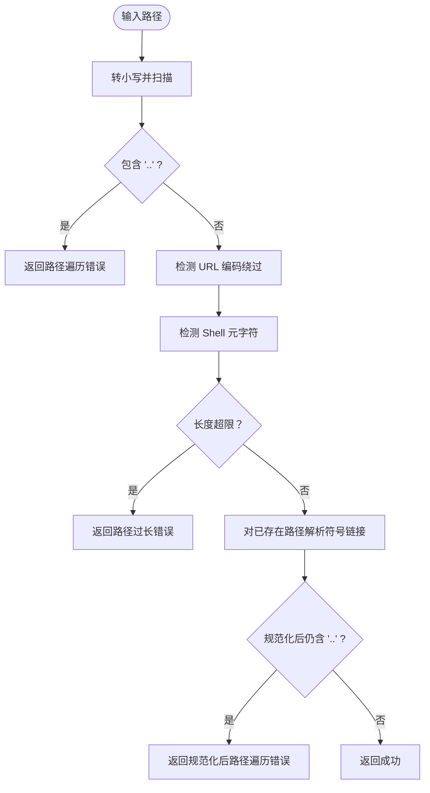
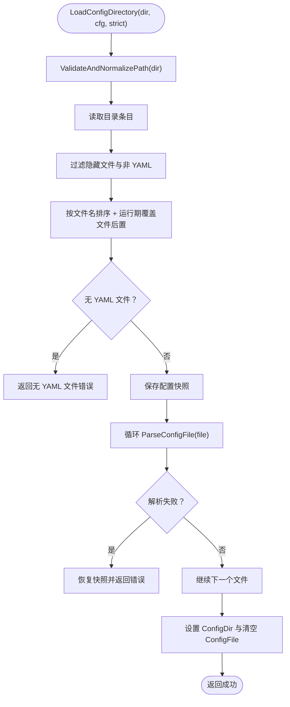
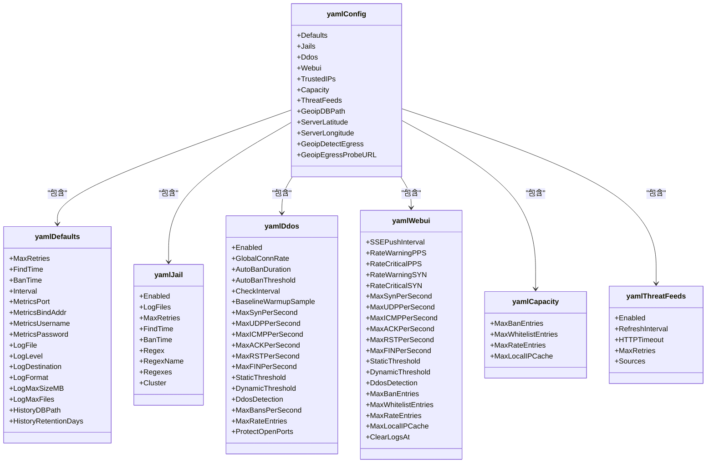
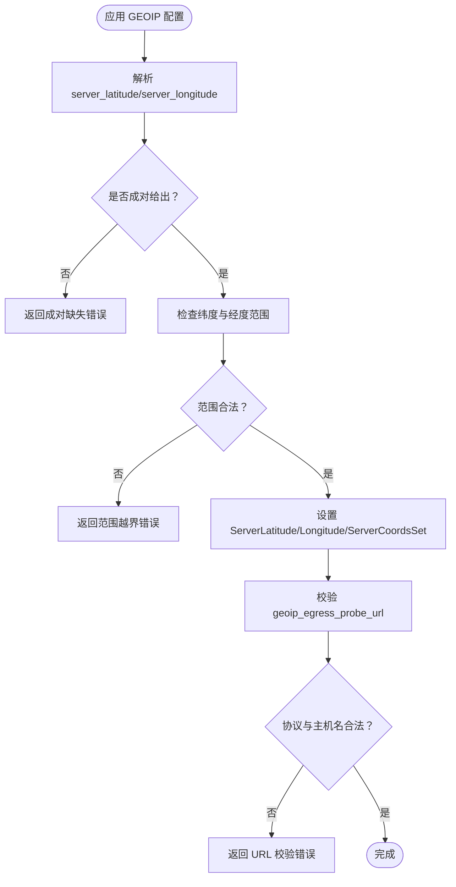
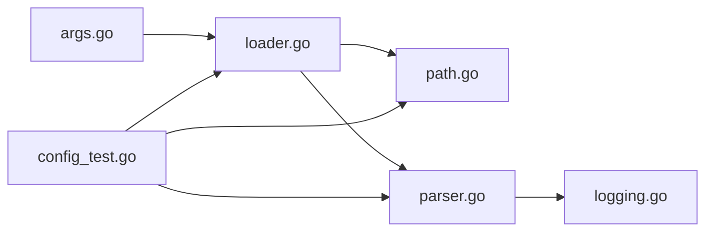

# 配置验证机制

<cite>
**本文引用的文件**   
- [loader.go](file://src/daemon/internal/config/loader.go)
- [parser.go](file://src/daemon/internal/config/parser.go)
- [path.go](file://src/daemon/internal/config/path.go)
- [logging.go](file://src/daemon/internal/config/logging.go)
- [args.go](file://src/daemon/internal/config/args.go)
- [config_test.go](file://src/daemon/internal/config/config_test.go)
</cite>

## 目录
1. [引言](#引言)
2. [项目结构](#项目结构)
3. [核心组件](#核心组件)
4. [架构总览](#架构总览)
5. [详细组件分析](#详细组件分析)
6. [依赖关系分析](#依赖关系分析)
7. [性能与行为特性](#性能与行为特性)
8. [故障诊断与修复指南](#故障诊断与修复指南)
9. [结论](#结论)
10. [附录：扩展自定义验证器与测试设计](#附录：扩展自定义验证器与测试设计)

## 引言
本文件面向守护进程的配置子系统，系统性说明配置文件的语法检查、数据类型校验、业务规则校验、错误类型与消息格式、处理流程，以及配置项之间的依赖关系验证。文档同时给出可扩展的自定义验证器设计与测试用例组织方式，并总结常见配置错误的诊断与修复方法。

该机制的核心目标是：在解析 YAML 配置时尽早发现错误，保证运行时不会因非法配置进入不稳定状态；同时在加载失败时保持原子性，避免部分应用导致的状态不一致。

## 项目结构
配置验证相关代码集中在守护进程的 `internal/config` 包中，主要职责划分如下：
- 命令行参数与严格模式开关：`args.go`
- 配置文件路径安全校验：`path.go`
- 单文件与目录加载、合并顺序与回滚：`loader.go`
- YAML 结构定义、字段映射、默认值、业务规则校验与归一化：`parser.go`
- 配置期告警日志输出：`logging.go`
- 单元测试覆盖关键语义与边界条件：`config_test.go`

**图表来源**
- [args.go:14-21](file://src/daemon/internal/config/args.go#L14-L21)
- [loader.go:17-50](file://src/daemon/internal/config/loader.go#L17-L50)
- [parser.go:13-29](file://src/daemon/internal/config/parser.go#L13-L29)
- [path.go:13-21](file://src/daemon/internal/config/path.go#L13-L21)
- [logging.go:8-13](file://src/daemon/internal/config/logging.go#L8-L13)
- [config_test.go:41-78](file://src/daemon/internal/config/config_test.go#L41-L78)

**章节来源**
- [args.go:14-21](file://src/daemon/internal/config/args.go#L14-L21)
- [loader.go:17-50](file://src/daemon/internal/config/loader.go#L17-L50)
- [parser.go:13-29](file://src/daemon/internal/config/parser.go#L13-L29)
- [path.go:13-21](file://src/daemon/internal/config/path.go#L13-L21)
- [logging.go:8-13](file://src/daemon/internal/config/logging.go#L8-L13)
- [config_test.go:41-78](file://src/daemon/internal/config/config_test.go#L41-L78)

## 核心组件
- 配置入口与严格模式
  - 通过命令行参数控制是否启用严格模式；严格模式下未知顶层字段直接拒绝。
- 路径安全校验
  - 对配置文件路径进行遍历、URL 编码绕过、Shell 元字符注入、长度上限和符号链接规范化检查。
- 文件与目录加载器
  - 支持单文件与目录两种加载方式；目录按文件名排序合并，运行期覆盖文件最后生效；任一文件失败整体回滚。
- YAML 解析与校验器
  - 将 YAML 映射到内部结构，执行默认值填充、数值范围校验、业务规则校验（如经纬度成对、探测 URL 协议限制）、正则数量上限等。
- 配置期告警日志
  - 在配置加载早期使用标准日志库输出告警，避免引入上层日志模块依赖。

**章节来源**
- [args.go:62-111](file://src/daemon/internal/config/args.go#L62-L111)
- [path.go:13-51](file://src/daemon/internal/config/path.go#L13-L51)
- [loader.go:17-127](file://src/daemon/internal/config/loader.go#L17-L127)
- [parser.go:155-206](file://src/daemon/internal/config/parser.go#L155-L206)
- [logging.go:8-13](file://src/daemon/internal/config/logging.go#L8-L13)

## 架构总览
配置加载与验证的整体流程如下：

**图表来源**
- [args.go:62-111](file://src/daemon/internal/config/args.go#L62-L111)
- [loader.go:17-127](file://src/daemon/internal/config/loader.go#L17-L127)
- [parser.go:155-206](file://src/daemon/internal/config/parser.go#L155-L206)
- [logging.go:8-13](file://src/daemon/internal/config/logging.go#L8-L13)

## 详细组件分析

### 配置文件路径安全校验
路径校验是配置加载的第一道防线，防止路径遍历、URL 编码绕过、Shell 命令注入、超长路径和符号链接逃逸。

- 检查项
  - 包含 `..` 的路径遍历
  - 包含 URL 编码关键字（单层与双重编码）
  - 包含 Shell 元字符（管道、重定向、反引号、子命令等）
  - 超过最大路径长度
  - 已存在路径解析符号链接后仍含 `..`
- 错误消息格式
  - 统一以“路径校验失败（原因）: 实际路径”形式返回，便于运维快速定位。

**图表来源**
- [path.go:13-51](file://src/daemon/internal/config/path.go#L13-L51)

**章节来源**
- [path.go:13-51](file://src/daemon/internal/config/path.go#L13-L51)
- [config_test.go:260-285](file://src/daemon/internal/config/config_test.go#L260-L285)

### 文件与目录加载器
加载器负责读取配置文件或目录下的所有 YAML 文件，并按约定顺序合并，同时保证原子性。

- 单文件加载
  - 校验路径合法性
  - 检查文件存在且为普通文件
  - 读取内容后快照当前配置，解析失败则整体回滚
  - 设置 `StrictMode` 与 `ConfigFile`
- 目录加载
  - 跳过隐藏文件与非 `.yml/.yaml` 文件
  - 按文件名字母序排序，并将 `_` 前缀的运行期覆盖文件排到最后
  - 逐个调用单文件解析，任一失败整体回滚
  - 设置 `ConfigDir` 并清空 `ConfigFile`

**图表来源**
- [loader.go:53-127](file://src/daemon/internal/config/loader.go#L53-L127)

**章节来源**
- [loader.go:17-50](file://src/daemon/internal/config/loader.go#L17-L50)
- [loader.go:53-127](file://src/daemon/internal/config/loader.go#L53-L127)

### YAML 解析与校验器
解析器将 YAML 映射到内部结构，依次应用默认值、jail 定义、DDoS/WebUI/容量/威胁情报源/GEOIP 等段，并在严格模式下拒绝未知字段。

- 严格模式
  - 使用 YAML 解码器的已知字段检查；未知顶层字段、defaults 内未知键、jail 内未知键均报错。
- defaults 段
  - 校验日志目的地与日志格式枚举值；历史数据库路径为空表示不启用。
- jails 段
  - 同名 jail 后到优先，只覆盖显式字段；正则数量有上限；log_files 数量有上限；智能默认仅在真正新建 jail 时应用。
- DDoS/WebUI/容量/威胁情报源
  - 通过 setU32/setU64/setBool/setString 等辅助函数安全赋值。
- GEOIP 与本机坐标
  - 经纬度必须成对给出；纬度范围 [-90, 90]，经度范围 [-180, 180]；出口探测 URL 仅允许 http(s) 且主机名非空。

**图表来源**
- [parser.go:13-153](file://src/daemon/internal/config/parser.go#L13-L153)

**章节来源**
- [parser.go:155-206](file://src/daemon/internal/config/parser.go#L155-L206)
- [parser.go:209-275](file://src/daemon/internal/config/parser.go#L209-L275)
- [parser.go:277-374](file://src/daemon/internal/config/parser.go#L277-L374)
- [parser.go:499-591](file://src/daemon/internal/config/parser.go#L499-L591)
- [parser.go:593-635](file://src/daemon/internal/config/parser.go#L593-L635)

### 配置项依赖关系与业务规则校验
- 经纬度成对校验
  - 若只给出纬度或经度之一，视为配置错误；两者都未给出则跳过设置。
- 数值范围校验
  - 纬度必须在 [-90, 90]；经度必须在 [-180, 180]。
- 探测 URL 校验
  - 仅允许 http(s) 协议；主机名不能为空；禁止空白与控制字符；长度不超过上限。
- jail 依赖与默认值
  - 如果 jail 只写了 `log_files` 或 `regex`，系统会为其推断合理的 findtime/ban_time/max_retries；但用户显式给出的值不会被覆盖。
- 运行期覆盖文件
  - 自动管理的运行期覆盖文件只能修改已存在的 jail 的 enabled 状态；未定义的 jail 名会被忽略并告警。

**图表来源**
- [parser.go:593-635](file://src/daemon/internal/config/parser.go#L593-L635)
- [parser.go:670-706](file://src/daemon/internal/config/parser.go#L670-L706)

**章节来源**
- [parser.go:593-635](file://src/daemon/internal/config/parser.go#L593-L635)
- [parser.go:670-706](file://src/daemon/internal/config/parser.go#L670-L706)
- [parser.go:473-497](file://src/daemon/internal/config/parser.go#L473-L497)
- [parser.go:303-374](file://src/daemon/internal/config/parser.go#L303-L374)

### 错误类型与消息格式
配置验证的错误主要分为以下几类：
- 路径安全错误
  - 路径遍历、URL 编码绕过、Shell 元字符、路径过长、规范化后仍含遍历。
- YAML 语法与严格模式错误
  - 解析失败、未知顶层字段、defaults/jail 内未知键。
- 业务规则错误
  - log_destination/log_format 取值非法、经纬度不成对或越界、探测 URL 非法、jail 正则数量超限、log_files 数量超限、jail 数量超限。
- 文件/目录加载错误
  - 配置文件不存在、不是普通文件、读取失败、目录不存在、不是目录、目录中没有 YAML 文件、目录中某文件解析失败。

典型错误消息格式示例（描述性而非源码片段）：
- “配置文件不存在: <路径>”
- “配置文件不是普通文件: <路径>”
- “读取配置文件失败 <路径>: <底层错误>”
- “配置目录不存在: <路径>”
- “配置路径不是目录: <路径>”
- “读取配置目录失败 <路径>: <底层错误>”
- “配置目录中没有 YAML 文件: <路径>”
- “解析配置目录中的文件失败 <文件>: <底层错误>”
- “解析 YAML 配置失败: <底层错误>”
- “log_destination 取值非法: <值>”
- “log_format 取值非法: <值>”
- “server_latitude 与 server_longitude 必须成对给出”
- “server_latitude 必须在 [-90, 90]，实际 <值>”
- “server_longitude 必须在 [-180, 180]，实际 <值>”
- “geoip_egress_probe_url 必须以 http:// 或 https:// 开头: <URL>”
- “geoip_egress_probe_url 缺少主机名: <URL>”
- “jail <名称> 的正则数量超过上限 <上限>”
- “jail <名称> 的 log_files 数量 <数量> 超过上限 <上限>”
- “jail 数量 <数量> 超过上限 <上限>”

**章节来源**
- [loader.go:20-50](file://src/daemon/internal/config/loader.go#L20-L50)
- [loader.go:60-127](file://src/daemon/internal/config/loader.go#L60-L127)
- [parser.go:171-206](file://src/daemon/internal/config/parser.go#L171-L206)
- [parser.go:209-275](file://src/daemon/internal/config/parser.go#L209-L275)
- [parser.go:277-374](file://src/daemon/internal/config/parser.go#L277-L374)
- [parser.go:593-635](file://src/daemon/internal/config/parser.go#L593-L635)
- [parser.go:670-706](file://src/daemon/internal/config/parser.go#L670-L706)

### 处理方式与原子性
- 原子性
  - 单文件解析失败时，恢复到调用前的配置快照。
  - 目录加载失败时，恢复到目录加载前的配置快照。
- 优先级
  - 环境变量覆盖认证凭据的优先级高于 YAML，再高于默认值；但凭据环境变量的失败不影响 YAML 已成功落盘的部分。
- 运行期覆盖
  - 自动管理的运行期覆盖文件最后合并，拥有最终发言权；但未定义的 jail 名被忽略并告警。

**章节来源**
- [loader.go:38-50](file://src/daemon/internal/config/loader.go#L38-L50)
- [loader.go:113-127](file://src/daemon/internal/config/loader.go#L113-L127)
- [parser.go:155-206](file://src/daemon/internal/config/parser.go#L155-L206)
- [parser.go:303-311](file://src/daemon/internal/config/parser.go#L303-L311)

## 依赖关系分析
配置子系统内部依赖关系如下：
- `args.go` 提供命令行参数解析与严格模式开关。
- `loader.go` 依赖 `path.go` 做路径安全校验，并驱动 `parser.go` 进行解析。
- `parser.go` 依赖 `logging.go` 输出配置期告警。
- `config_test.go` 覆盖默认值、严格模式、jail 合并、限制、坐标配对与范围、探测 URL 归一化、路径校验、监听地址合成、指标凭据解析、历史数据库可配置性等场景。

**图表来源**
- [args.go:14-21](file://src/daemon/internal/config/args.go#L14-L21)
- [loader.go:17-127](file://src/daemon/internal/config/loader.go#L17-L127)
- [parser.go:155-206](file://src/daemon/internal/config/parser.go#L155-L206)
- [path.go:13-51](file://src/daemon/internal/config/path.go#L13-L51)
- [logging.go:8-13](file://src/daemon/internal/config/logging.go#L8-L13)
- [config_test.go:41-78](file://src/daemon/internal/config/config_test.go#L41-L78)

**章节来源**
- [args.go:14-21](file://src/daemon/internal/config/args.go#L14-L21)
- [loader.go:17-127](file://src/daemon/internal/config/loader.go#L17-L127)
- [parser.go:155-206](file://src/daemon/internal/config/parser.go#L155-L206)
- [path.go:13-51](file://src/daemon/internal/config/path.go#L13-L51)
- [logging.go:8-13](file://src/daemon/internal/config/logging.go#L8-L13)
- [config_test.go:41-78](file://src/daemon/internal/config/config_test.go#L41-L78)

## 性能与行为特性
- 解析阶段采用局部结构先校验再一次性写入的方式，减少中间状态污染。
- 目录加载时对文件列表排序并使用稳定排序，确保合并顺序确定。
- 运行期覆盖文件最后合并，避免预置定义覆盖自动写回的运行时状态。
- 配置期告警使用标准日志库，避免在守护进程启动早期引入复杂日志模块依赖。

[本节为通用性能与行为讨论，不直接分析具体文件]

## 故障诊断与修复指南
- 路径相关问题
  - 现象：配置加载时报“路径校验失败”。
  - 排查：检查是否存在 `..`、URL 编码绕过、Shell 元字符、路径过长或符号链接逃逸。
  - 修复：清理路径中的危险字符，缩短路径，避免软链接指向敏感目录。
- YAML 语法与严格模式
  - 现象：解析失败或提示未知字段。
  - 排查：确认 YAML 语法正确；在严格模式下移除未知顶层字段、defaults/jail 内未知键。
  - 修复：修正拼写或改用支持的字段；必要时使用 `--no-strict` 放宽校验（不推荐长期）。
- 业务规则问题
  - 经纬度：确保 latitude 与 longitude 成对给出，且在合法范围内。
  - 探测 URL：确保以 http(s) 开头且主机名非空，不包含空白或控制字符。
  - jail 正则与 log_files：确保数量不超过上限。
  - 日志目的地与格式：使用支持的枚举值。
- 文件/目录加载问题
  - 现象：配置文件不存在、不是普通文件、目录中没有 YAML 文件等。
  - 排查：确认路径正确、权限足够、文件后缀为 `.yml/.yaml`。
  - 修复：创建或移动正确的配置文件，确保目录中存在至少一个 YAML 文件。

**章节来源**
- [path.go:13-51](file://src/daemon/internal/config/path.go#L13-L51)
- [parser.go:171-206](file://src/daemon/internal/config/parser.go#L171-L206)
- [parser.go:209-275](file://src/daemon/internal/config/parser.go#L209-L275)
- [parser.go:277-374](file://src/daemon/internal/config/parser.go#L277-L374)
- [parser.go:593-635](file://src/daemon/internal/config/parser.go#L593-L635)
- [loader.go:20-50](file://src/daemon/internal/config/loader.go#L20-L50)
- [loader.go:60-127](file://src/daemon/internal/config/loader.go#L60-L127)

## 结论
配置验证机制通过路径安全校验、YAML 严格模式、默认值与业务规则校验、以及文件/目录加载的原子性回滚，构建了稳健的配置加载体系。错误消息清晰分类，便于运维快速定位与修复。运行期覆盖文件与智能默认值的设计兼顾了灵活性与安全性。

[本节为总结性内容，不直接分析具体文件]

## 附录：扩展自定义验证器与测试设计

### 自定义验证器扩展方法
建议在解析器中新增专用验证函数，遵循以下原则：
- 单一职责：每个验证函数只负责一个字段或一组相关字段的校验。
- 明确错误：返回带上下文的错误消息，包含字段名与实际值。
- 可组合：将多个验证函数串联，形成字段级验证流水线。
- 可测试：为每个验证函数编写单元用例，覆盖正常、边界与异常分支。

参考现有实现风格：
- 数值型字段使用 setU32/setU64 安全赋值，并在需要时增加范围检查。
- 字符串字段使用 setString，并在需要时进行格式归一化（如探测 URL）。
- 布尔字段使用 setBool，避免误用零值作为“未设置”。

**章节来源**
- [parser.go:708-731](file://src/daemon/internal/config/parser.go#L708-L731)
- [parser.go:670-706](file://src/daemon/internal/config/parser.go#L670-L706)

### 测试用例设计
建议围绕以下维度组织测试：
- 默认值与工厂构造
  - 验证 Default() 的初始值与 NewJail() 的集群默认值。
- 严格模式
  - 验证未知顶层字段、defaults/jail 内未知键被拒绝。
- jail 合并与限制
  - 验证同名 jail 后到优先、只覆盖显式字段、正则数量上限、log_files 数量上限。
- 坐标与探测 URL
  - 验证经纬度成对、范围合法、URL 协议与主机名校验。
- 路径安全
  - 验证路径遍历、URL 编码绕过、Shell 元字符、长度上限与符号链接规范化。
- 监听地址与指标凭据
  - 验证 metrics_port/metrics_bind_address 的合成逻辑与 IPv6 方括号处理。
- 历史数据库
  - 验证 history_db_path/history_retention_days 的可配置性与默认关闭行为。

**章节来源**
- [config_test.go:41-78](file://src/daemon/internal/config/config_test.go#L41-L78)
- [config_test.go:80-135](file://src/daemon/internal/config/config_test.go#L80-L135)
- [config_test.go:137-150](file://src/daemon/internal/config/config_test.go#L137-L150)
- [config_test.go:152-194](file://src/daemon/internal/config/config_test.go#L152-L194)
- [config_test.go:196-258](file://src/daemon/internal/config/config_test.go#L196-L258)
- [config_test.go:260-285](file://src/daemon/internal/config/config_test.go#L260-L285)
- [config_test.go:287-337](file://src/daemon/internal/config/config_test.go#L287-L337)
- [config_test.go:339-401](file://src/daemon/internal/config/config_test.go#L339-L401)