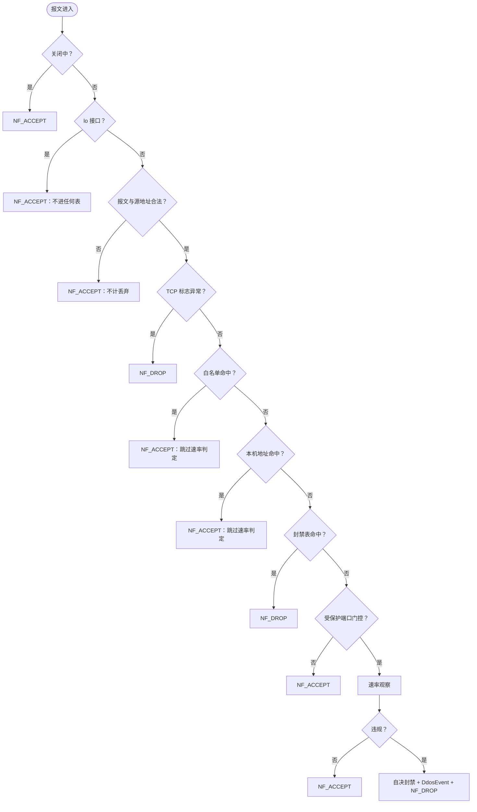
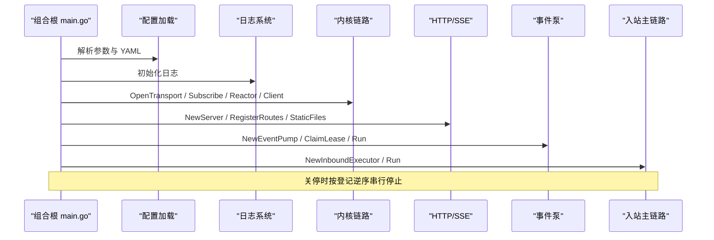
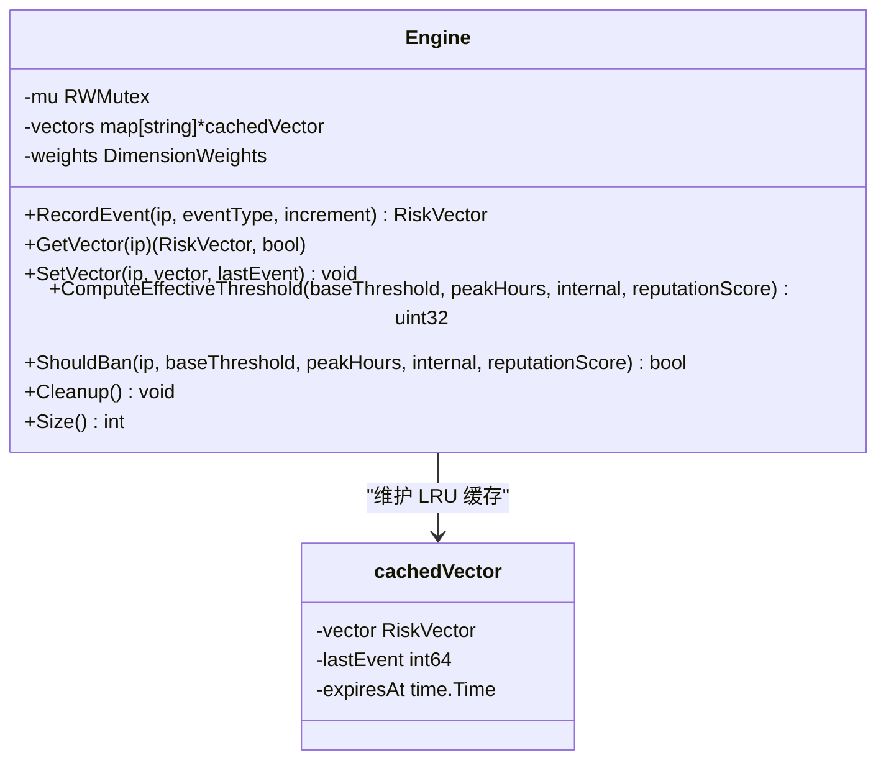
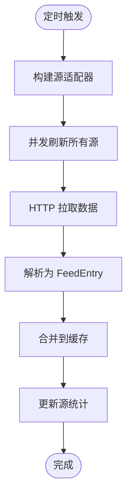
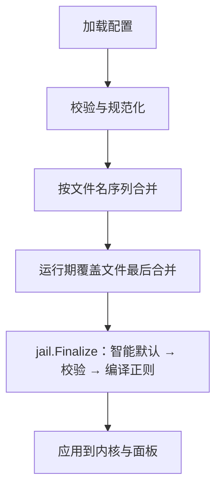
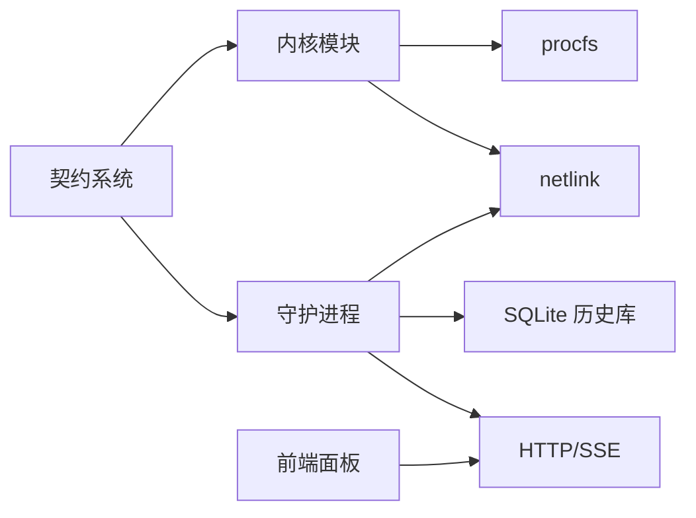

# 项目概述

<cite>
**本文引用的文件**   
- [README.md](file://README.md)
- [SECURITY.md](file://SECURITY.md)
- [docs/zh/SUMMARY.md](file://docs/zh/SUMMARY.md)
- [docs/zh/architecture/README.md](file://docs/zh/architecture/README.md)
- [docs/zh/architecture/kernel-module.md](file://docs/zh/architecture/kernel-module.md)
- [docs/zh/architecture/daemon.md](file://docs/zh/architecture/daemon.md)
- [docs/zh/architecture/data-flow.md](file://docs/zh/architecture/data-flow.md)
- [src/daemon/cmd/firewall-daemon/main.go](file://src/daemon/cmd/firewall-daemon/main.go)
- [src/daemon/internal/config/loader.go](file://src/daemon/internal/config/loader.go)
- [src/daemon/internal/risk/engine.go](file://src/daemon/internal/risk/engine.go)
- [src/daemon/internal/threatfeeds/manager.go](file://src/daemon/internal/threatfeeds/manager.go)
- [src/kernel-module/fw_hook.c](file://src/kernel-module/fw_hook.c)
</cite>

## 目录
1. [引言](#引言)
2. [项目结构](#项目结构)
3. [核心组件](#核心组件)
4. [架构总览](#架构总览)
5. [详细组件分析](#详细组件分析)
6. [依赖关系分析](#依赖关系分析)
7. [性能与可靠性特征](#性能与可靠性特征)
8. [使用场景与价值主张](#使用场景与价值主张)
9. [许可证、贡献与安全策略](#许可证贡献与安全策略)
10. [故障排查要点](#故障排查要点)
11. [结论](#结论)

## 引言
本项目是一个面向 Linux 的智能内核防火墙，采用“用户态智能判定 + 内核态高速封禁”的三层架构：内核模块负责报文判定与零用户态开销封禁，守护进程负责日志采集、多维风险判定、威胁情报聚合与 HTTP/SSE 面板服务，前端面板提供实时监控、配置管理与可视化分析。其核心价值在于把复杂的风险评估放在用户态，把最关键的丢包决策放在内核态，既保证安全能力，又保持高吞吐低延迟。

项目的关键特性包括：
- 多维风险引擎：频率、扫描、探测、协议异常、历史信誉等多维度评分，支持时间衰减与加法阈值模型。
- 威胁情报聚合：多源并发拉取、错误隔离、SSRF 防护、高置信度 IP 直接封禁。
- 自动化封禁：基于失败窗口、DDoS 速率检测、端口扫描与服务探测识别，结合渐进式时长策略。
- 实时面板与 API：RESTful API、SSE 事件流、Prometheus 指标、ProcFS 运维接口。
- 契约化接口：HTTP、netlink、procfs 三端接口由 `.fwidl` 契约冻结并生成代码，保障一致性。

**章节来源**
- [README.md:10-31](file://README.md#L10-L31)
- [docs/zh/architecture/README.md:12-18](file://docs/zh/architecture/README.md#L12-L18)

## 项目结构
仓库按职责分层组织：
- `src/kernel-module/`：C 语言内核模块，实现 netfilter 钩子、封禁表、白名单、速率统计、procfs/netlink 接口。
- `src/daemon/`：Go 守护进程，组合根装配配置、内核链路、入站主链路、HTTP 服务器、威胁情报调度等。
- `frontend/`：React 19 + TypeScript 前端面板，内嵌到守护进程二进制中。
- `contract/`：Python 驱动的契约定义与校验脚本，生成 HTTP、netlink、procfs 的线格式与路由常量。
- `config/`：YAML 配置文件模板，覆盖常见服务如 Nginx、MySQL、Redis、WordPress 等。
- `docs/zh/`：中文文档，包含架构、配置、开发、运维与迁移指南。
- `tests/`：端到端与集成测试，覆盖模块生命周期、procfs 接口、封禁解封、并发与压力等。

```mermaid
graph TB
subgraph "内核空间"
KMod["内核模块<br/>netfilter 钩子 / 封禁表 / 速率表"]
ProcFS["ProcFS 运维接口"]
Netlink["Netlink 内部通道"]
end
subgraph "用户空间"
Daemon["守护进程<br/>日志采集 / 风险判定 / HTTP / SSE"]
Frontend["前端面板<br/>监控 / 配置 / 分析"]
Contract["契约系统<br/>.fwidl 生成代码"]
end
subgraph "外部"
Logs["应用日志"]
ThreatFeeds["威胁情报源"]
Browser["浏览器或客户端"]
end
Logs --> Daemon
ThreatFeeds --> Daemon
Browser --> Frontend
Frontend --> Daemon
Daemon < --> Netlink
Netlink < --> KMod
Daemon --> ProcFS
Contract --> Daemon
Contract --> KMod
```

**图表来源**
- [docs/zh/architecture/README.md:20-54](file://docs/zh/architecture/README.md#L20-L54)
- [docs/zh/architecture/daemon.md:20-31](file://docs/zh/architecture/daemon.md#L20-L31)
- [docs/zh/architecture/kernel-module.md:18-50](file://docs/zh/architecture/kernel-module.md#L18-L50)

**章节来源**
- [docs/zh/SUMMARY.md:1-32](file://docs/zh/SUMMARY.md#L1-L32)
- [docs/zh/architecture/README.md:12-54](file://docs/zh/architecture/README.md#L12-L54)

## 核心组件
- 内核模块：在 `NF_INET_PRE_ROUTING` 拦截入站报文，依次执行环回豁免、合法性检查、白名单、本机地址、封禁表、受保护端口门控与速率判定；命中封禁表即丢包，违规 DDoS 自决封禁后也丢包。
- 守护进程：组合根装配配置、内核链路、入站主链路、HTTP/SSE、威胁情报调度、持久化历史库；通过 netlink 与内核交互，通过 ProcFS 暴露运维接口。
- 前端面板：React + TypeScript 应用，消费 REST 与 SSE，展示仪表盘、封禁列表、风险分析、威胁情报状态等。
- 契约系统：`.fwidl` 定义 HTTP、netlink、procfs 的线格式与路由，生成代码用于两端一致性与自动化校验。

**章节来源**
- [src/kernel-module/fw_hook.c:5-45](file://src/kernel-module/fw_hook.c#L5-L45)
- [src/daemon/cmd/firewall-daemon/main.go:1-34](file://src/daemon/cmd/firewall-daemon/main.go#L1-L34)
- [docs/zh/architecture/README.md:56-66](file://docs/zh/architecture/README.md#L56-L66)

## 架构总览
系统整体由两个运行组件构成：内核模块负责报文判定与表管理，守护进程负责日志监控、决策与对外接口；面板是守护进程内嵌的静态资源。两者之间必须走 netlink，ProcFS 是给人和运维用的接口，不是守护进程的内部通道。

```mermaid
graph TB
subgraph "用户空间"
Ingest["日志采集 inotify"]
Parse["切行 + 正则取 IP"]
Decide["失败窗口 + 阈值判定"]
API["HTTP / SSE / metrics"]
Bans["活跃封禁缓存"]
KernelClient["内核 netlink 客户端"]
Ingest --> Parse --> Decide --> Bans
API --> Bans
Bans --> KernelClient
end
subgraph "内核空间"
Hook["fw_hook_ipv4 / fw_hook_ipv6"]
WL["白名单：精确桶 + 子网链"]
Local["本机地址集合"]
Ban["封禁表：按前缀长度分层"]
Rate["速率表 + per-CPU 槽"]
Ports["受保护端口位图"]
ProcFS["procfs 13 个条目"]
Hook --> WL --> Ban
Hook --> Local --> Ban
Hook --> Ports --> Rate
Ban --> ProcFS
WL --> ProcFS
Rate --> ProcFS
end
KernelClient < --> |"netlink：命令 / 查询 / 事件"| KernelModule["内核模块"]
```

**图表来源**
- [docs/zh/architecture/README.md:20-54](file://docs/zh/architecture/README.md#L20-L54)

**章节来源**
- [docs/zh/architecture/README.md:12-18](file://docs/zh/architecture/README.md#L12-L18)
- [docs/zh/architecture/README.md:56-66](file://docs/zh/architecture/README.md#L56-L66)

## 详细组件分析

### 内核模块与报文判定路径
内核模块在 `NF_INET_PRE_ROUTING` 注册 IPv4/IPv6 钩子，优先级低于 filter 表，确保先于默认过滤规则看到报文。判定顺序为：
- 关闭中或 lo 进入：直接放行。
- 报文或源地址非法：放行且不记丢弃。
- TCP 标志异常：丢包并计入异常丢弃。
- 白名单命中：放行且跳过速率判定。
- 本机地址命中：放行且跳过速率判定。
- 封禁表命中：丢包。
- 受保护端口门控开启且目的端口受保护：进行速率判定，违规则自决封禁并丢包。



**图表来源**
- [docs/zh/architecture/data-flow.md:17-41](file://docs/zh/architecture/data-flow.md#L17-L41)
- [docs/zh/architecture/kernel-module.md:69-104](file://docs/zh/architecture/kernel-module.md#L69-L104)

**章节来源**
- [src/kernel-module/fw_hook.c:77-154](file://src/kernel-module/fw_hook.c#L77-L154)
- [docs/zh/architecture/kernel-module.md:54-104](file://docs/zh/architecture/kernel-module.md#L54-L104)
- [docs/zh/architecture/data-flow.md:17-86](file://docs/zh/architecture/data-flow.md#L17-L86)

### 守护进程组合根与装配顺序
守护进程的 `main.go` 是组合根，负责解析参数、加载配置、初始化日志、装配内核链路、HTTP 服务器、威胁情报管理器、事件泵与入站主链路，并按登记逆序优雅关停。关键装配顺序包括：
- 信号层早于 goroutine 建立。
- 预注册 Prometheus 计数器，使 `/metrics` 从启动起有稳定样本。
- 内核链路可降级：打开失败只告警，入站主链路仍可独立运行。
- 封禁下发汇聚点：入站主链路与 HTTP API 共用同一实例，避免状态分叉。
- 事件泵周期采样与对账：5 秒采样、30 秒对账、10 秒续约。



**图表来源**
- [src/daemon/cmd/firewall-daemon/main.go:44-498](file://src/daemon/cmd/firewall-daemon/main.go#L44-L498)
- [docs/zh/architecture/daemon.md:84-119](file://docs/zh/architecture/daemon.md#L84-L119)

**章节来源**
- [src/daemon/cmd/firewall-daemon/main.go:1-34](file://src/daemon/cmd/firewall-daemon/main.go#L1-L34)
- [src/daemon/cmd/firewall-daemon/main.go:44-498](file://src/daemon/cmd/firewall-daemon/main.go#L44-L498)
- [docs/zh/architecture/daemon.md:58-119](file://docs/zh/architecture/daemon.md#L58-L119)

### 多维风险引擎
多维风险引擎维护内存缓存（LRU）与风险向量，记录攻击事件并更新向量，计算有效阈值（加法模型），修复旧乘法模型的系数抵消问题。维度包括失败、封禁、扫描、暴力破解、DDoS、地理、集群等。有效阈值为基础阈值加高峰加成、内网加成与信誉调整，结果不小于 1。



**图表来源**
- [src/daemon/internal/risk/engine.go:8-210](file://src/daemon/internal/risk/engine.go#L8-L210)

**章节来源**
- [src/daemon/internal/risk/engine.go:8-210](file://src/daemon/internal/risk/engine.go#L8-L210)
- [README.md:78-87](file://README.md#L78-L87)

### 威胁情报聚合
威胁情报管理器支持多源并发刷新、错误隔离、后台调度、缓存合并与统计输出。支持的源包括 IPsum、FireHOL、DShield、Blocklist.de、Feodo 等。每个源可配置名称、URL、启用状态、分类与置信度。刷新失败不影响其他源，总耗时取最慢源。



**图表来源**
- [src/daemon/internal/threatfeeds/manager.go:20-268](file://src/daemon/internal/threatfeeds/manager.go#L20-L268)

**章节来源**
- [src/daemon/internal/threatfeeds/manager.go:20-268](file://src/daemon/internal/threatfeeds/manager.go#L20-L268)
- [README.md:88-98](file://README.md#L88-L98)

### 配置系统与热重载
守护进程支持单文件或目录模式加载 YAML 配置，严格模式下未知键报错退出。目录加载按字母序合并，运行期覆盖文件（`_` 前缀）最后合并，只承载运行期状态。热重载通过 SIGHUP 或文件变化触发，重读、比较差异、重挂 watch、重编译正则、更新内核白名单；失败保留旧快照。容量字段在守护进程侧只做持久化与展示，真正的上限是内核模块参数。



**图表来源**
- [src/daemon/internal/config/loader.go:17-129](file://src/daemon/internal/config/loader.go#L17-L129)
- [docs/zh/architecture/daemon.md:270-287](file://docs/zh/architecture/daemon.md#L270-L287)

**章节来源**
- [src/daemon/internal/config/loader.go:17-129](file://src/daemon/internal/config/loader.go#L17-L129)
- [docs/zh/architecture/daemon.md:270-287](file://docs/zh/architecture/daemon.md#L270-L287)

## 依赖关系分析
- 内核模块依赖 netfilter、netlink、procfs，不导出符号，内部按数据所有权切分文件。
- 守护进程依赖 Go 标准库、SQLite、YAML 解析器，无 cgo。
- 前端面板通过 HTTP/SSE 消费守护进程提供的数据面。
- 契约系统生成 HTTP、netlink、procfs 的线格式与路由常量，供两端一致性与自动化校验。



**图表来源**
- [docs/zh/architecture/daemon.md:20-31](file://docs/zh/architecture/daemon.md#L20-L31)
- [docs/zh/architecture/kernel-module.md:18-50](file://docs/zh/architecture/kernel-module.md#L18-L50)

**章节来源**
- [docs/zh/architecture/daemon.md:32-57](file://docs/zh/architecture/daemon.md#L32-L57)
- [docs/zh/architecture/kernel-module.md:33-50](file://docs/zh/architecture/kernel-module.md#L33-L50)

## 性能与可靠性特征
- 内核热路径单次 RCU 临界区读完四张表，零自旋锁，per-CPU 统计与速率窗口避免共享 cache line 写。
- 封禁查找平均 O(1)，精确层常态一次哈希返回；短前缀层按位图遍历已用层。
- 速率表满有意放行，避免误伤正常流量，由 procfs 观测溢出计数。
- 守护进程组合根按登记逆序串行关停，避免上下游同时收尾导致依赖不一致。
- 内核链路可降级，历史库可降级，HTTP 监听可禁用，各组件具备容错与恢复能力。

**章节来源**
- [docs/zh/architecture/kernel-module.md:274-335](file://docs/zh/architecture/kernel-module.md#L274-L335)
- [docs/zh/architecture/daemon.md:72-119](file://docs/zh/architecture/daemon.md#L72-L119)

## 使用场景与价值主张
- 企业服务器防护：针对 SSH 暴力破解、Web 应用扫描、DDoS 泛洪攻击，自动封禁并可视化分析。
- 云原生环境：配合容器网络命名空间，钩子挂在 `init_net`，跨 netns 打流仍能被本模块看到。
- 运维自动化：ProcFS 与 HTTP API 支持脚本化封禁、解封、白名单管理与配置热重载。
- 威胁情报联动：高置信度威胁 IP 直接封禁，跳过窗口计数，提升响应速度。

实际价值：
- 将复杂风险评估放在用户态，内核仅做快速丢包决策，兼顾安全性与高性能。
- 契约化接口保障前后端与内核一致性，降低集成与维护成本。
- 多维度风险评分与时间衰减避免永久误判，渐进式时长策略逐步收紧。

**章节来源**
- [README.md:10-31](file://README.md#L10-L31)
- [README.md:76-131](file://README.md#L76-L131)

## 许可证、贡献与安全策略
- 许可证：MIT License，内核模块源码声明为 Dual MIT/GPL。
- 贡献：欢迎提交 Issue 和 Pull Request，详见贡献指南。
- 安全策略：
  - 信任边界：谁能写 ProcFS，谁就能封 IP；守护进程以 root 运行，systemd 单元带沙箱项。
  - 面板与 API 认证：Basic 认证，未配置凭据时放行，非回环地址绑定且完全未配置凭据拒绝启动。
  - 输入校验：静态资源路径、配置正则、出口探测地址等均有校验。
  - 已知缺口：失败次数与 DDoS 命中没有按天历史，未内置 TLS，未实现 API 限速。

**章节来源**
- [README.md:219-243](file://README.md#L219-L243)
- [SECURITY.md:1-181](file://SECURITY.md#L1-L181)

## 故障排查要点
- 内核模块未加载：守护进程启动前检查 `/proc/firewall` 与 `/proc/firewall/bans`，缺失则启动失败。
- 面板未认证：绑定到非回环地址但未配置凭据会告警，建议设置环境变量或修改 YAML。
- 内核链路不可用：打开失败只告警，封禁表只反映本进程下发记录，需检查模块加载与 netlink 订阅。
- 配置热重载失败：保留旧快照，检查 YAML 语法与正则编译警告。
- 威胁情报刷新失败：单个源失败不影响其他源，查看源统计与错误日志。

**章节来源**
- [src/daemon/cmd/firewall-daemon/main.go:512-521](file://src/daemon/cmd/firewall-daemon/main.go#L512-L521)
- [SECURITY.md:86-108](file://SECURITY.md#L86-L108)
- [docs/zh/architecture/daemon.md:112-119](file://docs/zh/architecture/daemon.md#L112-L119)

## 结论
Linux Firewall KMod 项目通过三层架构实现了高性能、可扩展、可观测的内核防火墙方案。内核模块专注快速丢包与表管理，守护进程承担复杂风险判定与外部集成，前端面板提供直观操作界面。多维风险引擎与威胁情报聚合提升了自动化防护能力，契约化接口保障了系统一致性。项目在许可证、贡献方式与安全策略上清晰透明，适合企业级生产环境部署与持续演进。