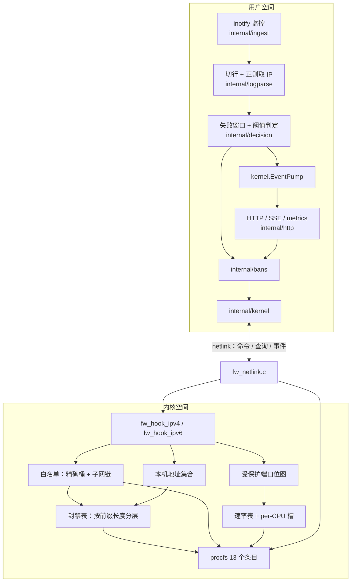

# 架构设计

本章节介绍 Linux Firewall 内核模块的整体架构与核心组件。

| 文档 | 内容 |
|------|------|
| [内核模块](kernel-module.md) | 文件清单、钩子判定顺序、表结构、RCU 与锁、procfs、模块参数 |
| [用户态守护进程](daemon.md) | 组合根装配顺序、各包职责、netlink 层、判定语义、HTTP 与指标 |
| [Web 前端](frontend.md) | 页面与路由、数据面、令牌处理、PWA 边界 |
| [数据流](data-flow.md) | 报文判定路径、封禁/解封事件链、双向通道 |

## 整体架构

系统由两个运行组件构成：内核模块负责报文判定与表管理，
守护进程负责日志监控、决策与对外接口。面板是守护进程内嵌的静态资源。

两者之间**必须走 netlink**。procfs 是给人和运维用的接口，
不是守护进程的内部通道。

## 核心设计原则

| 原则 | 实现 | 出处 |
|------|------|------|
| 判定在内核里生效 | netfilter 钩子命中封禁表即丢包，不看用户态进程有没有被调度 | `src/kernel-module/fw_hook.c` |
| 单次 RCU 临界区 | 白名单、本机地址、封禁表、速率四张表在同一次读侧临界区内读完 | `fw_hook.c` 的 `fw_ban_check` |
| 查找走哈希 | 封禁、白名单、速率都是哈希定位；精确封禁常态一次哈希即返回 | `fw_ban.c`、`fw_wl.c`、`fw_rate.c` |
| 热路径不写共享行 | 统计与速率窗口原始计数落 per-CPU，跨 CPU 汇总只在滚动与读侧 flush | `fw_stats.c`、`fw_rate.c` |
| 状态持久 | `fw_state_save()` / `fw_state_restore()` 落盘到 `state_file` | `fw_state.c`、`fw_main.c` |
| 误封防护 | 白名单与本机地址两道短路，都在封禁表之前 | `fw_hook.c` |
| 接口冻结 | 线格式与文本协议由 `contract/*.fwidl` 冻结，实现不得偏离生成物 | `contract/` |

## 关键参数

哈希桶数**不是**条目容量：桶数由 `*_HASH_BITS` 决定，
条目上限由模块参数决定（`src/kernel-module/fw_types.h`、`fw_main.c`）。
契约侧的机械核对见 `contract/procfs.fwidl` 的 `limit` 块与
`contract/verify_procfs.py`。

| 参数 | 值 | 说明 |
|------|-----|------|
| 封禁表桶数 | 全长层 4096（`BAN_HASH_BITS` = 12）；短前缀层每层 64 | 桶数，不是容量 |
| 封禁表条目上限 | `fw_max_ban_entries`（默认 65535） | 到限拒绝新增并计 `ban_table_full_rejects` |
| 白名单桶数 | 64（`WHITELIST_HASH_BITS` = 6） | 另有子网链 |
| 白名单条目上限 | `fw_max_whitelist_entries`（默认 65535） | 插入前在桶锁内检查 |
| 速率表桶数 | 65536（`RATE_HASH_BITS` = 16） | 桶数，不是容量 |
| 速率表条目上限 | `min(fw_max_rate_entries, FW_RATE_CPU_SLOTS)` | 后者 512，通常先到；表满有意放行 |
| 本机地址集合 | 下界 `fw_max_local_ips`（默认 256），硬上界 2^16 | 按实际地址数扩容 |
| 受保护端口位图 | 65536 位 | 未下发时全端口受保护 |
| 指标端口 | `9119` | `config/default.yaml` 的 `defaults.metrics_port` |
| 事件泵采样 / 对账 / 续约 | 5 秒 / 30 秒 / 10 秒 | `internal/kernel/consumer.go` |

以上 `fw_max_*` 都是**内核模块参数**，只在加载模块或写 sysfs 时生效。
守护进程配置里的 `capacity:` 段只做持久化与展示，不经 netlink 下发：
`SetConfig` 消息没有容量字段（`contract/netlink.fwidl`）。

## 并发模型

| 侧 | 做法 | 出处 |
|----|------|------|
| 读侧（报文判定） | 走 RCU，多核并行无锁 | `fw_hook.c` |
| 写侧（封禁 / 解封 / 白名单） | 持层内桶锁，锁内只做摘链与计数；节点释放一律 `call_rcu` 延到宽限期之后 | `fw_ban.c`、`fw_wl.c` |
| 每包可变统计 | 落 per-CPU 内存，不共享写 | `fw_stats.c`、`fw_rate.c` |
| 到期 | per-entry 定时器，没有全局清理线程 | `fw_ban.c` |
| 锁顺序 | 文档化在 `fw_types.h` 头部；除 `rate_locks[bkt] → rate_slot_lock` 外不得嵌套 | `fw_types.h` |

RCU 不按 CPU 分配读写角色：任意 CPU 都可读、都可在锁内写。

## 组件关系

| 组件 | 空间 | 职责 |
|------|------|------|
| 内核模块 | 内核 | 报文判定、封禁/白名单表、速率与 DDoS 检测、procfs 与 netlink 接口 |
| 守护进程 | 用户 | 日志监控、行解析、失败计数与封禁决策、配置下发、HTTP / SSE / 指标 / 面板托管 |
| Web 面板 | 浏览器 | React 应用，消费 REST 与 SSE；产物由守护进程内嵌托管，见 [frontend.md](frontend.md) |
| procfs | 内核 ↔ 用户 | 运维操作接口与状态查询：13 个条目，权限见 `contract/procfs.fwidl` |
| netlink | 内核 ↔ 用户 | 守护进程与内核之间的**唯一**内部通道：命令、分页查询响应、事件推送 |
| 历史库 | 用户 | 守护进程侧的时序历史与封禁历史持久化（`src/daemon/internal/persist/`） |
