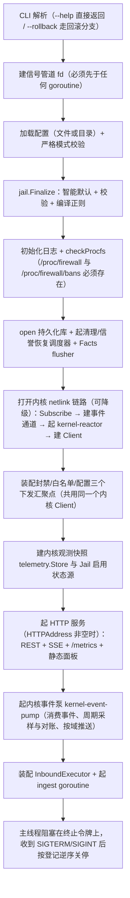

# 用户态守护进程

`firewall-daemon` 是内核模块的用户态对手侧：监控日志、做失败计数与封禁判定、经 netlink
把指令下发给内核，并把状态经 HTTP / SSE 呈现给运维与前端。内核负责报文级判定（速率、DDoS），
daemon 负责应用层检测（如 SSH 暴力破解）与对外接口。

两条硬边界：

- daemon 与内核之间的**内部通道只有 netlink**；`/proc/firewall/*` 是给用户/运维的接口，
  不是 daemon 的内部通道（`cmd/firewall-daemon/main.go`）。
- 威胁模型是**入站单向防守**：不引入出站钩子、外发检测或外联行为分析。

相关文档：

- 报文判定路径、封禁/解封事件链：`data-flow.md`
- 内核侧内部结构、模块参数与哈希表规模：`kernel-module.md`
- 接口真相源：`contract/netlink.fwidl`、`contract/procfs.fwidl`、`contract/http.fwidl`
- 配置字段与语义：`../configuration/yaml-config.md`

## 技术栈

| 组件 | 用途 |
|------|------|
| Go module `src/daemon`（组合根 `cmd/firewall-daemon/main.go` + `internal/*`） | 实现语言，编译为单文件 stripped 二进制。组合根只负责装配与生命周期，业务判定在 `internal/*`（bans / config / jail / kernel / logger / logparse / runtime） |
| golang.org/x/sys (unix) + yaml.v3 | netlink unix socket、procfs 读写、YAML 配置解析（字段名必须与 Go module 内 YamlConfig 一致，多一个 key 即启动失败） |
| HTTP / SSE / `/metrics` / 历史快照 / Web UI | 由 `internal/http` 承载：HTTP 服务、两条 SSE 流、Prometheus exporter、SQLite 历史快照与数据清理均已装配并启用；装配清单以 `cmd/firewall-daemon/main.go` 的装配标注为准（见下表与下文） |
| unix socket + syscall netlink | 与内核双向通信：命令下发、分页查询、事件推送 |
| log/slog + 自管日志文件 | 结构化日志（JSON Lines，整行单次写入；文件打开失败回退 syslog-only）与按大小轮转 |
| go:embed（`src/daemon/web_ui/static/assets.go`）+ vite | SPA 面板携带进二进制：vite 产物直接输出到 `src/daemon/web_ui/static/`，文件名固定后由 `assets.go` 的 `//go:embed *` 按名取走 |

## 组件关系

| 组件 | 空间 | 职责 |
|------|------|------|
| 内核模块 | 内核 | 报文判定、封禁/白名单表、速率与 DDoS 检测、procfs 与 netlink 接口 |
| 守护进程 | 用户 | 日志监控、行解析、失败计数与封禁判定、配置下发；HTTP/SSE/指标一并承载（见「技术栈」表） |
| netlink | 内核 ↔ 用户 | daemon 与内核的**唯一**内部通道：命令、分页查询响应、事件推送 |
| ProcFS | 内核 ↔ 用户 | 运维接口，daemon 只做启动期存在性检查，不用它做内部通信 |

## 运行时模型

Go module `src/daemon` 当前是**单执行体驱动四段**：组合根不创建任何业务 goroutine，只装配一个
`InboundExecutor`；其主链路 `executor.Run()` 在一个 goroutine 内顺序走「读字节 → 行分割 → 正则判
定 → 封禁下发」，段与段之间没有队列、也就不存在「满时丢弃」。信号层先于该 goroutine 建立
（见下一节），`inotify fd` 与信号管道 fd 并入同一个 `poll`，周期任务走执行体自己的单调时钟
定时器表；内核侧交互经 `kernel.Client`（syscall netlink + unix socket），发/收都在同一段阻塞 IO
上等待确认。除入站执行体外，内核接收回路（`kernel-reactor`）、HTTP 服务（`http-server`）与内核
事件泵（`kernel-event-pump`）各由一条 goroutine 承担，登记在 `Supervisor` 上统一关停。

| 承担者 | 职责 | 形态 |
|--------|------|------|
| `ingest` goroutine（`InboundExecutor.Run`） | 四段顺序驱动：读字节、行分割、正则判定、封禁下发；单线程独占每源偏移、半行缓冲与失败窗口，故段间无队列、不存在「满时丢弃」 | 阻塞 IO + CPU 正则 |
| `signals`（`runtime.NewSignalSource`） | 先于任何 goroutine 建立信号管道 fd；inotify fd 与信号 fd 同一池 poll | 阻塞 IO |
| `kernel-reactor`（`kernel.Reactor.Run`） | 接收回路 + `(type, seq)` 路由，`Supervisor` 统一关停 | 阻塞 IO |
| `kernel-event-pump`（`kernel.EventPump.Run`） | 消费内核事件流、周期采样与对账、按域发布 SSE | 阻塞 IO + 定时 |
| `http-server`（`http.Server.Start`） | REST / SSE / `/metrics` / 静态面板 | 网络 IO |

### 关停顺序

关停不变量是「**netlink 停止后才能在途事件写库**」。要让它真正成立，就不能一次性把停止信号
广播给所有执行体——那样上下游同时收尾，「上游已完全停止」不成立。故 `Supervisor.Shutdown()`
按**登记逆序逐段串行**停止：对当前段 `Request()` 后 `join` 到结束，才停下一段
（`internal/runtime/supervisor.go`）。登记顺序即依赖顺序（下游先登记）。

生产的实际顺序：`main` 阻塞在终止令牌上 → 停 `runtime` 执行体（入站执行体
最先停，随后内核事件泵、HTTP 服务与内核接收回路）→ 延迟清理按 LIFO 释放执行体依赖的资源
（关历史库、写 PID 文件清理），见 `cmd/firewall-daemon/main.go`。`persist.DB.Close` 自身会把已入队的
持久化落盘，故「netlink 停止后在途事件写库」由这个顺序保证。

## 模块划分（按数据所有权）

每个模块**独占**自己的状态，跨模块只传消息或不可变快照；共享状态以显式的总线/缓存对象
（如 `bans.GlobalCache()`、`telemetry.Store`）承载，其余一律构造期注入。

| 模块（Go 路径） | 数据所有权 | 对外接口 |
|------|-----------|---------|
| `cmd/firewall-daemon/main.go` | 装配状态 | CLI 解析 → 严格校验配置 → checkProcfs → 按登记顺序 Spawn → 逆序关停；每处装配都显式标注，缺席时降级而不假装完成 |
| `internal/config/`（args / parser / loader / types / path / logging） | 配置对象与字段语义 | `ParseConfigArgs` / `Default` / `ParseConfigFile|LoadConfigDirectory` / `Validate`；YamlConfig 带未知字段拒绝，多一个 key 即启动失败 |
| `internal/logger/`（logger / file / json / handler） | 日志目的地与整行不变量 | `Init(cfg)` 返回 slog Logger：JSON Lines、自定义 handler 整行单次写入；文件不可写时回退 stderr / syslog-only |
| `internal/runtime/`（supervisor / executor / pipeline / shutdown / signals / timers / hooks / file_reloader） | 执行体生命周期 | `NewSignalSource`（早于任何 goroutine）、`Spawn`/`Shutdown`、`InboundExecutor.Run`（阻塞 IO + CPU 正则的主链路口径）、周期维护与单调时钟定时器 |
| `internal/jail/`（jail / compile / service / pipeline） | jail 状态与规则集 | 智能默认 + `Validate` + 编译各 regex；`Finalize` 是启动/热重载/PUT 写入共用的一条流水线 |
| `internal/bans/`（ban / cache / endian / global） | 活跃封禁集合 | Ban 的入参编码/解码与活跃缓存、镜像插入、撤销路径 |
| `internal/logparse/`（splitter / rule / ip） | 日志行缓冲与规则 | 行分割、命名捕获组提取 IP（返回 `netip.Addr` 而非 `String`）、超时判定 |
| `internal/kernel/`（transport / reactor / router / client / codec / consumer） | netlink socket 与在途请求 | unix socket 单写者、按 `(type, seq)` 路由未知即计数、类型化 Ban/Unban/List/SetConfig；事件消费与对账在 `consumer` |
| `internal/kernel/client.go` | 类型化客户端 API | `Ban(addr, prefixLen, durationSecs, reason)` / `Unban` / 分页 `List*` / `SetConfig` / `AddWhitelist` / `RemoveWhitelist` |
| `internal/runtime/executor.go` | 入站主链路装配态 | `Deps.Logger/Facts/Sink/Stats/Hooks/Reloader/Enabled`：全部由组合根装配（Hooks=周期维护副作用、Reloader=配置热重载与回滚、Enabled=Web UI 权威启用状态源）；任一为 nil 时对应能力降级而不报错，装配参数来自读 `cfg()` |
| `internal/runtime/timers.go` + `shutdown.go` | 定时器表与关停令牌 | 周期任务按原定时刻重排；Shutdown 只有 Request/IsShutdown，完成通道由调用方自备 |

**已装配的能力**（以 `main.go` 的装配标注为准）：HTTP / `/health` / `/metrics` API、两条 SSE 流、Prometheus exporter、SQLite 历史快照与数据清理、配置热重载。

## 启动流程

`main()`（`cmd/firewall-daemon/main.go`）的顺序：

关键顺序约束（都有明确理由，不是习惯）：

- **信号层在任何 goroutine 创建之前建立**：`NewSignalSource` 先于执行体，其后启动的日志 /
  HTTP / 各执行体都能看见同一份信号；启动窗口内送达的信号不会丢。
- **配置后处理在所有消费者之前**：`jail.Finalize`（智能默认 → 校验 → 编译正则）与热重载、
  PUT 写入共用同一函数，保证「能启动的配置」与「能重载/能写入的配置」同口径。
- **配置所有权在入站执行体**：它是唯一改配置的执行体（自动重载 / 回滚 / 启用状态同步），
  组合根经 `InboundExecutor` 暴露的读口取装配参数，避免重载后两份配置分叉。
- **内核观测快照无条件建立**：`telemetry.Store` 由事件泵唯一写入；链路缺失时保持零值快照，
  读侧（`/health` 与统计面）无需区分「没有内核」与「还没采到样」。
- **内核链路可降级**：`OpenTransport` / `Subscribe` 失败只告警，入站主链路仍能独立运行，
  封禁表只反映本进程的下发记录。
- **找不到可监视的日志源即启动失败**：配置错 / 权限不足 / 内核模块未加载时不该留一个
  「界面正常但永不算」的进程。
- **`/proc/firewall` 与 `/proc/firewall/bans` 缺失直接启动失败**：内核模块未加载时 daemon
  不具有可工作的判定与下发通道。

## 判定语义

这条判据是**对外承诺**：`internal/decision/policy.go` 实现，`internal/detect/window.go` 提供窗口。

- **白名单命中 ⇒ 永不封禁**（内核侧还有一道白名单短路，daemon 侧不重复判定为「可封」）。
- **有效阈值** = `max_retries × 高峰期(×1.5) × 内网来源(×2.0) × 信誉系数`，再 `.Ceil().max(1.0)`
  （`EffectiveThreshold`）。
- **高峰时段**：UTC `9..18`（`IsPeakHours(hourUTC)`，时间源由调用方注入，便于用固定小时测试）。
- **信誉系数**：`≥80 → 1.0`、`≥50 → 0.8`、否则 `0.5`（`ReputationMultiplier`）。
- **渐进式时长**：第 1 次 `base`、第 2 次 `1800`、第 3 次 `86400`、第 4 次起永久；
  `ban_time < 0` 即配置级永久（`ProgressiveDuration` / `PlanBan`）。
- **失败窗口**：只统计 `now - findtime <= ts <= now` 的时间戳；单 IP 时间戳上限
  `MaxTimestampsPerIP = 100`（FIFO 淘汰最旧，`countRecent`）。

## netlink 层

线格式以契约生成物为**唯一**定义：协议号 `NETLINK_USERSOCK`、魔数 `0x46574C4E`、自定义公共头
12 字节、全部多字节整数大端、全部结构 `packed`。实现侧读的是契约里的字段名与偏移
（`internal/contract`），「手抄结构体」这一漂移来源被生成物消除。

`internal/kernel/` 的分层：

| 层 | 职责 | 关键取舍 |
|----|------|---------|
| `codec` | 字节 ↔ 语义类型，唯一的转义层 | 每个多字节字段显式 `from_be` / `to_be`，不依赖 `packed` 的内存表示；`decode` 搬完即逐字段转宿主序，原始字节不流出本模块 |
| `transport` | socket 唯一所有者（单写者） | 长度以 `nlmsghdr.nlmsg_len` 为准而非收包字节数（netlink 按 4 字节对齐，收包数可能多出至多 3 字节填充） |
| `reactor` + `router` | 接收回路 + `(type, seq)` 路由 | `Router` 是纯状态机可单测；路由白名单只收「回显请求 seq」的那一组 |
| `client` | 类型化请求 API | 「已投递」与「已确认」用类型分开；`List*` 一律请求契约单页上限并续页到底 |
| `consumer` | 事件消费与对账 | 重建封禁/白名单镜像、周期对账、注册租约与失联可见（`telemetry.LeaseState`） |

两条容易踩错的语义，写在这里以免被后来的实现改回去：

- **配对只允许白名单内的类型**。内核里有**两套**序号来源：`DaemonRegisterAck` /
  `ConfigAck` / `StatsResponse` / `AnalysisResponse` / 三个 `List*Response` 回显请求 `seq`；
  而 `DdosEvent` / `BanStateChange` / `WhitelistStateChange` / `ConfigChange` /
  `CmdResult` 用内核自增序号。两组取值必然碰撞，若把 `CmdResult` 也拿去配对，一条「封禁失败」
  通知会被误认成某次 LIST 的回复而被吞掉。
- **分页的收尾信号是空页，不是 `total`**。契约里 `limit == 0` 表示「内核默认页大小」而非
  「不限量」；内核在 `offset >= total` 时直接回空页，且 `total` 是另一时刻取的值，与已收条数
  不保证一致。故续页以空页为唯一可靠收尾，另加「本页起点未推进即停」的防死循环判据。

## 状态层与 SSE

内核事件泵持有唯一的内核观测快照（`telemetry.Store`，版本化 `atomic.Pointer` 发布）：写侧
独占数据，读侧拿不可变快照，永远看不到半个更新。域载荷的形状出自表现层：泵只报「哪个域变了、
它那张表里现在有什么」，由 `internal/http` 的纯函数（`SSEReplicas`）派生具体载荷。

| 域 | 事件名 | 说明 |
|----|-------|------|
| `Stats` | `stats` | 计数器快照；**周期事件**（无变化也要按 `sse_push_interval` 重发，否则安静时段数字冻住） |
| `Bans` | `bans` | 活跃封禁 |
| `Jails` | `jails` | Jail 列表与状态（**派生域**，其变更由知道输入变了的一方显式推进，见下） |
| `Whitelist` | `whitelist` | 白名单（键是规范化 `CidrKey`） |
| `Rates` | `rates` | 速率与 EWMA 基线 |

**每个域都必须有生产者**——推送只发「版本变化过」的域，没有生产者的域收完首帧就永远不再
更新。除 `Jails` 外都是所有者模块在内容变更时自行 `Publish`；`Jails` 是**派生域**（载荷在
渲染时现读内核快照与封禁表的计数，没有内容比对可用），故由知道派生输入变了的写入点显式推进：
封禁集合变更（`internal/http/publish.go::publishBans`）、jail 启用/禁用与 jail 配置快照变更
（`internal/http/jails_control.go`、组合根的 `jailSnapshotBridge`）、峰值时段翻转。`verify_http.py`
的 `check_sse_events` 会断言契约声明的每个域事件在生产代码里都有发布者。

### SSE 约束（契约）

| 项 | 值 | 出处 |
|----|-----|------|
| `/api/v1/events` 连接上限 | 10 | `internal/httpcontract/http_contract.go` |
| `/api/v1/logs/stream` 连接上限 | 5 | 同上 |
| `events` 事件集 | `connected`、`stats`、`bans`、`jails`、`whitelist`、`rates` | 同上 |
| keepalive | 15 s（两条流各自声明） | 同上 |
| 超限响应 | `503` | `internal/http/sse.go` |

两条流各自计数、各自回 503、各自声明心跳，不共用上限：共用会让「日志页开满 5 条连接」把实时
事件流一起饿死。

三条结构性保证：

- **只序列化变化的域**。连接持有上一次发出的版本集合，每轮与当前版本求差集；只有新连接才发
  全部五域。
- **SSE 与 REST 共用同一份视图**。域载荷全部由 `internal/http` 的纯函数派生，SSE 渲染器与路由调
  的是同一批函数——想改一个字段的显示方式，只有一处可改。
- **慢消费者被断开，而不是让写侧等待**。写侧只做「推进版本 + 覆盖式通知」，序列化与发送在每
  条连接自己的 goroutine 里。

### 白名单 CIDR 规范化

键是 `CidrKey` 而不是 `String`，两个构造入口（`NewCidrKey` 走结构路径、`ParseCidrKey` 走文本路径）
都过同一套规范化，外部无法塞入未规范化的键。规则取自内核而不是自拟：内核把白名单存成**网络
地址**（`fw_addr_normalize`），精确主机条目的判据是 IPv4 `/32` / IPv6 `/128`。故键的形态固定为
「主机位清零 + 恒带 `/prefix`」：`10.0.0.5/24` 存为 `10.0.0.0/24`，裸地址 `10.0.0.1` 存为
`10.0.0.1/32`。界面上从 `10.0.0.1` 显示为 `10.0.0.1/32` 是这一规则的直接结果。

## HTTP 与 API

单个 HTTP 服务（`internal/http`）承载全部内容（Web UI、REST、SSE、指标），监听
`metrics_bind_address:metrics_port`：代码默认 `127.0.0.1:9119`（`internal/config`），随包
`config/default.yaml` 给的是 `0.0.0.0:9119`（要局域网访问需后者那种绑定，且必须配凭据，见下）。

### 路由分层

| 组 | 认证 | 内容 |
|----|------|------|
| SPA 外壳与静态资源 | 无 | 一组**固定的**页面路径 + `/static/*path` + `/sw.js`（注册见 `internal/http/static.go`，路径清单以 `contract/http.fwidl` 为准）；静态资源由 `web_ui/static/assets.go` 的 `//go:embed *` 携带进二进制。页面语义（哪个页面做什么、数据从哪来）见 [Web 前端](frontend.md) |
| 探针 | 无 | `/health`、`/healthz`（有意不套信封，由就绪判定决定 200/503） |
| 需认证 | Basic Auth | `/metrics` 与 `/api/v1/*`（完整路由清单以 `contract/` 为准；`verify_http.py` 会对照契约核对） |

> 新增页面路径必须同时加进 `security_headers` 中间件的 `is_webui` 判定，否则外壳会以
> `default-src 'none'` 下发——页面能打开但样式与脚本全被拦掉。

### 信封与认证

- **信封单一形状**：`{code, data, message}`，成功 `code = 0` 且 `message` 为空串，失败
  `data = null`；两个字段都必然存在。
- **业务码与 HTTP 状态码是两套编号**：业务码常量与状态码一起在契约里声明。
- **认证**：`/metrics` 与 `/api/v1/*` 需 Basic Auth；凭据由中间件**每请求读取**，故 SIGHUP 改
  凭据无需重启；**未配置凭据时中间件直接放行**（此时只允许回环绑定，见下条）。不发
  `WWW-Authenticate`（该头会触发浏览器原生对话框，表现为「输错密码按钮永久转圈」）；
  EventSource 无法自定义请求头，故额外接受 `?access_token=<base64(user:pass)>`。
- **失败锁定**：连续失败达阈值后锁定一段时间（契约常量）。
- **启动期硬约束**：非回环地址绑定且完全未配置凭据 → **拒绝启动** HTTP 服务（避免管理 API 对
  全网开放）；`metrics_username` / `metrics_password` 只配一项 → 同样拒绝启动。
- **读路径零副作用**：读端点不清理、不累加统计、不限流——清扫与计数都在内核事件泵的
  reconcile 里，读侧没有任何写点。

## 配置与热重载

- **来源**：单个文件或目录（`--config`），文件不存在直接启动失败。
- **严格模式**：任何未知 key 直接报错退出（默认开启）。
- **运行期回写**：Web UI 改动的字段（如 webui 段）经 `internal/http/config_api.go` 回写到原始
  YAML 路径；目标为**目录**时写该目录下带 `_` 前缀的自动管理文件，该文件在目录加载时**最后
  合并**（`internal/config/loader.go::RuntimeOverridePrefix`），因此它只承载运行期状态，不复制
  别处已声明的 jail 定义。
- **SIGHUP 热重载**：重读配置 → 比较差异 → 新增/移除源的 watch、重编译正则、更新内核白名单；
  失败保留旧快照。**重载只替换规则集与参数，不重置失败窗口**——否则一次 SIGHUP 就能帮攻击者
  清零已积累的失败计数。

容量字段（`capacity.max_ban_entries` / `max_whitelist_entries` / `max_rate_entries` /
`max_local_ip_cache`，默认均为 65535）在 daemon 侧只做持久化与展示：**`SetConfig` 消息没有
容量字段**，真正的条目上限是内核模块参数 `fw_max_*`（见 `kernel-module.md`）。

## 持久化

`internal/persist` 用 SQLite 保存四类数据：时序统计（`historical_stats`）、封禁历史
（`ban_history`）、封禁事件（`ban_events`）、IP 信誉分（`ip_reputation`），并派生攻击预测、
协同检测、封禁时长推荐等分析数据（供分析类端点使用）。

读侧不重活：判定层每行日志都要扣一次信誉分并立刻取分，直接查库会把入站主链路钉在磁盘上，
故 `persist.Facts` 按 IP 折叠缓存并周期刷盘；库自带清理调度器（按保留天数）与信誉恢复调度器，
三者在关停时共用同一条 stop 通道，最后刷一次盘。

## 日志与信号

**日志**：基于 slog 的结构化日志，JSON Lines 格式（每行一条 JSON 对象），写入配置
`defaults.log_file` 指定的路径；未指定或为空时用默认路径 `/var/log/firewall-daemon.log`。日志
由自定义 handler 同步写出，**整行（含换行）合并为单次 `write()`**——这保证多个写者（例如重启
期间新旧进程短暂并存）追加同一文件时每行仍是独立合法 JSON。文件打开失败回退 stderr（用
`dup` 复制 fd 2，不接管原始 stderr）。

**按大小轮转**：独立日志文件支持按 `log_max_size_mb`（默认 10MB）切片，超过上限时
当前文件改名为 `.1`、旧切片（`.1` → `.2` …）依次顺移，保留片数由 `log_max_files`
（默认 10，含当前片）控制，超出则删最旧的一片。`log_max_size_mb=0` 关闭轮转；
`log_max_files=1` 表示只保留当前片（轮转时直接截断）。`log_max_*` 不随 SIGHUP 热切换，
需要重启 daemon 才生效。

**信号**（当前生产实现，`internal/runtime/signals.go`）：

| 信号 | 行为 |
|------|------|
| `SIGTERM` / `SIGINT` | 入站执行体收到后置位终止令牌，主线程醒来走清理流程 |
| `SIGHUP` | 触发配置热重载（执行体读入新配置后重扫 watch） |
| `SIGUSR1` | 触发配置回滚 |
| `SIGPIPE` | Go 运行时不发送、按需要忽略（HTTP 客户端断开不应杀死进程） |

信号层先于任何 goroutine 建立，把信号转成与 inotify 同池 `poll` 的普通 fd；不依赖 `EINTR`
打断 `poll` 的隐式协议，也没有信号处理函数写的全局原子标志。

## 可观测性

### Prometheus 指标

`/metrics` 由 `internal/http` 暴露。指标注册在 `internal/http` 的指标表中，计数点分布在
`cmd/firewall-daemon/main.go` 的 `statsSink` 与 `internal/kernel/consumer.go`。当前注册的
counter：

| 指标 | 说明 |
|------|------|
| `firewall_lines_parsed_total` | 已解析日志行数 |
| `firewall_lines_skipped_total` | 因超长/异常跳过的行数 |
| `firewall_regex_matches_total` | 正则命中总数 |
| `firewall_inotify_events_total` | inotify 唤醒次数（非事件数） |
| `firewall_log_rotations_total` | 轮转检测次数 |
| `firewall_bans_triggered_total` | 实际发起封禁的次数 |
| `firewall_ddos_events_total` | 检出的 DDoS 事件数 |
| `firewall_kernel_commands_rejected_total` | 被内核拒绝的指令数 |

清单以代码里的注册点为唯一真相源；当前没有注册任何 gauge。

### 健康与诊断

- `/health`、`/healthz`：套 `telemetry.Snapshot`（netlink 就绪、`/proc/firewall` 存在、封禁缓存与
  历史是否初始化、当前封禁数），就绪返回 200、否则 503。
- `/api/v1/stats/sse-status`：分别上报两条 SSE 流的当前连接数与上限（10 / 5）——用一条流的上限
  推断另一条是曾经的缺陷成因。
