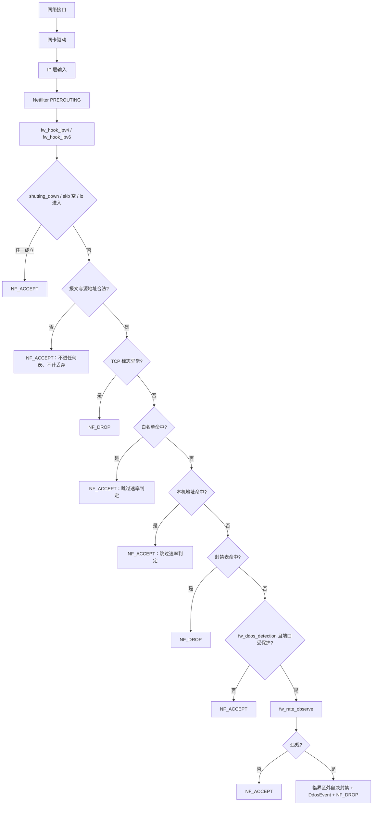
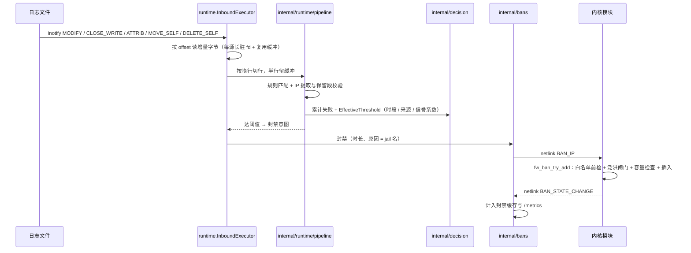
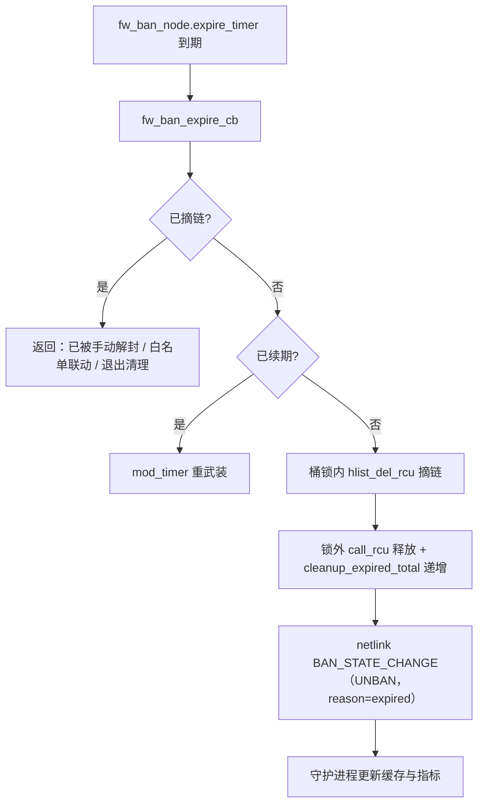
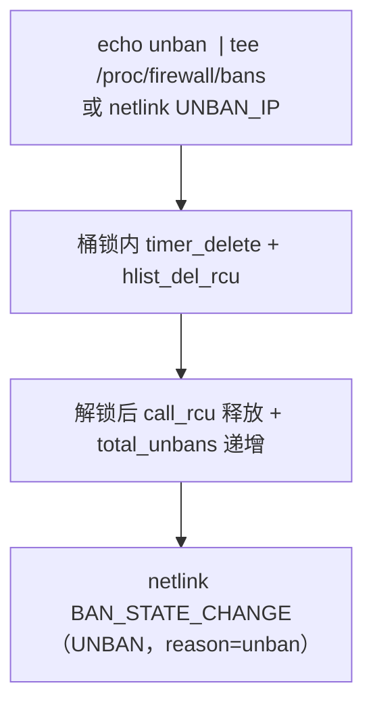
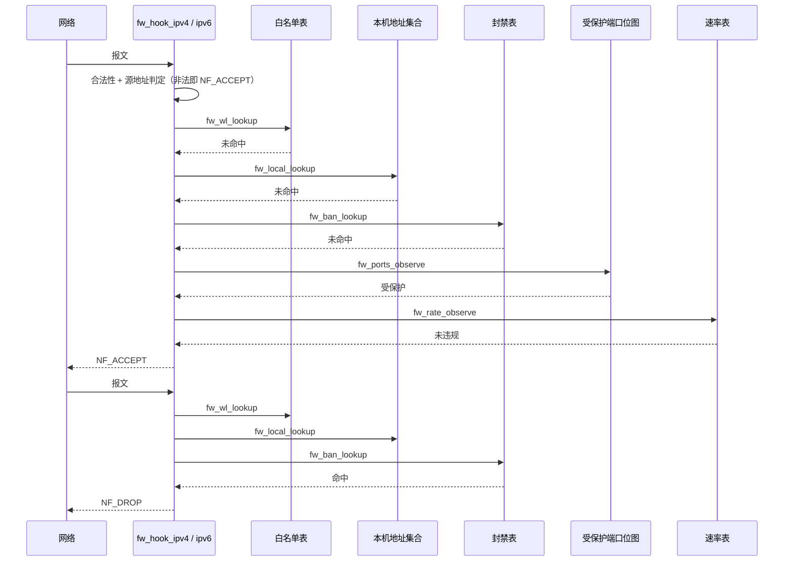

# 数据流

本文描述**报文判定路径**、**封禁/解封事件链**，以及内核与守护进程之间的通道。

| 侧 | 实现 |
|----|------|
| 内核 | `src/kernel-module/`，内部结构见 [内核模块](kernel-module.md) |
| 守护进程 | `src/daemon/`，见 [用户态守护进程](daemon.md) |
| 接口 | 以 `contract/*.fwidl` 与其生成物为准 |

相关文档：procfs 读写文法见 `docs/zh/configuration/procfs.md`。

## 数据包处理流

### 入站路径



钩子只注册在 `init_net` 的 `NF_INET_PRE_ROUTING`，优先级 `NF_IP_PRI_FILTER - 1`，
IPv4 / IPv6 各一个（`src/kernel-module/fw_hook.c` 的 `nf_ops_ipv4` / `nf_ops_ipv6`，
由 `fw_main.c` 在 init / exit 中按序注册与注销）。

```c
/* src/kernel-module/fw_hook.c */
struct nf_hook_ops nf_ops_ipv4 = {
  .hook = fw_hook_ipv4,
  .pf = NFPROTO_IPV4,
  .hooknum = NF_INET_PRE_ROUTING,
  .priority = NF_IP_PRI_FILTER - 1,
};
```

### 判定顺序的三条约束

| 约束 | 原因 |
|------|------|
| 本机地址判定先于封禁表 | 本机豁免由 `fw_local.c` 承担，接口地址不写进白名单。顺序颠倒会让本机地址被自己的封禁条目丢弃 |
| 四张表在同一个 RCU 读侧临界区内读完 | 旧实现分三处进出 RCU。自决封禁在临界区外执行：要取桶锁、分配内存、推 netlink 事件 |
| 端口门控只加在速率判定这一支 | 封禁表对所有端口生效。`dst_port == 0`（ICMP、非首片、解析失败）一律参与速率判定 |

代码（`fw_hook.c` 的 `fw_ban_check`）：

```c
if (!fw_wl_lookup(af, src) && !fw_local_lookup(af, src)) {
  if (fw_ban_lookup(af, src)) {
    banned = true;
  } else if (likely(READ_ONCE(fw_ddos_detection)) && fw_ports_observe(dst_port)) {
    reason = fw_rate_observe(af, src, packet_len, protocol, tcp_flags, dst_port, &pps);
  }
}
```

### 进入判定之前的前置检查

| 检查 | 不合法时 |
|------|---------|
| `skb` 非空、从 lo 进入（`IFF_LOOPBACK`） | `NF_ACCEPT`，lo 流量不进任何表、不计任何统计 |
| 报文长度 / 版本 / 头长 / 校验和 | `NF_ACCEPT` |
| 源地址合法性（0 / 广播 / 组播 / 回环 / 链路本地） | `NF_ACCEPT`，不计丢弃 |
| TCP 标志异常（`SYN+FIN` / `SYN+RST` / 四个主标志全零） | `NF_DROP`，计 `packets_dropped` + `tcp_anomaly_dropped` |
| 全局流量累加 | 在异常判定之后，只统计真正进入 DDoS 判定的报文 |

### 白名单查找：精确桶 → 子网链

不是线性扫描：精确地址走哈希桶，只有子网条目走子网链的前缀匹配。

```c
/* src/kernel-module/fw_wl.c */
bool fw_wl_lookup(u8 af, const void *ip) {
  /* 1) 精确桶：只比全长前缀条目 */
  hlist_for_each_entry_rcu(e, fw_wl_bucket_head(af, ip), hash) {
    if (e->af != af || !fw_wl_is_full_prefix(af, e->prefix_len))
      continue;
    if (fw_addr_equal(af, &e->addr, ip))
      return true;
  }
  /* 2) 子网链：存在覆盖该地址的前缀条目 */
  list_for_each_entry_rcu(e, fw_wl_subnet_list(af), subnet_node) {
    if (fw_prefix_match(af, ip, &e->addr, e->prefix_len))
      return true;
  }
  return false;
}
```

### 封禁表查找：按前缀长度分层

前缀条目不能按完整地址哈希直接命中：同一 /24 内的不同源 IP 会散落到不同桶。

```c
/* src/kernel-module/fw_ban.c */
bool fw_ban_lookup(u8 af, const void *ip) {
  struct fw_ban_table *t = fw_ban_table(af);

  /* 先查精确层（/32 或 /128）：现状全部条目都在这一层，一次哈希即命中 */
  if (test_bit(t->max_prefix, t->used) && fw_ban_probe_layer(t, af, t->max_prefix, ip))
    return true;

  /* 再按位图遍历更短前缀层（常态 1–3 层），每层一次哈希 */
  for_each_set_bit(L, t->used, t->max_prefix) {
    if (fw_ban_probe_layer(t, af, (u8)L, ip))
      return true;
  }
  return false;
}
```

层下标即 `prefix_len`，`used` 位图标记哪些层非空。层内桶索引按**该层前缀归一化后的
地址**计算，所以同一网段内任意源 IP 必落同一桶。结构与常量见
[内核模块](kernel-module.md)「封禁表：按前缀长度分层」。

### 表规模：桶数不是容量

| 表 | 结构 | 桶数 | 条目上限 |
|----|------|------|---------|
| 封禁表 | 分层桶表 + hlist + RCU | 全长层 4096（`BAN_HASH_BITS` = 12）；短前缀层每层 64 | `fw_max_ban_entries`（默认 65535） |
| 白名单 | 精确桶 + 子网链 | 64（`WHITELIST_HASH_BITS` = 6） | `fw_max_whitelist_entries`（默认 65535） |
| 速率表 | hlist + RCU + per-CPU 槽 | 65536（`RATE_HASH_BITS` = 16） | `min(fw_max_rate_entries, FW_RATE_CPU_SLOTS)`，后者 512 |
| 本机地址集合 | 开放寻址哈希集，线性探测 | 2 的幂 | 下界 `fw_max_local_ips`（256），按实际地址扩容 |

出处：`src/kernel-module/fw_types.h`（桶数）、`fw_main.c`（模块参数默认值）。
本机地址查找是 O(1) 平均探测（`fw_local.c` 的 `fw_local_lookup`），
不是每包 O(N) 线性扫描。

## 封禁事件流

`internal/runtime` 把「读字节 → 切行 → 规则判定 → 封禁下发」四段
**顺序驱动为单一执行体**。这是一个 goroutine 内的顺序主链路，
段与段之间没有队列（见 [daemon.md](daemon.md)「运行时形态」）。



关键事实：

| 项 | 内容 | 出处 |
|----|------|------|
| inotify 掩码 | `MODIFY \| ATTRIB \| CLOSE_WRITE \| MOVE_SELF \| DELETE_SELF` | `src/daemon/internal/ingest/watcher.go` |
| 轮转处理 | `MOVE_SELF` / `DELETE_SELF` 触发重挂新 inode | `internal/ingest/reader.go` |
| 源标识 | 稳定的 `SourceID`，不用切片下标 | `internal/ingest/registry.go` |
| 有效阈值 | 不是配置里的 `max_retries` 原值，叠加时段、来源与信誉系数 | `internal/decision/policy.go` 的 `EffectiveThreshold` |
| 分工 | 守护进程只做应用层检测（如 SSH 暴力破解）；网络层 DDoS 检测在内核钩子里 | `src/kernel-module/fw_rate.c` |
| 内核自决封禁回执 | 经 netlink `DDOS_EVENT` 推给事件泵 | `internal/kernel/consumer.go` |
| 封禁入口统一 | procfs、netlink、DDoS 自决三条路径都走 `fw_ban_try_add()`：白名单前检 → 泛洪闸门 → 容量检查 | `src/kernel-module/fw_ban.c` 的 `fw_ban_try_add` |
| 泛洪闸门 | 滑动 1 秒窗口内限制添加速率，解封不受限 | `fw_ban_flood_allow` |

周期维护分两处、各自独占：

| 侧 | 内容 | 驱动 |
|----|------|------|
| 入站侧 | 失败窗口清理、watch 重扫、集群扫描、历史快照、数据清理 | 执行体自己的单调时钟定时器表（`internal/runtime/timers.go`） |
| 内核侧 | 计数器镜像、封禁表对账、过期条目清理 | 事件泵的周期任务（`internal/kernel/consumer.go`） |

## 解封事件流

### 自动解封

封禁条目自带 per-entry 定时器，没有全局清理线程，`cleanup_cycles` 恒为 0。



回调整体包在 RCU 读侧临界区里。删除路径用 `timer_delete()`（非等待版）+
`hlist_del_rcu()` + `call_rcu()` 释放。宽限期不会在回调结束前完成，
所以回调不可能访问到已释放的节点。

### 手动解封



手动解封不调 `timer_delete_sync()`：那会在持桶锁时等待可能正在跑的到期回调，自锁死。

### 白名单变更联动

成功移除一条白名单后，落在其覆盖范围内的封禁条目一并解除。
procfs 与 netlink 复用同一条路径（`fw_wl.c` 调 `fw_ban_del_matching()`）。

## 组件间通信

### 用户态 → 内核

| 方式 | 接口 | 用途 |
|------|------|------|
| netlink | `BAN_IP` / `UNBAN_IP` / `ADD_WHITELIST` / `REMOVE_WHITELIST` / `SET_CONFIG` | 下发封禁、解封、白名单变更与配置 |
| netlink | `SET_PROTECTED_PORTS` | 下发受保护端口位图（65536 位）；仅集合变化时发 |
| netlink | `DAEMON_REGISTER` | 单守护进程注册租约 |
| ProcFS 写 | `/proc/firewall/bans`（0600） | `<ip>` / `<ip> <seconds>` / `<ip> 0` / `unban <ip>` |
| ProcFS 写 | `/proc/firewall/whitelist`（0600） | `add <subnet>` / `<subnet>` / `remove <subnet>` |
| ProcFS 写 | `/proc/firewall/config`（0600） | `ban_time <seconds>`；写成功推 `CONFIG_CHANGE` |

| 事实 | 说明 | 出处 |
|------|------|------|
| `/proc/firewall/config` 可写 | 0600，不是只读 | `contract/procfs.fwidl` 的 `file config` |
| procfs `bans` 只封精确单机 | 该入口没有 CIDR 文法，一律按全长前缀。网段封禁只由守护进程经 netlink 下发 | `src/kernel-module/fw_procfs.c` |
| 写侧一次一条命令 | 失败返回负 errno，无文本错误通道，原因只进内核日志 | 同上 |
| 白名单 `remove` 的本机判定 | 只按**精确主机地址**拒绝，不做子网比较 | `src/kernel-module/fw_wl.c` |

### 内核 → 用户态

| 方式 | 接口 | 用途 |
|------|------|------|
| netlink 多播 | `DDOS_EVENT` / `BAN_STATE_CHANGE` / `WHITELIST_STATE_CHANGE` / `CONFIG_CHANGE` / `CMD_RESULT` / `DAEMON_REGISTER_ACK` | 违规事件、状态变更、命令失败回执、注册确认 |
| netlink 单播 | `LIST_BANS_RESPONSE` / `LIST_WHITELIST_RESPONSE` / `LIST_RATES_RESPONSE` / `STATS_RESPONSE` / `ANALYSIS_RESPONSE` | 查询响应，按 `offset` / `limit` 分页 |
| ProcFS 读 | `/proc/firewall/stats`（0400） | 13 行 `key value`，`read_format = machine` |
| ProcFS 读 | 其余 9 个只读条目（0400） | `unstable` 表格，无排版稳定性承诺 |

| 事实 | 说明 | 出处 |
|------|------|------|
| 条目总数 | 13 个：3 个可写 + 10 个只读 | `contract/procfs.fwidl` 的 `file` 段 |
| `stats` 读前刷新 | `fw_stats_snapshot()` 内部先 `fw_stats_flush_all()` 跨 CPU 汇总，与 netlink `STATS_QUERY` 同口径 | `src/kernel-module/fw_procfs.c` |
| `protected_ports` 只读 | 集合由守护进程经 `SET_PROTECTED_PORTS` 写入，procfs 无写入口；未下发时显示全端口受保护 | `contract/procfs.fwidl`、`fw_ports.c` |
| 无「清空全部封禁」命令 | 只能逐条 `unban` 或重载模块 | `contract/procfs.fwidl` 的 `write bans` |

### 守护进程内部

| 组件 | 通信方式 | 数据 |
|------|----------|------|
| 守护进程 → HTTP 客户端 | HTTP（`internal/http`） | `/metrics`、`/api/v1/*`、`/api/v1/events`（SSE）、`/health`、`/healthz` |
| 守护进程 → 内核 | netlink | 每 5 秒采样（`SampleInterval`），每 30 秒对账（`ReconcileInterval`），每 10 秒续约（`RegisterInterval`） |
| 守护进程 → 磁盘 | 文件 I/O | JSON Lines 运行日志、SQLite 历史库 |

出处：`src/daemon/internal/kernel/consumer.go` 的三个周期常量。

## 报文判定时序



## 性能特征

内核热路径的每包开销与复现方法见[性能基线](../development/perf-baseline.md)。
绝对数字随机器与通路数变化，本文不重复。

引用性能基线时保留两条口径：

| 口径 | 内容 |
|------|------|
| 数字只作参照 | 单通路与多通路不可直接比较，跨机器不可比 |
| 结论以计数器口径为准 | `function_graph` 的绝对值不能当成本 |
