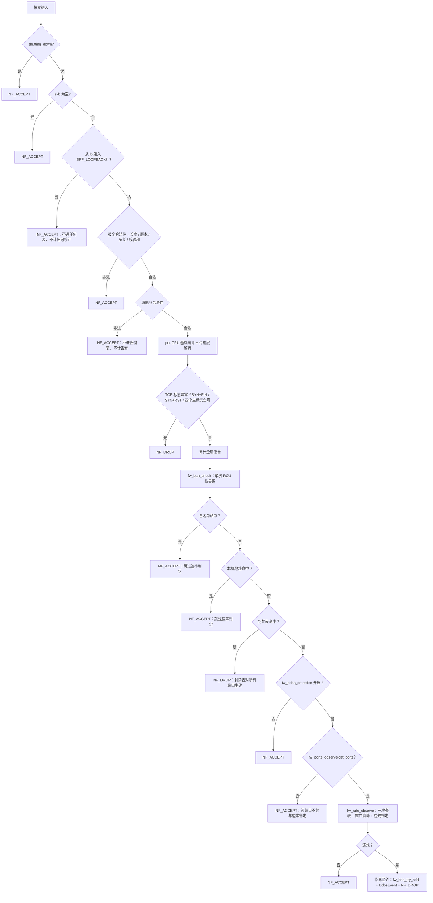
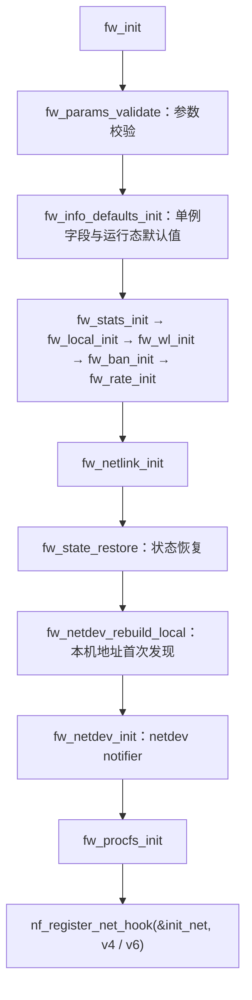
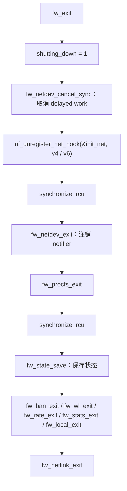

# 内核模块

本文描述 `src/kernel-module/` 的当前实现。文件清单以 `ls src/kernel-module/` 为准：
12 个 `fw_*.c`、`fw_types.h`、10 个模块私有头，另有 `Makefile`。

代码按**数据所有权**切分：每个文件只拥有一组数据，只暴露一个窄接口。
跨模块调用走对方头文件声明的接口。

对外接口（netlink 线格式、procfs 文本协议）由 `contract/*.fwidl` 冻结。
实现不得偏离 `contract/generated/` 里的生成物。

相关文档：

- procfs 读写文法与模块参数：`docs/zh/configuration/procfs.md`
- 设计决策与论证：`docs/zh/development/kernel-rewrite-design.md`
- 报文路径时序：[数据流](data-flow.md)

## 模块概览

模块名 `firewall`，产物 `build/kernel-module/firewall.ko`。
它在 `NF_INET_PRE_ROUTING` 拦截入站报文，依次判定白名单、本机地址、封禁表与速率。
命中封禁表即丢包。

| 属性 | 值 | 出处 |
|------|-----|------|
| 模块名 | `firewall` | `src/kernel-module/Makefile` 的 `obj-m := firewall.o` |
| 入口 | `fw_main.c` 的 `fw_init` / `fw_exit` | `module_init` / `module_exit` |
| 参与编译的 `.c` | 12 个 | `src/kernel-module/Makefile` 的 `firewall-y` |
| 许可证 | Dual MIT/GPL | `fw_main.c` 的 `MODULE_LICENSE` |
| 版本 | `2.2` | `fw_main.c` 的 `MODULE_VERSION` |
| 安装路径 | `/lib/modules/$(uname -r)/extra/firewall.ko` | 根 `Makefile` 的 `KERNEL_MODDIR` |

### 源文件与数据所有权

| 文件 | 拥有的数据 | 对外接口 |
|------|-----------|---------|
| `fw_types.h` | 无：类型、常量、`static inline` 原语 | 引入契约生成头，定义表规模常量 |
| `fw_main.c` | 模块生命周期、`fw_info` 单例 | `module_param`、`fw_init` / `fw_exit` |
| `fw_hook.c` | netfilter 钩子注册与报文解析 | `nf_ops_ipv4` / `nf_ops_ipv6` |
| `fw_ban.c` / `fw_ban.h` | 封禁表 | `fw_ban_lookup`、`fw_ban_try_add`、`fw_ban_del` |
| `fw_wl.c` / `fw_wl.h` | 白名单 | `fw_wl_lookup`、`fw_wl_add`、`fw_wl_remove` |
| `fw_local.c` / `fw_local.h` | 本机地址集合 | `fw_local_lookup`、`fw_local_publish` |
| `fw_rate.c` / `fw_rate.h` | 速率表、窗口、EWMA、违规判定 | `fw_rate_observe`、`fw_rate_clear_all` |
| `fw_ports.c` / `fw_ports.h` | 受保护端口位图 | `fw_ports_observe`、`fw_ports_replace` |
| `fw_stats.c` / `fw_stats.h` | per-CPU 统计与直方图 | `fw_stat_account`、`fw_stats_flush_all` |
| `fw_netlink.c` / `fw_netlink.h` | netlink socket 与收发 | `fw_netlink_init` / `fw_netlink_exit` |
| `fw_procfs.c` / `fw_procfs.h` | 13 个 procfs 条目 | `fw_procfs_init` / `fw_procfs_exit` |
| `fw_state.c` / `fw_state.h` | 状态文件读写 | `fw_state_save`、`fw_state_restore` |
| `fw_netdev.c` / `fw_netdev.h` | netdev notifier、本机地址重建 | `fw_netdev_init` / `fw_netdev_exit` |

`fw_hook.c` 与 `fw_main.c` 没有私有头，符号由 `fw_procfs.h` 等声明。
模块不导出任何符号（无 `EXPORT_SYMBOL`）。

## Netfilter 钩子

### 注册点

IPv4、IPv6 各一个钩子，只挂在 `init_net`：

| 字段 | 值 |
|------|-----|
| `hooknum` | `NF_INET_PRE_ROUTING` |
| `priority` | `NF_IP_PRI_FILTER - 1` |
| 注册函数 | `nf_register_net_hook`（`fw_main.c`） |
| 钩子函数 | `fw_hook_ipv4` / `fw_hook_ipv6`（`fw_hook.c`） |

优先级比 filter 表小 1，因此本模块先于 filter 看到报文。

### 判定顺序

`fw_hook_ipv4` / `fw_hook_ipv6` 的入口段依次做短路判定，再进 `fw_ban_check`：



对应代码（`fw_hook.c` 的 `fw_ban_check`）：

```c
rcu_read_lock();
if (unlikely(fw_is_shutting_down())) {
  rcu_read_unlock();
  return NF_ACCEPT;
}
if (!fw_wl_lookup(af, src) && !fw_local_lookup(af, src)) {
  if (fw_ban_lookup(af, src)) {
    banned = true;
  } else if (likely(READ_ONCE(fw_ddos_detection)) && fw_ports_observe(dst_port)) {
    reason = fw_rate_observe(af, src, packet_len, protocol, tcp_flags, dst_port, &pps);
  }
}
rcu_read_unlock();
```

三条顺序约束：

1. **本机地址必须先于封禁表**。本机豁免由 `fw_local.c` 承担，接口地址不写进白名单。
   顺序颠倒会让本机地址被自己的封禁条目丢弃。
2. **四张表在同一个 RCU 读侧临界区内读完**。自决封禁在临界区外执行：
   它要取桶锁、分配内存、推 netlink 事件。
3. **端口门控只加在速率判定这一支**。封禁表对所有端口生效。

`fw_ports_observe(dst_port)` 的三条边界（`fw_ports.c` / `fw_ports.h`）：

| 情形 | 返回 | 原因 |
|------|------|------|
| 位图从未下发 | `true`（全端口参与） | 失败安全：守护进程缺席不等于关掉检测 |
| 下发全零位图 | `false` | 显式关闭，与「从未下发」是两件事 |
| 报文无端口（`dst_port == 0`） | `true` | ICMP、非首片、传输层解析失败都要保留判定 |

### 返回值

| 值 | 场景 |
|----|------|
| `NF_ACCEPT` | 关闭中、`skb` 为空、lo 进入、报文非法、源地址非法、白名单命中、本机地址命中、未命中且未违规 |
| `NF_DROP` | TCP 标志异常、封禁表命中、速率违规（触发违规的报文本身也丢） |

### 记账口径

| 事件 | 计数 |
|------|------|
| 源地址非法 | 不进任何表，不计丢弃 |
| TCP 标志异常 | `packets_dropped` + `tcp_anomaly_dropped` |
| 全局流量 | 在异常判定之后累加，只统计进入 DDoS 判定的报文 |
| IPv6 扩展头 | 遍历深度上限 `FW_HOOK_MAX_EXT_HDR_DEPTH`（8），超限按畸变报文丢弃 |
| ICMPv6 Echo Request | 映射为 `IPPROTO_ICMP`，让协议阈值覆盖 IPv6 |

## 表结构

### 桶数与容量

桶数由 `*_HASH_BITS` 给出，**不是**条目容量。条目上限由模块参数给出。

| 表 | 结构 | 桶数 | 条目上限 |
|----|------|------|---------|
| 封禁表 | 按 `prefix_len` 分层桶表 + hlist + RCU | 全长层 4096；短前缀层每层 64 | `fw_max_ban_entries`（默认 65535） |
| 白名单 | 精确桶 + 子网链 | 64（`WHITELIST_HASH_BITS` = 6） | `fw_max_whitelist_entries`（默认 65535） |
| 速率表 | hlist + RCU + per-CPU 槽 | 65536（`RATE_HASH_BITS` = 16） | `min(fw_max_rate_entries, FW_RATE_CPU_SLOTS)`，后者通常先到 |
| 本机地址集合 | 开放寻址哈希集，线性探测 | 2 的幂 | 下界 `fw_max_local_ips`（默认 256），硬上界 2^16，按实际地址扩容 |
| UDP 端口分析表 | hlist + RCU | 256 | `MAX_UDP_PORT_ENTRIES`（512） |
| ICMP 类型分析表 | hlist + RCU | 64 | `MAX_ICMP_TYPE_ENTRIES`（128） |

IPv4 与 IPv6 各一套表，按 `af` 选表头。

### 哈希函数

```c
/* fw_types.h：v4 走 jhash_1word，v6 走 jhash，都带每引导随机种子 */
#define BAN_HASH_BITS 12
#define BAN_HASH_SIZE (1 << BAN_HASH_BITS)

static inline u32 fw_hash_addr(u8 af, const void *ip, int bits) {
  if (af == FW_AF_INET6)
    return jhash(ip, sizeof(struct in6_addr), fw_hash_seed) & ((1 << bits) - 1);
  return jhash_1word((__force u32) *(__be32 *)ip, fw_hash_seed) & ((1 << bits) - 1);
}
```

`fw_hash_seed` 在 `fw_main.c` 的 init 里用 `get_random_bytes()` 取值。
随机种子让外部无法构造哈希碰撞来拖慢查表。

### 封禁表：按前缀长度分层

封禁条目带 `prefix_len`。`32` / `128` 是精确单机，更短的是网段封禁。
条目身份是 `(af, addr, prefix_len)` 三元组。

前缀条目不能靠「按完整地址哈希」直接命中：同一 /24 内的不同源 IP 会散落到不同桶。
逐层探测要 32（IPv4）或 129（IPv6）次哈希，热路径不能接受。分层桶表把代价压到
「只遍历已用层，每层一次哈希」。

```c
/* fw_types.h：层下标即 prefix_len */
#define BAN_HASH_BITS 12              /* 全长层 4096 桶 */
#define BAN_MAX_LAYERS 129            /* IPv6 最长 128，故 129 层 */
#define BAN_SHORT_LAYER_BITS 6        /* 短前缀层每层 64 桶 */

struct fw_ban_layer {
  struct hlist_head *buckets;
  spinlock_t *locks;
  u8 bucket_bits;
  u8 pad[3];
  atomic_t count;                     /* 层内条目数：判层空的 O(1) 依据 */
  struct hlist_head short_buckets[BAN_SHORT_LAYER_SIZE];
  spinlock_t short_locks[BAN_SHORT_LAYER_SIZE];
};

struct fw_ban_table {
  u8 max_prefix;                      /* IPv4 32 / IPv6 128 */
  struct hlist_head full_buckets[BAN_HASH_SIZE];
  spinlock_t full_locks[BAN_HASH_SIZE];
  struct fw_ban_layer layers[BAN_MAX_LAYERS];
  DECLARE_BITMAP(used, BAN_MAX_LAYERS); /* 已用前缀长度位图，热路径只读 */
};
```

全长层复用 `full_buckets` / `full_locks`，规模与旧实现一致，热路径常数项不变。
短前缀层条目稀少，各用 64 桶的小数组，避免 129 组大桶数组撑爆段。
层内桶索引按**该层前缀归一化后的地址**计算，所以同一网段内任意源 IP 必落同一桶。

查找（`fw_ban_lookup`）：

```c
/* 先查精确层：现状全部条目都在这一层，一次哈希即命中 */
if (test_bit(t->max_prefix, t->used) && fw_ban_probe_layer(t, af, t->max_prefix, ip))
  return true;

/* 再按位图遍历更短前缀层，常态 1–3 层 */
for_each_set_bit(L, t->used, t->max_prefix) {
  if (fw_ban_probe_layer(t, af, (u8)L, ip))
    return true;
}
```

`used` 位图由 `fw_ban_layer_mark`（入账）与 `fw_ban_layer_release`（出账）
在增删时维护，只有这两个函数改写位图。
出账判据是层计数 `count` 减到 0 及以下；逐桶扫描是 O(层桶数)，不作为判据。
（注意 `fw_types.h` 里那句注释写的是 `mark/unmark`，
实际第二个函数名是 `fw_ban_layer_release`。）

### 封禁条目

```c
/* fw_types.h：运行期条目 */
struct fw_ban_node {
  u8 af;
  u8 prefix_len;              /* 32/128 = 精确单机，更短 = 网段 */
  u8 is_permanent;
  u32 duration_secs;          /* 本次时长（秒），永久为 0，续期时更新 */
  unsigned long banned_at;    /* 封禁起点（jiffies） */
  unsigned long unban_jiffies;/* 到期点（jiffies），永久条目无意义 */
  union fw_addr addr;
  char jail_name[32];
  char reason[32];
  struct hlist_node hash;
  struct rcu_head rcu;
  struct timer_list expire_timer;
};
```

契约生成头里的 `struct fw_ban_entry` 是**线格式**（packed、大端），只在 `fw_netlink.c`
序列化时使用。运行期条目另名 `fw_ban_node`，允许带定时器与链表节点。

条目没有端口与协议字段。`banned_at` 内部用 jiffies，读侧序列化时换算成 Unix 秒。

### 操作复杂度

| 操作 | 复杂度 | 说明 |
|------|--------|------|
| 封禁查找 | O(1) 平均 | 哈希定位桶；精确层常态一次哈希即返回 |
| 封禁插入 | O(1) 平均 | `hlist_add_head_rcu`，桶锁内完成 |
| 封禁删除 | O(1) 平均 | `hlist_del_rcu` + `call_rcu` |
| 本机地址查找 | O(1) 平均 | 线性探测到空槽即判定不存在 |
| 速率条目查找 | O(1) 平均 | 热点源走 per-CPU 槽，不查全局表 |

## RCU 与锁

### 读侧

报文路径只进一次 RCU 读侧临界区，在其中读完白名单、本机地址、封禁表、速率四张表。
全流程不取自旋锁。各查询函数内部用 `hlist_for_each_entry_rcu` /
`list_for_each_entry_rcu` 遍历。

### 写侧

增删一律「先发布或摘链，再等宽限期释放」：

```c
/* fw_ban.c：删除路径。手动解封、白名单联动、退出清理同构 */
spin_lock_bh(&layer->locks[bkt]);
timer_delete(&n->expire_timer);   /* 非等待版：不阻塞在可能正在跑的到期回调上 */
hlist_del_rcu(&n->hash);
spin_unlock_bh(&layer->locks[bkt]);
call_rcu(&n->rcu, fw_ban_free_rcu);
```

本机地址集合与端口位图整块重建，用 `rcu_assign_pointer` 发布，旧块交 `kfree_rcu`。
退出路径统一 `synchronize_rcu()` + `rcu_barrier()`。

### 锁顺序协议

协议文档化在 `fw_types.h` 头部注释。除 `rate_locks[bkt] → rate_slot_lock`
这一对之外，任意两把锁**不得嵌套**；跨表操作先释放再取。

| 锁 | 保护 | 获取 |
|----|------|------|
| 封禁层桶锁（每层每桶一把） | 层内桶、条目定时器、摘链 | `spin_lock_bh` |
| `ban_layer_lock` | 两张封禁表的 `used` 位图与层计数 | `spin_lock_bh`，与桶锁不嵌套 |
| `wl_lock` | 白名单表、子网链、计数 | `spin_lock_bh` |
| `rate_locks[bkt]` | 速率桶，仅建条目的冷路径 | `spin_lock_bh` |
| `rate_slot_lock` | per-CPU 速率槽的「探测空槽 + 发布」 | `spin_lock_bh`，唯一允许的嵌套 |
| `flood_lock` | 泛洪保护窗口 | `spin_lock_bh` |
| `udp_port_lock` / `icmp_type_lock` | 分析表，仅 flush 与惰性建条目 | `spin_lock_bh` |

### 热路径不写共享 cache line

每包只碰本 CPU 内存：

| 数据 | 落点 |
|------|------|
| 统计与直方图 | `alloc_percpu` 的 `fw_stats_pcpu`（`fw_stats.c`） |
| 速率窗口原始计数 | per-CPU 直接映射槽 `fw_rate_cpu_slot`（`fw_rate.c`） |
| 端口去重集合 | 同上，滚动时取并集 |

跨 CPU 汇总只发生在两处：窗口滚动（`fw_rate_roll` 汇总各 CPU 槽并清零）与
读侧 flush（`fw_stats_flush_all` 用 `on_each_cpu` 同步汇总）。两处都不在每包路径上。

## 速率表与 per-CPU 槽

一条目占一槽，槽号 `slot_idx` 由地址哈希给出，此后固定，永不复用他人槽位。
建条目时在 `rate_slot_lock` 下从哈希位置线性探测空槽，整表探不到空槽即视为表满。
表满时**有意放行**：新源地址不做速率判定。丢包会误伤正常流量，这是契约记录的
失败开放方向（`PROC_RATE_TABLE_FULL_FAILS_OPEN`），由 `rate_slot_spill` 观测，
在 procfs `rates` 表头读出。

静默超过 `FW_RATE_PIN_SECONDS` 的条目由回收工作项 `fw_rate_reclaim_work` 释放槽位，
所以槽表反映「近期活跃源」，不是「历史累积源」。

### 槽表分块：单次 per-CPU 申请的 32 KiB 上限

| 常量 | 值 | 出处 |
|------|-----|------|
| `FW_RATE_CPU_SLOTS` | 512 | `fw_types.h` |
| `FW_RATE_CHUNK_SLOTS` | 128 | `fw_types.h` |
| `FW_RATE_CHUNK_SHIFT` | 7 | `fw_types.h` |
| `FW_RATE_CPU_CHUNKS` | 4 = 512 / 128 | `fw_types.h` |
| `sizeof(struct fw_rate_cpu_slot)` | 168 字节 | `fw_types.h` 定义处 |

**索引空间仍是 0..511，`slot_idx` 的语义不变。** 分块只改底层申请方式，
探测与回绕逻辑（`(slot_idx + 1) & (FW_RATE_CPU_SLOTS - 1)`）照旧，容量没有变化。

拆块的原因是内核对单次 per-CPU 申请有 32 KiB 上限：`mm/percpu.c` 对超限
`WARN` 并返回 NULL。整表一次申请是 168 × 512 = 86016 字节。实测（Ubuntu 24.04 GA
的 6.8.0-146）：

```
illegal size (86016) or align (64) for percpu allocation
```

随后模块初始化失败，`insmod` 报 `Cannot allocate memory`。改成 4 块、每块
128 槽后单块是 168 × 128 = 21504 字节，申请合法。三个常数都取 2 的幂：
块号 = 全局下标右移 `FW_RATE_CHUNK_SHIFT`，块内下标 = 取低位。

取槽的两个入口（`fw_rate.c`）：

| 函数 | 用途 | 上下文 |
|------|------|--------|
| `fw_rate_this_slot(u16 idx)` | 取本 CPU 的槽，用 `this_cpu_ptr` | 热路径 |
| `fw_rate_slot_on(unsigned int cpu, u16 idx)` | 取指定 CPU 的槽，用 `per_cpu_ptr` | 槽位发布与窗口滚动汇总，非每包路径 |

`fw_info.rate_pcpu[FW_RATE_CPU_CHUNKS]` 逐块申请，任一块失败即回滚已分配的部分。

## 白名单

由**精确桶**（64 个 hlist 桶）与**子网链表**两部分组成。

```c
/* fw_types.h：精确条目只入桶，子网条目同时入桶与子网链 */
struct fw_wl_entry {
  u8 af;
  u8 prefix_len;
  union fw_addr addr;
  char device_name[16];
  struct hlist_node hash;
  struct list_head subnet_node; /* 仅前缀 < 全长时使用 */
  struct rcu_head rcu;
};
```

子网链是必要设计：命中判定不必为前缀比较遍历全部桶。表内存的是**归一化后的
network 地址**，写侧先过 `fw_addr_normalize()`。

匹配分两步，先精确桶再子网链（`fw_wl_lookup`）：

```c
/* 1) 精确桶：只比全长前缀条目 */
hlist_for_each_entry_rcu(e, fw_wl_bucket_head(af, ip), hash) {
  if (e->af != af || !fw_wl_is_full_prefix(af, e->prefix_len))
    continue;
  if (fw_addr_equal(af, &e->addr, ip))
    return true;
}

/* 2) 子网链：存在覆盖该地址的前缀条目 */
list_for_each_entry_rcu(e, fw_wl_subnet_list(af), subnet_node) {
  if (fw_prefix_match(af, ip, &e->addr, e->prefix_len))
    return true;
}
```

条目发布后不再修改，整体比较即可，不需要逐字节拼装。

| 项 | 行为 | 出处 |
|----|------|------|
| 添加与移除 | 接受 `<ip>` 或 `<ip>/<prefix>`；省略前缀按地址族全长 | `fw_procfs.c` 的 `fw_procfs_parse_whitelist_cmd` |
| 移除匹配 | `(af, 地址, prefix_len)` 三元组完全一致 | `fw_wl.h` |
| 条目上限 | `fw_max_whitelist_entries`，`wl_lock` 内检查，到限 `-ENOSPC` 并计 `whitelist_rejects` | `fw_wl.c` |
| 重复条目 | 同一 `(af, 归一化地址, prefix_len)` 只保留一条 | `fw_wl.c` |
| 本机接口地址 | 由 `fw_netdev.c` 自动维护；手工移除命中本机地址返回 `-EPERM`，按精确主机地址判定 | `fw_wl.c` |
| 变更联动 | 移除条目后调 `fw_ban_del_matching()`，解封覆盖范围内的封禁 | `fw_wl.c` |
| 地址准入 | 拒绝 `0.0.0.0` / 广播 / 组播 / 回环 / 链路本地 | `fw_wl.c` |

## 到期与清理

临时封禁用 per-entry 定时器，没有全局清理线程（`cleanup_cycles` 因此恒为 0）。

```c
/* fw_ban.c：到期回调结构节选 */
static void fw_ban_expire_cb(struct timer_list *t) {
  struct fw_ban_node *n = timer_container_of(n, t, expire_timer);

  rcu_read_lock();
  spin_lock_bh(&layer->locks[bkt]);

  if (hlist_unhashed(&n->hash))            /* 已被手动解封 / 联动 / 退出清理摘链 */
    goto out;
  if (!READ_ONCE(n->is_permanent) &&
      time_before(jiffies, READ_ONCE(n->unban_jiffies))) { /* 续期竞态：重武装 */
    mod_timer(&n->expire_timer, n->unban_jiffies);
    goto out;
  }
  hlist_del_rcu(&n->hash);
  /* 锁外：fw_stat_add_expired(1) + call_rcu + netlink BanStateChange */
}
```

| 项 | 行为 |
|----|------|
| 建立 | 条目分配时 `timer_setup`；只有临时封禁才 `mod_timer` 武装 |
| 永久封禁 | 只 `timer_setup`，不 `mod_timer`，永不到期 |
| 续期 | 桶锁内更新 `unban_jiffies` 后 `mod_timer`；旧回调已在跑时在回调内重新比较并重武装 |
| 手动解封 | 桶锁内 `timer_delete`（非 `_sync`）+ `hlist_del_rcu` + `call_rcu` |
| 释放安全 | 回调整体持 RCU 读侧临界区；宽限期不会在回调结束前完成，回调不可能访问已释放节点 |
| 持桶锁时 | 不调 `timer_delete_sync()`：会自锁死 |

## 两处内核适配

这两处都是按**实测**决定的，不是照文档写的。

### 1. `timer_container_of` 与 `from_timer`

| 事实 | 说明 |
|------|------|
| `timer_container_of()` | 6.16 引入的名字 |
| `from_timer()` | 此前的同名机制；7.0 起旧名已删除 |
| 两个名字 | 不共存 |
| Ubuntu 24.04 GA 的 6.8 | 只有 `from_timer`；缺适配会卡在 `-Werror=implicit-function-declaration` |

适配方式按**宏是否存在**，不比 `LINUX_VERSION_CODE`（`fw_ban.c`）：

```c
#ifndef timer_container_of
#  define timer_container_of(var, callback_timer, timer_fieldname) \
     from_timer(var, callback_timer, timer_fieldname)
#endif
```

原因：发行版会把新宏 backport 进旧版本号的内核，也会反过来砍掉旧宏。
照版本号判断在这类内核上正好判反。

### 2. 单次 per-CPU 申请的 32 KiB 上限

见上文「速率表与 per-CPU 槽」一节。要点：超限不是编译错误，是加载期
`Cannot allocate memory`，所以必须看 `dmesg` 才能定位。

## ProcFS 接口

根目录 `/proc/firewall`，13 个条目由 `fw_procfs.c` 按契约权限位创建。
条目名与权限位取自生成头 `FW_PROCFS_*_MODE`（`contract/generated/procfs_uapi.h`）。

| 文件 | 权限 | 操作 |
|------|------|------|
| `bans` | 0600 | 读：封禁列表；写：`<ip>` / `<ip> <seconds>` / `<ip> 0` / `unban <ip>` |
| `whitelist` | 0600 | 读：白名单；写：`add <subnet>` / `<subnet>` / `remove <subnet>` |
| `config` | 0600 | 读：运行时配置；写：`ban_time <seconds>`。**可写**，不是只读 |
| `stats` | 0400 | 只读：13 行 `key value`，**唯一机器可读条目** |
| `rates` | 0400 | 只读：速率表 |
| `udp_ports` | 0400 | 只读：UDP 端口分布 |
| `icmp_types` | 0400 | 只读：ICMP 类型分布 |
| `pkt_sizes` | 0400 | 只读：包大小分布 |
| `ttl_dist` | 0400 | 只读：TTL 分布 |
| `ip_frags` | 0400 | 只读：IP 分片统计 |
| `port_scanners` | 0400 | 只读：端口扫描者 |
| `service_probes` | 0400 | 只读：服务探测者 |
| `protected_ports` | 0400 | 只读：受保护端口；**无写入口**，集合由守护进程经 netlink 下发 |

`fw_procfs_exit()` 逆序移除 13 个条目，最后移除根目录。
完整读写文法、输出示例与错误码见 `docs/zh/configuration/procfs.md`，
该文件由 `contract/procfs.fwidl` 冻结，本文不重复其表格。

### 读侧纪律

| 纪律 | 说明 |
|------|------|
| 先取快照 | `stats` 与 5 个分析条目都调快照函数，内部先 `fw_stats_flush_all()` 跨 CPU 汇总 |
| 三个字段由 procfs 补齐 | `current_bans` / `current_whitelist` / `recent_additions` 分别取 `fw_ban_count()` / `fw_wl_count()` / `fw_ban_recent_additions_stat()`；统计模块不反向依赖封禁表与白名单 |
| 分析展示行数 | `FW_ANALYSIS_UDP_PACK_MAX` / `FW_ANALYSIS_ICMP_PACK_MAX`（均 64）；`Total entries` 打印真实条目数 |
| 同源 | 分析快照与 netlink `ANALYSIS_RESPONSE` 共用同一份快照 |
| `cleanup_cycles` | 恒为 0；保留键位只为不破坏按行解析的外部脚本 |

### 写侧纪律

| 约定 | 说明 |
|------|------|
| 一次 `write(2)` 一条命令 | 末尾换行可选 |
| 分隔符 | 空格或制表符 |
| 控制字符 | 除 `\t` 外所有 `< 0x20` 一律拒绝 |
| 失败 | 返回**负 errno**，无文本错误通道，原因只进内核日志 |
| 三条封禁路径统一 | procfs、netlink、DDoS 自决都经 `fw_ban_try_add()`：白名单前检 → 泛洪闸门 → 容量检查 |
| procfs `bans` 只封精确单机 | 该入口无 CIDR 文法，一律按全长前缀（`fw_procfs.c`）；网段封禁只由守护进程经 netlink 下发 |

## 生命周期

### 初始化



### 退出



### 顺序上的硬约束

| 约束 | 原因 |
|------|------|
| 本机地址首次发现必须在注册钩子之前 | 消除「集合为空即判定非本机」的失败开放窗口。`fw_netdev_rebuild_local()` 返回负值时放弃注册钩子、整个模块放弃加载 |
| 状态保存必须在全表清理之前 | `fw_state_save()` 要读封禁表与白名单表 |
| netlink 最后销毁 | 前面每一步都可能推送事件；到期回调在 `rcu_read_unlock()` 之后仍会调 `fw_nl_send_*` |
| `shutting_down` 双检 | 钩子入口与 `fw_ban_check()` 内各判一次；置位后热路径直接放行 |

### 模块参数

10 个参数，`/sys/module/firewall/parameters/` 可查看（`fw_main.c`）：

| 参数 | 默认 | sysfs 权限 | 说明 |
|------|------|-----------|------|
| `fw_ban_time` | 600 | 0400 | 默认封禁时长（秒），范围 1..31536000 |
| `state_file` | `/var/lib/firewall/state` | 0444 | 状态文件路径；内部变量名是 `fw_state_file` |
| `fw_max_bans_per_second` | 200 | 0400 | 泛洪保护下每秒最大封禁添加次数 |
| `fw_max_rate_entries` | 65536 | 0644 | 速率表条目上限，文档化范围 1024..262144 |
| `fw_max_ban_entries` | 65535 | 0644 | 封禁表条目上限，到限拒绝并计 `ban_table_full_rejects` |
| `fw_max_whitelist_entries` | 65535 | 0644 | 白名单条目上限 |
| `fw_max_local_ips` | 256 | 0644 | 本机地址集合容量**下界**；实际更多时按需扩容 |
| `fw_static_threshold` | 1 | 0644 | 启用静态阈值检测 |
| `fw_dynamic_threshold` | 0 | 0644 | 启用动态阈值检测；实际阈值 = max(静态, 基线 × 倍数) |
| `fw_ddos_detection` | 1 | 0644 | DDoS 检测总开关；关闭后跳过所有速率检测与自决封禁 |

`fw_params_validate()` 拒绝 `fw_ban_time` 越界与任一容量参数为 0，返回 `-EINVAL`
中止加载，不带着坏配置运行。

## 编译期自检

本机内核未开 `CONFIG_KUNIT`，也没有宿主侧单元测试环境。
能编译期证明的语义不变量都放编译期，不留到运行时（`fw_ban.c`）：

| 断言 | 内容 |
|------|------|
| 层数组尺寸 | 层下标即 `prefix_len`，层数组与 `used` 位图都要能索引到 IPv6 的 128 |
| 位移宽度 | 三处遍历桶都按 `1U << layer->bucket_bits`，位移量必须 < 32 |
| 分层取舍 | 短前缀层桶数必须真的小于全长层，否则「分层省内存」不成立 |

契约生成头的布局尺寸另有 `_Static_assert`（`contract/generated/`），
由 `contract/verify_layout.py` 对账。

## 内核日志

模块用 `pr_fmt(fmt) "firewall: " fmt` 给所有日志加前缀。

| 级别 | 场景 |
|------|------|
| `pr_info` | 加载、卸载、参数摘要 |
| `pr_err` | 初始化失败，如注册钩子失败 |
| `pr_warn_once` | 本机地址数超过 `fw_max_local_ips` 下界，只提示一次 |
| `pr_warn_ratelimited` | netlink 事件广播失败 |

模块**不提供**自有的调试级别开关。历史文档里的 `make debug DL=2` 与
`DL=0..3` 分级在当前仓库不存在（`Makefile` 无 `debug` 目标）。

```bash
# 读模块版本
modinfo firewall | grep '^version:'

# 看本模块的内核日志
sudo dmesg | grep firewall
```
