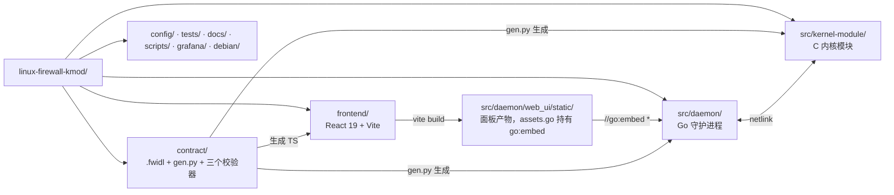

# 开发指南

本章节介绍如何开发、构建和测试本项目。

| 文档 | 内容 |
|------|------|
| [构建](building.md) | Makefile 目标逐条对齐、依赖版本、面板产物链路、契约门禁 |
| [测试](testing.md) | 三层测试、CI 六个任务、CI 加载不了模块这条实测结论 |
| [性能口径与测量方法](perf-baseline.md) | 红线定义、结构口径、`scripts/bench/` 的复现方法与判定纪律 |
| [内核模块重写设计](kernel-rewrite-design.md) | 设计决策、冻结面、缺陷处置、分阶段验收 |
| [集群扫描检测设计](cluster-detection-design.md) | 判据、实测依据、分层前缀表的取舍 |

架构侧文档在 [docs/zh/architecture/](../architecture/README.md)。

## 开发环境

| 项目 | 要求 | 出处 |
|------|------|------|
| OS | Ubuntu 22.04+ / Debian 12+ | 内核头文件与 clang-format 18 的可用范围 |
| GCC / 内核构建系统 | 与运行内核匹配的 `linux-headers-$(uname -r)` | 根 `Makefile` 的 `KDIR` |
| Make | 4.0+ | 根 `Makefile` 用到 `$(shell ...)`、模式规则与序化前提 |
| Go | `src/daemon/go.mod` 声明 `go 1.26.0` | `src/daemon/go.mod` |
| Node.js + npm | CI 用 `node-version: '22'` | `.github/workflows/ci.yml` |
| clang-format | 以 18 为准 | `.github/workflows/ci.yml`、`CHANGELOG.md` |
| Python 3 | 契约生成与校验 | 根 `Makefile` 的 `PYTHON ?= python3` |
| Git | 2.30+ | — |

### 安装依赖

```bash
# Ubuntu / Debian
sudo apt install -y \
    build-essential \
    linux-headers-$(uname -r) \
    clang-format \
    python3-pytest \
    python3-yaml \
    sqlite3
```

Go 与 Node.js 用各自官方分发安装，`apt` 里的版本常落后。
`pip install clang-format==18.1.8` 也能对齐 CI，见[构建](building.md)。

## 仓库布局



### 三个运行部件

| 部件 | 入口 | 职责 |
|------|------|------|
| 内核模块 | `src/kernel-module/fw_main.c` | 注册 netfilter 钩子，维护封禁 / 白名单 / 速率表并在报文路径判定 |
| 守护进程 | `src/daemon/cmd/firewall-daemon/main.go`（组合根）+ `src/daemon/internal/*`（业务） | 日志监控、行解析、失败计数与封禁判定、netlink 下发、HTTP / SSE / 指标 / 面板托管 |
| Web 面板 | `frontend/index.html` + `frontend/src/main.tsx` | React 应用，构建后嵌入守护进程二进制，不单独部署 |

`internal/` 各包的职责表见 [用户态守护进程](../architecture/daemon.md)。

### 契约目录

`contract/` 是线格式与文本协议的单一真相源。

| 文件 | 作用 |
|------|------|
| `http.fwidl` | HTTP 路由、信封、业务码、SSE 域与上限、安全头 |
| `procfs.fwidl` | `/proc/firewall` 条目、权限、写文法、机器可读 key、容量 |
| `netlink.fwidl` | netlink 消息类型、载荷布局 |
| `gen.py` | 生成器：C 头、TS、JSON 布局、Go 侧契约 |
| `verify_layout.py` / `verify_procfs.py` / `verify_http.py` | 三个校验器 |
| `http_gap_baseline.txt` | HTTP 未接线条目基线，只减不增 |
| `generated/` | 生成物，不手改 |

改流程：改 `.fwidl` → `python3 contract/gen.py` → `make contract-check`。

### 构建链路

`make daemon` 先产出面板，再编守护进程：

1. `$(WEBUI_STATIC_DIR)` 目标依赖 `frontend-install`（`npm ci`）与 `$(FRONTEND_SRCS)`。
2. 重建前清陈旧产物，但保留 `assets.go`：
   `find $(WEBUI_STATIC_DIR) -mindepth 1 ! -name assets.go -delete`。
3. Vite 按 `frontend/vite.config.ts` 输出到 `src/daemon/web_ui/static/`
   （`emptyOutDir: false`，否则会删掉 `assets.go`）。
4. `src/daemon/web_ui/static/assets.go` 的 `//go:embed *` 把目录带进二进制。

细节与三条易错点见[构建](building.md)。

其他目录：YAML 配置在 `config/`，集成测试在 `tests/`，
文档在 `docs/`，辅助脚本在 `scripts/`（含 `scripts/bench/`），
Grafana 资源在 `grafana/`，Debian 打包元数据在 `debian/`。

## 编码规范

### C 内核模块

以 `.clang-format` 为准：

| 项 | 约定 | 出处 |
|----|------|------|
| 命名 | 函数与变量 `snake_case`，宏 `UPPER_CASE` | 现有代码一致 |
| 缩进 | 2 个空格，禁 Tab | `.clang-format` 的 `IndentWidth: 2`、`UseTab: Never` |
| 行宽 | 80 | `.clang-format` 的 `ColumnLimit: 80` |
| 括号 | K&R，左括号不换行 | `.clang-format` 的 `BasedOnStyle: LLVM` |
| 注释 | 中文 | 现有代码一致 |
| 函数长度 | 单个函数不超过 50 行 | 项目约定 |
| 日志 | `pr_*` 宏，统一 `firewall:` 前缀 | `src/kernel-module/fw_main.c` 的 `pr_fmt` |
| 前后缀 | 函数与类型统一 `fw_` 前缀 | `src/kernel-module/` |
| 风格基础 | 遵循 Linux 内核编码风格 | `src/kernel-module/Makefile` 的 `-Wall -Wextra` |
| 原子上下文 | 不睡眠；持桶锁时不调等待版定时器删除 | `fw_ban.c` 的 `timer_delete` 用法 |
| 结构体命名 | `struct fw_xxx`，**不加 `_t` 后缀** | `fw_types.h` 全量核对 |

### Go 守护进程

| 项 | 约定 |
|----|------|
| 格式 | `gofmt`，CI 跑 `gofmt -l ./cmd ./internal` 须为空 |
| Lint | `go vet ./cmd/... ./internal/...` |
| 错误处理 | `fmt.Errorf("...: %w", err)` 包装 |
| 注释 | 中文 |
| 依赖 | 纯 Go，无 cgo。`unsafe.Pointer` 只用在两处，见[测试](testing.md) |

### 前端 TypeScript

| 项 | 约定 | 出处 |
|----|------|------|
| 严格模式 | `strict`、`noUnusedLocals`、`noUnusedParameters`、`noFallthroughCasesInSwitch` | `frontend/tsconfig.json` |
| JSX 运行时 | `jsx: "react-jsx"` + `jsxImportSource: "react"`，与 `@vitejs/plugin-react` 成对维护 | `frontend/tsconfig.json`、`frontend/vite.config.ts` |
| 类型检查 | `tsc --noEmit`（`make frontend-typecheck`） | `frontend/package.json` 的 `typecheck` |
| 注释 | 中文 | 现有代码一致 |

### 提交规范

遵循 Conventional Commits，格式 `类型(范围): 描述`。

| 类型 | 用途 |
|------|------|
| `feat` | 新功能 |
| `fix` | 缺陷修复 |
| `docs` | 文档 |
| `style` | 格式（不改行为） |
| `refactor` | 重构（不改行为） |
| `perf` | 性能 |
| `test` | 测试 |
| `chore` | 构建 / 工具链 |

一次提交只做一件事。重构与功能分两次提交。

## 质量门禁

提交前跑齐。五件事互相独立，跑一件不等于其余也过了：

```bash
make format-check                                # C + YAML
cd src/daemon && gofmt -l ./cmd ./internal       # Go 格式，输出须为空
cd src/daemon && go vet ./cmd/... ./internal/... # Go lint
make contract-check                              # 契约三校验
cd src/daemon && go test ./...                   # Go 单元测试
make test                                        # 集成测试，需 root 且需能 insmod
```

前端另跑 `make frontend-typecheck`。
任一环节失败不得提交。

## 什么时候必跑集成测试

改以下内容时必跑 `make test`：

- YAML 配置 schema 与字段含义；
- `/proc/firewall/*` 的条目与写文法；
- 守护进程与内核模块的 netlink 协议；
- `contract/*.fwidl`。

集成测试是行为规格。规格与实现冲突时先确认哪一侧错，不要改测试迁就实现。

**注意**：CI 的 runner 加载不了内核模块，`运行测试` 只跑守护进程子集。
内核模块套件要在真能 `insmod` 的机器上跑。见[测试](testing.md)。

## 贡献流程

1. 建特性分支：`git checkout -b feat/amazing-feature`。
2. 写代码，跑上面的质量门禁。
3. 提交：`git commit -m 'feat(scope): 描述'`。
4. 推送分支并开 Pull Request。

PR 模板在 `.github/PULL_REQUEST_TEMPLATE.md`。
贡献指南在仓库根 `CONTRIBUTING.md`。
