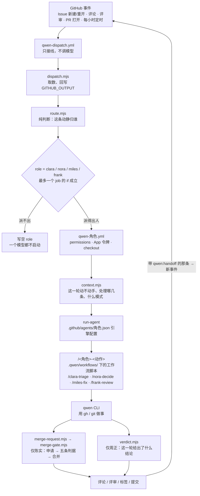

# 四个人怎么跑

管什么：这套 GitHub 侧的协作是怎么搭起来的——一条动静从哪进、在哪判、谁执行、状态存在哪、改哪一层。
什么时候读：想弄清某个行为该在哪一层改、判断该写成脚本还是提示词，或第一次接手这套东西。

## 一句话

事件驱动，无常驻进程。每次事件一个 runner，跑完即弃。所有状态都落在 GitHub 自己身上：Issue、PR、评论、标签、检查项。

## 一、分层

横着看是四层：**接线 → 判断 → 执行 → 动作**。竖着看是一个环，唯一的驱动力是评论事件。

四条约束把这个形状固定下来：

1. **判断归脚本，不写进 YAML。** 判据错时的形状是「安静地不干活」——没有人报错，只是某个人一直没被叫醒。放进 `.mjs` 才能本地对着真实数据跑、才能单测。这条在 `qwen-patrol.yml` 与 `qwen-ci.yml` 的注释里都写明了。
2. **动作归模型，闸门归脚本。** 模型能写代码、能发评论，但合并只能写一行申请；能不能合由 `merge-gate.mjs` 判（见 [merge-gate.md](merge-gate.md)）。
3. **四个人不合并成一个人。** 合并成一个带 `role` 输入的 job，权限模型会退化成一套 —— 顾清只需 `issues: write`，陈实要 `contents: write` + `workflows: write`。可维护性用共享 action 解决，不动权限粒度（论证见 [qwen-cli-runner.md](qwen-cli-runner.md) §3）。
4. **岗位说明归仓库。** 四个人的「这一轮怎么干」全在 `.qwen/workflows/*.js`，提交进仓库，不是运行时从别处取。所以改一个人的行为就是改一份文件，走正常 PR。

   四个人的写法是**同一种**：一条动态工作流，一轮里分几段、每段各起一个代理。

   | 谁 | 命令 | 分段 |
   |---|---|---|
   | 顾清 | `/clara-triage` | 一条 Issue 一个代理（批量时并行）→ 一路只读核对每条上真的落了东西 |
   | 叶澜 | `/nora-decide` | 取证两路并行（上下文 / 范围）→ 决定一路 → 核对一路 |
   | 陈实 | `/miles-fix` | 取证两路 → 动手一路 → 自检两路对抗 → 收场一路 |
   | 周正 | `/frank-review` | 取证两路（意图 / 分析）→ 一次评审 → 核对结论挂在哪个提交上 |

   分段不是为了并行好看，是为了让每段的边界写死。读 Issue 的上下文不该一直占着写代码那一段；「对抗式自检」「决定真的写进评论了没有」「评审挂的提交是不是当前 head」这类要求，写进一份提示词里只能算请求，写进流程里才会真的发生 —— 核对那一段拿不到证据就直接抛错，整轮判失败。

   代价是失败更难看见：工作流抛错时 `qwen -p` 照样退出 0，只把 `Workflow failed: …` 写进工具的返回内容。所以四份工作流都多了一步 `workflow-run.mjs`，专门读转录里那次工具调用 —— 这一条和 `run-agent` 里「API 报错时 CLI 退出 0」是同一类，见 §五。

每份工作流只剩自己特有的接线：权限、App 身份、prepare 步骤、做完看什么。「怎么跑模型」收在 `run-agent` 一处 —— 换引擎只改它的 `uses:` 一行。

### 1.1 谁判什么

| 脚本 | 判什么 | 什么时候跑 |
|---|---|---|
| `route.mjs` | 一条动静该归谁（标记解析、点名冷却、24 小时交接额度、权限闸） | 每次事件 |
| `dispatch.mjs` | 把事件摊平成 `route()` 的输入，再把结论写回 `GITHUB_OUTPUT` | 每次事件 |
| `context.mjs` | 每一轮开跑前：处理哪几条、对象还开着吗、动不动手、要不要再评 | 角色工作流第一步 |
| `patrol.mjs` | 定时巡检该叫醒谁 | `schedule` |
| `merge-request.mjs` | 这一轮提出合并申请了吗（先剥围栏与行内代码，再认独占一行的标记） | 陈实跑完模型后 |
| `merge-gate.mjs` | 五条判据，并执行合并 | 认到申请后 |
| `verdict.mjs` | 周正这一轮给出了什么结论 | 周正跑完模型后 |
| `review.mjs` | 评审语义与闸标签：批准算不算数、哪些标签要停手 | 被 `merge-gate` / `patrol` / `verdict` 复用 |
| `markdown.mjs` | `stripCode()`（剥围栏与行内代码）与 `tickCheckboxes()` | 被四处解析共用 / 合并后勾 checklist |
| `no-merge-gh` | 包在 `gh` 外面，挡 `pr merge` 与摘闸标签（bash，不是 `.mjs`） | 陈实这一轮 |

另外两个不在链路里，是给人用的离线工具：`setup-app.mjs`（用 CDP 驱动已登录的 Chrome 建 App、设权限、生成私钥、写 Variable / Secret）与 `app-perms.mjs`（解析 `--perms` 的取值，纯函数）。

`route.mjs` 与 `dispatch.mjs` 的分工是「判断」与「搬字段」：前者无 I/O、无 `process.exit`，用返回值表达结论（`assign` / `ignore` / `fail` / `handoff-limit` / `need-pull`）；后者负责 `gh api` 取数与回写，遇到 `need-pull` 就去查分支名再调一次。这样拆的理由是可以本地复用同一份事件 JSON 复现结论（README「验证改动」里给了命令）。

`dispatch.mjs` 里有一处例外值得记住：交接额度用完时，那条说明评论是它自己发的（`handoff-limit`），文案来自 `route.mjs` 的 `handoffLimitMessage()`。所以「脚本只判断、workflow 只接线」这句话在这一个点上是模糊的 —— 判断仍然在 `route.mjs`，只有发帖这一步在 `dispatch.mjs`。

**标记解析没有统一实现**，这是当前事实而不是设计：共享的只有 `markdown.mjs` 的 `stripCode()`，四类标记各有一套正则，强度也不同 —— `qwen:verdict` 与 `qwen:merge-request` 要求整行独占，`qwen:handoff` / `qwen:to` 只要出现即可，`qwen:role` / `qwen:opened-by` 干脆用 `includes` 且不剥代码。改任何一类都要单独确认它自己的强度。

退出码的约定也一样要紧，而且每个脚本的 `1` 含义不同：`merge-gate.mjs` 的 `1` 是「判据没过，结论已经贴在 PR 上」，它用 `2` 表示「脚本自己出错」；`context.mjs` 与 `patrol.mjs` 则完全不用 `1`（一个会被读成「跳过了」，一个不用），出错一律 `2`。改动时若把两者混用，会让人把「闸门拦下」看成「程序崩溃」，或者反过来 —— 工作流正是按退出码决定要不要报 `::error`。

## 二、一条动静走完全程

以「有人在一张 Issue 里回复一句」为例：

1. GitHub 触发 `issue_comment`，`qwen-dispatch.yml` 启动。`checkout` 显式钉在**默认分支**、只取 `.github/scripts` —— 否则 PR 事件下会检出该 PR 的合并提交，等于让 fork 的代码拿着 App 令牌在 runner 上跑。
2. `dispatch.mjs` 取评论与话题上下文，交给 `route.mjs` 判。判出的人写进 `GITHUB_OUTPUT`；不派活时只写 `role`，下游四个 job 的 `if` 全不成立，一个模型都不启动。
3. `qwen-dispatch.yml` 的 `clara` / `nora` / `miles` / `frank` 四个 job 各挂一个 `needs.route.outputs.role == '<名字>'` 的 `if`，所以最多只有一个会真正生效；生效的那个 `uses:` 调对应角色工作流，并把编号、`on_pr`、`reason` 等作为 `with:` 传下去。
4. 角色工作流 mint 自己的 App 令牌 → checkout → 跑 `context.mjs <角色>` 做开跑前判定（是否需要跳过；陈实这里还要定模式与分支）。
5. `run-agent` 读 `.github/agents/<role>.json`、校验 JSON、交给 `qwen-code-action@v1` 跑这一轮的工作流命令：`/clara-triage {…}`、`/nora-decide {…}`、`/miles-fix {…}`、`/frank-review {…}`，参数由各自工作流显式拼成 JSON 传进去 —— 命令名取自 `.qwen/workflows/<脚本>.js` 的文件名，`QWEN_CODE_ENABLE_WORKFLOWS=1` 少了它那条命令只会被当成普通文本。收尾时 `run-agent` 判「最后一段话是不是 API 报错」，后面还有一步 `workflow-run.mjs` 判「工作流本身跑完没有」。
6. 模型在这一轮里用 `gh` / `git` 做事，最后在评论里写正文 + 签名 `<!-- qwen:role=<名字> -->`，需要别人接手时再写一行 `<!-- qwen:handoff=… -->`。
7. 那行交接标记产生**新的** `issue_comment` 事件，回到第 1 步 —— 这是整条链路唯一的推进方式。没有队列、没有调度器、没有「下一步」对象。

第 7 步决定了整套设计的一个前提：**所有人都要有话可说才动**。没人评论，链路就停。补这个死角的是 `qwen-patrol.yml`：每小时第 23 分钟扫一遍，扫到候选才调人。

## 三、状态存在哪

没有数据库，也没有缓存。所有「上一轮发生了什么」都得从 GitHub 上读回来：

| 事实 | 从哪读 |
|---|---|
| 已经批准了吗 | `reviews`，比 `commit.oid` 与 `headRefOid` |
| 谁在等我 | 评论里的 `<!-- qwen:handoff=… -->` |
| 人放了闸吗 | 标签 `do-not-merge` / `manual-review` |
| 代码验过吗 | 检查项（`statusCheckRollup`），其中 `qwen test` 是 `.github/workflows/qwen-ci.yml` |
| 这张单子是机器人开的吗 | 正文里的 `<!-- qwen:opened-by=agent -->` |

所以有一条硬约束：**任何要留到下一轮的判断，都必须落成评论、标签或提交。** 只写在这一轮模型上下文里的东西，下一轮不存在。

`<!-- qwen:opened-by=agent -->` 就是这条约束的一个具体后果：`GITHUB_TOKEN` 开出的 Issue 不触发 `issues` 事件（GitHub 防递归），于是用 App 身份开、并在正文里留这个标记，那张单子才会像人开的一样落到顾清手上。

## 四、合同与测试

跨层的名字对不上**不会报错**，只会取到空串，然后「谁都没被叫醒」。所以契约由两份测试盯着，而不是靠改的时候记得：

`workflow-contract.test.mjs`
- `dispatch.mjs` 写出的每个 `GITHUB_OUTPUT` 键，都在 `route` job 的 `outputs:` 里声明过；
- 声明过的每个键都有人取（防空转）；
- 每个会 `gh issue create` 的工作流都带「我方」标记。

`agent-contract.test.mjs`
- 四个角色各有一份合法 JSON 引擎配置，关了自动记忆与遥测，`tools.core` 只有 `run_shell_command`；
- 配置里引用的 MCP 工具在 `github-mcp-server:v0.18.0` 里真实存在，镜像钉死版本；
- 四份工作流都走共享 action、传了全部必填 input、`prompt` 指向同名的工作流脚本（命令名取自文件名）；
- 工作流拼的每个 `args` 键脚本都读得到，脚本读的每个键工作流都传了，脚本开头要的必填键一个不少；
- 四个人的工作流都打开了 `QWEN_CODE_ENABLE_WORKFLOWS`、放开了墙钟，并且都有 `workflow-run.mjs` 那一步；
- 用工作区文件的步骤都排在 `checkout` 之后，且 `checkout` 不依赖判断步骤的输出（否则成环）；
- `context.mjs` 每个角色读的环境变量，工作流都传了 —— 这类错一次都不报，判据恒为假且日志正常。

## 五、并发与失败

**并发**一律用 `queue: max` + `cancel-in-progress: false`。默认的 `queue: single` 只有一个排队位，新来的会取消排着的那次，被取消的运行 `jobs` 为空 —— 等于事件被静默丢弃。同理不能中断正在进行的运行：会留下说了一半的评论或半成品提交。

唯一的例外是 `qwen-ci.yml`：同一张 PR 连续推就 `cancel-in-progress: true`，因为被取消也算不上「通过之前那次提交」。

**失败**分四层兜，因为每层漏的方式不一样：

| 层 | 兜什么 | 在哪 |
|---|---|---|
| 内层 | 模型 API 报错时 CLI 仍退出 0 | `run-agent` 的收尾步骤：只认「最后一段话以 `[API Error: …]` 结尾」 |
| 次内层 | 工作流抛错时 CLI 也退出 0（四个人都是） | 各自工作流的 `workflow-run.mjs` 步骤：读转录判那次工具调用成没成 |
| 中层 | 分派或角色 job 真的挂了 | `qwen-dispatch.yml` 的 `report-failure`：在话题里说明哪一步没跑完 |
| 外层 | 机器人在闸门之外合掉了 PR | `qwen-miles.yml` 的 `gate` job：`always()` 核一次状态，非闸门合并则整轮失败 |
| 旁路 | 主干检查红了没人知道 | `qwen-ci.yml` 在 `push` 到主干失败时开（或追加）一张 `Main CI failed` 的 Issue |

`no-merge-gh` 那层包装器不是安全边界（令牌就在环境里，绕道 curl 照样能合），它只让「顺手合了」当场失败。真正的保底是上面那张表的第四行。

## 六、凭据与权限

每个人可以有自己的 GitHub App；没配就按 `APP_ID_<英文名>` → `APP_ID_<职称别名>` → 共用 `APP_ID` 的顺序退回，所以能逐个迁移。用 `setup-app.mjs` 建 App，完整变量表在 README「配置说明」。

权限按职责给，最小化（左列是角色工作流的 `permissions:`，App 令牌另有一份）：

| 谁 | contents | issues | pull_requests | 其它 |
|---|---|---|---|---|
| `qwen-dispatch.yml` | read | write | write | 用顾清的身份，只读评论计数、发说明 |
| 顾清 | read | write | read | — |
| 叶澜 | read | write | read | — |
| 陈实 | write | write | write | `workflows: write`（App）、`actions` / `checks` / `statuses: read`（工作流令牌，只给 `gate` job） |
| 周正 | read | read | write | — |

三个易错点记在这里。**闸门那一步用的是 `github.token` 而不是陈实的 App 令牌** —— App 没有 `checks: read`，用它查 `statusCheckRollup` 只会得到 `Resource not accessible by integration`，五条判据一条都跑不了。**被调用工作流的权限由调用方给**，`qwen-dispatch.yml` 里少给陈实一档 `checks: read`，整次运行就会 `startup_failure` —— 闸门搬到 `gate` job 后仍然如此，只是那三档现在声明在 `gate` 里。**改 `.github/workflows/` 需要 App 令牌带 `workflows: write`**，缺了会被 GitHub 拒绝推送，此时应停下说明而不是反复重试。

密钥要人参与的有两个：`QWEN_API_KEY` 得在控制台生成，App 私钥得在已登录的浏览器里生成（`setup-app.mjs` 会代劳页面操作，但登录与 2FA 只能由人输入）。任何密钥的值不进提交、评论和日志；私钥只落在 `--download-dir` 指向的本地目录，不进仓库。

## 七、改哪一层

| 想改什么 | 改哪 | 先读 |
|---|---|---|
| 某条动静归谁 | `.github/scripts/route.mjs` + 测试 | 本文件 §1.1 |
| 谁能被叫醒、多久叫一次 | `route.mjs`（额度）、`patrol.mjs`（巡检） | README「配置说明」 |
| 某个人的行为、语气、红线 | 各自的 `.qwen/workflows/<角色>-*.js`（`clara-triage.js` / `nora-decide.js` / `miles-fix.js` / `frank-review.js`） | 对应脚本自己就是完整说明（人设常量 + 各次 `agent()` 的提示词）；先看 §一 第 4 条 |
| 某个人的轮次预算、MCP 工具 | `.github/agents/<名字>.json` | `agent-contract.test.mjs` |
| 陈实该跑哪些检查命令 | `.qwen/workflows/miles-fix.js` 的 `REPO_CHECKS` 常量 | 该常量上方的注释说明了为什么写死在那儿 |
| 能不能合并 | `.github/scripts/merge-gate.mjs` | [merge-gate.md](merge-gate.md) |
| 怎么跑模型（换引擎、加预算） | `.github/actions/run-agent/action.yml` | [qwen-cli-runner.md](qwen-cli-runner.md) |

## 八、已知的边界与风险

- **代理能改并合并约束自己的文件。** `.github/workflows/`、`.github/scripts/`、`.github/actions/` 都能改，闸门本身也在 `.github/scripts/` 里。这是本设计最大的残余风险，唯一的对外出口是人自己先合掉那张 PR（闸门只在 `OPEN` 时动手）。写进 PR 正文的要求在 `CONTRIBUTING.md`。
- **自建 runner 仍是提案。** `run-agent` 内部还是 `QwenLM/qwen-code-action@v1`，`--max-wall-time` 之类透不出来，超时只能靠 job 级 `timeout-minutes`。取舍见 [qwen-cli-runner.md](qwen-cli-runner.md)。
- **审批的两种形态并存。** 每人一个 App 时周正能提交真 `APPROVE`；四人共用一个 App 时 GitHub 不让 App 批准自己开的 PR，只能退成正文里独占一行的 `<!-- qwen:verdict=approve -->`，闸门两种都认。
- **`.qwen/commands/` 是空的。** 岗位说明全在 `.qwen/workflows/`。`qwen-code-action@v1` 里那一步 `cp -r .../.github/commands/*` 拷不到东西，实际行为未核实（见 qwen-cli-runner.md）。
